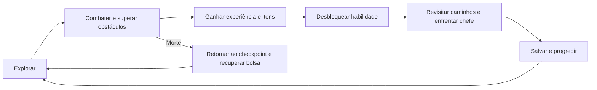

# 2. Gameplay

> [← Anterior: 1. Visão Geral](01-visao-geral.md) · [Próxima: 3. Conteúdo do Jogo →](03-conteudo-do-jogo.md)

## 2.1 Core Loop (micro, macro e meta) + diagrama Mermaid

- **Micro (segundos):** observar → mover/esquivar → atacar ou interagir → receber feedback.
- **Macro (minutos):** explorar → superar obstáculos → coletar equipamento → ativar checkpoint/quarto seguro → enfrentar chefe.
- **Meta (sessões):** desenvolver personagem → revisitar caminhos → completar campanha → continuar no mesmo save e escolher dificuldade.

## 2.2 Mecânicas principais (tabela com ID)

Todos os números desta seção são **[SUPOSIÇÃO] valores iniciais para teste**, não promessas de balanceamento final. IDs de testes e requisitos são definidos na seção 11.

| ID | Mecânica | Descrição | Entrada | Regras/Parâmetros | Feedback | Critério de aceite |
|---|---|---|---|---|---|---|
| MEC-001 | Movimento e salto | Caminhar, saltar e usar salto duplo; P1/P2. | Esquerda/direita e salto. | 220 px/s, primeiro salto 480 px/s; segundo salto disponível após descoberta. | Animação e SFX-001. | Dado salto duplo desbloqueado, quando saltar no ar uma vez, então ocorre um segundo impulso; um terceiro não ocorre antes de tocar o chão. TST-001. |
| MEC-002 | Combate | Arma branca e arma à distância no MVP; P2. | Ataque e disparo. | Dano inicial 20 e 10 HP; inimigos telegrafam ataques. | Impacto visual, SFX-002, redução de HP. | Dado inimigo com 20 HP, quando um ataque branco válido atingir, então HP chega a 0 e a derrota ocorre uma vez. TST-002. |
| MEC-003 | Recursos | Vida, escudo e poder; P2/P3. | Dano ou ação especial. | Vida 100 HP; escudo absorve antes da vida; corrida consome poder. | Barras e som distintos. | Dado escudo 10 e dano 20, quando atingido, então escudo vira 0 e vida perde 10 HP. TST-003. |
| MEC-004 | Inventário e morte | Bolsa de 40 espaços, até 20 itens presos; P3. | Menu, prender, coletar, morrer, recuperar. | Itens não presos ficam na bolsa da morte; segunda morte antes de recuperação destrói a bolsa anterior. | Contagem, marcador de recuperação e mensagem de perda. | Dado item preso e item solto, quando morrer, então o preso permanece e o solto vai à bolsa recuperável; outra morte antes da recuperação destrói a bolsa anterior. TST-004. |
| MEC-005 | Exploração e habilidade | Descobrir salto duplo para acessar nova rota; P1. | Explorar e interagir. | Habilidade de acesso é permanente e não cai na morte. | Notificação e mudança visual da rota. | Dado salto duplo descoberto, quando morrer e carregar checkpoint, então habilidade permanece ativa. TST-005. |
| MEC-006 | Obstáculos e puzzle | Evitar armadilha e abrir porta por senha descoberta no cenário; P1/P2. | Movimento e interação. | Senha do MVP fixa, de 4 símbolos; pista está na mesma região. | Sinais visuais e resposta sonora; mensagens não dependem só de cor. | Dada a senha correta, quando confirmada, então porta abre; senha incorreta mantém porta fechada. TST-006. |
| MEC-007 | Salvamento | Passagens de fase salvam automaticamente; quarto seguro permite salvar; P3. | Transição ou interação. | Persistência no servidor autenticado; fases de desafio não criam checkpoints de transição. | Ícone de salvamento e confirmação/erro. | Dado usuário conectado, quando atravessar transição elegível, então posição e progresso confirmados são restaurados após novo login. TST-007. |
| MEC-008 | Dificuldade | Fácil, médio e difícil escolhidos no início; P2/P3. | Seleção inicial; oferta após mortes; seleção pós-final. | Durante campanha só redução ofertada após 3 mortes consecutivas no mesmo trecho/chefe; pós-final permite escolher qualquer nível no mesmo save. | Tela de seleção e oferta opcional. | Dadas 3 mortes consecutivas no mesmo trecho no difícil, quando reaparecer, então há oferta recusável de nível inferior. TST-008. |
| MEC-009 | Chefe e conclusão | Superar chefe da área e registrar conclusão; P1/P2. | Combate. | MVP conclui após chefe do recorte; vitória de campanha completa depende do chefe final. | Animação, recompensa e tela de conclusão. | Dado chefe com 0 HP, quando derrota for processada, então recompensa e conclusão do recorte ocorrem uma vez. TST-009. |
| MEC-010 | Desafio procedural opcional | Variações de sala/armadilhas somente em desafios opcionais; P1/P2. | Entrada voluntária; somente pós-MVP. | [SUPOSIÇÃO] Geração por peças validadas e seed; rota obrigatória permanece fixa; sem checkpoint de transição. | Identificação do desafio e resultado. | Dada uma seed válida, quando gerar desafio duas vezes com a mesma versão de conteúdo, então a sequência de peças é igual e há caminho alcançável. TST-010. |

## 2.3 Controles e input (teclado/mouse/touch/gamepad) + tabela de mapeamento

[SUPOSIÇÃO] Mapeamento inicial; ações de teclado remapeáveis. Touch usa botões virtuais multitouch de pelo menos 44 × 44 px CSS, separados e identificados por ícone e texto acessível na UI. Gamepad fica fora do MVP.

| Ação | Teclado/mouse | Touch horizontal |
|---|---|---|
| Mover | A/D ou setas | Direcional virtual |
| Pular/salto duplo | Espaço | Botão Pular |
| Ataque branco | Clique esquerdo ou J | Botão Ataque |
| Ataque à distância | Clique direito ou K | Botão Disparo |
| Correr | Shift | Botão Correr |
| Interagir/recuperar | E | Botão Interagir |
| Pausar/inventário | Esc / I | Botões Pausa / Bolsa |

Desabilitar menu de contexto e rolagem apenas na área interativa do jogo; não bloquear zoom geral do navegador. [SUPOSIÇÃO] Objetivo de feedback local < 100 ms, medido em dispositivo de referência.

## 2.4 Câmera e visão (tipo, follow, zoom, bounds, shake)

[SUPOSIÇÃO] Visão lateral, câmera segue o jogador com suavização, limites por sala e zoom lógico 1×. Shake é opcional, reduzido ou desativável; não pode esconder ameaças. Sem câmera livre no MVP.

## 2.5 Física e colisões (gravidade, atrito, layers, hitboxes)

Arcade Physics: [SUPOSIÇÃO] gravidade 1.200 px/s² e velocidade horizontal 220 px/s. Camadas: cenário sólido, plataformas, jogador, inimigos, projéteis e sensores de interação. Hitboxes menores ou iguais às silhuetas de ameaça e exibíveis no modo debug. Não depender de resolução variável por frame para regras; usar passo temporal controlado e unidades em segundos.

## 2.6 Regras de vitória, derrota, continue e respawn

Vida 0 causa morte. Reaparecer no último checkpoint de transição elegível ou salvamento em quarto seguro, o que for mais recente. Uma bolsa por jogador: caso outra morte ocorra antes de recuperar a anterior, a anterior é destruída e uma nova é criada com os itens não presos restantes. **[SUPOSIÇÃO]** Itens equipados não presos também caem; um kit básico não comercial e sem slots é restaurado para recuperação. Dinheiro, XP, habilidades de acesso e cosméticos comprados não caem. [PENDENTE] Confirmar kit e tratamento de equipamento em uso. O MVP vence com o chefe do recorte; a campanha completa, com o chefe final.

## 2.7 Progressão e desbloqueios

O jogador explora com liberdade; áreas acessíveis podem ser perigosas. Habilidades necessárias a rotas são permanentes e encontradas por exploração. Monstros e chefes oferecem equipamentos; equipamentos fortes vêm de chefes médios/altos na campanha completa. [SUPOSIÇÃO] XP aumenta o nível; no MVP a primeira melhoria de atributos ocorre em 100 XP. Evolução completa de habilidades, combos, escalada, corrida e equipamentos será balanceada após playtest; só corrida e salto duplo são Must no MVP.

## 2.8 Economia e recompensas (fontes, sumidouros, curvas)

MVP: dinheiro e XP obtidos em combate; [SUPOSIÇÃO] 5 moedas e 10 XP por inimigo comum, sem loja nem sumidouro obrigatório. A quantia é salva no servidor. Não confundir moeda do jogo com Manch's. Pós-MVP: lojas de cosméticos podem aceitar moeda de jogo ou Manch's, conforme item; alguns itens serão obtidos jogando. Manch's só entram mediante compra. [PENDENTE] Preços, fontes/sumidouros e simulação de inflação antes de implementar economia comercial; pagamentos não integram o MVP.

## 2.9 Dificuldade, curva de aprendizado e tutorial (onboarding)

[SUPOSIÇÃO] Multiplicadores de dano recebido: fácil 0,75×; médio 1,00×; difícil 1,25×. Aplicar depois da absorção do escudo. A oferta de redução permite difícil → médio ou fácil; médio → fácil. Contador de 3 mortes é por trecho/chefe; [SUPOSIÇÃO] zera ao vencer o chefe ou atravessar para outro trecho. Ensinar mover, pular e atacar em até 90 s, depois apresentar armadilha, puzzle e salto duplo. Desafio aumenta por introduzir → praticar → combinar → testar.

## 2.10 Sistemas de suporte (pontuação, combos, conquistas, missões)

MVP: contador de XP, dinheiro, inventário e marcador de bolsa. Combo de armas brancas, conquistas e missões: pós-MVP; pontuação independente não aplicável no MVP. Todos os ataques e falhas recebem feedback visual e sonoro; não depender apenas de áudio.

## 2.11 Balanceamento inicial (tabela de parâmetros tunáveis com valores padrão, min e max)

[SUPOSIÇÃO] Limites são intervalos de ajuste de design, não valores simultâneos de gameplay. Valores de danos assumem dificuldade média.

| Parâmetro | Valor padrão | Mín | Máx | Unidade | Observação |
|---|---:|---:|---:|---|---|
| Vida máxima | 100 | 50 | 200 | HP | Jogador inicial |
| Escudo máximo | 50 | 0 | 100 | pontos | Absorve dano primeiro |
| Poder máximo | 100 | 50 | 200 | pontos | Habilidades |
| Poder gasto ao correr | 10 | 5 | 25 | pontos/s | Enquanto correndo |
| Regeneração de poder | 15 | 5 | 30 | pontos/s | [SUPOSIÇÃO] Quando não gasta poder |
| Velocidade de movimento | 220 | 120 | 320 | px/s | Não correndo |
| Multiplicador de corrida | 1,4 | 1,1 | 1,8 | × | Velocidade base |
| Impulso do salto | 480 | 350 | 600 | px/s | Magnitude vertical |
| Gravidade | 1.200 | 800 | 1.600 | px/s² | Em coordenadas lógicas |
| Dano da arma branca | 20 | 10 | 40 | HP/golpe | MVP |
| Dano da arma à distância | 10 | 5 | 30 | HP/projétil | MVP |
| Vida do inimigo comum | 20 | 10 | 80 | HP | MVP |
| Vida do chefe MVP | 200 | 100 | 400 | HP | MVP |
| Danos de inimigo/armadilha/chefe | 20 | 10 | 40 | HP/impacto | Antes de multiplicador de dificuldade sobre dano à vida |
| Slots / itens presos | 40 / 20 | 40 / 20 | 40 / 20 | slots / itens | Requisito confirmado |
| Mortes para oferta | 3 | 2 | 5 | mortes | Consecutivas, mesmo trecho |
