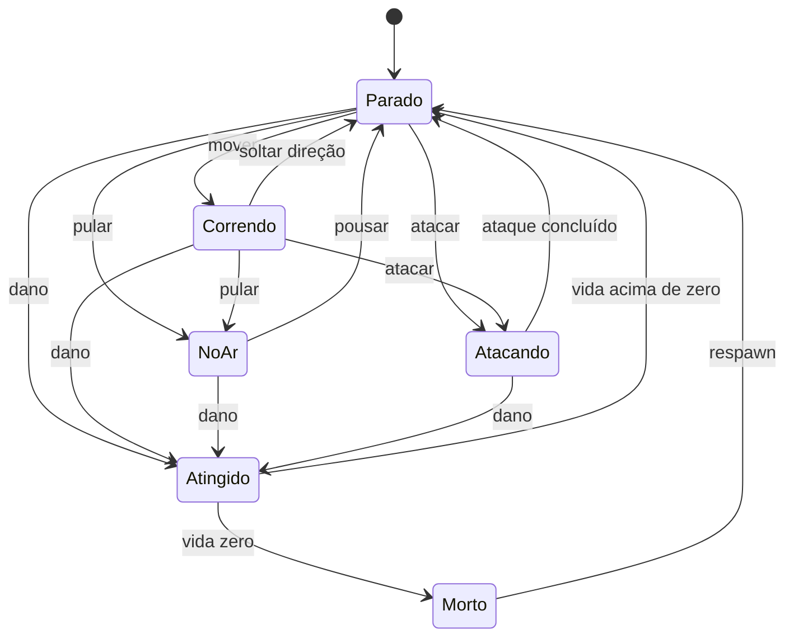

# 3. Conteúdo do Jogo

> [← Anterior: 2. Gameplay](02-gameplay.md) · [Próxima: 4. Interface e Experiência →](04-interface-e-experiencia.md)

## 3.1 Personagem(ns) jogável(is): atributos, habilidades, estados, animações

**ENT-001 — Homem Macho:** vida, escudo, poder e atributos conforme 2.11. Habilidades MVP: mover, pular, correr e descobrir salto duplo. Futuras: agarrar paredes, aumento de força, combos e outras melhorias. Estados: parado, correndo, no ar, atacando, atingido, morto. Animações necessárias: idle, corrida, subida, queda, ataque branco, disparo, dano e morte.

## 3.2 Inimigos / NPCs / Chefes: comportamento (FSM/Behavior), stats, telegraph

[SUPOSIÇÃO] **ENT-002 — Sentinela distorcida:** 20 HP; patrulha → detecta jogador a 250 px → prepara ataque por 600 ms → golpeia → recupera por 800 ms; dano 20 HP. **ENT-003 — Guardião da passagem:** 200 HP; prepara ataque por 800 ms → investe → recuperação 1.000 ms; dano 20 HP. A forma, animação e pista de ataque são originais. Chefes secretos, de fases e final pertencem à campanha completa; lista e atributos ainda pendentes. Sem NPC funcional no MVP.

## 3.3 Itens, power-ups e coletáveis

| ID | Item | Efeito / origem | Escopo |
|---|---|---|---|
| ITM-001 | Arma branca básica | 20 HP/golpe; kit básico proposto | MVP |
| ITM-002 | Arma à distância básica | 10 HP/projétil; kit básico proposto | MVP |
| ITM-003 | Fragmento de salto duplo | Concede habilidade permanente; encontrado na exploração | MVP |
| ITM-004 | Equipamento de teste | Drop de inimigo; ocupa 1 slot, pode ser preso | MVP |
| ITM-005 | Moeda de jogo | Recompensa de inimigos; não ocupa slot | MVP |
| ITM-006 | Cosmético | Aparência sem atributos; disponibilidade varia por item | Pós-MVP |

[SUPOSIÇÃO] Kit básico e habilidade não ocupam slots; drops de equipamentos ocupam 1 slot por item. Se a bolsa estiver cheia, o drop permanece no chão e o jogador recebe aviso; não substituir itens automaticamente.

## 3.4 Níveis / Mundos / Fases: lista, objetivo, novidades, duração estimada

A visão completa tem 16 áreas, não 16 entregas aprovadas de conteúdo detalhado. A lista abaixo é planejamento provisório, com nomes originais sujeitos a revisão. Tempos são de primeira visita e não incluem exploração extra; sessões podem terminar em checkpoints.

| ID | Área provisória | Objetivo / novidade proposta | Duração estimada | Escopo |
|---|---|---|---|---|
| LVL-01 | Ruínas da Vigília | Aprender controles e acessar quarto seguro | 3–5 min | MVP |
| LVL-02 | Galeria Partida | Encontrar salto duplo, senha e armadilha | 4–6 min | MVP |
| LVL-03 | Portão do Guardião | Enfrentar chefe e acessar saída | 3–5 min | MVP |
| LVL-04 | Bosque das Cinzas | Exploração com rotas verticais | 5–10 min | Futuro |
| LVL-05 | Cripta das Engrenagens | Mecanismos e inimigos | 5–10 min | Futuro |
| LVL-06 | Mina Esquecida | Recursos e desníveis | 5–10 min | Futuro |
| LVL-07 | Catedral Oca | Combate e rotas bloqueadas | 5–10 min | Futuro |
| LVL-08 | Pátio Rubro | Chefe de área | 5–10 min | Futuro |
| LVL-09 | Canais Sombrios | Armadilhas combinadas | 5–10 min | Futuro |
| LVL-10 | Torre da Vigília | Escalada e revisitação | 5–10 min | Futuro |
| LVL-11 | Jardim Profanado | Desvios e exploração | 5–10 min | Futuro |
| LVL-12 | Forja Distorcida | Equipamentos e chefe médio | 5–10 min | Futuro |
| LVL-13 | Abismo do Eco | Percurso vertical | 5–10 min | Futuro |
| LVL-14 | Fortaleza do Eclipse | Combinação de desafios | 5–10 min | Futuro |
| LVL-15 | Ante-sala do Fim | Chefe de alto nível e preparação | 5–10 min | Futuro |
| LVL-16 | Trono do Caos | Chefe final e conclusão | 5–10 min | Futuro |

[PENDENTE] Conexões, habilidades de acesso, chefes secretos e duração real das áreas futuras dependem de design e testes. MVP usa LVL-01–03 como um recorte, não representa três níveis de qualidade final completos.

## 3.5 Level design: princípios, ritmo, teaching moments, ferramentas (Tiled)

[SUPOSIÇÃO] Grafo do MVP: LVL-01 ↔ LVL-02 ↔ LVL-03; porta de LVL-02 para LVL-03 exige senha; salto duplo abre uma rota lateral que fornece acesso à pista. Cada trecho apresenta um desafio isolado antes de combiná-lo; sala segura situa-se em LVL-01, checkpoint nas transições. Validar acessibilidade do caminho sem itens recuperáveis. Mapas feitos no Tiled com camadas `ground`, `collision`, `objects`, `decor`; desafios procedurais usam peças conectáveis validadas, sem alterar rota principal.

## 3.6 Narrativa e personagens (se aplicável): sinopse, tom, diálogos, estrutura

Homem Macho é um soldado e lutador iniciante em uma Terra caótica, distorcida por monstros e demônios. O percurso de aperfeiçoamento pessoal o transforma em herói. Humor exagerado contrasta com ambiente sombrio, sem violar a meta etária. [SUPOSIÇÃO] MVP usa textos curtos ambientais e uma fala do chefe; sem dublagem. [PENDENTE] Identidades, diálogos e arco final da campanha.
