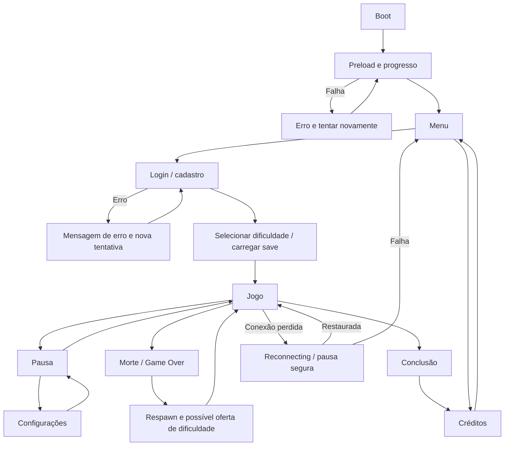

# 4. Interface e Experiência (UX/UI)

> [← Anterior: 3. Conteúdo do Jogo](03-conteudo-do-jogo.md) · [Próxima: 5. Arte e Direção Visual →](05-arte-e-direcao-visual.md)

## 4.1 Fluxo de telas (diagrama Mermaid): Boot → Preload → Menu → Jogo → Pausa → Game Over → Créditos

## 4.2 Wireframes textuais de cada tela

| ID | Tela | Wireframe textual |
|---|---|---|
| UI-01 | Boot / carregamento | Logo · barra de progresso · erro e tentar novamente |
| UI-02 | Menu | Logo · Jogar/Continuar · Configurações · Créditos |
| UI-03 | Conta | E-mail/senha ou provedor escolhido · criar conta · entrar · erros acessíveis |
| UI-04 | Dificuldade | Fácil / Médio / Difícil · descrição · confirmar |
| UI-05 | Jogo | HUD superior · mundo central · controles touch inferiores |
| UI-06 | Pausa | Retomar · Bolsa · Configurações · Sair |
| UI-07 | Bolsa | 40 espaços · itens presos até 20 · prender/soltar · descrição |
| UI-08 | Morte | Causa · posição da bolsa · reaparecer · oferta de dificuldade quando elegível |
| UI-09 | Quarto seguro | Salvar · confirmação ou erro · voltar |
| UI-10 | Conclusão/créditos | Resultado · continuar save · créditos · menu |
| UI-11 | Erro/conexão | Estado · orientação · tentar novamente / voltar ao menu |

## 4.3 HUD: elementos, posição, comportamento responsivo

[SUPOSIÇÃO] Barras de vida, escudo e poder no topo esquerdo; dinheiro/XP e aviso de bolsa no topo direito; ações touch na parte inferior. Ao perder conexão, modal não obstrui informações de estado. Redimensionar para paisagem, respeitando safe-area; orientar usuário a girar o dispositivo em retrato, sem exigir fullscreen.

## 4.4 Menus, configurações (áudio, controles, idioma, acessibilidade, qualidade gráfica)

Menus React: conta, dificuldade, pausa, bolsa, salvar, configurações e créditos. Configurações: master/música/SFX, idioma, remapeamento de teclado, redução de movimento e qualidade. [SUPOSIÇÃO] Qualidade baixa desativa partículas e reduz resolução de renderização. Configurações persistem por conta; fallback de preferência local sem dados sensíveis.

## 4.5 Feedback ao jogador (juice): partículas, screen shake, hit-stop, tweens, sons

[SUPOSIÇÃO] Golpe confirma com alteração visual e som; telegraph apresenta forma e animação claras. Partículas limitadas a 30 simultâneas; shake padrão baixo e desativável. Hit-stop fora do MVP até ser testado. Feedback visual e sonoro visam < 100 ms local, quando áudio estiver habilitado.

## 4.6 Acessibilidade (daltonismo, contraste, remapeamento, redução de movimento, legendas, tamanho de fonte, áreas de toque ≥ 44 px)

UI HTML com navegação por teclado, foco visível, nomes acessíveis, remapeamento, modo de movimento reduzido, sinais que não dependem só de cor ou som, legendas para informação sonora relevante e áreas touch ≥ 44 × 44 px CSS. Texto normal visa contraste ≥ 4,5:1; texto grande ≥ 3:1. Permitir ampliação do navegador e texto da UI; não desabilitar zoom global. Evitar flashes acima de 3 por segundo; revisar WCAG 2.2 para conteúdo aplicável. [PENDENTE] Testar com usuários e acessibilidade do gameplay em canvas; não declarar conformidade integral sem auditoria. Oferecer pausas; compras para menores exigem revisão apropriada.

## 4.7 Localização / i18n (idiomas, chaves, formatos)

PT-BR e EN-US desde MVP; textos em arquivos de chaves, por exemplo `menu.play`, `inventory.recover`, `error.offline`. Usar `Intl` para números e datas; reservar ≥ 30% de expansão textual. Não embutir textos nos sprites; testar ambas as línguas.
