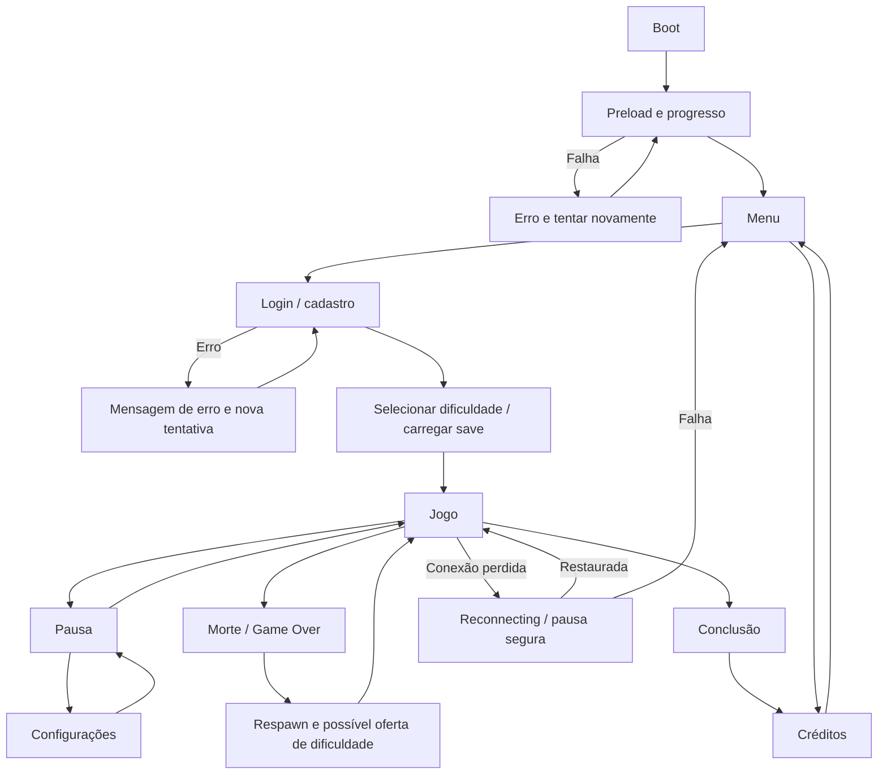

# 4. Interface e Experiência (UX/UI)

> [← Anterior: 3. Conteúdo do Jogo](03-conteudo-do-jogo.md) · [Próxima: 5. Arte e Direção Visual →](05-arte-e-direcao-visual.md)

## 4.1 Fluxo de telas (diagrama Mermaid): Boot → Preload → Menu → Jogo → Pausa → Game Over → Créditos



## 4.2 Wireframes textuais de cada tela

| ID | Tela | Wireframe textual |
|---|---|---|
| UI-01 | Boot / carregamento | Logo · barra de progresso · erro e tentar novamente |
| UI-02 | Menu | Logo · Jogar/Continuar (escolha do save) · Configurações · Créditos — comportamento em §4.2.1 |
| UI-12 | Criação de personagem | Nome · cabelo · cor · rosto · expressão · marca · corpo · pele, com prévia — §4.2.2 |
| UI-13 | Introdução | A história antes da primeira sala: o véu, a queda, os Homens Machos — §4.2.2.2 |
| UI-14 | Habilidades | Níveis das seis habilidades, preço e efeito do próximo, moedas — §4.3.2 |
| UI-22 | Mapa | Planta do setor (salas, corredores, fenda do teto), estado de exploração e coluna dos 16 setores — §4.3.3 |
| UI-03 | Conta | E-mail/senha ou provedor escolhido · criar conta · entrar · erros acessíveis |
| UI-04 | Dificuldade | Fácil / Médio / Difícil · descrição · confirmar |
| UI-05 | Jogo | HUD superior · mundo central · controles touch inferiores |
| UI-06 | Pausa | Retomar · Bolsa · Configurações · Sair |
| UI-07 | Bolsa | 40 espaços · itens presos até 20 · prender/soltar · descrição |
| UI-08 | Morte | Causa · posição da bolsa · reaparecer · oferta de dificuldade quando elegível |
| UI-09 | Quarto seguro | Salvar · confirmação ou erro · voltar |
| UI-10 | Conclusão/créditos | Resultado · continuar save · créditos · menu |
| UI-11 | Erro/conexão | Estado · orientação · tentar novamente / voltar ao menu |

### 4.2.1 Tela inicial — desktop, o comportamento que o build já entrega

> Implementação: `PreloadScene.ts`, `MainMenu.tsx`, `MenuConfig.tsx`, `menuMachine.ts`, `services/settings.ts`, `services/save.ts`, `App.tsx`. Prova: `npm test` (a contagem exata é a que o comando imprime — o número escrito aqui envelhecia a cada etapa; 54 dos casos são da máquina do menu) e `npm run menu` (capturas `MENU-01`…`MENU-10`).
> **A arte não existe.** O ecrã de abertura é uma **área reservada** (`ARTE DE ABERTURA · RESERVADA (PARALLAX)`); a etiqueta sai no dia em que a arte em parallax entrar dentro dela.

**Alvo: desktop.** Teclado primeiro, rato como alternativa; o tipo de controle `toque` existe nas configurações, mas não muda o desenho do menu (só acrescenta os botões em jogo).

#### O fluxo

```
UI-01 carregamento ─▶ TELA DE ABERTURA (arte reservada + "PRESSIONE QUALQUER BOTÃO")
                              │ qualquer botão
                              ▼
                       JOGAR · CONTINUAR · CONFIGURAÇÕES · CRÉDITOS
                         │        │            │              └─ créditos (DAVID CREATOR)
                         │        │            └─ configurações ─▶ atalhos
                         │        └─ escolher o save (3 slots)
                         └─ dificuldade ─▶ partida nova
```

| Ecrã/painel | O que tem | Regra que o define |
|---|---|---|
| Tela de abertura | área da arte em parallax (reservada), "PRESSIONE QUALQUER BOTÃO" | **Nenhum jogo montado** atrás dela: o canvas só existe depois de se escolher entrar. O primeiro gesto **só dispensa** — não escolhe item nenhum |
| Menu | `JOGAR`, `CONTINUAR` (só com save), `CONFIGURAÇÕES`, `CRÉDITOS` | **Nada começa focado**: o 1.º `Enter`/`↓` escolhe, o 2.º confirma |
| Dificuldade | FÁCIL / MÉDIO / DIFÍCIL + consequência escrita | `UI-04` embutido: a escolha vale para a partida e **vai gravada no save**. O painel diz em que slot a partida vai entrar antes de começar |
| Saves | 3 slots, cada um com *área · sala — nome · n/total · vida · escudo · dificuldade · data* | `CONTINUAR` só existe com save; slot vazio aparece na lista mas **não é escolhível** (e diz por quê). Retomar grava **no mesmo slot** |
| Configurações | tipo de controle, atalhos, som geral, música, efeitos, legendas, movimento reduzido, idioma, restaurar padrões | Tudo o que se vê já está valendo: cada mudança é gravada (`services/settings.ts`) |
| Atalhos | uma linha por ação, `Enter` remapeia, `Esc` cancela | **Uma tecla pertence a uma ação só.** Se a troca deixaria outra ação sem tecla, é recusada com o nome da ação |
| Créditos | **DAVID CREATOR · DESENVOLVIMENTO** + o que ficou feito | Texto no `tuning.ts`, não no componente |

#### Regras que o código não pode violar (todas com teste)

| Regra | Por quê |
|---|---|
| **Um gesto, uma consequência.** A tecla que dispensa o título não age no menu; um painel aberto engole tudo menos `Esc`. | Já falhou em execução: com dois ouvintes (captura + bolha), o mesmo `Enter` fechava o título e escolhia JOGAR. |
| **`←/→` nunca entram no jogo**: mudam o valor da linha em foco. | Entrar é só `Enter` (ou clique) num item em foco. |
| **A dificuldade e a vida viajam com o save**; retomar não pergunta a dificuldade outra vez. | O jogador que escolhia DIFÍCIL não pode receber MÉDIO de volta em silêncio. |
| **Um save não escreve por cima de outro.** Partida nova ocupa o 1.º slot vazio (ou o mais antigo, e o painel diz qual). | Perder progresso é o pior defeito possível deste ecrã. |
| **Sair para o menu grava antes de desmontar** (`ui:persist`). | Sair para o menu não pode custar a sala em que o jogador estava. |
| **Teclado, foco visível, alvo ≥ 44 px, contraste ≥ 4,5:1**, e o painel do menu tem teto de altura com rolagem. | `§4.6`. O menu é a única tela que **todo** jogador vê; texto ampliado não pode esconder o que se escolhe. |
| **Idioma: só PT-BR** nesta versão — a linha existe, muda, e **diz** que EN-US entra com os textos. | `§4.7`. Uma opção que não muda nada e não avisa é uma mentira de interface. |
| **Legendas** põem em texto o que só se ouviria (dano, morte, checkpoint) e são ligáveis. | `§4.6`: sem áudio ainda, a legenda é a acessibilidade que já dá para entregar. |

`?skip=menu` continua a ser a **porta de serviço** do E2E dos 16 setores: sem menu, o `PreloadScene` entra direto na sala. `npm run menu` prova que ela não interferiu no caminho normal.

### 4.2.2 Criação de personagem (`UI-12`) — entre a dificuldade e a primeira sala

> Implementação: `services/character.ts` (catálogo + normalização + easter eggs do nome), `ui/components/CharacterScreen.tsx`, `ui/components/CharacterPreview.tsx`, `game/scenes/personagem.ts`, regras em `ui/menuMachine.ts`. Prova: `src/services/character.test.ts` (36), `menuMachine.test.ts` (54, 20 deles de `UI-12`) e `npm run personagem` (capturas `PERS-01`…`PERS-05`).
> **A prévia é placeholder.** É uma silhueta em SVG gerada a partir das escolhas, marcada "PRÉVIA · PLACEHOLDER"; quando a arte chegar (`P-16`), lê os mesmos campos.

```
JOGAR → DIFICULDADE → [ CRIE O SEU PERSONAGEM ] → primeira sala
                            ↑↓ linha · ←→ valor · letras escrevem o nome · R sorteia
                            Enter começa · Esc volta
```

| Linha | Valores | O que muda no jogo |
|---|---|---|
| **NOME** | até 12 caracteres, sempre em MAIÚSCULAS (`HERÓI` é o de fábrica; o campo mostra-o como espaço vazio) | o nome do herói no save e nos ecrãs que o chamarem pelo nome |
| CABELO | curto · moicano · coque · longo · raspado · franja · cacheado | a forma da cabeça no sprite e na prévia |
| COR DO CABELO | preto · castanho · loiro · ruivo · grisalho · branco · azul | o preenchimento do cabelo |
| ROSTO | quadrado · oval · angular · redondo | a silhueta da cabeça |
| EXPRESSÃO | séria · furiosa · sorriso · cansada · grito | olhos, sobrancelhas e boca |
| TATUAGEM / CICATRIZ | nenhuma · cicatriz no olho · cicatriz na boca · tatuagem no braço · tatuagem no peito · pintura de guerra | a marca sobre a pele |
| CORPO | **magro · atlético · forte · maromba · gordo** | ombro, tronco, cintura e altura — a silhueta |
| TOM DE PELE | clara · **pálida** · média · morena · parda · escura · retinta | a cor da pele (mãos, rosto) |

Regras:

| Regra | Por quê |
|---|---|
| **A escolha é do jogo, não do ecrã**: vai para o save (`Progress.personagem`) e para o `BootScene` (textura `player`). | Criar personagem sem consequência seria um ecrã decorativo. `CONTINUAR` devolve o mesmo herói. |
| **Um `undefined` nunca chega ao desenho**: `normalizarPersonagem` fecha a fronteira. | Um campo inválido num save antigo daria uma cor `NaN` — um herói invisível, sem erro nenhum. |
| **A dificuldade escolhida não se perde** ao entrar e sair da criação (`Esc` volta à dificuldade). | O jogador já decidiu uma vez; voltar atrás não pode custar a decisão. |
| **`R` sorteia** os sete campos, e nunca repete o valor atual — mas **o nome fica**: é a única coisa que o jogador escreveu com as próprias mãos. | Sete decisões seguidas são muitas para quem só quer jogar; um botão que parece não funcionar é pior que não ter botão. |
| **A prévia tem nome acessível** (`Prévia do personagem: cabelo …, corpo …, pele …`). | `§4.6`: informação que só existe numa imagem não chega a quem usa leitor de ecrã. |
| **Teclado primeiro, rato igual**: as setas, os botões de valor e o campo de texto fazem o mesmo (escrever no campo passa pelas mesmas regras do nome). | O ecrã não pode ter dois vocabulários. |
| **`NOME` é a única linha em que as letras escrevem**; fora dela, `R` sorteia. Ao sair da linha 0 o campo perde o foco, senão as setas escreviam no nome. | Duas maneiras de escrever no mesmo teclado dariam `ANAR` em vez de `ANA`. |
| **Easter eggs do nome** (tabela abaixo): só disparam **na tecla que completa** o nome, sem distinguir maiúsculas nem acentos; depois disso o jogador muda tudo à vontade e o jogo não volta a mexer. | É um easter egg, não uma armadilha: quem escreve o nome por acaso vê o resultado uma vez e continua com o ecrã nas mãos. |

### 4.2.2.1 Easter eggs do nome

O nome é a única coisa que o jogador **escreve** em vez de percorrer, por isso é onde ficam as
brincadeiras. Cada egg é um `preset` que toca **só** nos campos que nomeia: quem escreve `Alucard`
não perde o rosto ou a marca que já tinha escolhido.

| Nome | O herói que aparece | Aviso no rodapé |
|---|---|---|
| `Macho` | cabelo **moicano** · cor **azul** · expressão **furiosa** · corpo **maromba** · pele **clara** | `ELE JÁ ESTAVA AQUI. (EASTER EGG)` |
| `Alucard` | cabelo **longo** · cor **branco** · **presas de vampiro** · corpo **magro** · pele **pálida** | `ELE NÃO APARECE NO ESPELHO. (EASTER EGG)` |

| Regra | Por quê |
|---|---|
| **As presas não são uma linha do ecrã.** Vivem em `Personagem.dentes` (`normais \| vampiro`), que fica **fora** de `GRUPOS`: o ecrã continua com as mesmas 8 linhas e o sorteio nunca dá presas. | As presas são surpresa, não escolha — mas três camadas as leem (prévia, herói em jogo, save), e um campo que só existe no desenho viraria `undefined` numa delas. |
| **O tom `pálida` é de todos.** Entra em `TOM DE PELE` como os outros seis. | É o único tom que não se lê como `clara` no ecrã escuro — e um herói de pele pálida não pode depender de um easter egg para existir. |
| **A descrição acessível diz `presas de vampiro`.** | `§4.6`: o que só se vê na imagem não chega a quem usa leitor de ecrã. |
| **O desenho das presas põe boca escura por baixo.** | Presas brancas sobre pele pálida sem fundo não se veem. A prova foi feita a olhar para o ecrã, não para o código. |

### 4.2.2.2 Introdução (`UI-13`) — a história antes da primeira sala

> Implementação: `services/historia.ts` (texto + navegação pura), `ui/components/Historia.tsx`, ligação em `src/App.tsx`. Prova: `src/services/historia.test.ts` (10 casos) e `npm run historia` (capturas `INTRO-01`…`INTRO-05`).
> **A arte não existe.** Cada quadro tem uma **área reservada** (`ARTE · RESERVADA · INTRODUÇÃO`); quando a arte entrar, fica por trás do texto e nenhum quadro se move.

```
JOGAR → DIFICULDADE → CRIE O SEU PERSONAGEM → [ A HISTÓRIA ] → primeira sala
                                                 Enter segue · ← volta · S salta
```

| Quadro | Título | O que fica dito |
|---|---|---|
| 1 / 5 | O VÉU | a guerra já dura gerações: humanidade de um lado, monstros e demónios do outro |
| 2 / 5 | O VÉU ROMPEU | havia uma fronteira que lhes barrava o acesso; alguém a rompeu, e eles entraram |
| 3 / 5 | O QUE SOBROU | parte da humanidade escravizada, a outra exterminada; o planeta em trevas e devastação |
| 4 / 5 | OS HOMENS MACHOS | soldados rasos que são a esperança da raça humana — e lutam para se tornarem heróis |
| 5 / 5 | O COMEÇO | um soldado raso, uma batalha antiga, e a história a começar aqui |

| Regra | Por quê |
|---|---|
| **Só em partida nova.** `CONTINUAR` cai direto na sala em que o jogador estava. | Quem retoma já sabe de que jogo se trata; repetir a história a cada retomar é um pedágio. |
| **Há sempre como sair.** `S` e o botão `SALTAR` levam ao jogo em qualquer quadro, e `Enter` no último começa a partida. | Uma abertura obrigatória ao fim da décima partida nova é um castigo, não uma apresentação. |
| **Nenhum jogo montado atrás.** Enquanto a introdução está no ecrã não existe `canvas` (`§4.4`). | Dois ecrãs a competir pelo mesmo gesto dão o bug clássico: um `Enter` que avança a história **e** começa a partida. |
| **O texto vive em `services/`, não no componente.** | Um ecrã que guarda a própria história não se revê, não se traduz e não se testa sem mexer no desenho. |
| **`aria-live` por quadro, com a contagem `N / 5`.** | `§4.6`: a história é conteúdo; quem usa leitor de ecrã tem de a ouvir e saber onde está. |
| **A troca de quadro não anima com `prefers-reduced-motion`.** | A única animação do ecrã é a entrada do texto — e ela não existe para quem pediu menos movimento. |

## 4.3 HUD: elementos, posição, comportamento responsivo

[SUPOSIÇÃO] Barras de vida, escudo e poder no topo esquerdo; dinheiro/XP, **o ícone da mochila (`§4.3.1`)** e aviso de bolsa no topo direito; ações touch na parte inferior. Ao perder conexão, modal não obstrui informações de estado. Redimensionar para paisagem, respeitando safe-area; orientar usuário a girar o dispositivo em retrato, sem exigir fullscreen.

### 4.3.1 A mochila (`UI-07`) — ícone no HUD e tecla `I`

> Implementação: `core/inventory.ts` e `core/ordenar.ts` (regra), `ui/components/Mochila.tsx` +
> `ItemIcon.tsx` (painel), `GameScene` (`ui:inventario`, `ui:inventory-command`),
> `services/settings.ts` (ação `inventario`).
> Prova: `src/core/inventory.test.ts` (17 casos), `src/core/ordenar.test.ts` (15), 4 casos novos em
> `settings.test.ts`, `npm run mochila` (20 verificações) e `npm run bau-ferramentas` (32
> verificações, captura `MOCHILA-BAU-01-duas-metades`).

**Como se abre.** Duas entradas, o mesmo estado: o **ícone de mochila no canto superior direito do
HUD** (com o número de espaços ocupados quando há algum) e a **tecla `I`**. A tecla é uma **ação**
como as outras (`inventario`), logo é remapeável em CONFIGURAÇÕES e o `I` é só o padrão — remapear
para outra tecla não deixa o painel sem caminho, porque o ícone continua lá.

**Duas metades, sempre.** O painel ocupa o ecrã inteiro dividido a meio (`DEC-040`): a **mochila à
esquerda**, o **baú à direita** — a divisão é fixa porque o gesto é sempre passar de um lado para o
outro, e um lado que mudasse de sítio obrigaria o jogador a procurar as suas coisas. Sem baú ao
alcance a metade direita continua lá, com a explicação; o painel não muda de forma quando o herói
se aproxima de um baú. Abaixo de 900 px a divisão é 58/42, para as células não descerem do alvo de
toque de 44 px (`§4.6`).

**O que cada metade mostra.** A grelha inteira de **40 espaços** (8 × 5), incluindo os vazios: o
jogador precisa de ver quanto ainda cabe *antes* de o drop ficar no chão. Cabeçalho com
`ESPAÇOS n / 40 · PRESOS n / 20`; no pé, a célula escolhida com nome, descrição de uma linha, a
ficha (`ARMA · 12 MOEDAS · COMUM`) e a etiqueta `PRESO`/`SOLTO` (mais `×N` quando há iguais), o
botão `PRENDER`/`SOLTAR` e a barra de teclas.

**Prender (`MEC-004`).** Prender é o que impede o item de cair na morte; solto, ele vai para uma
bolsa recuperável. O *prender* mexe numa lista à parte e tem o seu próprio limite (20), e só se
prende o que está na mochila — largar o item desprende-o (senão contava para os 20 sem existir).
**A consequência** — a bolsa da morte no chão e a destruição da anterior — vive em §4.3.1.3.

**A regra de espaço.** Os únicos itens que ocupam espaço são os três drops (`ITM-004`, `ITM-007`,
`ITM-011`); habilidades e consumíveis não ocupam (`03-conteudo` §3.3). Mochila cheia **não
substitui nada**: o item fica no chão e o jogador recebe o aviso `A MOCHILA ESTÁ CHEIA.` — é a
única alternativa a perder um drop em silêncio.

**Três caminhos.** A mochila abre pela tecla `I`, pelo ícone do HUD e pelo botão `MOCHILA` da pausa (`UI-06`: a pausa lista Retomar · Bolsa · Sair) — o botão fecha a pausa e abre o painel, e o jogo continua pausado (provado em `npm run mochila`).

**Pausa.** Abrir pausa a `GameScene` (o desenho continua, o tempo para), como a porta de senha: um
único mecanismo de pausa no jogo. Ao voltar, a cena **limpa as teclas** (`resetKeys`) — uma cena
pausada não corre o `KeyboardPlugin`, o `keyup` que fechou o painel perde-se e sem isto a mesma
tecla exigia dois toques na vez seguinte.

**Acessibilidade (`§4.6`).** É jogável sem rato: `← → ↑ ↓` andam pelas células, `ENTER`/`P` prendem
e soltam, `I`/`ESC` fecham. Cada célula é um botão com `aria-label` que diz o índice, o nome e se
está preso (`Espaço 3: EQUIPAMENTO DE TESTE — preso`), a grelha é `role="grid"` e o detalhe fala por
`aria-live`. Área de toque ≥ 44 × 44 px. Nada depende só de cor: o preso tem alfinete e a palavra
`PRESO`, não só a moldura dourada.

**As ferramentas da mochila e do baú (`DEC-040`).** As duas metades têm as mesmas três famílias de
ferramentas, porque as duas listas se manejam da mesma forma:

| Ferramenta | O que faz | Onde |
|---|---|---|
| **Ordenar** | por `CHEGADA · NOME · TIPO · QTD · VALOR · RARIDADE`. É uma **vista**: não mexe na mochila, no baú nem no save — a ordem guardada continua a de chegada (a única que diz o que se apanhhou primeiro), e a ordem escolhida é só a que o painel desenha | as duas metades |
| **Quantidade** | `− n +` ao lado do botão de transferir. Nunca passa do que existe nem desce de 1; o botão diz o número (`GUARDAR 2`) | as duas metades |
| **Semelhantes** | `TODOS OS IGUAIS (n)` passa de uma vez todas as cópias do item escolhido — é o pedido dos "diversos itens semelhantes" | as duas metades |
| **Tudo** | `GUARDAR TUDO (ITENS E MOEDAS)` e `RETIRAR TUDO DO BAÚ`: o que couber, sem partir nada (o que não cabe fica do lado de origem) | no baú |
| **Moedas** | `GUARDAR n` · `GUARDAR TODAS` · `RETIRAR n` · `RETIRAR TODAS`, com `MOEDAS NO BAÚ` e `NA CARTEIRA` à vista | no baú |

**As moedas no baú.** O baú não é só de itens: `Progress.bauMoedas` guarda moedas, e a morte
(`DEC-037`) **não lhes toca** — é a mesma regra dos itens do baú, e é o que dá sentido a guardar
antes de entrar numa arena. As moedas guardadas vivem no save (fechar o jogo não as perde) e são
saneadas na entrada (`moedasValidas`: inteiro, nunca negativo, nunca `NaN`).

**Alinhadas ao pixel.** As duas metades usam **o mesmo modelo de linhas** — cabeçalho · ordens ·
grelha · detalhe · pé — com a ficha numa linha de altura fixa e o pé na última: as grelhas, as
fichas e os pés das duas metades começam e acabam no mesmo pixel (medido no `npm run
bau-ferramentas`: grelhas `87–327`, fichas com a mesma altura, os dois pés na mesma linha).
Duas consequências: uma ficha comprida rola **dentro da sua moldura** (a moldura é a que
alinha), e o aviso do rodapé ganhou lugar próprio em vez de flutuar sobre o pé do baú. Em ecrã
baixo (`< 660 px`) o alinhamento cede — quem rola passa a ser a metade inteira —, porque
mantê-lo obrigaria a espremer as células abaixo dos 44 px de `§4.6`.

**Teclado.** `← → ↑ ↓` andam pelas células, `TAB` troca de metade, `ENTER`/`P` prendem/soltam (na
mochila) ou retiram (no baú), `G` guarda a quantidade escolhida, `+`/`−` mudam a quantidade e `T` é
o "tudo" do lado em que se está (guardar na mochila, retirar no baú).

#### 4.3.1.1 O baú das salas seguras — **um só, compartilhado**

> Implementação: `core/storage.ts` (regra pura, incluindo as transferências em quantidade e as
> moedas), `Mochila.tsx` (a metade direita), `GameScene` (`bau`, `bauMoedas`, `bauSprites`,
> `game:bau`, `ui:bau-command`, textura `chest`), `Progress.bau` e `Progress.bauMoedas` no save.
> Prova: `src/core/storage.test.ts` (37 casos, 20 deles das transferências e das moedas),
> `npm run bau` (20 verificações) e `npm run bau-ferramentas` (32, captura
> `MOCHILA-BAU-01-duas-metades`).

Junto de cada ponto de salvamento (`P` da grade) nasce um **baú**. **Há um baú, não um por sala:**
todas as salas seguras abrem a mesma lista. A razão é a que o pedido nomeia — o baú existe para
**não se perder nada** —, e um baú por sala transformaria "guardar" em "escolher onde deixar as
coisas": o jogador que guarda no quarto de LVL-01 perde tudo quando a campanha avança para LVL-16.

| Regra | Por quê |
|---|---|
| **Guarda no save** (`Progress.bau`) | fechar o jogo, morrer ou trocar de sala não pode custar o item guardado. Save antigo abre com o baú vazio |
| **Guardar tira da mochila** | senão o baú duplicava equipamento. `guardar` = mochila → baú; `retirar` = baú → mochila |
| **40 espaços, como a mochila** | um número só para aprender. Baú cheio e mochila cheia são recusados **sem perder o item**: ele fica onde estava |
| **Só abre ao lado do baú** | um baú acessível por menu seria um teletransporte. A cena diz `disponivel`; longe, o painel explica por que não há baú |
| **O que está no baú não se prende** | prender é sobre a bolsa da morte; guardar um item preso **solta-o** — um preso que não está na mochila contava para os 20 sem existir |
| **O `E` do pilar continua a salvar** | o baú tem prioridade só quando o herói está mais perto dele; a 100 px, `E` grava o checkpoint como antes |

**Onde se vê.** Na **metade direita do painel** da mochila (`I`), que só mostra o baú com o herói ao
alcance: `BAÚ · SALA SEGURA`, `ESPAÇOS n / 40 · MOEDAS n`, os **40 espaços** (como a mochila — o
vazio no fim diz quanto ainda cabe), o detalhe do item escolhido, as ferramentas e as moedas. Para
guardar: a célula da mochila e `GUARDAR NO BAÚ` (ou `G`). Um painel e não dois: as duas listas são o
mesmo gesto, e dois painéis obrigariam o jogador a decorar o conteúdo de um para usar o outro — é
por isso que são duas **metades** e não duas janelas.

**Cada movimento grava** (`persist('transition')`, sem o toast `SALVO` por cima do aviso do baú). É a
única escrita no save fora de transição, ponto de salvamento e fim — e é justificada: o baú está
dentro de uma sala segura, e o objetivo dele é não se perder.

#### 4.3.1.2 A morte e o que se perde (`MEC-004`, `DEC-037`)

> Implementação: `core/loot.ts` (regra pura, gerador semeado), `GameScene.aplicarPerdaDaMorte` e
> `ganharMoedas`, `Overlays.tsx` (aviso), `HUD` (contador de moedas), `PERDA`/`MOEDAS`/`classe` em
> `tuning.ts`. Prova: `src/core/loot.test.ts` (20 casos) e `npm run morte` (17 verificações).

| O que | Quanto se perde |
|---|---|
| **Itens do baú** (sala segura) | **nada** — `perderNaMorte` nem recebe o baú |
| **Presos / equipados ao personagem** | **0 %** |
| **Armas simples** (`ITM-004`) | **100 %** |
| **Armas forjadas / de chefe** (`ITM-007`, `ITM-011`) | **20 %**, com uma chance **por unidade** |
| **Acumulativos** (cura, escudo) | **30 % da quantidade**, arredondado para baixo |
| **Moedas** (de mobs e chefes) | **100 %** |
| **Habilidades** (salto, força, fôlego, gancho, garra, planar) | **0 %** (`TST-005`) |

Três decisões que a regra fixa e que se leem nos testes:

1. **Os 20 % são por unidade.** Duas peças forjadas são duas chances — é o que faz levar uma peça
   forjada para a arena ser uma decisão, e não um seguro.
2. **Os 30 % arredondam para baixo.** Com 1 cura, "30 %" daria 0,3 → 0: a regra nunca transforma
   uma probabilidade pequena em perda total. Com 10 curas perdem-se 3.
3. **O baú não é argumento da função.** Não é uma condição (`se item está no baú`): o baú não
   entra na conta porque a função não o conhece. É a forma mais forte de garantir "nunca se perde".

**O aviso.** Depois de cair, um painel de 5 s no topo (`VOCÊ CAIU`) lista o que se perdeu por nome
(`3× CURA`), as moedas, quantos presos sobreviveram e a linha `O BAÚ DA SALA SEGURA NÃO SE PERDE
NUNCA.` Não é modal: o jogo já voltou a correr quando ele aparece. Uma perda silenciosa seria
indistinguível de um bug.

**Moedas.** `MOEDAS.porInimigo` = 5 e `MOEDAS.porChefe` = 25; o HUD mostra `MOEDAS n` só quando há
algumas. Vivem na cena, não no save — e não precisam dele, porque a morte as apaga a 100 %.
`P-22` (a moeda sem sumidouro) passa a ter uma resposta: o sumidouro é o risco de a carregar.

#### 4.3.1.3 A bolsa da morte e o que não regride (`MEC-004`, `DEC-038`)

> Implementação: `core/deathbag.ts` e `core/permanentes.ts` (regra pura), `GameScene`
> (`bolsaMorte`, `recolherBolsa`, `localDaBolsa`, `permanentes`, `conquistarHabilidade`),
> `Progress.bolsaMorte` no save, `HUD` (marcador) e `Overlays` (aviso). Prova:
> `src/core/deathbag.test.ts` (16 casos) + `src/core/permanentes.test.ts` (14) e `npm run bolsa`
> (23 verificações, captura `BOLSA-01-no-chao`).

**O ciclo da morte, completo.**

1. Ao cair, o que se perdeu (`core/loot.ts`, §4.3.1.2) **não desaparece**: vai para uma **bolsa**
   deixada no sítio onde o herói caiu — ou, na arena de chefe, **à entrada dela** (`P-28`: ninguém
   deve atravessar o chefe para reaver as coisas).
2. A bolsa guarda **todos** os itens perdidos **e todas** as moedas perdidas.
3. **Só existe uma bolsa no mundo.** Morrer outra vez sem a recuperar **destrói a anterior** — itens
   e moedas incluídos — e deixa uma nova. É o que faz a perda doer: com duas bolsas, a morte não
   custava nada.
4. `E` em cima da bolsa **recupera**: as moedas entram sempre, os itens entram até a mochila
   encher, e **o que não couber fica na bolsa** (nada desaparece por falta de espaço).
5. A bolsa **vive no save**: fechar o jogo não a perde nem a duplica.

**Onde se vê.** No HUD, `BOLSA · L01-04 · 2 ITENS · 10 MOEDAS`, com `▸` quando é **nesta** sala —
o sinal para não atravessar a porta sem ela. No chão, um saco com o nó no topo (`death_bag`), com
uma oscilação lenta para se ler como "apanha-me". No aviso da morte, a linha `NO CHÃO: …` e, quando
for o caso, `A BOLSA ANTERIOR FOI DESTRUÍDA.`

**O que se conquista não regride.** As barras (vida, escudo, poder) e o fôlego têm **teto**, e o
teto nunca desce: `core/permanentes.ts` guarda o retrato (`hp`, `shield`, `power`, `habilidades`) e
`aoMorrer` é, de propósito, a função identidade — o teste diz "não regrediu" sobre a função que a
cena chama, não sobre uma suposição. Ao reaparecer, as barras voltam **cheias no teto conquistado**
(não no teto de fábrica), e as habilidades conquistadas continuam todas (`TST-005`, agora escrito
também para as barras). `melhorarTeto` só sobe: um ganho negativo é ignorado.


### 4.3.2 As habilidades e as melhorias (`UI-14`, `DEC-041`, `DEC-042`)

> Implementação: `core/melhorias.ts` (regra pura), `core/drop.ts` (regra do drop raro),
> `MELHORIAS`/`NOME_HABILIDADE`/`ORDEM_HABILIDADES`/`DROPS_RAROS`/`MOEDAS` em `game/data/tuning.ts`,
> `ui/components/Habilidades.tsx`, `GameScene` (`niveis`, `comprarMelhoria`, `bonusDeNiveis`,
> `aplicarNiveis`, `aoMatarChefe`), `Player.bonus`, `core/breathe.maxBreath`.
> Prova: `src/core/melhorias.test.ts` (22 casos), `src/core/drop.test.ts` (16), os casos do
> `tuning.test.ts`, `src/game/data/levels/raras.test.ts` (5), `npm run habilidades` (31 verificações)
> e `npm run drop` (18) — capturas `HABILIDADES-02-dez-niveis` e `DROP-01-garantia`.

**Como se abre.** Tecla **`H`** (ação `habilidades`, remapeável como as outras), **ícone no HUD** ao
lado da mochila, e o painel pausa a cena — o mesmo mecanismo de pausa da mochila (`§4.3.1`): um só
mecanismo no jogo.

**O que aparece.** As **seis habilidades** que o jogo entrega (salto duplo, força, fôlego, gancho,
garra, estandarte), cada uma com **dez marcas**: cheias = níveis comprados. As conquistadas mostram o
efeito do **próximo** nível e o preço; as que ainda não se conquistaram aparecem **trancadas, com a
razão** — sem preço e sem botão. **Não é uma loja:** não há como comprar uma habilidade que não se
ganhou a jogar, e o painel diz isso.

**Dez níveis, preços diferentes (`DEC-042`).** O pedido do proprietário foi explícito: as habilidades
têm de valer **coisas diferentes**, senão o jogador compra tudo depressa demais. O preço base depende
da complexidade de uso e da altura em que a habilidade aparece no jogo, e cada nível extra custa
**+40 %** sobre o anterior (`CUSTO_UP = 1,40`). O nível 1 é a **conquista** e não se paga.

| Habilidade | Preço base (2.º nível) | 3.º nível | 10.º nível | Total do 1 ao 10 | O que vale o nível 10 |
|---|---|---|---|---|---|
| SALTO DUPLO | 100 | 140 | 1.476 | **4.915** | o segundo pulo sobe 50 % mais |
| FORÇA | 140 | 196 | 2.066 | **6.881** | o golpe chega 45 % mais longe |
| FÔLEGO | 180 | 252 | 2.656 | **8.846** | 36 s debaixo d'água (de 20) |
| GANCHO | 240 | 336 | 3.542 | **11.797** | 9,2 tiles de alcance (de 6) |
| GARRA | 300 | 420 | 4.427 | **14.744** | sobe a parede 63 % mais depressa |
| ESTANDARTE | 380 | 532 | 5.608 | **18.679** | desce 32 % mais devagar |

**O que isto faz ao jogo.** A campanha inteira vale cerca de **8.800 moedas** (mob 20, chefe 200 —
`MOEDAS`). Ou seja: o jogador leva **uma** habilidade ao topo — ou espalha o dinheiro por três ou
quatro e fica a meio de todas. É a decisão que o pedido queria: progressão lenta, escolha com custo e
nenhuma personagem que faz tudo. O painel não esconde o número: o botão diz o preço do próximo nível,
e o total aparece no documento, não no ecrã (o ecrã diz o que se compra **agora**).

**As três raras caem de chefe (`DEC-042`).** Gancho (`ITM-008`, `HAB-04`), garra (`ITM-009`,
`HAB-03`) e estandarte (`ITM-010`, `HAB-07`) **deixaram de estar em pedestais**: saíram das grades de
L09-04, L10-02 e L11-02 e passaram a ser **drop de chefe** com **8 % de chance** por chefe derrotado e
**garantia ao 12.º**. As outras três (salto duplo, força, fôlego) continuam garantidas no item — sem
elas não há tutorial de salto, elevador nem água.

- **A garantia não é decoração.** A garra é exigida pelo poço de `LVL-10` e o estandarte **dentro** de
  `CEN-096` (`LVL-13`). Com 8 % puro, um jogador azarado fechava o próprio save. A regra vive em
  `core/drop.ts` e a `garantia` é dado (`DROPS_RAROS`), porque é o que o dono vai balancear.
- **O contador está no save** (`Progress.tentativasDrop`): fechar o jogo não recomeça a contagem. Com
  a sorte média, o drop cai por volta do 7.º chefe; 49 % dos jogadores já o têm ao 8.º.
- **O drop é entregue no momento**, com um resto de teatro (a imagem sobe e desvanece) e o aviso a
  dizer **por que** veio — `DROP RARO` ou `GARANTIA`. Deitar o item no chão foi a primeira versão e o
  E2E mostrou o que valia: o chefe morre ao lado do jogador, o item caía-lhe aos pés e era apanhado no
  frame seguinte — e um item no chão **não está no save**, pelo que mudar de sala antes de lhe tocar
  perdia-o.
- **Sem `X` nas grades.** Nenhuma sala dos 16 setores declara um pedestal de rara, e há teste para
  isso (`raras.test.ts`): um item garantido na sala transformava o drop em decoração.

**O que o nível faz.** Cada um multiplica a constante do `tuning` **no sítio onde ela é lida** — o
impulso do segundo salto no `Player`, os segundos de fôlego no `core/breathe.maxBreath`, o alcance
do gancho no `GameScene.tryGrapple`, a velocidade da escalada e a queda do planeio no `Player`, o
alcance do golpe no `Player.attackRect`. Nada é reescrito: o `tuning` continua a ser a única fonte
de números, e o nível é um fator (`1,00` no nível 1 — a habilidade como foi conquistada). No
estandarte o fator **desce** (menos queda = mais longe); nos outros cinco sobe.

**A moeda.** As melhorias pagam-se com as **moedas do jogo** — as mesmas que a morte leva a 100 %
(`DEC-037`). Isso dá ao baú uma segunda razão de existir: guardar antes de entrar numa arena passou a
proteger também o dinheiro que ia virar nível. `DEC-042` subiu a fonte: **20 por mob** e **200 por
chefe** (eram 5 e 25). O painel diz isso no pé, em todas as aberturas.

**Só se melhora o que se conquistou.** Conquistar uma habilidade é o **nível 1**; do 2 ao 10 são
compras. Nem a morte nem um save antigo descem um nível (`normalizarNiveis` nunca vai abaixo do
conquistado, e recusa uma habilidade que o save diga ter sem o item apanhado).

**Uma correção que isto obrigou.** O que o jogador já tinha apanhado (`collected`) vivia **só na
memória da cena**: o `CONTINUAR` devolvia o herói sem as habilidades e os itens voltavam a nascer no
chão — o `TST-005` dizia "permanente" e o save não sabia. Agora `Progress.coletados` guarda a lista, e
as habilidades e os níveis são reconstruídos a partir dela (`habilidadesConquistadas`).

**Acessibilidade (`§4.6`).** `↑ ↓` percorrem, `ENTER` melhora, `H`/`ESC` fecham; cada linha anuncia
`NOME: nível n de 10` no `aria-label`, as dez marcas são `aria-hidden` (o número já está no rótulo) e o
botão diz o preço ou quanto falta (`FALTAM 196`), nunca só uma cor.

### 4.3.3 O mapa (`UI-22`, `DEC-043`)

> O id **`UI-15`** é o ícone do estandarte (LVL-11), `UI-16` o d'O Forjador (LVL-12), `UI-17` a corrente de ar (LVL-13), `UI-18`–`UI-20` os três chefes seguintes e `UI-21` o indicador de canal de `MEC-011`; o mapa é **`UI-22`**.

> Implementação: `core/mapa.ts` (regra pura da planta — 25 casos), `game/data/mapa.ts` (as saídas
> lidas das 90 salas), `ui/components/Mapa.tsx`, `GameScene` (`visitadas`, `pushMapa`), `Progress.visitadas`.
> Prova: `src/core/mapa.test.ts` (25 casos), `src/game/data/mapa.test.ts` (20 casos) e `npm run mapa`
> (33 verificações) — capturas `MAPA-01-lvl01`, `MAPA-02-bifurcacao` e `MAPA-03-rota-alta`.

**Como se abre — três entradas, e nenhuma delas falha.** Tecla **`M`** (ação `mapa`, remapeável como
as outras), **ícone no HUD** ao lado das habilidades, e **a partir da pausa** (`ESC` → `M`, ou o
botão **MAPA** no menu de pausa). O painel **pausa** a cena — o mesmo mecanismo único de pausa do
jogo (`§4.3.1`) — e fecha com `M` ou `ESC`.

> **`DEC-045` (duas correcções na entrada, nenhuma na planta).** Primeiro, a tecla `M` é lida no
> `update` da cena e **uma cena pausada não corre o `update`**: com o menu de pausa aberto — o gesto
> mais comum do jogo — `M` não fazia nada, e o jogador concluía, com razão, que o mapa não carregava.
> Segundo, com `mapa` nulo o componente devolvia `null`, e o resultado era **um ecrã vazio** com a
> cena pausada: a única resposta que o jogador não distingue de um jogo congelado. Agora o painel
> aberto sem planta diz «a preparar…», volta a pedir a planta (dez tentativas em 400 ms) e sai com
> `M`/`ESC`. A regra que fica: **um painel que o jogador abriu tem sempre saída e nunca é vazio.**

**Não é uma lista de salas: é uma planta.** As salas ficam onde ficam e os corredores desenham-se
nos lados por onde se passa; a fenda do teto **sobe**, o sumidouro **desce**. As posições **não são
escritas à mão** — são derivadas das saídas declaradas na ficha de cada sala (`core/mapa.ts`), com
`BFS` a partir da primeira. Uma tabela de 90 coordenadas divergiria do jogo à primeira sala nova, e
um mapa que mente sobre a topologia é pior do que não ter mapa.

**Esta é a razão de ele existir:** o mapa **denunciou um bug**. Em L02-02 — Bifurcação, a fenda do
teto levava a **L02-03** (a sala que se acabou de atravessar por baixo) em vez de **L02-06**, a rota
alta. A causa era a regra geral de `DEC-015` («sem destino declarado, a sala seguinte»), que no meio
de um setor é a sala do lado. A sala passou a declarar `destRoom` (`hatches`), o motor obedece e a
planta desenha a subida onde ela deve estar — e há teste para as três coisas (`lvl02.test.ts`,
`mapa.test.ts` e `npm run mapa`).

**O que se revela, e o que não.** Três estados, e nada mais: `atual` (onde o herói está), `visitada`
(já lá esteve) e `conhecida` (não entrou, mas viu a porta de uma sala por onde passou — desenhada a
tracejado). O resto **não se desenha**: um mapa completo no minuto 1 não é um mapa, é um spoiler. A
lista vive no save (`Progress.visitadas`), porque o mapa é o registo do que se andou — e um registo
que se apaga ao fechar o jogo não é um registo.

**O que a planta não consegue desenhar, e diz que não consegue.** Um grafo com ciclos não cabe numa
grelha com todas as arestas a uma casa de distância. As ligações que **não** são a sala ao lado — o
trifório de L07-05 (que devolve a L07-01 com quatro salas pelo meio), o segundo alçapão de L13-04, o
monta-carga de L08 que é a única entrada do pátio — vão para `Saidas.atalhos` e desenham-se como
**seta**, não como corredor. É a diferença entre um mapa e um desenho bonito que mente.

**A coluna dos setores.** Ao lado da planta, os **16 setores** com o que já se andou em cada um
(`6/6`, `3/8`, `—` para os que nunca se visitaram). É o mapa-múndi do género: diz onde se está no
jogo, não só na sala.

**Acessibilidade (`§4.6`).** `↑ ↓ ← →` percorrem a planta **casa a casa** entre salas visíveis (a
seleção não atravessa paredes nem revela o que não se viu), `M`/`ESC` fecham. Cada sala é um
`listitem` com `aria-label` completo (`L02-06 Rota alta — porta vista`), e o estado não depende só de
cor: "atual" tem moldura dupla e as três legenda têm forma própria (cheio, tracejado, seta).

**A pausa é a sala de espera dos três painéis.** O menu de pausa (`UI-06`) tem **MOCHILA**,
**MAPA** e **HABILIDADES**, e as teclas `I`, `M` e `H` também funcionam com ele aberto. Antes, só a
mochila tinha caminho a partir da pausa; o mapa e as habilidades exigiam que o jogador fechasse a
pausa primeiro — e um jogador que carregou em `ESC` para parar e pensar no mapa não devia ter de
adivinhar que o `M` estava morto.

## 4.4 Menus, configurações (áudio, controles, idioma, acessibilidade, qualidade gráfica)

Menus React: conta, dificuldade, pausa, bolsa, salvar, configurações e créditos. Configurações: master/música/SFX, idioma, remapeamento de teclado, redução de movimento e qualidade. [SUPOSIÇÃO] Qualidade baixa desativa partículas e reduz resolução de renderização. Configurações persistem por conta; fallback de preferência local sem dados sensíveis.

## 4.5 Feedback ao jogador (juice): partículas, screen shake, hit-stop, tweens, sons

[SUPOSIÇÃO] Golpe confirma com alteração visual e som; telegraph apresenta forma e animação claras. Partículas limitadas a 30 simultâneas; shake padrão baixo e desativável. Hit-stop fora do MVP até ser testado. Feedback visual e sonoro visam < 100 ms local, quando áudio estiver habilitado.

## 4.6 Acessibilidade (daltonismo, contraste, remapeamento, redução de movimento, legendas, tamanho de fonte, áreas de toque ≥ 44 px)

UI HTML com navegação por teclado, foco visível, nomes acessíveis, remapeamento, modo de movimento reduzido, sinais que não dependem só de cor ou som, legendas para informação sonora relevante e áreas touch ≥ 44 × 44 px CSS. Texto normal visa contraste ≥ 4,5:1; texto grande ≥ 3:1. Permitir ampliação do navegador e texto da UI; não desabilitar zoom global. Evitar flashes acima de 3 por segundo; revisar WCAG 2.2 para conteúdo aplicável. [PENDENTE] Testar com usuários e acessibilidade do gameplay em canvas; não declarar conformidade integral sem auditoria. Oferecer pausas; compras para menores exigem revisão apropriada.

## 4.7 Localização / i18n (idiomas, chaves, formatos)

PT-BR e EN-US desde MVP; textos em arquivos de chaves, por exemplo `menu.play`, `inventory.recover`, `error.offline`. Usar `Intl` para números e datas; reservar ≥ 30% de expansão textual. Não embutir textos nos sprites; testar ambas as línguas.
