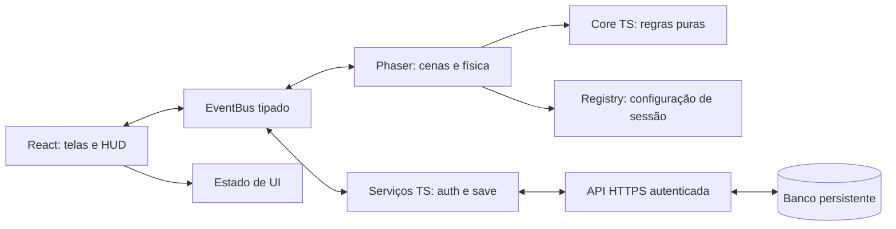

# 7. Arquitetura Técnica (React + Phaser)

> [← Anterior: 6. Áudio](06-audio.md) · [Próxima: 8. Monetização e Live Ops →](08-monetizacao-e-live-ops.md)

## 7.1 Visão de arquitetura (diagrama Mermaid: React Shell ↔ EventBus ↔ Phaser Game)



React não manipula GameObjects; Phaser não importa componentes React. Eventos carregam apenas dados serializáveis. Serviços isolam rede e persistência.

## 7.2 Stack e versões (com justificativa)

[SUPOSIÇÃO] TypeScript strict 5.x, React 18+, Phaser 3.x estável, Vite, Vitest, Testing Library e Playwright. Fixar versões exatas e verificar compatibilidade no lockfile ao iniciar implementação; não presumir uma versão mais recente sem validação. Context API para UI pequena no MVP; migrar a Zustand apenas se o fluxo justificar. CSS Modules para isolamento. Arcade Physics é suficiente para plataforma; Matter.js fica fora até surgir necessidade específica.

## 7.3 Estrutura de pastas do projeto

```text
src/
  main.tsx  App.tsx
  core/                  # regras puras de dano, bolsa, morte, dificuldade
  game/
    PhaserGame.tsx config.ts EventBus.ts
    scenes/ entities/ systems/ state-machines/ data/ constants/
  ui/                    # screens/ components/ hooks/
  store/                 # estado de UI
  services/              # auth, api, save, i18n, analytics quando aplicável
  types/
public/assets/           # atlases, imagens, áudio, tilemaps e fontes
```

## 7.4 Cenas Phaser (Boot, Preload, MainMenu, Game, UI overlay, GameOver) e responsabilidades

BootScene configura o mínimo e carrega arte do loading; PreloadScene carrega pacote MVP e sinaliza resultado; GameScene controla mundo, entidades, física e câmera. MainMenuScene é opcional apenas para fundo animado. UI e GameOver são telas React; UIScene e GameOverScene não são necessárias no MVP. `scene.start` inicia GameScene; `scene.pause`/`scene.resume` operam pausa, `scene.stop` encerra a sessão. A criação/destruição é coordenada com React e nunca duplica o canvas.

## 7.5 Ponte React ↔ Phaser: contrato de eventos (tabela tipada: nome, payload, origem, destino)

Payloads são snapshots serializáveis. Wrapper tipado em TypeScript sobre `Phaser.Events.EventEmitter`; validar payloads em fronteiras externas. EVT identifica contrato, não substitui nome do evento.

| ID | Nome | Payload TypeScript | Origem → destino |
|---|---|---|---|
| EVT-001 | `scene:ready` | `{ key: string }` | Phaser → React |
| EVT-002 | `game:resources` | `{ hp: number; shield: number; power: number }` | Phaser → React |
| EVT-003 | `game:inventory` | `{ slotsUsed: number; pinnedCount: number; itens: readonly ItemId[]; presos: readonly ItemId[] }` | Phaser → React |
| EVT-004 | `game:death` | `{ areaId: string; recoverable: boolean }` | Phaser → React/serviço |
| EVT-005 | `ui:pause` | `{ paused: boolean }` | React → Phaser |
| EVT-006 | `ui:settings` | `{ music: number; sfx: number; reducedMotion: boolean }` | React → Phaser |
| EVT-007 | `save:result` | `{ ok: boolean; revision?: number; errorCode?: string }` | Serviço → React/Phaser |
| EVT-008 | `game:completed` | `{ scope: 'mvp' \| 'campaign' }` | Phaser → React/serviço |
| EVT-009 | `ui:inventory-command` | `{ action: 'pin' \| 'unpin' \| 'recover'; itemId?: ItemId }` | React → Phaser |

No código, `|` nos tipos literais representa união TypeScript; as barras são escapadas nesta tabela Markdown. **Extensões locais aditivas** (`DEC-019`, atualizadas em `DEC-039`): `game:inventario`/`ui:inventario` (mochila aberta), `game:bau`/`ui:bau-command` (baú das salas seguras), `game:moedas` (moedas de mobs e chefes), `game:bau` com `moedas` e os seis gestos de `ui:bau-command` (`guardar`, `retirar`, `guardar-tudo`, `retirar-tudo`, `moedas-para-bau`, `moedas-do-bau`, com `quantidade` opcional) — `DEC-040`; `game:habilidades`/`ui:habilidades`/`game:habilidades-painel` e `ui:habilidade-command` (os níveis das habilidades) — `DEC-041`, `game:morte` (o que se perdeu) e `game:bolsa` (a bolsa da morte: existe, onde, com quê). Todas fora do contrato `EVT-###` e todas declaradas em `game/EventBus.ts`. **`DEC-042`** junta ao mesmo registo `Progress.tentativasDrop`/`SceneData.tentativasDrop` (o contador do drop raro de chefe, no save para o fecho do jogo não reiniciar a contagem) e `game:habilidades` com `max = 10` por linha; o drop não tem evento próprio — usa `game:text` e `game:toast`. **`DEC-043`** acrescenta ao mesmo registo `game:mapa` (a planta do setor com o estado de cada sala, as ligações e a coluna dos 16 setores — a UI desenha, não calcula topologia), `ui:mapa`/`game:mapa-painel` (abrir e fechar o painel) e `Progress.visitadas`.
[SUPOSIÇÃO] HUD recebe alterações relevantes com teto de 10 Hz, não eventos a cada frame.

## 7.6 Gerenciamento de estado (o que vive em React, em Phaser, em registry, em storage)

React: tela, formulários e snapshot de HUD. Phaser: estado transitório de mundo, física e input. `registry`: configuração de sessão, IDs e flags leves, não fonte autoritativa de economia. Serviço/servidor: identidade, save versionado, inventário, XP e dinheiro persistentes. `localStorage`: apenas preferências locais não sensíveis; não gravar tokens em texto puro ali. Dados de jogo são serializáveis; reconciliar com servidor após reconexão.

## 7.7 Entidades e padrões (Component/ECS leve, Object Pooling, State Machine, Command, Observer)

FSM para jogador e inimigos; composição de behaviors; comandos para input; eventos para observação. Pool de projéteis e efeitos com limites explícitos; evitar objetos novos em `update`. Parâmetros em `game/data/`, regras puras em `core/`. Usar delta/tempo simulado com limites e passo fixo para física quando apropriado; não multiplicar por delta novamente valores já integrados pela física Phaser. Seed e versão de gerador somente quando desafios procedurais forem construídos.

Ciclo de vida: uma instância `Phaser.Game` por montagem, `destroy(true)` no unmount; testar StrictMode e HMR para evitar duplicação de canvas e listeners. Registrar listeners em `create` e removê-los em `shutdown`/`destroy`; não guardar objetos Phaser no estado React. [RISCO] Como a destruição do Phaser pode ser concluída no ciclo seguinte, validar remontagem rápida e isolar contêineres em testes reais.

## 7.8 Pipeline de assets (carregamento, atlas, cache, lazy-loading, versionamento)

Exportar atlas JSON e texturas, validar limites de GPU; áudio curto em audio sprites quando vantajoso, com fallback de formato. Tilemaps `.tmj` com camadas nomeadas. Pré-carregar fontes antes de texto no canvas. Preload contém apenas MVP; futuros pacotes de área carregam sob demanda. Assets com hash de build; falhas exibem UI-11 e opção de nova tentativa.

## 7.9 Persistência e save (localStorage/IndexedDB/nuvem), versionamento e migração do save

Save online autenticado é fonte de verdade. [SUPOSIÇÃO] Estrutura `{ version, revision, updatedAt, profile, progress, inventory, recoveryBag, settings }`; versão do servidor controla migrações e revisão otimista evita sobrescrever saves concorrentes. Salvar na transição elegível e ao interagir com quarto seguro; snapshots também devem capturar imediatamente operações críticas de morte, recuperação e perda de bolsa. Processar essas operações no servidor como transações idempotentes com IDs de operação; confirmar antes de permitir continuação definitiva. Erro de rede pausa as operações críticas, exibe estado e permite retry; não prometer funcionamento offline. Recuperar último save confirmado sem apagar compras ou progresso validado. Em conflito entre dispositivos, bloquear confirmação e oferecer escolha/recarregamento, sem sobrescrita silenciosa. [PENDENTE] Política de retenção e exclusão de dados.

## 7.10 Escala, resolução e responsividade (Scale Manager, DPR, safe-area mobile)

Base 1280 × 720, `FIT`/`CENTER_BOTH`; adaptar HUD e tratar `resize`, mudança de orientação e safe-area CSS. [SUPOSIÇÃO] Limitar DPR de renderização a 2 quando o pipeline permitir e medir uso de memória; não confundir DPR com resolução lógica. Na vertical, exibir orientação horizontal. `visibilitychange` pausa; fullscreen opcional por gesto. Restringir seleção/context menu/scroll apenas ao canvas e controles.

## 7.11 Performance: orçamento (FPS, draw calls, memória, tamanho do bundle, tempo de carga)

[SUPOSIÇÃO] Metas a validar em staging com tela de teste e amostra de dispositivos definida em 10.1: desktop ≥ 55 FPS médio com alvo 60; mobile ≥ 30 FPS estáveis. Primeiro nível ≤ 10 MB desktop / 6 MB mobile transferidos; texturas ≤ 256/128 MB estimados em GPU; draw calls < 100/50 por frame; objetos de física ativos < 500/200. JS inicial sem Phaser < 500 KB gzip; medir também peso do chunk Phaser separado. A partir de cache frio e rede 4G emulada, alvo < 5 s até menu interativo no mobile e < 3 no desktop em condições de teste documentadas; login/rede de terceiros ficam medidos separadamente. TTI aqui é métrica operacional própria: tempo de navegação até menu habilitado, não uma métrica padronizada de navegador. Reduzir custo via atlas, pooling, culling e limite de partículas; medir, não presumir batching.

## 7.12 Backend e serviços (opcional): endpoints, autenticação, anti-cheat básico, LGPD

Backend é **obrigatório** porque conta e conexão são exigidas. [SUPOSIÇÃO] Serviço gerenciado de autenticação e banco com API própria ou funções server-side; fornecedor pendente por custo e política para menores. Contrato conceitual HTTPS:

| Operação | Método / rota | Autorização e comportamento |
|---|---|---|
| Entrar/criar conta | Serviço de identidade | Fluxo do provedor; proteção de credenciais e limitação de tentativas |
| Ler save | `GET /api/save` | Sessão autenticada; retorna versão e revisão |
| Salvar | `PUT /api/save` | Validar schema e revisão; retornar conflito sem sobrescrever |
| Morte/recuperação | `POST /api/inventory/operations` | Transação idempotente; valida propriedade, limite de slots e estado |
| Excluir conta | `DELETE /api/account` | Reautenticação e fluxo de exclusão/retensão aplicável |

Servidor valida inventário, progressão e direitos de cosméticos; comandos do cliente não constituem prova de compra. Validar limites e aplicar rate limits. Para jogo single-player com simulação no cliente, isso reduz trapaças simples, mas **não garante anti-cheat**; sem simulação autoritativa não se prova legitimidade de toda recompensa. Pagamentos só após desenho transacional específico, validação de webhook e revisão legal, fora do MVP.

## 7.13 Telemetria e analytics (eventos, funis, privacidade/consentimento)

MVP: [SUPOSIÇÃO] sem analytics comportamental de produção; playtests consentidos registram observações agregadas. Registros operacionais mínimos para erros e segurança têm finalidade, acesso e retenção definidos antes de produção. Eventos futuros possíveis: `tutorial_completed`, `boss_defeated`, `session_started`, sem texto livre nem dados pessoais desnecessários. Avaliar base legal, consentimento quando exigido e regras para menores antes de ativar; não presumir que consentimento é sempre a única base legal.

## 7.14 Estratégia de testes (unitários, integração, E2E, playtest, dispositivos)

Vitest para `core/`: dano, slots, morte, transações e dificuldade; Testing Library para conta, menus, acessibilidade e UI; testes de integração com backend de staging; Playwright para login → jogo → pausa → morte → recuperação e save/relogin. Debug restrito a desenvolvimento/staging: FPS, hitboxes e seed. Objetivo: 5 jogadores do público-alvo por milestone com gameplay; para menores, consentimentos apropriados. Se indisponível, registrar lacuna em vez de afirmar que o teste ocorreu.

## 7.15 Build, CI/CD e deploy (ambientes, variáveis, PWA, cache, CDN)

Vite separa chunks React e Phaser, com nomes hash e `base` configurável. `.env` separa dev/staging/prod; segredos nunca no cliente. CI executa lint, `tsc --noEmit`, testes unitários/integração disponíveis, build, análise de bundles e E2E em staging. [SUPOSIÇÃO] Hospedagem HTTPS estática + API gerenciada; escolha depende de custo e requisitos de dados. PWA/offline não aplicável no MVP; cache de assets não deve permitir jogar offline nem persistir dados privados indevidamente.

## 7.16 Segurança e privacidade (sanitização, CSP, dados pessoais, menores de idade)

Minimizar dados de conta; HTTPS, validação server-side, CSP adequada, cookies seguros HttpOnly/SameSite se aplicáveis, proteção CSRF quando usar cookies, controle de acesso por usuário e logs sem segredos. Seguir orientações do provedor de autenticação. Publicar política de privacidade, termos, contato e procedimento de acesso/exclusão. Avaliar LGPD e, conforme jurisdição e público, GDPR/COPPA e exigências relacionadas a menores; revisar idade mínima, representação/consentimento apropriado e tratamento no melhor interesse de crianças e adolescentes. [PENDENTE] Revisão jurídica e de requisitos de loja antes de coletar dados reais ou vender. Não registrar dados bancários no jogo; usar provedor de pagamento apropriado quando houver loja.

## 7.17 Decisões arquiteturais (ADR) e alternativas descartadas

| ID | Decisão | Justificativa / alternativa |
|---|---|---|
| ADR-01 | React para UI; Phaser para mundo | Acessibilidade e responsabilidades claras; UI complexa em canvas descartada no MVP. |
| ADR-02 | Arcade Physics | Adequada ao escopo; Matter.js apenas para física complexa validada. |
| ADR-03 | Backend autenticado | Exigência de conta online; save apenas local descartado como fonte de verdade. |
| ADR-04 | Context API inicial | Menor complexidade; Zustand/Redux se necessidades aumentarem. |
| ADR-05 | Mundo principal fixo; procedural opcional | Preserva caminhos e reduz complexidade; geração total descartada. |
| ADR-06 | MVP sem pagamentos | Evita integrar loja ainda inexistente e antecipa validação do jogo. |
