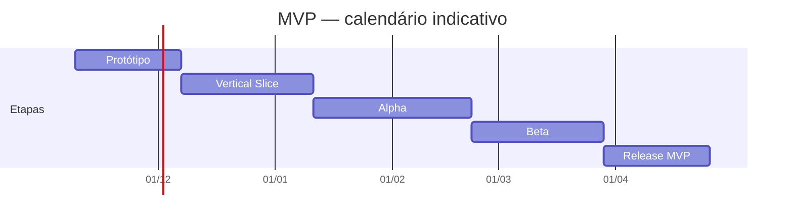

# 9. Produção e Gestão

> [← Anterior: 8. Monetização e Live Ops](08-monetizacao-e-live-ops.md) · [Próxima: 10. Qualidade, Testes e Lançamento →](10-qualidade-testes-e-lancamento.md)

## 9.1 Equipe, papéis e responsabilidades (RACI simplificado)

| Atividade | Responsável / aprovador | Consultados |
|---|---|---|
| Design, arte, programação e produção | Proprietário, única pessoa | Playtesters e especialistas pontuais, se disponíveis |
| Aprovação de escopo e orçamento | Proprietário | Serviços/assessoria conforme necessidade |
| Segurança, privacidade e classificação | Proprietário; revisão especializada recomendada | [PENDENTE] profissional qualificado |

## 9.2 Roadmap por milestones (Protótipo → Vertical Slice → Alpha → Beta → Release) com critérios de saída

Planejamento abaixo refere-se **somente ao lançamento do MVP**, não às 16 áreas completas. [SUPOSIÇÃO] 5 dias/semana × 5 h/dia = 25 h/semana; confirmar dias efetivos. Total indicativo 24 semanas / 600 h, sendo 420 h planejadas e 180 h de reserva (30% da capacidade). Os prazos não são compromisso.

| Milestone | Semanas | Critério de saída |
|---|---|---|
| Protótipo | 1–4 | Movimento, salto duplo, combate básico e teste interno; regras centrais verificadas. |
| Vertical Slice | 5–9 | Trecho com arte e áudio representativos, 1 inimigo e 1 chefe; playtest inicial. |
| Alpha | 10–15 | Fluxo completo do MVP, conta/save de staging, inventário e duas línguas integrados. |
| Beta | 16–20 | Testes de regressão, privacidade, compatibilidade e playtests; sem defeitos bloqueantes conhecidos. |
| Release MVP | 21–24 | Checklist de lançamento aprovado, revisão de custos e publicação segura; reserva usada conforme necessário. |

Expansão comercial com 16 áreas e loja requer estimativa, financiamento e roadmap próprios após validação do MVP. Não declarar o projeto completo no Release MVP.

## 9.3 Backlog inicial priorizado (tabela: ID, história, requisito, prioridade MoSCoW, estimativa, dependência, DoD)

Estimativas de trabalho ativo em horas, [SUPOSIÇÃO], somam 420 h. Reserva de 180 h é separada e não uma tarefa adicional. Cada tarefa só termina com código revisado, teste indicado aprovado e critérios comuns de 9.5.

| ID | História / entrega | Requisito | Prioridade | Est. | Dependência | DoD específico |
|---|---|---|---|---:|---|---|
| BKL-001 | Configurar projeto e ciclo de vida | REQ-NF-001 | Must | 20 h | — | Build, CI e TST-011 aprovados |
| BKL-002 | Implementar movimento e salto | REQ-F-001 | Must | 25 h | BKL-001 | TST-001 aprovado |
| BKL-003 | Implementar ataques e projéteis | REQ-F-002 | Must | 30 h | BKL-002 | TST-002 aprovado |
| BKL-004 | Criar vida, escudo e poder | REQ-F-003 | Must | 20 h | BKL-002 | TST-003 aprovado |
| BKL-005 | Criar inventário e bolsa de morte | REQ-F-004 | Must | 40 h | BKL-004, BKL-009 | TST-004 aprovado com persistência |
| BKL-006 | Criar habilidade permanente e rota | REQ-F-005 | Must | 20 h | BKL-002 | TST-005 aprovado |
| BKL-007 | Criar armadilha, senha e porta | REQ-F-006 | Must | 20 h | BKL-002 | TST-006 aprovado |
| BKL-008 | Criar checkpoint e quarto seguro | REQ-F-007 | Must | 30 h | BKL-009 | TST-007 aprovado |
| BKL-009 | Implementar conta, API e save | REQ-F-008 | Must | 50 h | BKL-001 | TST-012 e segurança de staging aprovados |
| BKL-010 | Implementar seleção e oferta de dificuldade | REQ-F-009 | Must | 20 h | BKL-004, BKL-009 | TST-008 aprovado |
| BKL-011 | Criar inimigo, chefe e conclusão | REQ-F-010 | Must | 35 h | BKL-003 | TST-009 aprovado |
| BKL-012 | Integrar região e assets de MVP | REQ-F-011 | Must | 45 h | BKL-006, BKL-007, BKL-011 | LVL-01–03 navegáveis e fluxo TST-013 aprovado |
| BKL-013 | Criar HUD, menus e touch acessíveis | REQ-NF-002 | Must | 30 h | BKL-001 | TST-014 aprovado em teclado e touch |
| BKL-014 | Localizar PT-BR e EN-US | REQ-NF-003 | Must | 15 h | BKL-013 | TST-015 aprovado |
| BKL-015 | Executar QA, performance e publicação | REQ-NF-004 | Must | 20 h | BKL-008, BKL-010, BKL-012, BKL-014 | TST-016 e checklist de 10.5 aprovados |

Backlog pós-MVP sem estimativa aprovada: BKL-016 desafios procedurais (REQ-F-012, Could; depende de BKL-012; DoD TST-010 e validação de alcançabilidade); BKL-017 loja cosmética e Manch's (REQ-F-013, Could; depende de decisão legal, provedor e arquitetura de pagamentos; DoD TST-017 e auditoria de transações). Ambos não entram nas 420 h.

## 9.4 Cronograma (Mermaid Gantt)

Datas são **[SUPOSIÇÃO]**, apenas ilustração de início em 2026-11-09 com calendário semanal; dependem da disponibilidade real e não são prazo assumido pelo usuário.

## 9.5 Definition of Ready / Definition of Done

**Ready:** requisito e teste identificados; regras, parâmetros, dependências, assets e casos de erro conhecidos; suposições aprovadas. **Done por tarefa:** implementação tipada, sem erros de lint/tipos, testes relevantes aprovados, acessibilidade e telemetria quando aplicáveis, revisão de segurança, documentação/contrato atualizados e critérios de aceite demonstrados. **Done por milestone:** critérios de 9.2 demonstrados em build reproduzível, sem bloqueantes conhecidos; pendências, métricas e riscos registrados; playtest documentado quando houver gameplay.

## 9.6 Gestão de riscos (prob × impacto × mitigação × dono)

Escala 1–5; exposição = probabilidade × impacto. Dono de todos: proprietário, até designar outra pessoa.

| ID | Risco | Prob. | Impacto | Exposição | Mitigação |
|---|---|---:|---:|---:|---|
| RSK-01 | Escopo de campanha/armas excede capacidade solo | 5 | 5 | 25 | Limitar MVP; estimar expansão após playtests. |
| RSK-02 | Backend e operação excedem orçamento | 4 | 4 | 16 | Medir custo, estabelecer limite e avaliar provedores em staging. |
| RSK-03 | Compra por menores e privacidade | 4 | 5 | 20 | Loja fora do MVP; revisão legal e controles antes da coleta/venda. |
| RSK-04 | Bloqueio por perda de equipamento | 3 | 5 | 15 | Habilidades permanentes, kit básico proposto e testes de alcançabilidade. |
| RSK-05 | Falha de conexão causa perda ou duplicação | 4 | 5 | 20 | Transações idempotentes, revisão de save e teste de interrupção. |
| RSK-06 | Mobile não atinge performance ou touch é desconfortável | 4 | 4 | 16 | Profiling cedo e playtests em aparelhos reais. |
| RSK-07 | Direitos de assets/IA ou nome incertos | 3 | 4 | 12 | Inventário de licenças e pesquisa de marca antes de publicar. |
| RSK-08 | Balanceamento e tempo por sessão inadequados | 4 | 3 | 12 | Testes de 5–10 min, checkpoints e parâmetros ajustáveis. |

## 9.7 Orçamento e custos (se aplicável)

[PENDENTE] Orçamento monetário e limites de gasto. Categorias: hospedagem/CDN, autenticação e banco, transferência, domínio, ferramentas de arte/IA, testes, suporte, jurídico e eventual provedor de pagamentos. Dono: proprietário; definir antes de produção pública. Não há valores de fornecedores validados neste documento.
