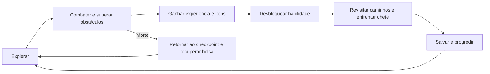
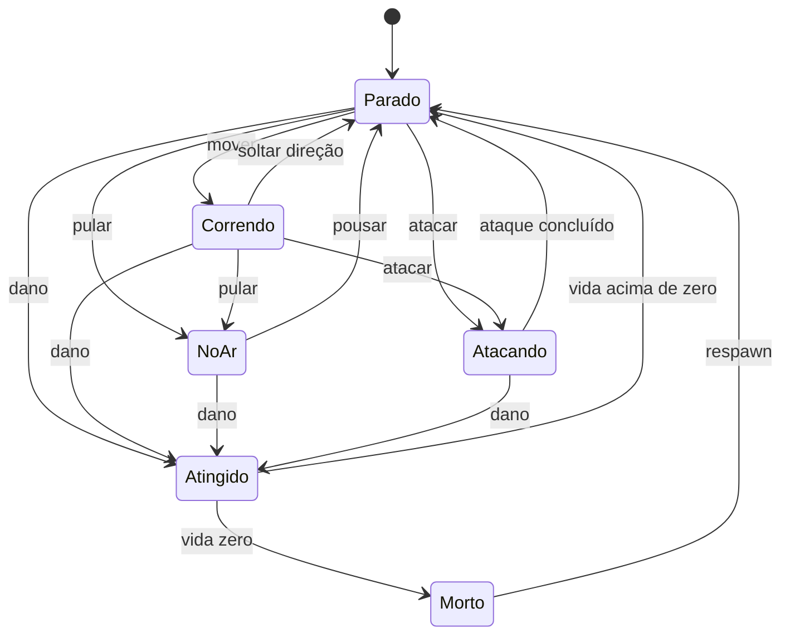
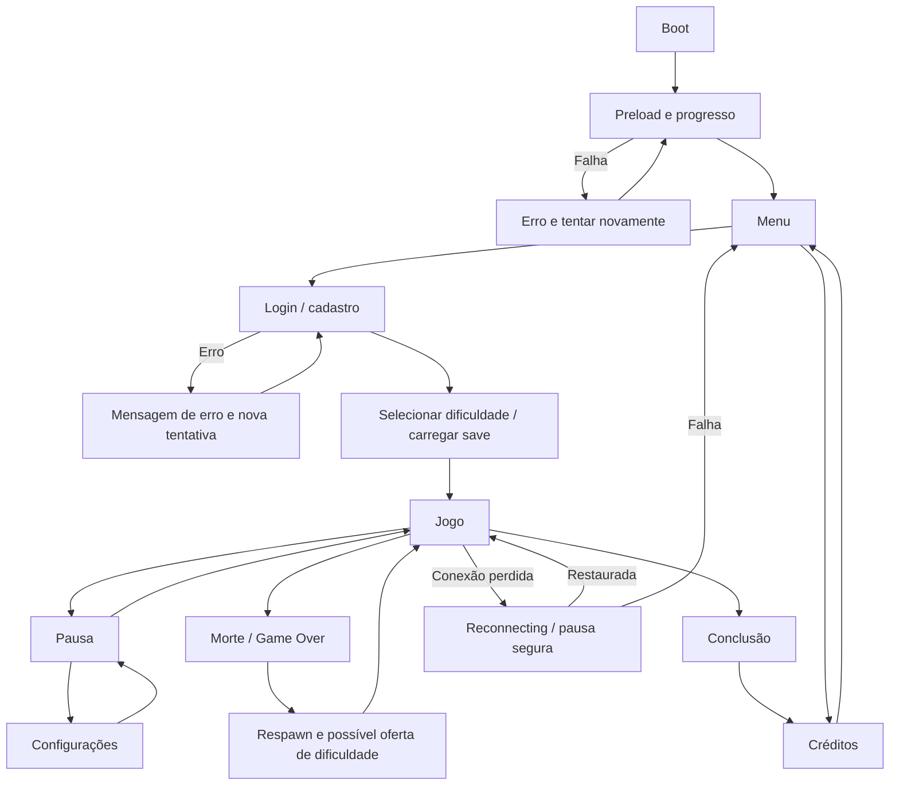
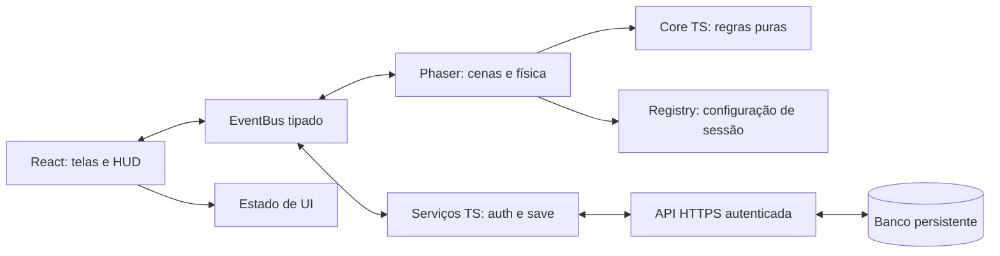
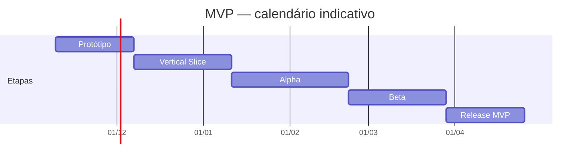

# GDD — Homem Macho
> Versão: 0.1.0 · Data: 2026-11-04 · Autor(es): proprietário do projeto e assistente de design · Status: Rascunho

## Histórico de versões
| Versão | Data | Autor | Mudanças |
|--------|------|-------|----------|
| 0.1.0 | 2026-11-04 | Proprietário do projeto e assistente | Primeira especificação após aprovação do Game Brief. Valores e decisões não informados são propostas identificadas. |

## Sumário
1. [Visão Geral](#1-visão-geral)
2. [Gameplay](#2-gameplay)
3. [Conteúdo do Jogo](#3-conteúdo-do-jogo)
4. [Interface e Experiência](#4-interface-e-experiência-uxui)
5. [Arte e Direção Visual](#5-arte-e-direção-visual)
6. [Áudio](#6-áudio)
7. [Arquitetura Técnica (React + Phaser)](#7-arquitetura-técnica-react--phaser)
8. [Monetização e Live Ops](#8-monetização-e-live-ops-se-aplicável)
9. [Produção e Gestão](#9-produção-e-gestão)
10. [Qualidade, Testes e Lançamento](#10-qualidade-testes-e-lançamento)
11. [Requisitos Consolidados](#11-requisitos-consolidados)
12. [Premissas, Riscos Abertos e Perguntas Pendentes](#12-premissas-riscos-abertos-e-perguntas-pendentes)
13. [Apêndices](#13-apêndices)

> **Documentos por seção:** o GDD também está dividido em arquivos individuais em [`docs/`](README.md) para facilitar revisão no GitHub.

---

## 1. Visão Geral
### 1.1 Elevator Pitch (máx. 50 palavras)
Em um mundo de fantasia sombria, um soldado iniciante explora áreas conectadas, luta contra monstros e conquista habilidades. Recupere seus equipamentos após a morte, derrote chefes e evolua até se tornar o Homem Macho mais forte de seu mundo.

### 1.2 Conceito de alto nível
Jogo de ação e plataforma 2D para navegador, com exploração não linear, progressão por habilidades, equipamentos obtidos de inimigos e desafios opcionais procedurais. A campanha completa prevê 16 áreas conectadas. O MVP é um recorte curto e online, não a campanha inteira.

### 1.3 Gênero, plataforma e público-alvo
Ação/plataforma, metroidvania e elementos roguelike restritos a desafios opcionais. Desktop web com teclado e mouse; web mobile com touch horizontal. Público pretendido: pessoas a partir de 12 anos. Sessões-alvo: 5–10 min; a campanha pode exigir várias sessões.

### 1.4 Pilares de design (3–5)
- **P1 — Exploração com agência:** caminhos visíveis, novas possibilidades ao conquistar habilidades.
- **P2 — Combate legível:** ataques, ameaças e respostas claramente sinalizados.
- **P3 — Risco recuperável:** a morte cobra itens não presos, mas nunca habilidades de acesso.
- **P4 — Dark fantasy irreverente:** ambiente sombrio com humor exagerado compatível com o público pretendido.

### 1.5 USP / Diferenciais
Combinação proposta de humor autoconsciente, fantasia sombria, bolsa recuperável com proteção limitada de itens e exploração conectada. A diferenciação deve ser comprovada em playtests; não se presume exclusividade de mecânicas isoladas.

### 1.6 Jogos de referência e diferenciação
Metal Slug e Contra inspiram ritmo e ação; Metroid e Castlevania inspiram exploração e revisitação. Não reproduzir personagens, sprites, mapas, música, textos ou marcas dessas obras. Criar identidade visual, narrativa, níveis e personagens próprios. [PENDENTE] Pesquisar disponibilidade do nome e possíveis conflitos de marca antes do lançamento comercial.

### 1.7 Experiência-alvo do jogador (emoções e fantasia de poder)
Superação progressiva, curiosidade diante de caminhos inacessíveis e tensão ao recuperar a bolsa, aliviadas por humor visual. Fantasia: transformar um lutador iniciante no herói mais forte daquele mundo.

### 1.8 Classificação indicativa prevista e justificativa
Meta de projeto: classificação indicativa brasileira **12 anos**, a confirmar por avaliação do conteúdo final. Violência fantasiosa e humor devem respeitar essa meta; evitar conteúdo sexual explícito, gore realista e linguagem incompatível. Compras e públicos menores exigem revisão específica. A classificação não está garantida. [PENDENTE] Avaliar ClassInd e eventual ESRB/PEGI conforme países de lançamento.

### 1.9 Escopo: Dentro / Fora (MoSCoW)
| Prioridade | Escopo |
|---|---|
| Must — MVP | Conta online, região pequena conectada, movimento, combate com uma arma branca e uma à distância, vida/escudo/poder, salto duplo explorável, inventário e recuperação, checkpoint e quarto seguro, um inimigo, armadilha, puzzle e chefe, três dificuldades, PT-BR/EN-US. |
| Should — após validação do MVP | Mais armas, equipamentos, inimigos, chefes e áreas; melhorias de acessibilidade e conteúdo. |
| Could — expansão | Desafios opcionais procedurais, chefes secretos, variedade cosmética, loja e Manch's. Essas são metas da visão completa, não compromissos do MVP. |
| Won't — MVP | Pagamentos reais, Manch's, loja oficial, multiplayer e campanha completa de 16 áreas. |

## 2. Gameplay
### 2.1 Core Loop (micro, macro e meta) + diagrama Mermaid
- **Micro (segundos):** observar → mover/esquivar → atacar ou interagir → receber feedback.
- **Macro (minutos):** explorar → superar obstáculos → coletar equipamento → ativar checkpoint/quarto seguro → enfrentar chefe.
- **Meta (sessões):** desenvolver personagem → revisitar caminhos → completar campanha → continuar no mesmo save e escolher dificuldade.



### 2.2 Mecânicas principais (tabela com ID)
Todos os números desta seção são **[SUPOSIÇÃO] valores iniciais para teste**, não promessas de balanceamento final. IDs de testes e requisitos são definidos na seção 11.

| ID | Mecânica | Descrição | Entrada | Regras/Parâmetros | Feedback | Critério de aceite |
|---|---|---|---|---|---|---|
| MEC-001 | Movimento e salto | Caminhar, saltar e usar salto duplo; P1/P2. | Esquerda/direita e salto. | 220 px/s, primeiro salto 480 px/s; segundo salto disponível após descoberta. | Animação e SFX-001. | Dado salto duplo desbloqueado, quando saltar no ar uma vez, então ocorre um segundo impulso; um terceiro não ocorre antes de tocar o chão. TST-001. |
| MEC-002 | Combate | Arma branca e arma à distância no MVP; P2. | Ataque e disparo. | Dano inicial 20 e 10 HP; inimigos telegrafam ataques. | Impacto visual, SFX-002, redução de HP. | Dado inimigo com 20 HP, quando um ataque branco válido atingir, então HP chega a 0 e a derrota ocorre uma vez. TST-002. |
| MEC-003 | Recursos | Vida, escudo e poder; P2/P3. | Dano ou ação especial. | Vida 100 HP; escudo absorve antes da vida; corrida consome poder. | Barras e som distintos. | Dado escudo 10 e dano 20, quando atingido, então escudo vira 0 e vida perde 10 HP. TST-003. |
| MEC-004 | Inventário e morte | Bolsa de 40 espaços, até 20 itens presos; P3. | Menu, prender, coletar, morrer, recuperar. | Itens não presos ficam na bolsa da morte; segunda morte antes de recuperação destrói a bolsa anterior. | Contagem, marcador de recuperação e mensagem de perda. | Dado item preso e item solto, quando morrer, então o preso permanece e o solto vai à bolsa recuperável; outra morte antes da recuperação destrói a bolsa anterior. TST-004. |
| MEC-005 | Exploração e habilidade | Descobrir salto duplo para acessar nova rota; P1. | Explorar e interagir. | Habilidade de acesso é permanente e não cai na morte. | Notificação e mudança visual da rota. | Dado salto duplo descoberto, quando morrer e carregar checkpoint, então habilidade permanece ativa. TST-005. |
| MEC-006 | Obstáculos e puzzle | Evitar armadilha e abrir porta por senha descoberta no cenário; P1/P2. | Movimento e interação. | Senha do MVP fixa, de 4 símbolos; pista está na mesma região. | Sinais visuais e resposta sonora; mensagens não dependem só de cor. | Dada a senha correta, quando confirmada, então porta abre; senha incorreta mantém porta fechada. TST-006. |
| MEC-007 | Salvamento | Passagens de fase salvam automaticamente; quarto seguro permite salvar; P3. | Transição ou interação. | Persistência no servidor autenticado; fases de desafio não criam checkpoints de transição. | Ícone de salvamento e confirmação/erro. | Dado usuário conectado, quando atravessar transição elegível, então posição e progresso confirmados são restaurados após novo login. TST-007. |
| MEC-008 | Dificuldade | Fácil, médio e difícil escolhidos no início; P2/P3. | Seleção inicial; oferta após mortes; seleção pós-final. | Durante campanha só redução ofertada após 3 mortes consecutivas no mesmo trecho/chefe; pós-final permite escolher qualquer nível no mesmo save. | Tela de seleção e oferta opcional. | Dadas 3 mortes consecutivas no mesmo trecho no difícil, quando reaparecer, então há oferta recusável de nível inferior. TST-008. |
| MEC-009 | Chefe e conclusão | Superar chefe da área e registrar conclusão; P1/P2. | Combate. | MVP conclui após chefe do recorte; vitória de campanha completa depende do chefe final. | Animação, recompensa e tela de conclusão. | Dado chefe com 0 HP, quando derrota for processada, então recompensa e conclusão do recorte ocorrem uma vez. TST-009. |
| MEC-010 | Desafio procedural opcional | Variações de sala/armadilhas somente em desafios opcionais; P1/P2. | Entrada voluntária; somente pós-MVP. | [SUPOSIÇÃO] Geração por peças validadas e seed; rota obrigatória permanece fixa; sem checkpoint de transição. | Identificação do desafio e resultado. | Dada uma seed válida, quando gerar desafio duas vezes com a mesma versão de conteúdo, então a sequência de peças é igual e há caminho alcançável. TST-010. |

### 2.3 Controles e input (teclado/mouse/touch/gamepad) + tabela de mapeamento
[SUPOSIÇÃO] Mapeamento inicial; ações de teclado remapeáveis. Touch usa botões virtuais multitouch de pelo menos 44 × 44 px CSS, separados e identificados por ícone e texto acessível na UI. Gamepad fica fora do MVP.

| Ação | Teclado/mouse | Touch horizontal |
|---|---|---|
| Mover | A/D ou setas | Direcional virtual |
| Pular/salto duplo | Espaço | Botão Pular |
| Ataque branco | Clique esquerdo ou J | Botão Ataque |
| Ataque à distância | Clique direito ou K | Botão Disparo |
| Correr | Shift | Botão Correr |
| Interagir/recuperar | E | Botão Interagir |
| Pausar/inventário | Esc / I | Botões Pausa / Bolsa |

Desabilitar menu de contexto e rolagem apenas na área interativa do jogo; não bloquear zoom geral do navegador. [SUPOSIÇÃO] Objetivo de feedback local < 100 ms, medido em dispositivo de referência.

### 2.4 Câmera e visão (tipo, follow, zoom, bounds, shake)
[SUPOSIÇÃO] Visão lateral, câmera segue o jogador com suavização, limites por sala e zoom lógico 1×. Shake é opcional, reduzido ou desativável; não pode esconder ameaças. Sem câmera livre no MVP.

### 2.5 Física e colisões (gravidade, atrito, layers, hitboxes)
Arcade Physics: [SUPOSIÇÃO] gravidade 1.200 px/s² e velocidade horizontal 220 px/s. Camadas: cenário sólido, plataformas, jogador, inimigos, projéteis e sensores de interação. Hitboxes menores ou iguais às silhuetas de ameaça e exibíveis no modo debug. Não depender de resolução variável por frame para regras; usar passo temporal controlado e unidades em segundos.

### 2.6 Regras de vitória, derrota, continue e respawn
Vida 0 causa morte. Reaparecer no último checkpoint de transição elegível ou salvamento em quarto seguro, o que for mais recente. Uma bolsa por jogador: caso outra morte ocorra antes de recuperar a anterior, a anterior é destruída e uma nova é criada com os itens não presos restantes. **[SUPOSIÇÃO]** Itens equipados não presos também caem; um kit básico não comercial e sem slots é restaurado para recuperação. Dinheiro, XP, habilidades de acesso e cosméticos comprados não caem. [PENDENTE] Confirmar kit e tratamento de equipamento em uso. O MVP vence com o chefe do recorte; a campanha completa, com o chefe final.

### 2.7 Progressão e desbloqueios
O jogador explora com liberdade; áreas acessíveis podem ser perigosas. Habilidades necessárias a rotas são permanentes e encontradas por exploração. Monstros e chefes oferecem equipamentos; equipamentos fortes vêm de chefes médios/altos na campanha completa. [SUPOSIÇÃO] XP aumenta o nível; no MVP a primeira melhoria de atributos ocorre em 100 XP. Evolução completa de habilidades, combos, escalada, corrida e equipamentos será balanceada após playtest; só corrida e salto duplo são Must no MVP.

### 2.8 Economia e recompensas (fontes, sumidouros, curvas)
MVP: dinheiro e XP obtidos em combate; [SUPOSIÇÃO] 5 moedas e 10 XP por inimigo comum, sem loja nem sumidouro obrigatório. *(Atualizado em `DEC-042`: o build usa **20 moedas por inimigo** e **200 por chefe**, porque as melhorias das habilidades custam moedas — o sumidouro passou a existir e é isso que o torna uma decisão.)* A quantia é salva no servidor. Não confundir moeda do jogo com Manch's. Pós-MVP: lojas de cosméticos podem aceitar moeda de jogo ou Manch's, conforme item; alguns itens serão obtidos jogando. Manch's só entram mediante compra. [PENDENTE] Preços, fontes/sumidouros e simulação de inflação antes de implementar economia comercial; pagamentos não integram o MVP.

### 2.9 Dificuldade, curva de aprendizado e tutorial (onboarding)
[SUPOSIÇÃO] Multiplicadores de dano recebido: fácil 0,75×; médio 1,00×; difícil 1,25×. Aplicar depois da absorção do escudo. A oferta de redução permite difícil → médio ou fácil; médio → fácil. Contador de 3 mortes é por trecho/chefe; [SUPOSIÇÃO] zera ao vencer o chefe ou atravessar para outro trecho. Ensinar mover, pular e atacar em até 90 s, depois apresentar armadilha, puzzle e salto duplo. Desafio aumenta por introduzir → praticar → combinar → testar.

### 2.10 Sistemas de suporte (pontuação, combos, conquistas, missões)
MVP: contador de XP, dinheiro, inventário e marcador de bolsa. Combo de armas brancas, conquistas e missões: pós-MVP; pontuação independente não aplicável no MVP. Todos os ataques e falhas recebem feedback visual e sonoro; não depender apenas de áudio.

### 2.11 Balanceamento inicial (tabela de parâmetros tunáveis com valores padrão, min e max)
[SUPOSIÇÃO] Limites são intervalos de ajuste de design, não valores simultâneos de gameplay. Valores de danos assumem dificuldade média.

| Parâmetro | Valor padrão | Mín | Máx | Unidade | Observação |
|---|---:|---:|---:|---|---|
| Vida máxima | 100 | 50 | 200 | HP | Jogador inicial |
| Escudo máximo | 50 | 0 | 100 | pontos | Absorve dano primeiro |
| Poder máximo | 100 | 50 | 200 | pontos | Habilidades |
| Poder gasto ao correr | 10 | 5 | 25 | pontos/s | Enquanto correndo |
| Regeneração de poder | 15 | 5 | 30 | pontos/s | [SUPOSIÇÃO] Quando não gasta poder |
| Velocidade de movimento | 220 | 120 | 320 | px/s | Não correndo |
| Multiplicador de corrida | 1,4 | 1,1 | 1,8 | × | Velocidade base |
| Impulso do salto | 480 | 350 | 600 | px/s | Magnitude vertical |
| Gravidade | 1.200 | 800 | 1.600 | px/s² | Em coordenadas lógicas |
| Dano da arma branca | 20 | 10 | 40 | HP/golpe | MVP |
| Dano da arma à distância | 10 | 5 | 30 | HP/projétil | MVP |
| Vida do inimigo comum | 20 | 10 | 80 | HP | MVP |
| Vida do chefe MVP | 200 | 100 | 400 | HP | MVP |
| Danos de inimigo/armadilha/chefe | 20 | 10 | 40 | HP/impacto | Antes de multiplicador de dificuldade sobre dano à vida |
| Slots / itens presos | 40 / 20 | 40 / 20 | 40 / 20 | slots / itens | Requisito confirmado |
| Mortes para oferta | 3 | 2 | 5 | mortes | Consecutivas, mesmo trecho |

## 3. Conteúdo do Jogo
### 3.1 Personagem(ns) jogável(is): atributos, habilidades, estados, animações
**ENT-001 — Homem Macho:** vida, escudo, poder e atributos conforme 2.11. Habilidades MVP: mover, pular, correr e descobrir salto duplo. Futuras: agarrar paredes, aumento de força, combos e outras melhorias. Estados: parado, correndo, no ar, atacando, atingido, morto. Animações necessárias: idle, corrida, subida, queda, ataque branco, disparo, dano e morte.



### 3.2 Inimigos / NPCs / Chefes: comportamento (FSM/Behavior), stats, telegraph
[SUPOSIÇÃO] **ENT-002 — Sentinela distorcida:** 20 HP; patrulha → detecta jogador a 250 px → prepara ataque por 600 ms → golpeia → recupera por 800 ms; dano 20 HP. **ENT-003 — Guardião da passagem:** 200 HP; prepara ataque por 800 ms → investe → recuperação 1.000 ms; dano 20 HP. A forma, animação e pista de ataque são originais. Chefes secretos, de fases e final pertencem à campanha completa; lista e atributos ainda pendentes. Sem NPC funcional no MVP.

### 3.3 Itens, power-ups e coletáveis
| ID | Item | Efeito / origem | Escopo |
|---|---|---|---|
| ITM-001 | Arma branca básica | 20 HP/golpe; kit básico proposto | MVP |
| ITM-002 | Arma à distância básica | 10 HP/projétil; kit básico proposto | MVP |
| ITM-003 | Fragmento de salto duplo | Concede habilidade permanente; encontrado na exploração | MVP |
| ITM-004 | Equipamento de teste | Drop de inimigo; ocupa 1 slot, pode ser preso | MVP |
| ITM-005 | Moeda de jogo | Recompensa de inimigos; não ocupa slot | MVP |
| ITM-006 | Cosmético | Aparência sem atributos; disponibilidade varia por item | Pós-MVP |

[SUPOSIÇÃO] Kit básico e habilidade não ocupam slots; drops de equipamentos ocupam 1 slot por item. Se a bolsa estiver cheia, o drop permanece no chão e o jogador recebe aviso; não substituir itens automaticamente.

### 3.4 Níveis / Mundos / Fases: lista, objetivo, novidades, duração estimada
A visão completa tem 16 áreas, não 16 entregas aprovadas de conteúdo detalhado. A lista abaixo é planejamento provisório, com nomes originais sujeitos a revisão. Tempos são de primeira visita e não incluem exploração extra; sessões podem terminar em checkpoints.

| ID | Área provisória | Objetivo / novidade proposta | Duração estimada | Escopo |
|---|---|---|---|---|
| LVL-01 | Ruínas da Vigília | Aprender controles e acessar quarto seguro | 3–5 min | MVP |
| LVL-02 | Galeria Partida | Encontrar salto duplo, senha e armadilha | 4–6 min | MVP |
| LVL-03 | Portão do Guardião | Enfrentar chefe e acessar saída | 3–5 min | MVP |
| LVL-04 | Bosque das Cinzas | Exploração com rotas verticais | 5–10 min | Futuro |
| LVL-05 | Cripta das Engrenagens | Mecanismos e inimigos | 5–10 min | Futuro |
| LVL-06 | Mina Esquecida | Recursos e desníveis | 5–10 min | Futuro |
| LVL-07 | Catedral Oca | Combate e rotas bloqueadas | 5–10 min | Futuro |
| LVL-08 | Pátio Rubro | Chefe de área | 5–10 min | Futuro |
| LVL-09 | Canais Sombrios | Armadilhas combinadas | 5–10 min | Futuro |
| LVL-10 | Torre da Vigília | Escalada e revisitação | 5–10 min | Futuro |
| LVL-11 | Jardim Profanado | Desvios e exploração | 5–10 min | Futuro |
| LVL-12 | Forja Distorcida | Equipamentos e chefe médio | 5–10 min | Futuro |
| LVL-13 | Abismo do Eco | Percurso vertical | 5–10 min | Futuro |
| LVL-14 | Fortaleza do Eclipse | Combinação de desafios | 5–10 min | Futuro |
| LVL-15 | Ante-sala do Fim | Chefe de alto nível e preparação | 5–10 min | Futuro |
| LVL-16 | Trono do Caos | Chefe final e conclusão | 5–10 min | Futuro |

[PENDENTE] Conexões, habilidades de acesso, chefes secretos e duração real das áreas futuras dependem de design e testes. MVP usa LVL-01–03 como um recorte, não representa três níveis de qualidade final completos.

### 3.5 Level design: princípios, ritmo, teaching moments, ferramentas (Tiled)
[SUPOSIÇÃO] Grafo do MVP: LVL-01 ↔ LVL-02 ↔ LVL-03; porta de LVL-02 para LVL-03 exige senha; salto duplo abre uma rota lateral que fornece acesso à pista. Cada trecho apresenta um desafio isolado antes de combiná-lo; sala segura situa-se em LVL-01, checkpoint nas transições. Validar acessibilidade do caminho sem itens recuperáveis. Mapas feitos no Tiled com camadas `ground`, `collision`, `objects`, `decor`; desafios procedurais usam peças conectáveis validadas, sem alterar rota principal.

### 3.6 Narrativa e personagens (se aplicável): sinopse, tom, diálogos, estrutura
Homem Macho é um soldado e lutador iniciante em uma Terra caótica, distorcida por monstros e demônios. O percurso de aperfeiçoamento pessoal o transforma em herói. Humor exagerado contrasta com ambiente sombrio, sem violar a meta etária. [SUPOSIÇÃO] MVP usa textos curtos ambientais e uma fala do chefe; sem dublagem. [PENDENTE] Identidades, diálogos e arco final da campanha.

## 4. Interface e Experiência (UX/UI)
### 4.1 Fluxo de telas (diagrama Mermaid): Boot → Preload → Menu → Jogo → Pausa → Game Over → Créditos


### 4.2 Wireframes textuais de cada tela
| ID | Tela | Wireframe textual |
|---|---|---|
| UI-01 | Boot / carregamento | Logo · barra de progresso · erro e tentar novamente |
| UI-02 | Menu | Logo · Jogar/Continuar · Configurações · Créditos |
| UI-03 | Conta | E-mail/senha ou provedor escolhido · criar conta · entrar · erros acessíveis |
| UI-04 | Dificuldade | Fácil / Médio / Difícil · descrição · confirmar |
| UI-05 | Jogo | HUD superior · mundo central · controles touch inferiores |
| UI-06 | Pausa | Retomar · Bolsa · Configurações · Sair |
| UI-07 | Bolsa | 40 espaços · itens presos até 20 · prender/soltar · descrição |
| UI-08 | Morte | Causa · posição da bolsa · reaparecer · oferta de dificuldade quando elegível |
| UI-09 | Quarto seguro | Salvar · confirmação ou erro · voltar |
| UI-10 | Conclusão/créditos | Resultado · continuar save · créditos · menu |
| UI-11 | Erro/conexão | Estado · orientação · tentar novamente / voltar ao menu |

### 4.3 HUD: elementos, posição, comportamento responsivo
[SUPOSIÇÃO] Barras de vida, escudo e poder no topo esquerdo; dinheiro/XP e aviso de bolsa no topo direito; ações touch na parte inferior. Ao perder conexão, modal não obstrui informações de estado. Redimensionar para paisagem, respeitando safe-area; orientar usuário a girar o dispositivo em retrato, sem exigir fullscreen.

### 4.4 Menus, configurações (áudio, controles, idioma, acessibilidade, qualidade gráfica)
Menus React: conta, dificuldade, pausa, bolsa, salvar, configurações e créditos. Configurações: master/música/SFX, idioma, remapeamento de teclado, redução de movimento e qualidade. [SUPOSIÇÃO] Qualidade baixa desativa partículas e reduz resolução de renderização. Configurações persistem por conta; fallback de preferência local sem dados sensíveis.

### 4.5 Feedback ao jogador (juice): partículas, screen shake, hit-stop, tweens, sons
[SUPOSIÇÃO] Golpe confirma com alteração visual e som; telegraph apresenta forma e animação claras. Partículas limitadas a 30 simultâneas; shake padrão baixo e desativável. Hit-stop fora do MVP até ser testado. Feedback visual e sonoro visam < 100 ms local, quando áudio estiver habilitado.

### 4.6 Acessibilidade (daltonismo, contraste, remapeamento, redução de movimento, legendas, tamanho de fonte, áreas de toque ≥ 44 px)
UI HTML com navegação por teclado, foco visível, nomes acessíveis, remapeamento, modo de movimento reduzido, sinais que não dependem só de cor ou som, legendas para informação sonora relevante e áreas touch ≥ 44 × 44 px CSS. Texto normal visa contraste ≥ 4,5:1; texto grande ≥ 3:1. Permitir ampliação do navegador e texto da UI; não desabilitar zoom global. Evitar flashes acima de 3 por segundo; revisar WCAG 2.2 para conteúdo aplicável. [PENDENTE] Testar com usuários e acessibilidade do gameplay em canvas; não declarar conformidade integral sem auditoria. Oferecer pausas; compras para menores exigem revisão apropriada.

### 4.7 Localização / i18n (idiomas, chaves, formatos)
PT-BR e EN-US desde MVP; textos em arquivos de chaves, por exemplo `menu.play`, `inventory.recover`, `error.offline`. Usar `Intl` para números e datas; reservar ≥ 30% de expansão textual. Não embutir textos nos sprites; testar ambas as línguas.

## 5. Arte e Direção Visual
### 5.1 Estilo, referências e moodboard (descrição)
Desenho animado 2D old school com fantasia sombria: ruínas, silhuetas de arquitetura decadente e monstros originais; humor principalmente por animação e expressão. Produção própria com apoio de IA, sem copiar designs de franquias.

### 5.2 Paleta de cores (hex) e tipografia
[SUPOSIÇÃO] Fundo `#15131F`, pedra `#464052`, vermelho de ameaça `#D95555`, dourado de progresso `#F2C66D`, texto `#F8F7F2`. Validar contraste em contexto real. Fonte de UI: fonte local de licença permissiva a escolher; fallback `system-ui`.

### 5.3 Especificações técnicas: resolução base, tamanho de tiles/sprites, FPS de animação, formato (PNG/WebP), atlas
[SUPOSIÇÃO] Resolução lógica 1280 × 720 px, `Scale.FIT` e `CENTER_BOTH`; tiles 64 × 64 px; personagem em caixa de até 96 × 128 px; animação 8–12 frames/s. PNG para transparência, WebP quando compatível; atlas até 2048 × 2048 px como alvo mobile, sujeito a teste de GPU. Não pressupor pixel art.

### 5.4 Lista de assets visuais (tabela com ID, nome, dimensões, frames, prioridade, status, origem/licença)
Dimensões e contagens são [SUPOSIÇÃO], devem ser revisadas antes de produzir; status de todos: pendente.

| ID | Nome | Dimensões por frame | Frames | Prioridade | Status | Origem/licença |
|---|---|---|---:|---|---|---|
| AST-001 | Herói: conjunto de ações | 96 × 128 px | 40 | Must | Pendente | Próprio/IA; verificar direitos |
| AST-002 | Sentinela | 96 × 128 px | 16 | Must | Pendente | Próprio/IA; verificar direitos |
| AST-003 | Guardião | 192 × 192 px | 20 | Must | Pendente | Próprio/IA; verificar direitos |
| AST-004 | Tiles ruínas | 64 × 64 px | 24 | Must | Pendente | Próprio/IA; verificar direitos |
| AST-005 | Armadilha e porta | 64 × 64 px | 8 | Must | Pendente | Próprio/IA; verificar direitos |
| AST-006 | Ícones inventário e HUD | 64 × 64 px | 12 | Must | Pendente | Próprio/IA; verificar direitos |
| AST-007 | Fundo com parallax | 1280 × 720 px | 3 | Should | Pendente | Próprio/IA; verificar direitos |
| AST-008 | Cosméticos e chefes futuros | Variável | A definir | Could | Pendente | Origem/licença a revisar antes do uso |

### 5.5 Animações e VFX
Usar poses de antecipação para ataques e sinal distinto para dano. Exportar animações para atlas; partículas de impacto são opcionais e desativáveis. Chefe e jogador têm estados coerentes com 3.1–3.2.

### 5.6 Convenções de nomenclatura e pastas
`snake_case`, prefixos `spr_`, `bgm_`, `sfx_`, `ui_`, `tm_`; exemplos `spr_player_run`, `tm_ruinas`. Guardar fontes editáveis fora do bundle e exportações em `public/assets/{images,atlases,audio,tilemaps,fonts}`.

## 6. Áudio
### 6.1 Direção sonora e referências
[SUPOSIÇÃO] Música de ação sombria com instrumentação sintetizada old school e momentos cômicos discretos; impactos claros e distintos. Sem dublagem no MVP. Toda referência é estética, sem copiar gravações ou composições.

### 6.2 Lista de SFX e músicas (ID, gatilho, duração, loop, volume, formato OGG/MP3/M4A)
[SUPOSIÇÃO] Volumes relativos ao bus, sujeitos a mixagem. Arquivos pendentes de produção/licença.

| ID | Gatilho | Duração | Loop | Volume | Formato |
|---|---|---:|---|---:|---|
| SFX-001 | Salto | 0,2 s | Não | 70% | OGG + M4A/MP3 fallback |
| SFX-002 | Impacto de arma | 0,3 s | Não | 75% | OGG + M4A/MP3 fallback |
| SFX-003 | Dano ao jogador | 0,4 s | Não | 70% | OGG + M4A/MP3 fallback |
| SFX-004 | Abrir porta/salvar | 0,5 s | Não | 60% | OGG + M4A/MP3 fallback |
| SFX-005 | Derrota/morte | 1,0 s | Não | 70% | OGG + M4A/MP3 fallback |
| BGM-01 | Exploração | 90 s | Sim | 50% | OGG + M4A/MP3 fallback |
| BGM-02 | Chefe | 60 s | Sim | 55% | OGG + M4A/MP3 fallback |

### 6.3 Mixagem, ducking e regras de autoplay do navegador (desbloqueio por gesto do usuário)
Desbloquear AudioContext por gesto explícito em Jogar; mostrar opção de iniciar sem áudio se necessário. Master, música e SFX separados e persistidos. [SUPOSIÇÃO] Limitar SFX a 8 vozes, variar levemente pitch; reduzir música em 20% durante sinais críticos. Para faixas longas avaliar HTML5 audio/streaming conforme suporte e comportamento da engine, sem assumir que todos os formatos são suportados em todos os navegadores.

### 6.4 Licenças e créditos
Registrar criação, ferramenta de IA, termos de uso comercial, fonte, licença e atribuição por asset. Não usar material de origem ou voz de terceiros sem autorização. Licença final de cada faixa e SFX: [PENDENTE] proprietário, antes de publicação.

## 7. Arquitetura Técnica (React + Phaser)
### 7.1 Visão de arquitetura (diagrama Mermaid: React Shell ↔ EventBus ↔ Phaser Game)

React não manipula GameObjects; Phaser não importa componentes React. Eventos carregam apenas dados serializáveis. Serviços isolam rede e persistência.

### 7.2 Stack e versões (com justificativa)
[SUPOSIÇÃO] TypeScript strict 5.x, React 18+, Phaser 3.x estável, Vite, Vitest, Testing Library e Playwright. Fixar versões exatas e verificar compatibilidade no lockfile ao iniciar implementação; não presumir uma versão mais recente sem validação. Context API para UI pequena no MVP; migrar a Zustand apenas se o fluxo justificar. CSS Modules para isolamento. Arcade Physics é suficiente para plataforma; Matter.js fica fora até surgir necessidade específica.

### 7.3 Estrutura de pastas do projeto
```text
src/
  main.tsx  App.tsx
  core/                  # regras puras de dano, bolsa, morte, dificuldade
  game/
    PhaserGame.tsx config.ts EventBus.ts
    scenes/ entities/ systems/ state-machines/ data/ constants/
  ui/                    # screens/ components/ hooks/
  store/                 # estado de UI
  services/              # auth, api, save, i18n, analytics quando aplicável
  types/
public/assets/           # atlases, imagens, áudio, tilemaps e fontes
```

### 7.4 Cenas Phaser (Boot, Preload, MainMenu, Game, UI overlay, GameOver) e responsabilidades
BootScene configura o mínimo e carrega arte do loading; PreloadScene carrega pacote MVP e sinaliza resultado; GameScene controla mundo, entidades, física e câmera. MainMenuScene é opcional apenas para fundo animado. UI e GameOver são telas React; UIScene e GameOverScene não são necessárias no MVP. `scene.start` inicia GameScene; `scene.pause`/`scene.resume` operam pausa, `scene.stop` encerra a sessão. A criação/destruição é coordenada com React e nunca duplica o canvas.

### 7.5 Ponte React ↔ Phaser: contrato de eventos (tabela tipada: nome, payload, origem, destino)
Payloads são snapshots serializáveis. Wrapper tipado em TypeScript sobre `Phaser.Events.EventEmitter`; validar payloads em fronteiras externas. EVT identifica contrato, não substitui nome do evento.

| ID | Nome | Payload TypeScript | Origem → destino |
|---|---|---|---|
| EVT-001 | `scene:ready` | `{ key: string }` | Phaser → React |
| EVT-002 | `game:resources` | `{ hp: number; shield: number; power: number }` | Phaser → React |
| EVT-003 | `game:inventory` | `{ slotsUsed: number; pinnedCount: number; itens: readonly ItemId[]; presos: readonly ItemId[] }` | Phaser → React |
| EVT-004 | `game:death` | `{ areaId: string; recoverable: boolean }` | Phaser → React/serviço |
| EVT-005 | `ui:pause` | `{ paused: boolean }` | React → Phaser |
| EVT-006 | `ui:settings` | `{ music: number; sfx: number; reducedMotion: boolean }` | React → Phaser |
| EVT-007 | `save:result` | `{ ok: boolean; revision?: number; errorCode?: string }` | Serviço → React/Phaser |
| EVT-008 | `game:completed` | `{ scope: 'mvp' \| 'campaign' }` | Phaser → React/serviço |
| EVT-009 | `ui:inventory-command` | `{ action: 'pin' \| 'unpin' \| 'recover'; itemId?: ItemId }` | React → Phaser |

No código, `|` nos tipos literais representa união TypeScript; as barras são escapadas nesta tabela Markdown. **Extensões locais aditivas** (`DEC-019`, atualizadas em `DEC-039`): `game:inventario`/`ui:inventario` (mochila aberta), `game:bau`/`ui:bau-command` (baú das salas seguras), `game:moedas` (moedas de mobs e chefes), `game:bau` com `moedas` e os seis gestos de `ui:bau-command` (`guardar`, `retirar`, `guardar-tudo`, `retirar-tudo`, `moedas-para-bau`, `moedas-do-bau`, com `quantidade` opcional) — `DEC-040`; `game:habilidades`/`ui:habilidades`/`game:habilidades-painel` e `ui:habilidade-command` (os níveis das habilidades) — `DEC-041`, `game:morte` (o que se perdeu) e `game:bolsa` (a bolsa da morte: existe, onde, com quê). Todas fora do contrato `EVT-###` e todas declaradas em `game/EventBus.ts`. **`DEC-042`** acrescentou, no mesmo registo: `Progress.tentativasDrop`/`SceneData.tentativasDrop` (o contador do drop raro de chefe, que sobrevive ao fecho do jogo) e `game:habilidades` com `max = 10` por linha (dez níveis, preço base por habilidade e +40 % por nível). O drop em si não tem evento próprio: usa `game:text` (o anúncio) e `game:toast` (`DROP RARO · NOME` / `GARANTIA · NOME` / `NADA RARO CAIU · n / 12`). **`DEC-043`** acrescenta ao mesmo registo `game:mapa` (a planta do setor com o estado de cada sala, as ligações e a coluna dos 16 setores — a UI desenha, não calcula topologia), `ui:mapa`/`game:mapa-painel` (abrir e fechar o painel) e `Progress.visitadas`.
[SUPOSIÇÃO] HUD recebe alterações relevantes com teto de 10 Hz, não eventos a cada frame.

### 7.6 Gerenciamento de estado (o que vive em React, em Phaser, em registry, em storage)
React: tela, formulários e snapshot de HUD. Phaser: estado transitório de mundo, física e input. `registry`: configuração de sessão, IDs e flags leves, não fonte autoritativa de economia. Serviço/servidor: identidade, save versionado, inventário, XP e dinheiro persistentes. `localStorage`: apenas preferências locais não sensíveis; não gravar tokens em texto puro ali. Dados de jogo são serializáveis; reconciliar com servidor após reconexão.

### 7.7 Entidades e padrões (Component/ECS leve, Object Pooling, State Machine, Command, Observer)
FSM para jogador e inimigos; composição de behaviors; comandos para input; eventos para observação. Pool de projéteis e efeitos com limites explícitos; evitar objetos novos em `update`. Parâmetros em `game/data/`, regras puras em `core/`. Usar delta/tempo simulado com limites e passo fixo para física quando apropriado; não multiplicar por delta novamente valores já integrados pela física Phaser. Seed e versão de gerador somente quando desafios procedurais forem construídos.

Ciclo de vida: uma instância `Phaser.Game` por montagem, `destroy(true)` no unmount; testar StrictMode e HMR para evitar duplicação de canvas e listeners. Registrar listeners em `create` e removê-los em `shutdown`/`destroy`; não guardar objetos Phaser no estado React. [RISCO] Como a destruição do Phaser pode ser concluída no ciclo seguinte, validar remontagem rápida e isolar contêineres em testes reais.

### 7.8 Pipeline de assets (carregamento, atlas, cache, lazy-loading, versionamento)
Exportar atlas JSON e texturas, validar limites de GPU; áudio curto em audio sprites quando vantajoso, com fallback de formato. Tilemaps `.tmj` com camadas nomeadas. Pré-carregar fontes antes de texto no canvas. Preload contém apenas MVP; futuros pacotes de área carregam sob demanda. Assets com hash de build; falhas exibem UI-11 e opção de nova tentativa.

### 7.9 Persistência e save (localStorage/IndexedDB/nuvem), versionamento e migração do save
Save online autenticado é fonte de verdade. [SUPOSIÇÃO] Estrutura `{ version, revision, updatedAt, profile, progress, inventory, recoveryBag, settings }`; versão do servidor controla migrações e revisão otimista evita sobrescrever saves concorrentes. Salvar na transição elegível e ao interagir com quarto seguro; snapshots também devem capturar imediatamente operações críticas de morte, recuperação e perda de bolsa. Processar essas operações no servidor como transações idempotentes com IDs de operação; confirmar antes de permitir continuação definitiva. Erro de rede pausa as operações críticas, exibe estado e permite retry; não prometer funcionamento offline. Recuperar último save confirmado sem apagar compras ou progresso validado. Em conflito entre dispositivos, bloquear confirmação e oferecer escolha/recarregamento, sem sobrescrita silenciosa. [PENDENTE] Política de retenção e exclusão de dados.

### 7.10 Escala, resolução e responsividade (Scale Manager, DPR, safe-area mobile)
Base 1280 × 720, `FIT`/`CENTER_BOTH`; adaptar HUD e tratar `resize`, mudança de orientação e safe-area CSS. [SUPOSIÇÃO] Limitar DPR de renderização a 2 quando o pipeline permitir e medir uso de memória; não confundir DPR com resolução lógica. Na vertical, exibir orientação horizontal. `visibilitychange` pausa; fullscreen opcional por gesto. Restringir seleção/context menu/scroll apenas ao canvas e controles.

### 7.11 Performance: orçamento (FPS, draw calls, memória, tamanho do bundle, tempo de carga)
[SUPOSIÇÃO] Metas a validar em staging com tela de teste e amostra de dispositivos definida em 10.1: desktop ≥ 55 FPS médio com alvo 60; mobile ≥ 30 FPS estáveis. Primeiro nível ≤ 10 MB desktop / 6 MB mobile transferidos; texturas ≤ 256/128 MB estimados em GPU; draw calls < 100/50 por frame; objetos de física ativos < 500/200. JS inicial sem Phaser < 500 KB gzip; medir também peso do chunk Phaser separado. A partir de cache frio e rede 4G emulada, alvo < 5 s até menu interativo no mobile e < 3 no desktop em condições de teste documentadas; login/rede de terceiros ficam medidos separadamente. TTI aqui é métrica operacional própria: tempo de navegação até menu habilitado, não uma métrica padronizada de navegador. Reduzir custo via atlas, pooling, culling e limite de partículas; medir, não presumir batching.

### 7.12 Backend e serviços (opcional): endpoints, autenticação, anti-cheat básico, LGPD
Backend é **obrigatório** porque conta e conexão são exigidas. [SUPOSIÇÃO] Serviço gerenciado de autenticação e banco com API própria ou funções server-side; fornecedor pendente por custo e política para menores. Contrato conceitual HTTPS:

| Operação | Método / rota | Autorização e comportamento |
|---|---|---|
| Entrar/criar conta | Serviço de identidade | Fluxo do provedor; proteção de credenciais e limitação de tentativas |
| Ler save | `GET /api/save` | Sessão autenticada; retorna versão e revisão |
| Salvar | `PUT /api/save` | Validar schema e revisão; retornar conflito sem sobrescrever |
| Morte/recuperação | `POST /api/inventory/operations` | Transação idempotente; valida propriedade, limite de slots e estado |
| Excluir conta | `DELETE /api/account` | Reautenticação e fluxo de exclusão/retensão aplicável |

Servidor valida inventário, progressão e direitos de cosméticos; comandos do cliente não constituem prova de compra. Validar limites e aplicar rate limits. Para jogo single-player com simulação no cliente, isso reduz trapaças simples, mas **não garante anti-cheat**; sem simulação autoritativa não se prova legitimidade de toda recompensa. Pagamentos só após desenho transacional específico, validação de webhook e revisão legal, fora do MVP.

### 7.13 Telemetria e analytics (eventos, funis, privacidade/consentimento)
MVP: [SUPOSIÇÃO] sem analytics comportamental de produção; playtests consentidos registram observações agregadas. Registros operacionais mínimos para erros e segurança têm finalidade, acesso e retenção definidos antes de produção. Eventos futuros possíveis: `tutorial_completed`, `boss_defeated`, `session_started`, sem texto livre nem dados pessoais desnecessários. Avaliar base legal, consentimento quando exigido e regras para menores antes de ativar; não presumir que consentimento é sempre a única base legal.

### 7.14 Estratégia de testes (unitários, integração, E2E, playtest, dispositivos)
Vitest para `core/`: dano, slots, morte, transações e dificuldade; Testing Library para conta, menus, acessibilidade e UI; testes de integração com backend de staging; Playwright para login → jogo → pausa → morte → recuperação e save/relogin. Debug restrito a desenvolvimento/staging: FPS, hitboxes e seed. Objetivo: 5 jogadores do público-alvo por milestone com gameplay; para menores, consentimentos apropriados. Se indisponível, registrar lacuna em vez de afirmar que o teste ocorreu.

### 7.15 Build, CI/CD e deploy (ambientes, variáveis, PWA, cache, CDN)
Vite separa chunks React e Phaser, com nomes hash e `base` configurável. `.env` separa dev/staging/prod; segredos nunca no cliente. CI executa lint, `tsc --noEmit`, testes unitários/integração disponíveis, build, análise de bundles e E2E em staging. [SUPOSIÇÃO] Hospedagem HTTPS estática + API gerenciada; escolha depende de custo e requisitos de dados. PWA/offline não aplicável no MVP; cache de assets não deve permitir jogar offline nem persistir dados privados indevidamente.

### 7.16 Segurança e privacidade (sanitização, CSP, dados pessoais, menores de idade)
Minimizar dados de conta; HTTPS, validação server-side, CSP adequada, cookies seguros HttpOnly/SameSite se aplicáveis, proteção CSRF quando usar cookies, controle de acesso por usuário e logs sem segredos. Seguir orientações do provedor de autenticação. Publicar política de privacidade, termos, contato e procedimento de acesso/exclusão. Avaliar LGPD e, conforme jurisdição e público, GDPR/COPPA e exigências relacionadas a menores; revisar idade mínima, representação/consentimento apropriado e tratamento no melhor interesse de crianças e adolescentes. [PENDENTE] Revisão jurídica e de requisitos de loja antes de coletar dados reais ou vender. Não registrar dados bancários no jogo; usar provedor de pagamento apropriado quando houver loja.

### 7.17 Decisões arquiteturais (ADR) e alternativas descartadas
| ID | Decisão | Justificativa / alternativa |
|---|---|---|
| ADR-01 | React para UI; Phaser para mundo | Acessibilidade e responsabilidades claras; UI complexa em canvas descartada no MVP. |
| ADR-02 | Arcade Physics | Adequada ao escopo; Matter.js apenas para física complexa validada. |
| ADR-03 | Backend autenticado | Exigência de conta online; save apenas local descartado como fonte de verdade. |
| ADR-04 | Context API inicial | Menor complexidade; Zustand/Redux se necessidades aumentarem. |
| ADR-05 | Mundo principal fixo; procedural opcional | Preserva caminhos e reduz complexidade; geração total descartada. |
| ADR-06 | MVP sem pagamentos | Evita integrar loja ainda inexistente e antecipa validação do jogo. |

## 8. Monetização e Live Ops (se aplicável)
### 8.1 Modelo de negócio e ética (sem dark patterns)
Visão comercial pós-MVP: cosméticos apenas. Alguns podem ser conquistados jogando; outros são obtidos com Manch's, compradas por dinheiro real. Nenhum item aumenta atributos ou vantagens. Exibir preço e quantidade claramente, confirmação antes de compra, sem falsa urgência ou pressão dirigida a menores. MVP não vende itens.

### 8.2 Itens/ofertas, preços e economia
Itens previstos: skins e efeitos visuais; catálogo, disponibilidade por moeda, preços, pacotes de Manch's e política de reembolso são [PENDENTE]. Antes de ativar: definir transações e razão contábil no servidor, idempotência, confirmação de pagamento, reembolsos, atendimento, impostos e regras por jurisdição; consultar provedor/assessoria. Não simular saldos pagos no MVP como se fossem reais.

### 8.3 Anúncios (frequência, placements, opt-in recompensado)
Não aplicável — anúncios não foram solicitados e estão fora do escopo atual.

### 8.4 Eventos, atualizações e roadmap pós-lançamento
[PENDENTE] Definir após validação do MVP: expansão gradual de áreas, desafios opcionais e chefes; loja apenas após infraestrutura e conformidade. Sem prometer frequência ou eventos temporários antes de avaliar capacidade da equipe.

## 9. Produção e Gestão
### 9.1 Equipe, papéis e responsabilidades (RACI simplificado)
| Atividade | Responsável / aprovador | Consultados |
|---|---|---|
| Design, arte, programação e produção | Proprietário, única pessoa | Playtesters e especialistas pontuais, se disponíveis |
| Aprovação de escopo e orçamento | Proprietário | Serviços/assessoria conforme necessidade |
| Segurança, privacidade e classificação | Proprietário; revisão especializada recomendada | [PENDENTE] profissional qualificado |

### 9.2 Roadmap por milestones (Protótipo → Vertical Slice → Alpha → Beta → Release) com critérios de saída
Planejamento abaixo refere-se **somente ao lançamento do MVP**, não às 16 áreas completas. [SUPOSIÇÃO] 5 dias/semana × 5 h/dia = 25 h/semana; confirmar dias efetivos. Total indicativo 24 semanas / 600 h, sendo 420 h planejadas e 180 h de reserva (30% da capacidade). Os prazos não são compromisso.

| Milestone | Semanas | Critério de saída |
|---|---|---|
| Protótipo | 1–4 | Movimento, salto duplo, combate básico e teste interno; regras centrais verificadas. |
| Vertical Slice | 5–9 | Trecho com arte e áudio representativos, 1 inimigo e 1 chefe; playtest inicial. |
| Alpha | 10–15 | Fluxo completo do MVP, conta/save de staging, inventário e duas línguas integrados. |
| Beta | 16–20 | Testes de regressão, privacidade, compatibilidade e playtests; sem defeitos bloqueantes conhecidos. |
| Release MVP | 21–24 | Checklist de lançamento aprovado, revisão de custos e publicação segura; reserva usada conforme necessário. |

Expansão comercial com 16 áreas e loja requer estimativa, financiamento e roadmap próprios após validação do MVP. Não declarar o projeto completo no Release MVP.

### 9.3 Backlog inicial priorizado (tabela: ID, história, requisito, prioridade MoSCoW, estimativa, dependência, DoD)
Estimativas de trabalho ativo em horas, [SUPOSIÇÃO], somam 420 h. Reserva de 180 h é separada e não uma tarefa adicional. Cada tarefa só termina com código revisado, teste indicado aprovado e critérios comuns de 9.5.

| ID | História / entrega | Requisito | Prioridade | Est. | Dependência | DoD específico |
|---|---|---|---|---:|---|---|
| BKL-001 | Configurar projeto e ciclo de vida | REQ-NF-001 | Must | 20 h | — | Build, CI e TST-011 aprovados |
| BKL-002 | Implementar movimento e salto | REQ-F-001 | Must | 25 h | BKL-001 | TST-001 aprovado |
| BKL-003 | Implementar ataques e projéteis | REQ-F-002 | Must | 30 h | BKL-002 | TST-002 aprovado |
| BKL-004 | Criar vida, escudo e poder | REQ-F-003 | Must | 20 h | BKL-002 | TST-003 aprovado |
| BKL-005 | Criar inventário e bolsa de morte | REQ-F-004 | Must | 40 h | BKL-004, BKL-009 | TST-004 aprovado com persistência |
| BKL-006 | Criar habilidade permanente e rota | REQ-F-005 | Must | 20 h | BKL-002 | TST-005 aprovado |
| BKL-007 | Criar armadilha, senha e porta | REQ-F-006 | Must | 20 h | BKL-002 | TST-006 aprovado |
| BKL-008 | Criar checkpoint e quarto seguro | REQ-F-007 | Must | 30 h | BKL-009 | TST-007 aprovado |
| BKL-009 | Implementar conta, API e save | REQ-F-008 | Must | 50 h | BKL-001 | TST-012 e segurança de staging aprovados |
| BKL-010 | Implementar seleção e oferta de dificuldade | REQ-F-009 | Must | 20 h | BKL-004, BKL-009 | TST-008 aprovado |
| BKL-011 | Criar inimigo, chefe e conclusão | REQ-F-010 | Must | 35 h | BKL-003 | TST-009 aprovado |
| BKL-012 | Integrar região e assets de MVP | REQ-F-011 | Must | 45 h | BKL-006, BKL-007, BKL-011 | LVL-01–03 navegáveis e fluxo TST-013 aprovado |
| BKL-013 | Criar HUD, menus e touch acessíveis | REQ-NF-002 | Must | 30 h | BKL-001 | TST-014 aprovado em teclado e touch |
| BKL-014 | Localizar PT-BR e EN-US | REQ-NF-003 | Must | 15 h | BKL-013 | TST-015 aprovado |
| BKL-015 | Executar QA, performance e publicação | REQ-NF-004 | Must | 20 h | BKL-008, BKL-010, BKL-012, BKL-014 | TST-016 e checklist de 10.5 aprovados |

Backlog pós-MVP sem estimativa aprovada: BKL-016 desafios procedurais (REQ-F-012, Could; depende de BKL-012; DoD TST-010 e validação de alcançabilidade); BKL-017 loja cosmética e Manch's (REQ-F-013, Could; depende de decisão legal, provedor e arquitetura de pagamentos; DoD TST-017 e auditoria de transações). Ambos não entram nas 420 h.

### 9.4 Cronograma (Mermaid Gantt)
Datas são **[SUPOSIÇÃO]**, apenas ilustração de início em 2026-11-09 com calendário semanal; dependem da disponibilidade real e não são prazo assumido pelo usuário.


### 9.5 Definition of Ready / Definition of Done
**Ready:** requisito e teste identificados; regras, parâmetros, dependências, assets e casos de erro conhecidos; suposições aprovadas. **Done por tarefa:** implementação tipada, sem erros de lint/tipos, testes relevantes aprovados, acessibilidade e telemetria quando aplicáveis, revisão de segurança, documentação/contrato atualizados e critérios de aceite demonstrados. **Done por milestone:** critérios de 9.2 demonstrados em build reproduzível, sem bloqueantes conhecidos; pendências, métricas e riscos registrados; playtest documentado quando houver gameplay.

### 9.6 Gestão de riscos (prob × impacto × mitigação × dono)
Escala 1–5; exposição = probabilidade × impacto. Dono de todos: proprietário, até designar outra pessoa.

| ID | Risco | Prob. | Impacto | Exposição | Mitigação |
|---|---|---:|---:|---:|---|
| RSK-01 | Escopo de campanha/armas excede capacidade solo | 5 | 5 | 25 | Limitar MVP; estimar expansão após playtests. |
| RSK-02 | Backend e operação excedem orçamento | 4 | 4 | 16 | Medir custo, estabelecer limite e avaliar provedores em staging. |
| RSK-03 | Compra por menores e privacidade | 4 | 5 | 20 | Loja fora do MVP; revisão legal e controles antes da coleta/venda. |
| RSK-04 | Bloqueio por perda de equipamento | 3 | 5 | 15 | Habilidades permanentes, kit básico proposto e testes de alcançabilidade. |
| RSK-05 | Falha de conexão causa perda ou duplicação | 4 | 5 | 20 | Transações idempotentes, revisão de save e teste de interrupção. |
| RSK-06 | Mobile não atinge performance ou touch é desconfortável | 4 | 4 | 16 | Profiling cedo e playtests em aparelhos reais. |
| RSK-07 | Direitos de assets/IA ou nome incertos | 3 | 4 | 12 | Inventário de licenças e pesquisa de marca antes de publicar. |
| RSK-08 | Balanceamento e tempo por sessão inadequados | 4 | 3 | 12 | Testes de 5–10 min, checkpoints e parâmetros ajustáveis. |

### 9.7 Orçamento e custos (se aplicável)
[PENDENTE] Orçamento monetário e limites de gasto. Categorias: hospedagem/CDN, autenticação e banco, transferência, domínio, ferramentas de arte/IA, testes, suporte, jurídico e eventual provedor de pagamentos. Dono: proprietário; definir antes de produção pública. Não há valores de fornecedores validados neste documento.

## 10. Qualidade, Testes e Lançamento
### 10.1 Plano de QA e matriz de dispositivos/navegadores
[SUPOSIÇÃO] Matriz mínima: Windows/Chrome e Firefox; macOS/Safari; Android médio/Chrome; iPhone e iPad/Safari; Edge desktop. Modelos e versões exatas: [PENDENTE], definidos antes do Beta conforme aparelhos disponíveis. Testar horizontal, touch simultâneo, perda de foco, rede instável, erro de login e retomada de save. Registrar hardware, resolução, versão, rede, FPS e resultados; não afirmar compatibilidade sem executar.

### 10.2 Casos de teste críticos e critérios de aceite por mecânica
Todos são cenários planejados, não testes já executados.

| ID | Dado / Quando / Então |
|---|---|
| TST-001 | Dada habilidade ativa, quando pular duas vezes no ar antes de pousar, então apenas o primeiro salto extra ocorre. |
| TST-002 | Dado inimigo com 20 HP, quando golpe branco de 20 HP atingir, então ele morre uma vez. |
| TST-003 | Dado escudo 10 e vida 100 em dificuldade média, quando receber dano 20, então escudo = 0 e vida = 90. |
| TST-004 | Dados um item preso e um solto, quando morrer, então só o solto vai à bolsa; ao morrer novamente sem recuperar, a primeira bolsa é destruída. Testar limite de 20 presos e 40 slots. |
| TST-005 | Dada habilidade de acesso obtida, quando morrer e retornar, então ela permanece utilizável. |
| TST-006 | Dada porta fechada, quando informar senha incorreta/correta, então permanece fechada/abre respectivamente. |
| TST-007 | Dado checkpoint elegível ou quarto seguro, quando save for confirmado e houver novo login, então estado confirmado é restaurado; desafio não salva por transição. |
| TST-008 | Dadas três mortes no mesmo trecho no difícil, quando respawn ocorrer, então oferta recusável aparece; após campanha, qualquer dificuldade é selecionável no mesmo save. |
| TST-009 | Dado chefe com 0 HP, quando resultado for processado, então recompensa e conclusão são registradas uma vez. |
| TST-010 | Dada seed e versão fixas, quando gerar desafio opcional duas vezes, então resultado é reproduzível e alcançável. Pós-MVP. |
| TST-011 | Dado StrictMode, quando montar/desmontar/remontar, então há no máximo um canvas ativo e nenhum listener duplicado. |
| TST-012 | Dado save com revisão antiga ou retry após interrupção, quando enviar operação, então conflito é indicado ou operação idempotente não duplica itens; conta não acessa save de outra conta. |
| TST-013 | Dado novo jogador autenticado, quando percorrer LVL-01–03, então alcança habilidade, puzzle, chefe e conclusão sem ficar preso. |
| TST-014 | Dado desktop ou mobile horizontal, quando usar controles pertinentes, então ações funcionam; botões touch têm ≥ 44 × 44 px CSS e foco de UI é visível. |
| TST-015 | Dado PT-BR ou EN-US, quando percorrer todas as telas MVP, então textos corretos aparecem sem chaves ausentes ou corte impeditivo. |
| TST-016 | Dada matriz e rede documentadas, quando executar percurso, então desempenho, carregamento e build são medidos contra 7.11 e erros bloqueantes corrigidos. |
| TST-017 | Dado pagamento confirmado e reenvio do mesmo webhook, quando crédito for processado, então saldo é creditado uma única vez; reembolso revoga conforme política. Pós-MVP. |

### 10.3 Plano de playtest (perfil, roteiro, métricas, perguntas)
Recrutar, quando possível, 5 jogadores do público-alvo por milestone com gameplay, incluindo desktop e mobile; obter consentimentos apropriados para menores. Roteiro: iniciar, compreender controles, explorar por 5–10 min, encontrar habilidade, morrer/recuperar e enfrentar chefe quando disponível. Medir conclusão, tempo de onboarding, mortes e compreensão da bolsa com observação consentida. Perguntar: onde quis ir, por que morreu, como recuperar itens, o que foi frustrante e se gostaria de continuar. Não interpretar amostra de cinco como prova estatística de retenção.

### 10.4 KPIs e métricas de sucesso (retenção D1/D7/D30, tempo de sessão, taxa de conclusão, crash rate)
Metas são [SUPOSIÇÃO] e dependem de instrumentação legal e tamanho de amostra suficiente.

| Métrica | Definição e meta inicial |
|---|---|
| Sessão | Mediana de 5–10 min em playtests; início de gameplay até saída/pausa longa. |
| Tutorial | ≥ 85% concluem onboarding sem ajuda; observacional no MVP. |
| Conclusão do recorte | [SUPOSIÇÃO] ≥ 60% dos participantes de teste concluem em até 3 sessões; registrar amostra. |
| Crash-free | Meta ≥ 99% das sessões medidas; definir coleta e denominador antes de ativar. |
| Retenção D1/D7/D30 | Coorte de contas que retornam após 1/7/30 dias; metas não fixadas. Não medir sem análise de privacidade/consentimento aplicável. |
| Loja | Conversão/receita não aplicáveis no MVP; definir apenas antes da loja. |

### 10.5 Checklist de lançamento (legal, loja/plataforma, SEO/OG tags, termos, política de privacidade)
- [ ] Revisar classificação indicativa e conteúdo por jurisdição; confirmar nome/marca.
- [ ] Publicar termos, política de privacidade, contato e fluxo de exclusão; revisar regras para menores.
- [ ] Auditar direitos de assets, ferramentas de IA, fontes e créditos de bibliotecas.
- [ ] Validar HTTPS, CSP, permissões, backup, recuperação e custo mensal do backend.
- [ ] Passar testes 10.2, matriz 10.1 e revisão de acessibilidade; documentar limitações.
- [ ] Configurar título, descrição e OG tags, conforme indexação desejada; revisar políticas da hospedagem.
- [ ] Testar deploy/rollback e monitoramento operacional mínimo.
- [ ] Se houver venda futura: revisar fornecedor, pagamentos, reembolsos, moedas virtuais e proteções para menores antes de ativar.

## 11. Requisitos Consolidados
### 11.1 Requisitos funcionais (REQ-F-###)
| ID | Requisito |
|---|---|
| REQ-F-001 | Permitir deslocamento, pulo e salto duplo após desbloqueio. |
| REQ-F-002 | Permitir ataques branco e à distância com dano verificável. |
| REQ-F-003 | Aplicar dano a escudo/vida e consumir/regenerar poder conforme parâmetros. |
| REQ-F-004 | Controlar 40 slots, até 20 itens presos e recuperação/perda da bolsa de morte. |
| REQ-F-005 | Conceder habilidade de exploração permanente e preservar acesso após morte. |
| REQ-F-006 | Fornecer armadilha e porta com senha e pista encontrável. |
| REQ-F-007 | Salvar automaticamente em transições elegíveis e por interação em quarto seguro. |
| REQ-F-008 | Exigir conta e conexão; persistir estado online e tratar falhas/conflitos. |
| REQ-F-009 | Oferecer três dificuldades, redução condicionada e troca após campanha. |
| REQ-F-010 | Processar inimigo, chefe, recompensa e conclusão sem duplicações. |
| REQ-F-011 | Entregar região MVP conectada e jogável até sua conclusão. |
| REQ-F-012 | Pós-MVP: gerar desafios opcionais reproduzíveis e alcançáveis. |
| REQ-F-013 | Pós-MVP: vender cosméticos sem vantagens e creditar Manch's de forma transacional. |

### 11.2 Requisitos não funcionais (REQ-NF-###): desempenho, compatibilidade, acessibilidade, segurança
| ID | Requisito |
|---|---|
| REQ-NF-001 | Manter separação React/Phaser, lifecycle seguro e build verificável. |
| REQ-NF-002 | Suportar teclado/mouse e touch horizontal; UI acessível conforme metas 4.6. |
| REQ-NF-003 | Disponibilizar PT-BR e EN-US com textos externalizados. |
| REQ-NF-004 | Medir performance e compatibilidade da seção 7.11 na matriz 10.1; HTTPS e proteção de dados conforme 7.16. |

### 11.3 Matriz de rastreabilidade (Mecânica ↔ Requisito ↔ Tarefa ↔ Teste)
| Mecânica / sistema | Requisito | Tarefa | Teste |
|---|---|---|---|
| MEC-001 | REQ-F-001 | BKL-002 | TST-001 |
| MEC-002 | REQ-F-002 | BKL-003 | TST-002 |
| MEC-003 | REQ-F-003 | BKL-004 | TST-003 |
| MEC-004 | REQ-F-004 | BKL-005 | TST-004 |
| MEC-005 | REQ-F-005 | BKL-006 | TST-005 |
| MEC-006 | REQ-F-006 | BKL-007 | TST-006 |
| MEC-007 | REQ-F-007 | BKL-008 | TST-007 |
| Conta e save | REQ-F-008 | BKL-009 | TST-012 |
| MEC-008 | REQ-F-009 | BKL-010 | TST-008 |
| MEC-009 | REQ-F-010 | BKL-011 | TST-009 |
| Região conectada | REQ-F-011 | BKL-012 | TST-013 |
| MEC-010 | REQ-F-012 | BKL-016 | TST-010 |
| Loja futura | REQ-F-013 | BKL-017 | TST-017 |
| Arquitetura | REQ-NF-001 | BKL-001 | TST-011 |
| Input e acessibilidade | REQ-NF-002 | BKL-013 | TST-014 |
| Localização | REQ-NF-003 | BKL-014 | TST-015 |
| Performance, compatibilidade e segurança | REQ-NF-004 | BKL-015 | TST-016, TST-012 |

## 12. Premissas, Riscos Abertos e Perguntas Pendentes
Todas as decisões novas propostas no documento permanecem [SUPOSIÇÃO] até validadas; não são requisitos originalmente fornecidos. O Game Brief foi aprovado, mas os detalhes adicionais abaixo precisam de confirmação.

| ID | Status | Item e ação | Dono / momento |
|---|---|---|---|
| P-01 | [SUPOSIÇÃO] | Salto duplo é a primeira habilidade; valores de movimento, dano, HP, escudo e poder conforme 2.11. Validar em protótipo. | Proprietário / Protótipo |
| P-02 | [SUPOSIÇÃO] | Itens equipados não presos caem; kit básico permanente permite recuperação e não ocupa slot. Confirmar regra. | Proprietário / antes de BKL-005 |
| P-03 | [SUPOSIÇÃO] | Oferta de dificuldade após 3 mortes consecutivas no mesmo trecho; contador reinicia ao vencer ou mudar trecho. | Proprietário / antes de BKL-010 |
| P-04 | [SUPOSIÇÃO] | Mapa MVP LVL-01–03, puzzle de 4 símbolos, nomes e durações; futuros níveis são esboços, não conteúdo aprovado. | Proprietário / Vertical Slice |
| P-05 | [SUPOSIÇÃO] | 25 h/semana, 24 semanas para MVP, incluindo reserva de 30% da capacidade; usuário informou apenas 5 h/dia. Confirmar dias disponíveis. | Proprietário / planejamento |
| P-06 | [SUPOSIÇÃO] | MVP sem loja real/procedural; cosméticos comprados nunca caem. Confirmação do Game Brief; revisar política de posse ao implementar loja. | Proprietário / antes da loja |
| P-07 | [SUPOSIÇÃO] | Valores de métricas, controles, progressão, áudio, arte, câmera, equipamento, localização técnica e arquitetura propostos nas seções correspondentes. Validar em testes. | Proprietário / milestones pertinentes |
| P-08 | [PENDENTE] | Orçamento, provedor de conta/backend, custo e política de dados/exclusão. | Proprietário / antes de produção pública |
| P-09 | [PENDENTE] | Direitos de nome, licenças de assets/IA e classificação final; revisão jurídica de dados de menores e pagamentos. | Proprietário / antes de publicar ou vender |
| P-10 | [PENDENTE] | Preços e catálogo de cosméticos, política de reembolso, regras detalhadas de economia e mapa das 16 áreas. | Proprietário / planejamento pós-MVP |
| P-11 | [PENDENTE] | Modelos de dispositivos, versões de navegadores e condições reais de medição. | Proprietário / antes do Beta |
| P-12 | [RISCO] | Backlog de 420 h é hipótese inicial, não estimativa validada; conta online, inventário e conformidade podem excedê-la. | Proprietário / revisar após Protótipo |
| P-13 | [PENDENTE] | Definir duração de cada dia/semana de trabalho e datas reais de início. | Proprietário / planejamento |

Riscos operacionais completos e mitigação: RSK-01 a RSK-08 em 9.6.

## 13. Apêndices
### A. Glossário
- **MVP:** menor versão jogável para validar as premissas centrais.
- **Metroidvania:** exploração de espaços conectados em que habilidades abrem novas rotas.
- **Checkpoint:** ponto de retorno e, neste jogo, salvamento automático em transição elegível.
- **Quarto seguro:** área onde o jogador pode salvar; não é um depósito.
- **Item preso:** equipamento protegido da perda na morte, limitado a 20 itens.
- **Bolsa recuperável:** conjunto de itens não presos deixados no local da morte.
- **Manch's:** moeda virtual obtida somente por compra, planejada para depois do MVP.
- **FSM:** máquina de estados; **ADR:** registro de decisão técnica; **DoD:** critérios para considerar uma entrega concluída.

### B. Referências e inspirações
- Phaser: https://docs.phaser.io/ e https://phaser.io/examples
- Template React/TypeScript: https://github.com/phaserjs/template-react-ts
- WCAG 2.2: https://www.w3.org/TR/WCAG22/
- Classificação Indicativa: https://www.gov.br/mj/pt-br/assuntos/seus-direitos/classificacao
- Referências de gênero: Metal Slug, Contra, Metroid e Castlevania; não são fontes de assets nem indicam afiliação.

### C. Créditos e licenças de terceiros
Nenhum asset ou biblioteca de terceiros foi incorporado a este documento. [PENDENTE] Criar inventário de dependências e assets ao iniciar implementação, com autoria, versão, licença, fonte, atribuição e evidência de permissão comercial; incluir ferramentas de IA e seus termos. Dono: proprietário; revisar antes da distribuição.

### D. Relatório de Auditoria do GDD (checklist ✔/✖)
Auditoria documental, não execução de testes ou garantia jurídica.

| Item | Resultado | Observação |
|---|---|---|
| 13 seções, pitch e pilares | ✔ | Seções completas ou identificadas como não aplicáveis/pendentes. |
| Loop em três camadas e fluxo de telas | ✔ | Diagramas e estados documentados. |
| Vitória, morte, retry e inventário | ✔ | Regra básica especificada; kit e tratamento de equipamento são suposições P-02. |
| IDs e rastreabilidade | ✔ | Mecânicas e requisitos ligados a tarefas e testes na seção 11.3. |
| Parâmetros consistentes | ✔ | Valores de referência centralizados em 2.11; métricas sujeitas a teste. |
| MVP compatível com capacidade | ✖ | 420 h + 180 h de reserva são hipótese; viabilidade depende de protótipo, dias disponíveis e custos. |
| Arquitetura, ciclo de vida e contrato | ✔ | Responsabilidades, eventos e limpeza especificados; teste real pendente. |
| Performance, assets, escala, input e save | ✔ | Metas e estratégia documentadas; aparelhos e medições reais pendentes. |
| Testes e deploy | ✔ | Plano definido; nenhum teste executado nesta etapa. |
| Classificação, privacidade, acessibilidade e licenças | ✔ | Abordados; conformidade e licenças não verificadas e dependem de revisão. |
| Monetização ética | ✔ | Sem vantagens de gameplay; implementação, preços e conformidade são pendentes. |
| Roadmap, backlog, riscos e premissas | ✔ | Marcos, estimativas, responsáveis e itens pendentes registrados. |
