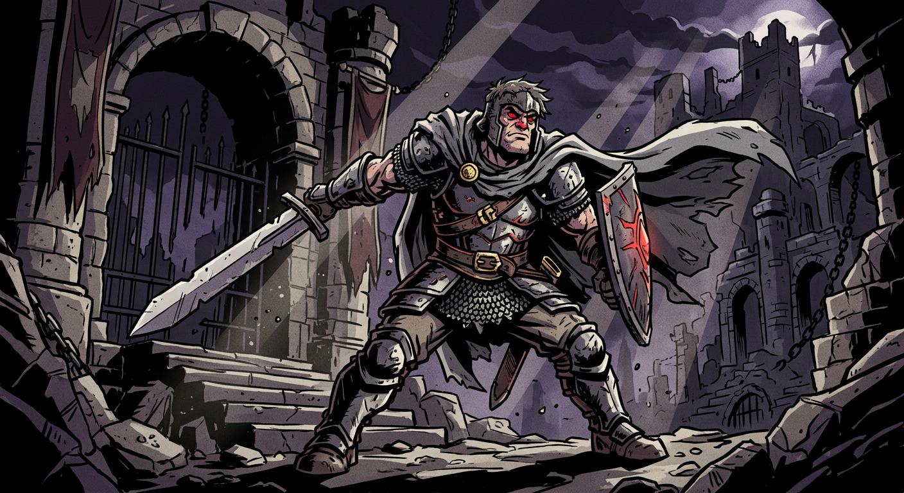

# 1. Estilo e Identidade Visual

> [← Índice](README.md) · [Próximo: 2. Paleta, Tipografia e UI →](02-paleta-tipografia-e-ui.md)

> Status: **Rascunho** · Todos os parâmetros numéricos são `[SUPOSIÇÃO]` até a primeira prancha validada.

## 1.1 A frase de estilo

> **Cartoon 2D old school com gramática de mangá dramático, num mundo de fantasia sombria que se leva a sério — até não se levar.**

Três ingredientes, nesta hierarquia de prioridade:

1. **Leitura** (jogo) — silhueta e ameaça legíveis a 64 px, sob qualquer paleta e em qualquer zoom.
2. **Atitude** (identidade) — o personagem é *dramático, bravateiro e exagerado*; a câmera e a pose vendem poder.
3. **Sucata** (tom) — ruína, ferrugem, osso, lama. O mundo está caindo aos pedaços e isso é bom.

Se uma escolha artística melhora 2 e 3 mas piora 1, **ela está errada**. `[MVP]`

## 1.2 Old school: o que isso significa em termos operacionais

"Old school" aqui **não** significa pixel art. O GDD (5.3) já descarta isso: resolução lógica 1280×720, tiles 64×64, personagem 96×128, animação 8–12 fps. O que define o estilo é a **técnica de animação e pintura**, não a resolução:

| Técnica old school | Como aparece no jogo | ID |
|---|---|---|
| **Animação limitada** (*limited animation*) | Personagens animam a 8–12 fps com *holds* de 2–4 frames na pose-chave e transições em 1–2 frames. Não interpolar tudo. | `VIS-001` |
| **Sombra chapada de 2 tons** | Cada material tem cor base + 1 sombra. Sem gradiente suave, sem *airbrush*. | `VIS-002` |
| **Traço de tinta visível** | Contorno de 2–3 px na cor de tinta, presente em todas as entidades, ausente no fundo distante. | `VIS-003` |
| **Cor por camada** | Fundo dessaturado, meio-termo com 1 acento, primeiro plano saturado. A saturação sinaliza o que é interativo. | `VIS-004` |
| **Squash & stretch manual** | Exagero desenhado à mão no impacto, nunca *tween* automático de escala. | `VIS-005` |

## 1.3 A gramática dramática (influência de mangá de ação)

O que importa da referência é **a gramática**, não o desenho. Cinco mecanismos, todos genéricos do vocabulário de quadrinhos:

### `VIS-006` Pose com atitude
Toda ação relevante tem **linha de ação clara** e antecipação exagerada.

- Ataque branco: 3 frames de *windup* com o corpo em "S" contrário ao golpe, 1 frame de contato, 2 frames de follow-through.
- Pulo: perna recolhida e tronco inclinado (não um retângulo subindo).
- Morte do jogador: não é *fade*; é queda com **pose final de 6 frames** mantida no chão, como uma vinheta.
- Idle nunca é estático: 2 frames de respiração + 1 frame ocasional de "olhada de lado" (o humor entra por aqui).

### `VIS-007` Hold dramático
Em eventos-chave, o jogo **congela a pose por 150–400 ms** antes de resolver. Isso substitui *hit-stop* genérico (fora do MVP, GDD 4.5) por um congelamento **autorado**, legível e desativável.

| Gatilho | Hold | Pode desativar |
|---|---:|---|
| Golpe pesado conectado | 90 ms | Sim (Redução de movimento) |
| Chefe entra na arena | 400 ms (com nome na tela) | Sim |
| Chefe morre | 600 ms + câmera lenta 0,3× por 800 ms | Sim |
| Jogador morre | 250 ms | Não (é feedback de regra) |

### `VIS-008` Enquadramento de impacto
A câmera é lateral e funcional (GDD 2.4), mas tem **licença dramática pontual**: zoom 1,0 → 1,15 por 400 ms em morte de chefe, e leve inclinação de 2° em golpes críticos. **Regra dura:** nenhuma licença de câmera pode ocultar ameaça ativa. Se ocultar, cancela.

### `VIS-009` Aura de ameaça
Telegraph de ataque usa **forma + cor + som**, nunca só cor. O "vento de tensão" é feito com linhas radiais de tinta (3–5 traços) e um contorno pulsante no inimigo, ambos originais.

> `[PENDENTE]` Não usar caracteres japoneses, marcas de catalogação, setas de mangá específicas ou qualquer símbolo gráfico assinatura de obra existente. A onomatopeia do jogo é **PT-BR e EN-US**, escrita por nós (ver `05-animacao-e-vfx.md`).

### `VIS-010` Onomatopeia diegética
Impactos podem gerar a palavra desenhada como VFX de tela ("PÁ!", "CRÉU!", "THUM"), com fonte própria. Elas são **redundantes** com o som, nunca o substituto — acessibilidade. Limite: 1 por impacto, máx. 3 simultâneas, desativável.

## 1.4 Anti-regras (o que reprova uma prancha automaticamente)

| # | Proibido | Motivo |
|---|---|---|
| 1 | Copiar pose, traço facial, símbolo ou personagem de obra existente | PI — `RSK-07` |
| 2 | Contorno no fundo distante | Mata profundidade e custa draw calls |
| 3 | Gradiente suave em personagem | Quebra `VIS-002` e o look old school |
| 4 | Sombra que esconde hitbox de ameaça | Viola `P2` do GDD |
| 5 | Frame interpolado "liso" em ação | Viola `VIS-001` |
| 6 | Mais de 1 acento saturado por sala | Quebra `VIS-004` e a leitura de interativo |
| 7 | Flash > 3 por segundo ou tremor de tela sem opção de desligar | Viola WCAG / GDD 4.6 |
| 8 | Texto embutido em sprite | Viola i18n (GDD 4.7) |
| 9 | Gore realista, sangue em jato, conteúdo sexual | Viola meta 12 anos (GDD 1.8) |
| 10 | Asset sem autor, ferramenta, licença e data registrados | Viola GDD 6.4 e apêndice C |

## 1.5 Escala de leitura (teste obrigatório de qualquer asset)

`[MVP]` Todo asset de entidade é aprovado só se passar nos três testes:

1. **Teste de silhueta** — preenchido de preto puro (#000) a 64 px de altura, ainda é identificável como a entidade certa.
2. **Teste de contraste** — sobre o fundo `#15131F` e sobre a pedra `#464052`, mantém separação de valor ≥ 3:1 na forma.
3. **Teste de acento** — com a cena dessaturada, o único elemento saturado é o que interage (inimigo, item, saída).

## 1.6 Paleta de valores (não de matiz)

A leitura do jogo depende de **valor**, não de cor. Definimos 5 degraus fixos; qualquer sala usa no máximo 4 deles:

| Degrau | Valor | Uso |
|---|---:|---|
| V0 — Tinta | `#0B0910` | Contorno, silhueta, profundidade extrema |
| V1 — Sombra | `#15131F` | Fundo padrão, vazio |
| V2 — Massa | `#2A2433` | Parede, chão, volume grande |
| V3 — Pedra | `#464052` | Superfície iluminada, plataforma |
| V4 — Osso | `#E6DFD2` | Destaque, luz, texto |

O acento de setor (`PAL-###`) é aplicado **somente** em elementos de V3/V4.

## 1.7 Convenção de nomenclatura e pastas (complementa GDD 5.6)

```
public/assets/
  images/    spr_<entidade>_<ação>_<variante>.png
  atlases/   atl_<agrupamento>.png + atl_<agrupamento>.json
  audio/     sfx_<gatilho>.ogg · bgm_<setor>.ogg
  tilemaps/  tm_lvl01_ruinas.tmj
  fonts/     fnt_<família>.woff2
  ui/        ui_<tela>_<elemento>.svg
```

Atlas-alvo de 2048×2048 (GDD 5.3). Fonte editável (`.aseprite`, `.kra`, `.psd`) **fora** do bundle, em repositório de arte separado ou em `art-source/` no `.gitignore`.

## 1.8 Pipeline de arte `[PENDENTE]`

Antes do vertical slice é preciso **uma** decisão travada — hoje é o maior buraco de produção (ver análise: 0 h de arte no backlog).

| Etapa | Ferramenta candidata | Precisa decidir |
|---|---|---|
| Desenho/animação | Ferramenta de sprite + edição vetorial | qual, e quem opera |
| Geração assistida por IA | — | termos de uso comercial + registro por asset |
| Empacotamento de atlas | *packer* da engine ou externo | margem de 2 px, rotação desligada |
| Tilemap | Tiled (`.tmj`) | já decidido no GDD 3.5 |
| Versionamento de fonte | `art-source/` | dentro ou fora do repo |

`[RISCO]` Animar ~120 frames (AST-001–008) sem pipeline travada = retrabalho garantido. Travar **antes** de `BKL-012`.

## 1.9 Prancha de estilo



*Prancha de referência gerada como direção, não como asset final. Uso: calibração de tom, contraste e atitude. Não usar em build.*

---

[← Índice](README.md) · [Próximo: 2. Paleta, Tipografia e UI →](02-paleta-tipografia-e-ui.md)
