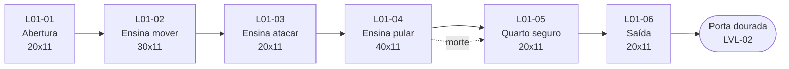

# LVL-01 — Ruínas da Vigília

> Setor 1 de 16 · **`[MVP]`** · Ato I — O Turno
> Versão: `0.1.0` · Data: `2026-11-13` · Autor: `AGT-02` (Designer de Level)
> Base: [GDD 3.4–3.5](../03-conteudo-do-jogo.md) · [Setores e Cenários §4.5](../design-patterns/04-setores-e-cenarios.md) · [Padrões de Level Design](../design-patterns/07-padroes-de-level-design.md)

**Status deste documento:** layout fechado, pronto para virar `.tmj` no Tiled. Fecha a pendência `P-17`.

---

## 1. Os 12 campos obrigatórios

| # | Campo | Definição |
|---|---|---|
| 1 | **ID e nome canônico** | `LVL-01` — Ruínas da Vigília |
| 2 | **Objetivo** | Aprender os controles e chegar ao quarto seguro antes de seguir para LVL-02. |
| 3 | **Duração e mortes** | 3–5 min na primeira visita · **0 mortes esperadas** (1 aceitável) |
| 4 | **Acento e materiais** | `PAL-01` dourado-poeira `#F2C66D` · pedra clara, pano rasgado, poeira |
| 5 | **Sinais de ambientação** | `LOR` §3.7 → sinete da Vigília (1) · vela acesa sem ninguém (2) · marco de pedra (variação de 3) |
| 6 | **Habilidade de entrada / saída** | Entrada: nenhuma. Saída: nenhuma. **Salto duplo NÃO existe aqui** — é obtido em LVL-02 |
| 7 | **Salas** | 6 salas: 20×11 · 30×11 · 20×11 · 40×11 · 20×11 · 20×11 |
| 8 | **O que ensina** | `MEC-001` mover/pular · `MEC-002` atacar · `MEC-004` bolsa (só leitura) · `MEC-007` salvar |
| 9 | **Set pieces** | `CEN-001` espinhos · `CEN-002` vela · `CEN-003` sinete · `CEN-004` caixa de carga |
| 10 | **Inimigos** | `ENT-002` Sentinela distorcida × 3 (1 em L01-03, 2 em L01-04) |
| 11 | **Entradas e saídas** | L01-01 → L01-02 → L01-03 → L01-04 → L01-05 → L01-06 → **porta dourada** para LVL-02. Sem ramificações, sem travas |
| 12 | **Teste de rastreabilidade** | `TST-013` (percurso completo, inventário vazio) · `TST-001` (salto) · `TST-002` (combate) · `TST-014` (touch) · `TST-007` (save em L01-05) |

### Propriedades de design deste setor

- **Escopo de tutorial.** Não introduz nenhuma mecânica de perigo irreversível. A única fonte de dano (`CEN-001`) é evitável andando.
- **Config-agnóstico.** Foi validado nas duas configurações de salto que estavam em disputa — e a decisão `P-15` caiu na **B** (`DEC-014`). **Nenhum obstáculo exige salto duplo** — ver §7.
- **Sem soft lock.** Todas as quedas são reversíveis por degraus de 1 tile (`PAT-LD-06`).
- **Sem ramificação.** A primeira decisão de rota do jogo acontece em LVL-02, não aqui.

---

## 2. Fluxo das salas



| Transição | Elevação | Tipo | Trava |
|---|---|---|---|
| L01-01 → L01-02 | linhas 4–6 | abertura de arco | — |
| L01-02 → L01-03 | linhas 4–6 | abertura de arco | — |
| L01-03 → L01-04 | linhas 4–6 | abertura de arco | — |
| L01-04 → L01-05 | linhas 4–6 | abertura de arco | — |
| L01-05 → L01-06 | linhas 4–6 | abertura de arco | — |
| L01-06 → LVL-02 | linhas 4–6 | **porta dourada** (`D`) | — |

**Convenção:** toda abertura de passagem tem **3 tiles de altura** (linhas 4–6). O topo do piso está na linha 7 em todas as salas. Isso elimina a classe de bug "o jogador chega na porta mas a altura não bate".

---

## 3. Legenda das grades

| Símbolo | Camada | Significado |
|---|---|---|
| `#` | `ground` + `collision` | sólido |
| `=` | `collision` (só topo) | plataforma atravessável *(one-way)* |
| `+` | — | abertura de passagem na parede |
| `.` | — | ar |
| `S` | `objects` | spawn do jogador (`ENT-001`) |
| `E` | `objects` | Sentinela distorcida (`ENT-002`) |
| `A` | `objects` | espinhos (`CEN-001`) |
| `P` | `objects` | ponto de salvamento (quarto seguro) |
| `D` | `objects` | porta dourada de saída de área |
| `k` | `decor` | caixa de carga (`CEN-004`, sem colisão) |
| `c` | `decor` | vela da Vigília (`CEN-002`) |
| `G` | `decor` | sinete da Vigília (`CEN-003`, na parede) |
| `N` | `objects` | marco de pedra / inscrição (lore) |
| `Q` | `objects` | quadro de aviso do quarto seguro |

Coordenadas: `x` cresce para a direita, `y` para baixo, `y0` é o teto. Âncora de todo objeto = **célula inferior esquerda**.

---

## 4. Salas

### 4.1 L01-01 — Abertura silenciosa · 20×11

```
    00000000001111111111
    01234567890123456789
y0  ####################
y1  #..................#
y2  #..................#
y3  #.............G....#
y4  #..................+
y5  #..................+
y6  #S...N...c.........+
y7  ####################
y8  ####################
y9  ####################
y10 ####################
```

| Objeto | Pos | Função |
|---|---|---|
| `S` spawn | (1,6) | jogador nasce aqui, virado para a direita |
| `N` marco | (5,6) | `LOR` — "TURNO 1 · NÃO ABANDONE O POSTO" |
| `c` vela | (9,6) | `CEN-002`, decoração animada |
| `G` sinete | (14,3) | `CEN-003`, marca de facção na parede |

- **Função:** abertura sem estímulo. **256 px** de cenário puro antes do primeiro objeto de leitura.
- **Ensina:** nada. É a respiração antes do tutorial.
- **Aceite:** o jogador atravessa em ≤ 8 s sem apertar nenhum botão além de andar.

---

### 4.2 L01-02 — Ensina mover · 30×11

```
    000000000011111111112222222222
    012345678901234567890123456789
y0  ##############################
y1  #............................#
y2  #............................#
y3  #.........................N..#
y4  +.........................==.+
y5  +......................==....+
y6  +....k.k............==.......+
y7  ###########.......############
y8  ###########......#############
y9  ##############################
y10 ##############################
```

| Elemento | Posição | Função |
|---|---|---|
| caixas `k` | (5,6) e (7,6) | `CEN-004` — decor interativo leve, ensina que o cenário reage |
| **bacia** | x = 11–16 | descida de **2 tiles**, piso em y=9 |
| degrau de saída | x = 17, topo y=8 | 1º dos dois degraus de 1 tile |
| piso de retorno | x = 18+, topo y=7 | 2º degrau — **queda reversível** |
| escada de prática | `=` em (20–21,6), (23–24,5), (26–27,4) | 3 degraus de 1 tile, 3 vãos de 1 tile |
| marco `N` | (26,3) | no topo da escada — recompensa de leitura |

- **Função:** ensinar a andar, cair e subir — sem consequência.
- **Ensina:** `MEC-001` nos tempos **1 (introduzir)** e **2 (praticar)** do `PAT-LD-02`.
- **Aceite:** o jogador entra na bacia, sai dela e sobe a escada sem morrer. A escada é **opcional** — isso é correto: prática não pode ser obrigatória.
- **Nota de design:** a bacia tem 2 tiles de profundidade porque a saída é feita em **dois degraus de 1 tile**. Se fosse um poço de parede reta, seria armadilha na config A (`P-15`).

---

### 4.3 L01-03 — Ensina atacar · 20×11

```
    00000000001111111111
    01234567890123456789
y0  ####################
y1  #..................#
y2  #..................#
y3  #................G.#
y4  +..................+
y5  +.........E........+
y6  +........####......+
y7  ####################
y8  ####################
y9  ####################
y10 ####################
```

| Objeto | Pos | Função |
|---|---|---|
| pedestal | x = 9–12, topo y=6 | obstáculo de 1 tile no caminho |
| `E` Sentinela | (10,5) | **de costas** para a entrada, patrulha 3 tiles sobre o pedestal |
| `G` sinete | (17,3) | marca de facção |

- **Função:** primeiro combate, em condição controlada.
- **Ensina:** `MEC-002` no tempo **1 (introduzir)**. O inimigo está virado para o outro lado: o jogador tem a iniciativa e vê o telegraph antes de ser atacado.
- **Aceite:** o jogador derrota o Sentinela (vida 20 / dano branco 20 = **1 golpe**, `TST-002`) **ou** o contorna subindo no pedestal sem ser atingido.
- **Nota:** o pedestal de 1 tile obriga um pulo. É o único pulo obrigatório antes de L01-04.

---

### 4.4 L01-04 — Ensina pular + combate · 40×11

```
    0000000000111111111122222222223333333333
    0123456789012345678901234567890123456789
y0  ########################################
y1  #......................................#
y2  #......................................#
y3  #..................................G...#
y4  +......................................+
y5  +......................................+
y6  +.......###..E....AA..........E........+
y7  ########################################
y8  ########################################
y9  ########################################
y10 ########################################
```

| Objeto | Pos | Função |
|---|---|---|
| degrau | x = 8–10, topo y=6 | salto obrigatório de 1 tile |
| `E` Sentinela | (13,6) | combate após o degrau — **combinação** |
| espinhos `A` | (18,6) e (19,6) | `CEN-001`, vão de **2 tiles** |
| `E` Sentinela | (30,6) | combate após os espinhos |
| `G` sinete | (35,3) | marca de facção |

- **Função:** teste do setor. Combina degrau + inimigo + armadilha.
- **Ensina:** `MEC-001` e `MEC-002` no tempo **4 (testar)**.
- **Densidade:** 2 inimigos + 1 armadilha = teto do MVP (`PAT-LD-10`).
- **Aceite:** `TST-013` — o jogador atravessa sem morrer e sem ficar preso.
- **Nota:** o vão de espinhos tem **2 tiles (128 px)**, não 2,5 tiles. O dimensionamento nasceu da config A (alcance 176 px; 2,5 tiles deixaria 16 px de margem, ambíguo — `PAT-LD-09`). Com a config **B** (`DEC-014`) o alcance andando é 224 px e o vão continua confortável: a escolha é conservadora, não obsoleta.

---

### 4.5 L01-05 — Quarto seguro · 20×11

```
    00000000001111111111
    01234567890123456789
y0  ####################
y1  #..................#
y2  #..................#
y3  #............Q..G..#
y4  +..................+
y5  +..................+
y6  +..c.....P.........+
y7  ####################
y8  ####################
y9  ####################
y10 ####################
```

| Objeto | Pos | Função |
|---|---|---|
| `c` vela | (3,6) | `CEN-002` |
| `P` salvamento | (9,6) | `MEC-007` — salvar por interação (`UI-09`) |
| `Q` quadro de aviso | (13,3) | `LOR` — 2–3 linhas sobre a Vigília vazia (≤ 90 palavras) |
| `G` sinete | (16,3) | marca de facção |

- **Função:** checkpoint manual e primeira entrega de lore do jogo.
- **Ensina:** `MEC-007` — salvar. O jogador **pode** ignorar; a porta de L01-06 salva automaticamente.
- **Aceite:** `TST-007` — interagir salva; erro de conexão mostra `UI-11` e permite retry sem perder a posição.
- **Nota:** sem inimigos, sem armadilha (`PAT-LD-04`, respiro).

---

### 4.6 L01-06 — Saída · 20×11

```
    00000000001111111111
    01234567890123456789
y0  ####################
y1  #..................#
y2  #..................#
y3  #..........G.......#
y4  +..................D
y5  +..................D
y6  +.....N........c...D
y7  ####################
y8  ####################
y9  ####################
y10 ####################
```

| Objeto | Pos | Função |
|---|---|---|
| `N` marco | (6,6) | `LOR` — aviso de saída da área |
| `c` vela | (15,6) | `CEN-002` |
| `G` sinete | (11,3) | marca de facção |
| `D` porta dourada | (19, 4–6) | transição para LVL-02 + **save automático** |

- **Função:** saída e checkpoint automático de transição.
- **Aceite:** cruzar a porta dispara `MEC-007` e carrega LVL-02. `TST-007` verde.

---

## 5. Set pieces (`CEN-###`)

| ID | Nome | Comportamento | Frames | Dano | Desativável |
|---|---|---|---|---:|---|
| `CEN-001` | Espinhos de ferro | ciclo ativo/inativo de 1,2 s; telegraph por brilho `--threat` 300 ms antes de ativar | 4 | 20 HP | Não (é regra) |
| `CEN-002` | Vela da Vigília | chama animada, 6 partículas, apaga e reacende quando o jogador passa | 3 | 0 | Sim |
| `CEN-003` | Sinete da Vigília | marca pintada na parede, sempre em `y=3`, mesma posição relativa em todos os setores | 1 | 0 | Sim |
| `CEN-004` | Caixa de carga | decor com colisão leve; pode ser empurrada 1 tile; nunca bloqueia passagem | 2 | 0 | Não |

> `[MVP]` Neste setor `CEN-001` está **desativado** (sempre visível, sempre causando dano) para não introduzir ritmo de armadilha antes de o jogador saber pular. A versão cíclica entra em LVL-02.

---

## 6. Entidades e ensino

| Entidade | Qtd | Onde | Estado inicial | Vida | Dano |
|---|---:|---|---|---:|---:|
| `ENT-001` Homem Macho | 1 | L01-01 (1,6) | `idle` | 100 | 20 / 10 |
| `ENT-002` Sentinela | 1 | L01-03 (10,5) | patrulhando **de costas** | 20 | 20 |
| `ENT-002` Sentinela | 2 | L01-04 (13,6) e (30,6) | patrulhando | 20 | 20 |

### Sequência de ensino (`PAT-LD-02`)

| Momento | Sala | Mecânica | Tempo |
|---|---|---|---|
| t = 0–20 s | L01-01, L01-02 | andar | **1 introduzir** |
| t = 20–60 s | L01-02 | cair / subir degrau | **1 introduzir** |
| t = 60–90 s | L01-02 (escada) | pular | **2 praticar** |
| t = 90–120 s | L01-03 | atacar | **1 introduzir** |
| t = 120–180 s | L01-04 | pular + combate + armadilha | **4 testar** |
| t = 180–240 s | L01-05 | salvar | **1 introduzir** |

**Meta do GDD 2.9:** mover, pular e atacar compreendidos em **≤ 90 s**. Este layout entrega atacar por volta de 90 s — está no limite. Se o playtest mostrar atraso, a correção é **encurtar L01-02** (remover a escada) e **não** antecipar o inimigo.

---

## 7. Validação de alcançabilidade

Calculada a partir de `02-gameplay.md` §2.11 (`[SUPOSIÇÃO]`) e conferida contra as duas configurações que estavam em disputa — a canônica hoje é a **B** (`DEC-014`).

| Config | Impulso | Gravidade | Altura 1 salto | Altura 2 saltos | Vão horizontal |
|---|---:|---:|---:|---:|---:|
| **A** (GDD atual) | 480 | 1.200 | 96 px (1,5 tile) | 192 px | 176 px (2,75 tiles) |
| **B** (recomendada) | 560 | 1.100 | 142 px (2,2 tiles) | 284 px | 226 px (3,5 tiles) |

| Obstáculo | Tipo | Subida | Vão | Config A | Config B |
|---|---|---:|---:|---|---|
| L01-02 · bacia: descida de 2 tiles | descida | 128 px | 0 px | OK | OK |
| L01-02 · saída da bacia: degrau x=17 | subida | 64 px | 64 px | OK | OK |
| L01-02 · escada: plataforma y=6 | subida | 64 px | 0 px | OK | OK |
| L01-02 · escada: y=6 → y=5 | subida | 64 px | 64 px | OK | OK |
| L01-02 · escada: y=5 → y=4 | subida | 64 px | 64 px | OK | OK |
| L01-03 · pedestal do Sentinela | subida | 64 px | 0 px | OK | OK |
| L01-04 · degrau de 1 tile | subida | 64 px | 0 px | OK | OK |
| L01-04 · vão de espinhos | vão | 0 px | 128 px | OK | OK |

**Resultado: 0 falhas.** LVL-01 é completável nas configs A e B e **não** depende de `HAB-01` (salto duplo). Este setor foi desenhado para ser config-agnóstico (`DEC-008`) — e essa propriedade se mantém útil depois de `P-15`: com a config **B** adotada (`DEC-014`), todas as folgas de LVL-01 ficaram **maiores**, nunca menores.

---

## 8. Salvamento e morte

| Evento | O que acontece | Regra |
|---|---|---|
| Interagir com `P` em L01-05 | salva | `MEC-007` |
| Cruzar `D` em L01-06 | salva automaticamente | `MEC-007` |
| Morrer em L01-04 | respawn no último checkpoint confirmado | `MEC-004` |
| Morrer com bolsa | bolsa fica no local; nova morte destrói a anterior | `MEC-004`, `TST-004` |
| Perda de conexão durante save | `UI-11`, operação pausada, retry | `PAT-C-07` |

Este setor **não** cria checkpoint em transição interna (L01-02 → L01-03 etc.). Só `P` e `D` salvam — coerente com `PAT-LD-05`.

---

## 9. Conversão para Tiled (`.tmj`)

| Item | Definição |
|---|---|
| Nome do arquivo | `public/assets/tilemaps/tm_lvl01_ruinas.tmj` |
| Tileset | `tm_ruinas` (`AST-004`), 24 tiles, 64×64 |
| Orientação | orthogonal, tile 64×64, 20–40 colunas × 11 linhas por sala |
| Camadas (ordem) | `decor-back` · `ground` · `collision` · `objects` · `decor-front` |
| `collision` | retângulos desenhados sobre o `ground`, **nunca** desalinhados |
| Propriedades do mapa | `lvl_id=LVL-01`, `pal=PAL-01`, `bgm=BGM-01`, `amb=AMB-01` |

### Propriedades dos objetos (camada `objects`)

| Tipo | Propriedades |
|---|---|
| `player_spawn` | `facing` = `right` |
| `enemy` | `ent=ENT-002`, `patrol_tiles`=3, `initial_facing`=`left` (L01-03) / `right`, `has_telegraph`=true |
| `trap_spikes` | `cen=CEN-001`, `mode`=`static` (`[MVP]`), `damage_key`=`spikes` |
| `save_point` | `ui=UI-09`, `checkpoint`=true |
| `door` | `to=LVL-02`, `style`=`gold`, `autosave`=true |
| `lore_marker` | `key`=`lore.lvl01.post`, `max_words`=25 |
| `lore_board` | `key`=`lore.lvl01.board`, `max_words`=90 |
| `decor` | `ast=CEN-002` / `CEN-003` / `CEN-004`, `collides`=false |

**Regra de ouro da conversão:** nenhum número de gameplay no `.tmj`. Dano, vida e tempos vêm de `src/game/data/tuning.ts` (`PAT-C-04`). O mapa aponta a **chave**, não o valor.

---

## 10. Checklist de aprovação (`07-padroes` §7.14)

- [x] Dimensões múltiplas de 20×11 — 20, 30, 20, 40, 20, 20 × 11
- [x] Objetivo de cada sala compreensível em ≤ 3 s
- [x] Respeita a tabela de alcance (§7) — 0 falhas em A e B (config canônica: **B**, `DEC-014`)
- [x] Ensino segue `PAT-LD-02` nos 4 tempos
- [x] Sem travas de habilidade neste setor (nenhuma necessária)
- [x] Rota crítica funciona com inventário vazio (`PAT-LD-06`)
- [x] Densidade de inimigos conforme `PAT-LD-10` (máx. 2 + 1 armadilha)
- [x] `collision` alinhada ao `ground` (validado pelo gerador de grade)
- [x] Nenhuma ameaça fora da tela — a sala mais larga (40 tiles) mantém a ameaça visível ao entrar
- [x] Paleta com um único acento (`PAL-01`)
- [x] Testes associados: `TST-001`, `TST-002`, `TST-004`, `TST-007`, `TST-013`, `TST-014`

---

## 11. Desvios registrados

| # | O que mudou | Por quê | IDs afetados |
|---|---|---|---|
| 1 | Vão de espinhos de **2,5 tiles → 2 tiles** | Na config A o alcance era 176 px; 2,5 tiles (160 px) deixaria 16 px de margem. A é hoje descartada (`DEC-014`), mas o vão de 2 tiles continua correto: é o valor que também funciona andando na config B | `04-setores` §4.5, `PAT-LD-09` |
| 2 | Aberturas passam a ter **3 tiles de altura (linhas 4–6)**, com piso sempre na linha 7 | Elimina a classe de bug "porta em altura incompatível" entre salas | `DEC-007` |
| 3 | `CEN-001` entra **estático** neste setor | Ritmo de armadilha antes de o jogador saber pular seria injusto | `05-animacao` §5.3 |
| 4 | A escada de L01-02 é **opcional** | `PAT-LD-02` define "praticar" como repetição sem consequência; obrigar prática contradiz o padrão | — |

## 12. Pendências geradas

| ID | Item | Bloqueia |
|---|---|---|
| — | Nenhuma. O layout está fechado. | — |

Dependências externas: `P-15` **fechada** (`DEC-014 = B`; era irrelevante aqui de todo modo, ver §7). Ainda aberta: `P-16` (pipeline de arte, para `AST-004`).

---

## Handoff

**Para `AGT-01`** — produzir `AST-004` (tiles de ruína, 24 frames) e os set pieces `CEN-001`–`004`.
**Para `AGT-03`** — spawns, patrulha do `ENT-002`, `CEN-001` estático, `P` e `D` com autosave.

**O próximo agente precisa saber, em 3 linhas:**
1. Piso sempre em `y=7`, aberturas em `y=4–6`, nada de obstáculo acima de 1 tile neste setor.
2. `CEN-001` aqui é estático e não cíclico; o ciclo só existe a partir de LVL-02.
3. O `.tmj` guarda chaves, nunca valores — dano e tempos vivem em `tuning.ts`.
