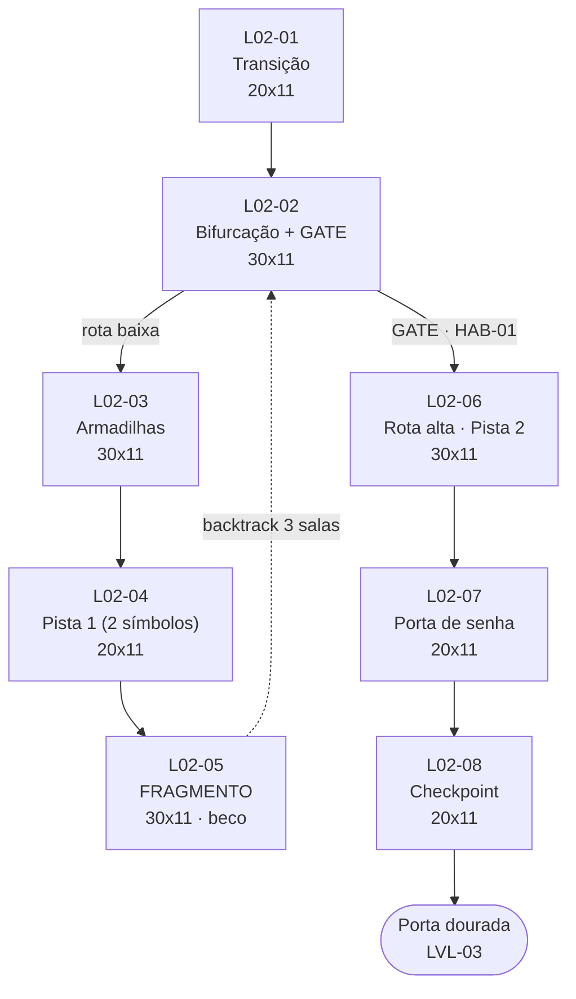

# LVL-02 — Galeria Partida

> Setor 2 de 16 · **`[MVP]`** · Ato I — O Turno
> Versão: `0.1.0` · Data: `2026-11-13` · Autor: `AGT-02` (Designer de Level)
> Base: [GDD 3.4–3.5](../03-conteudo-do-jogo.md) · [Setores e Cenários §4.6](../design-patterns/04-setores-e-cenarios.md) · [Padrões de Level Design](../design-patterns/07-padroes-de-level-design.md)

> ✅ **Este setor forçou a decisão `P-15` — e ela está fechada:** config **B** (impulso 560 / gravidade 1100), `DEC-014`. O gate de 3 tiles foi desenhado em cima dela e passa com **84 px** de folga medidos a 60 Hz. A §3 preserva o raciocínio que levou à decisão.

**Status:** layout fechado, pronto para `.tmj`. A config de salto está decidida (`P-15` → `DEC-014 = B`), então nenhum campo deste documento está bloqueado.

---

## 1. Os 12 campos obrigatórios

| # | Campo | Definição |
|---|---|---|
| 1 | **ID e nome canônico** | `LVL-02` — Galeria Partida |
| 2 | **Objetivo** | Encontrar o **fragmento de salto duplo** (`ITM-003`), reunir os **4 símbolos** da senha e abrir a porta para LVL-03. |
| 3 | **Duração e mortes** | 4–6 min na primeira visita (até 9 min com backtracking) · **1–3 mortes esperadas** |
| 4 | **Acento e materiais** | `PAL-02` água estagnada `#7FD3C0` · pedra interna, vitral quebrado, água rasa refletiva |
| 5 | **Sinais de ambientação** | `LOR` §3.7 → objeto de trabalho abandonado no meio da tarefa (3) · vitral partido · sinete da Vigília |
| 6 | **Habilidade de entrada / saída** | Entrada: nenhuma. **Saída: `HAB-01` salto duplo** — obtido dentro do setor |
| 7 | **Salas** | 8 salas: 20 · 30 · 30 · 20 · 30 · 30 · 20 · 20 (× 11) = 200 tiles de largura |
| 8 | **O que ensina** | `MEC-005` habilidade permanente · `MEC-006` pista, senha e porta · `MEC-001` salto duplo |
| 9 | **Set pieces** | `CEN-001` espinhos **cíclicos** · `CEN-002` vela · `CEN-003` sinete · `CEN-010` vitral partido · `CEN-011` água rasa · `CEN-012` painel de símbolos · `CEN-013` grade da galeria |
| 10 | **Inimigos** | `ENT-002` Sentinela × 3 (L02-03 × 1, L02-05 × 1) — ver §7 |
| 11 | **Entradas e saídas** | L02-01 ← LVL-01 · L02-08 → LVL-03 (porta dourada). Estrutura em **laço com backtracking obrigatório** |
| 12 | **Teste de rastreabilidade** | `TST-005` (habilidade sobrevive à morte) · `TST-006` (senha) · `TST-013` (percurso) · `TST-001` (salto duplo) · `TST-004` (bolsa) |

### Propriedades de design deste setor

- **Primeira habilidade do jogo.** `MEC-005` exige que `HAB-01` seja permanente e nunca caia na morte. Isso é testado por `TST-005` e é o teste mais importante do setor.
- **Primeira bifurcação real.** O jogador vê uma saída que não consegue usar (`PAT-LD-03`).
- **Laço, não linha.** O jogador atravessa o setor duas vezes. O backtracking é de **3 salas (~22 s)**, dentro do tolerável.
- **Recusa de soft lock.** Nenhuma queda causa dano; vãos de L02-06 devolvem à entrada da sala.

---

## 2. Topologia e fluxo



| Sala | Tipo de acesso | Elevação | Trava |
|---|---|---|---|
| L02-01 | esquerda | linhas 4–6 | — |
| L02-02 | esquerda · direita · **teto → L02-06** | 4–6 · 4–6 · linha 0 | **teto exige `HAB-01`** |
| L02-03 | esquerda · direita | 4–6 | — |
| L02-04 | esquerda · direita | 4–6 | — |
| L02-05 | esquerda apenas (beco) | 4–6 | — |
| L02-06 | **furo no piso** (x=2–3) · direita | 7–10 · 4–6 | só alcançável pelo gate |
| L02-07 | esquerda · direita | 4–6 · 4–6 | direita = **porta de senha** `MEC-006` |
| L02-08 | esquerda · porta dourada | 4–6 | — |

### O laço, em ordem de jogo

1. **L02-01** → entra, sem perigo.
2. **L02-02** → vê a plataforma a 3 tiles com a fenda no teto. **Não alcança.** Segue pela direita.
3. **L02-03** → armadilhas cíclicas + 1 Sentinela (ensina tempo).
4. **L02-04** → 1ª metade da senha + **grade que mostra a porta de senha ao longe** (`PAT-LD-03`).
5. **L02-05** → beco: **fragmento de salto duplo**. Momento de revelação.
6. **Backtrack** → L02-05 → L02-04 → L02-03 → L02-02 (~22 s).
7. **L02-02** → agora sobe na plataforma e atravessa a fenda do teto.
8. **L02-06** → rota alta, 3 vãos de 4 tiles, 2ª metade da senha.
9. **L02-07** → porta de senha (`MEC-006`).
10. **L02-08** → checkpoint e saída.

---

## 3. ⚠️ `P-15` — por que este setor forçou a decisão de configuração de salto

Este é o primeiro setor que precisa de um gate de salto duplo. Rodei um solver de trajetória com os parâmetros `[SUPOSIÇÃO]` do GDD §2.11 e a velocidade de corrida de 1,4× (`MEC-001`). Três resultados que mudam o design:

### 3.1 A corrida quebra gates horizontais

| Gate | Config | Andando | Correndo | Veredito |
|---|---|---|---|---|
| vão de 4 tiles, plano | A | 1 salto falha (alt −254 px) | 1 salto falha (−16 px) | gate OK, mas com **16 px** de margem |
| vão de 4 tiles, plano | B | 1 salto falha (−93 px) | **1 salto PASSA** (alt +85 px) | **quebra o gate** |

Em config B, um jogador correndo atravessa um vão de 4 tiles **sem** salto duplo. Qualquer gate horizontal fica inválido.

### 3.2 A config A não sustenta gate vertical com folga

> Tabela na **forma fechada** (`v²/2g`), como foi calculada na época. Os valores finais, integrados a 60 Hz, estão no parágrafo seguinte e em [`../decisoes/P-15-tuning-de-movimento.md`](../decisoes/P-15-tuning-de-movimento.md).

| Config | Altura 1 salto | Altura 2 saltos | Gate vertical viável | Margem |
|---|---:|---:|---|---:|
| **A** | 96 px (1,5 tile) | **192 px (3,0 tiles)** | 2 tiles | 64 px — mas 2 tiles é **pulado por B com 1 salto** |
| **B** | 143 px (2,2 tiles) | **285 px (4,5 tiles)** | **3 tiles** | **93 px** ✓ (84 px reais a 60 Hz) |

Na config A, a forma fechada diz que o salto duplo mede *exatamente* 3 tiles — margem zero. Pior: integrado em passo fixo (como o jogo roda), A chega a apenas **184 px a 60 Hz**, ou seja **falha por 8 px**, e falha mais ainda em hardware fraco. Na config B, o mesmo gate tem **84 px** de folga a 60 Hz (91 px a 240 Hz).

### 3.3 A conclusão

> **O único gate ao mesmo tempo (a) imune à corrida e (b) com folga real é o gate vertical de 3 tiles, e ele só é confiável na configuração B.**

Este setor foi desenhado com esse gate, e a recomendação dele — **`P-15 = B`** (impulso 560 / gravidade 1100) — foi a adotada. O caminho alternativo continua registrado porque explica por que A nunca foi viável: com A o gate teria de cair para 2 tiles, e então B o pularia com um salto simples, tornando o layout dependente de configuração (`DEC-008`).

**Decidido em 2026-11-13:** o proprietário adotou **`P-15 = B`**, registrado como `DEC-014`. A medição por simulação de passo fixo confirmou a recomendação deste setor e acrescentou a evidência mais forte: em A o gate é inalcançável em **todas** as taxas de quadros (240/120/60/30 Hz). Ver [`../decisoes/P-15-tuning-de-movimento.md`](../decisoes/P-15-tuning-de-movimento.md).

---

## 4. Legenda das grades

| Símbolo | Camada | Significado |
|---|---|---|
| `#` | `ground` + `collision` | sólido |
| `=` | `collision` (só topo) | plataforma atravessável *(one-way)* — **o gate** |
| `+` | — | abertura de passagem |
| `.` | — | ar |
| `S` | `objects` | spawn (só onde indicado no texto) |
| `E` | `objects` | Sentinela (`ENT-002`) |
| `A` | `objects` | espinhos **cíclicos** (`CEN-001`) |
| `F` | `objects` | **fragmento de salto duplo** (`ITM-003`) |
| `P` | `objects` | ponto de salvamento |
| `D` | `objects` | porta dourada (saída de área) |
| `Y` | `objects` | **porta de senha** (`MEC-006`) |
| `R` | `decor` | grade da galeria (`CEN-013`) — vê-se a porta ao longe |
| `N` | `objects` | inscrição / pista de símbolo |
| `G` | `decor` | sinete da Vigília (`CEN-003`) |
| `c` | `decor` | vela (`CEN-002`) |
| `k` | `decor` | objeto de trabalho abandonado |

Piso em `y=7` e aberturas em `y=4–6` seguem `DEC-007`.

---

## 5. Salas

### 5.1 L02-01 — Transição · 20×11

```
    00000000001111111111
    01234567890123456789
y0  ####################
y1  #..................#
y2  #..................#
y3  #..................#
y4  +..................+
y5  +..................+
y6  +.....c.....N......+
y7  ####################
y8  ####################
y9  ####################
y10 ####################
```

| Objeto | Pos | Função |
|---|---|---|
| spawn | (2,6) | vindo de LVL-01 |
| `c` vela | (6,6) | `CEN-002` |
| `N` inscrição | (12,6) | `LOR` — "GALERIA 2 · ACESSO INTERDITO" (≤ 25 palavras) |

- **Função:** respiro e leitura de ambiente. Vitral partido ao fundo (`CEN-010`), luz `PAL-02`.
- **Ensina:** nada. Sem inimigo, sem armadilha (`PAT-LD-04`).

---

### 5.2 L02-02 — Bifurcação + **o gate** · 30×11

```
    000000000011111111112222222222
    012345678901234567890123456789
y0  ########################++####
y1  #............................#
y2  #............................#
y3  #...........G................#
y4  +.....................====...+
y5  +............................+
y6  +.......c....................+
y7  ##############################
y8  ##############################
y9  ##############################
y10 ##############################
```

| Elemento | Posição | Função |
|---|---|---|
| **plataforma do gate** | `=` em `y=4`, x = 22–25 | **3 tiles acima do piso** — inalcançável sem `HAB-01` |
| **fenda no teto** | `+` em `y=0`, x = 24–25 | passagem para L02-06 — **destino declarado** (`DEC-043`) |
| marcador dourado | borda da plataforma | `PAT-LD-09` — desambigua a altura |
| `c` vela | (8,6) | `CEN-002` |
| `G` sinete | (12,3) | `CEN-003` |

- **Função:** a bifurcação. À direita, o caminho possível. Acima, o caminho impossível **e visível**.
- **Ensina:** `PAT-LD-03` nas 3 exposições — o jogador vê a plataforma, vê a fenda acima dela, e reconhece a solução ao receber `ITM-003` (notificação `MEC-005` no momento da coleta, não aqui).
- **Gate:** subida de **3 tiles (192 px)**. Sem `HAB-01`: falha em qualquer config e correndo. Com `HAB-01`: passa com **84 px** de margem a 60 Hz na config canônica B (`DEC-014`).
- **Aceite:** sem `HAB-01`, o jogador **não** consegue subir (testado em jogo). Com `HAB-01`, sobe e atravessa a fenda em ≤ 2 tentativas.
- **Nota:** a plataforma é *one-way*, então não bloqueia o corredor de baixo — o jogador atravessa por baixo dela para chegar a L02-03.
- **`DEC-043` (a fenda tem destino próprio):** esta é a **única** fenda do jogo cujo destino não é «a sala seguinte» (`DEC-015`) — é a **rota alta**, L02-06 (índice 5). Sem essa declaração o motor mandava o jogador para L02-03, a sala que ele acabou de atravessar por baixo: o bug que o jogador encontrou em jogo e que o mapa (`UI-15`) tornou visível à primeira vista. A sala declara-o na ficha (`hatches: [{ from: 24, to: 25, destRoom: 5 }]`), e há dois testes a prendê-lo — `lvl02.test.ts` e `mapa.test.ts`.

---

### 5.3 L02-03 — Armadilhas · 30×11

```
    000000000011111111112222222222
    012345678901234567890123456789
y0  ##############################
y1  #............................#
y2  #............................#
y3  #............................#
y4  +............................+
y5  +............................+
y6  +..c......AA......AA....E....+
y7  ##############################
y8  ##############################
y9  ##############################
y10 ##############################
```

| Objeto | Pos | Função |
|---|---|---|
| `c` vela | (3,6) | `CEN-002` |
| `A` espinhos | (10,6) · (11,6) | `CEN-001` ciclo 1,2 s — **1º par** |
| `A` espinhos | (18,6) · (19,6) | `CEN-001` — **2º par**, ciclo defasado em 0,6 s |
| `E` Sentinela | (24,6) | patrulha 3 tiles, virada para a esquerda |

- **Função:** ensinar **tempo** (o que L01 não fez).
- **Ensina:** `MEC-006` no tempo 2 (praticar) para armadilhas; combate no tempo 3 (combinar).
- **Aceite:** o jogador atravessa os dois pares e o Sentinela sem morrer em ≤ 3 tentativas.
- **Nota:** o defasamento de 0,6 s entre os pares é o que transforma "esperar" em "ler padrão". Sem ele, os dois pares viram um só.

---

### 5.4 L02-04 — Pista 1 + grade · 20×11

```
    00000000001111111111
    01234567890123456789
y0  ####################
y1  #..................#
y2  #..................#
y3  #..................#
y4  +..............R...+
y5  +..................+
y6  +....N...kk........+
y7  ####################
y8  ####################
y9  ####################
y10 ####################
```

| Objeto | Pos | Função |
|---|---|---|
| `N` inscrição | (5,6) | **símbolos 1 e 3** da senha, com a posição |
| `k` objetos abandonados | (9,6) · (10,6) | `LOR` — andaime e ferramenta largados no meio da tarefa |
| `R` grade | (15,4) | `CEN-013` — **vê-se a porta de senha ao longe** |

- **Função:** dar metade da senha e, principalmente, mostrar o obstáculo antes da chave.
- **Ensina:** `MEC-006` no tempo 1 (introduzir) — a senha existe e tem 4 posições.
- **Aceite:** o jogador sai da sala sabendo que existe uma porta e que faltam 2 símbolos.

---

### 5.5 L02-05 — **Fragmento de salto duplo** · 30×11 · beco

```
    000000000011111111112222222222
    012345678901234567890123456789
y0  ##############################
y1  #............................#
y2  #............................#
y3  #............................#
y4  +............................#
y5  +............................#
y6  +.......AA...E..AA.....AA..F.#
y7  ##############################
y8  ##############################
y9  ##############################
y10 ##############################
```

| Objeto | Pos | Função |
|---|---|---|
| `A` espinhos | (8,6) · (9,6) | `CEN-001` |
| `E` Sentinela | (13,6) | guarda o corredor |
| `A` espinhos | (16,6) · (17,6) | `CEN-001` |
| `A` espinhos | (23,6) · (24,6) | `CEN-001` |
| `F` fragmento | (27,6) | **`ITM-003`** — pedestal ao fundo |

- **Função:** o prêmio do setor. Beco sem saída: o jogador **precisa** voltar.
- **Momento de revelação:** `VIS-007` hold de 400 ms + `VFX-008` aura dourada + notificação de `MEC-005`.
- **Proteção:** combate e tempo, **nunca altura** — o jogador ainda não tem o salto duplo.
- **Aceite:** `TST-005` — obtido o fragmento, morrer e retornar ao checkpoint mantém `HAB-01` ativa.
- **Nota:** a densidade aqui é "teste" (3 pares de espinhos + 1 inimigo) — acima do padrão de `PAT-LD-10`. Justificado: é a sala do prêmio, e a morte custa apenas o backtrack de 1 sala.

---

### 5.6 L02-06 — Rota alta · 30×11

```
    000000000011111111112222222222
    012345678901234567890123456789
y0  ##############################
y1  #............................#
y2  #............................#
y3  #............................#
y4  #............................+
y5  #............................+
y6  #....c........N.....####.....+
y7  ##..####....####....####....##
y8  ##..####....####....####....##
y9  ##..####....####....####....##
y10 ##..####....####....####....##
```

| Elemento | Posição | Função |
|---|---|---|
| **furo de entrada** | x = 2–3, `y=7–10` | cai de L02-02 (fenda no teto) |
| spawn | (4,6) | ponto de entrada da sala |
| **vão 1** | x = 8–11 (4 tiles) | plano |
| **vão 2** | x = 16–19 (4 tiles) | sobe 1 tile (patamar em x=20–23) |
| **vão 3** | x = 24–27 (4 tiles) | desce 1 tile (piso em x=28–29) |
| `c` vela | (5,6) | `CEN-002` |
| `N` inscrição | (14,6) | **símbolos 2 e 4** da senha |

- **Função:** colher o que o salto duplo comprou. Três travessias com ritmo crescente.
- **Queda em vão:** o jogador reaparece na entrada da sala (spawn 4,6), **sem dano**, com fade de 300 ms. Nunca há morte por queda aqui.
- **Aceite:** `TST-013` — o jogador atravessa os 3 vãos e sai pela direita.
- **Nota:** os vãos têm **4 tiles (256 px)**. Com `HAB-01` andando, a config B cobre 382 px — folga de 126 px. Correndo, também passaria, mas isso não importa: o gate já foi vencido em L02-02.

---

### 5.7 L02-07 — Porta de senha · 20×11

```
    00000000001111111111
    01234567890123456789
y0  ####################
y1  #..................#
y2  #..................#
y3  #.........G........#
y4  +..................Y
y5  +..................Y
y6  +..c...............Y
y7  ####################
y8  ####################
y9  ####################
y10 ####################
```

| Objeto | Pos | Função |
|---|---|---|
| `c` vela | (3,6) | `CEN-002` |
| `G` sinete | (10,3) | `CEN-003` |
| `Y` porta de senha | (19, 4–6) | `MEC-006` — painel `CEN-012` ao lado. **Fechada, é sólida** (`DEC-044`) |

### Mecânica da senha (`MEC-006`)

| Item | Definição |
|---|---|
| Símbolos | **4 glifos originais**, 24×24 px, gravados em pedra (sem alfabeto real) |
| Ordem correta | **mão aberta → engrenagem partida → três traços → olho vazado** |
| Pista 1 (L02-04) | símbolos **1 e 3** + posição |
| Pista 2 (L02-06) | símbolos **2 e 4** + posição |
| Entrada | o jogador seleciona os 4 na ordem; sem limite de tentativas |
| Erro | porta permanece fechada + som distinto + os glifos "sacodem" (`VFX`), **sem** texto de erro |
| Acerto | animação de abertura, `SFX-004`, save de transição |
| Acessibilidade | os glifos têm nomes textuais no `aria-label` e a pista é legível em texto (nunca só imagem) |

- **Aceite:** `TST-006` — senha correta abre; incorreta mantém fechada. Ambos verificados.
- **`DEC-044` (o loop que o jogador encontrou).** A porta fechada **não tinha corpo**: o glifo `Y`
  desenhava-a e não criava colisão, e o herói atravessava-a para fora do mundo, caía e o respawn
  devolvia-o à entrada da sala — um loop literal. Cada tile `Y` passa a ser uma zona estática
  (`BuiltRoom.passwordLock`), criada do glifo como o alçapão lacrado de `DEC-015` e destruída quando
  a senha cede. E a porta aberta **fica aberta**: `passwordOpen` passa a viver no save
  (`Progress.senhaAberta`) e `enterArea` deixa de o apagar — antes, voltar a L02-07 (ou morrer nela)
  fechava a porta **e** calava o `E`, e o caminho para L02-08 cortava-se sozinho.
- **Nota de leitura:** nesta sala a porta ocupa a última coluna (`x=19`), e a coluna de botões do HUD
  (`UI-05`) assenta por cima dela — a porta é sólida e funciona, mas **vê-se pouco** (registado em
  `P-99`). Quem desenhar a arte final deve decidir entre encolher o HUD, deslocar a porta para `x=17`
  ou dar-lhe um realce próprio quando o herói se aproxima.

---

### 5.8 L02-08 — Checkpoint · 20×11

```
    00000000001111111111
    01234567890123456789
y0  ####################
y1  #..................#
y2  #..................#
y3  #.............G....#
y4  +..................D
y5  +..................D
y6  +..c....P..........D
y7  ####################
y8  ####################
y9  ####################
y10 ####################
```

| Objeto | Pos | Função |
|---|---|---|
| `c` vela | (3,6) | `CEN-002` |
| `P` salvamento | (8,6) | `MEC-007` |
| `G` sinete | (14,3) | `CEN-003` |
| `D` porta dourada | (19, 4–6) | → LVL-03 + autosave |

- **Função:** respiro pós-clímax (`PAT-LD-04`) e checkpoint antes de LVL-03.

---

## 6. Set pieces

| ID | Nome | Comportamento | Frames | Dano | Novo? |
|---|---|---|---|---:|---|
| `CEN-001` | Espinhos de ferro | **cíclico**: 1,2 s ativo / 1,2 s inativo; telegraph de brilho `--threat` 300 ms antes | 4 | 20 | já existe em L01 (estático) |
| `CEN-002` | Vela da Vigília | chama + 6 partículas | 3 | 0 | reuso |
| `CEN-003` | Sinete da Vigília | marca na parede em `y=3` | 1 | 0 | reuso |
| `CEN-010` | Vitral partido | 3 feixes de luz `PAL-02`, parallax de fundo, sem colisão | 3 | 0 | **novo** |
| `CEN-011` | Água rasa | 4 px de profundidade, respingo de 3 partículas, sem dano | 2 | 0 | **novo** |
| `CEN-012` | Painel de símbolos | 4 glifos, estados: neutro / pressionado / erro | 6 | 0 | **novo** |
| `CEN-013` | Grade da galeria | vazada; permite ver L02-07 ao longe; sem colisão de passagem | 1 | 0 | **novo** |

---

## 7. Entidades

| Entidade | Qtd | Onde | Estado inicial | Vida | Dano |
|---|---:|---|---|---:|---:|
| `ENT-001` Homem Macho | 1 | L02-01 (2,6) | `idle` → `run` | 100 | 20 / 10 |
| `ENT-002` Sentinela | 1 | L02-03 (24,6) | patrulha 3 tiles, virada à esquerda | 20 | 20 |
| `ENT-002` Sentinela | 1 | L02-05 (13,6) | patrulha 3 tiles | 20 | 20 |
| `ITM-003` Fragmento | 1 | L02-05 (27,6) | — | — | — |

> **Correção em relação a `04-setores` §4.6:** a versão anterior do resumo listava **3 Sentinelas** e dizia que o fragmento ficava *depois* da rota lateral. Isso criava uma dependência circular (precisar do salto duplo para pegar o salto duplo). Corrigido: **2 Sentinelas**, e o fragmento vem **antes** da rota alta.

### Sequência de ensino (`PAT-LD-02`)

| Momento | Sala | Mecânica | Tempo |
|---|---|---|---|
| 0–60 s | L02-01, L02-02 | ler a bifurcação | 1 introduzir |
| 60–120 s | L02-03 | armadilha cíclica | 2 praticar |
| 120–150 s | L02-03 | armadilha + inimigo | 3 combinar |
| 150–180 s | L02-04 | senha (existência) | 1 introduzir |
| 180–240 s | L02-05 | prêmio + combate sob pressão | 4 testar |
| 240–260 s | backtracking | reconhecer o gate | 3 combinar |
| 260–330 s | L02-06 | **salto duplo em travessia** | 2 praticar |
| 330–360 s | L02-07 | senha (uso) | 4 testar |

---

## 8. Validação de alcançabilidade

Solver de trajetória com os parâmetros do GDD §2.11 e corrida 1,4×. `✓` = alcança, `✗` = não alcança.

| Obstáculo | Desnível | Vão | Config A — 1 / 2 saltos / correndo | Config B — 1 / 2 saltos / correndo |
|---|---:|---:|---|---|
| **L02-02 · gate** (plataforma one-way) | 3 tiles | 0 | ✗ / ✓ / ✗ | ✗ / ✓ / ✗ |
| L02-02 · fenda no teto | 2 tiles | 0 | ✗ / ✓ / ✗ | ✓ / ✓ / ✓ |
| L02-03 · vão de espinhos | 0 | 2 tiles | ✓ / ✓ / ✓ | ✓ / ✓ / ✓ |
| L02-05 · vão de espinhos | 0 | 2 tiles | ✓ / ✓ / ✓ | ✓ / ✓ / ✓ |
| L02-06 · vão 1 (plano) | 0 | 4 tiles | ✗ / ✓ / ✗ | ✗ / ✓ / ✓ |
| L02-06 · vão 2 (+1 tile) | +1 | 4 tiles | ✗ / ✓ / ✗ | ✗ / ✓ / ✓ |
| L02-06 · vão 3 (−1 tile) | −1 | 4 tiles | ✗ / ✓ / ✓ | ✗ / ✓ / ✓ |

**Leitura:**
- O **gate** é o único obstáculo que exige `HAB-01` **e** é imune à corrida em qualquer config. ✓
- Mas na **config A** a margem é **negativa**: a forma fechada dá 192 px contra um gate de 192 px (0 px), e a integração a 60 Hz dá **184 px — falta 8 px**. Na **config B** a margem real é de **84 px**. Ver §3.
- A fenda no teto de L02-02 não é gate: o jogador já tem `HAB-01` quando a usa.
- Os vãos de L02-06 não são gates (o gate já foi vencido), são dificuldade.

---

## 9. Backtracking

| Trecho | Distância | Tempo a 220 px/s |
|---|---:|---:|
| L02-05 (x=27) → L02-02 (x=22) | ~75 tiles (4.800 px) | **~22 s** |
| L02-02 (gate) → L02-07 | ~60 tiles | ~17 s |

- Sem dano, sem inimigo novo no caminho de volta (as Sentinelas já foram derrotadas; não respawnam ao voltar).
- `PAT-LD-08` (atalho de retorno): **a rota alta é o atalho**, utilizável nos dois sentidos depois de `HAB-01`. Não há um segundo atalho — este setor tem 8 salas mas comprimento efetivo de 5.
- `[SUPOSIÇÃO]` Inimigos derrotados **não** respawnam durante o backtracking. Se respawnassem, o custo de voltar subiria para ~40 s e o laço ficaria hostil.

---

## 10. Conversão para Tiled

| Item | Definição |
|---|---|
| Arquivo | `public/assets/tilemaps/tm_lvl02_galeria.tmj` |
| Tileset | `tm_ruinas` (`AST-004`) + variante interna `tm_galeria` |
| Camadas | `decor-back` · `ground` · `collision` · `objects` · `decor-front` |
| Propriedades | `lvl_id=LVL-02`, `pal=PAL-02`, `bgm=BGM-01`, `amb=AMB-02` |
| Empilhamento | L02-06 fica **acima** de L02-02 no mapa-múndi; a transição pela fenda do teto é um **spawn**, não uma queda simulada |

### Objetos novos

| Tipo | Propriedades |
|---|---|
| `ability_pickup` | `itm=ITM-003`, `hab=HAB-01`, `hold_ms=400`, `vfx=VFX-008`, `notify=true` |
| `oneway_gate` | `rise_tiles`=3, `gold_marker`=true, `requires=HAB-01` |
| `ceiling_passage` | `to=LVL-02/L02-06`, `trigger_rows`=1 |
| `pit_respawn` | `to_room=L02-06`, `damage`=0, `fade_ms`=300 |
| `password_door` | `to=LVL-02/L02-08`, `cen=CEN-012`, `code`=`hand-gear-strokes-eye`, `max_attempts`=0 |
| `password_clue` | `key`=`lore.lvl02.code.part1` / `part2`, `symbols`=`[1,3]` / `[2,4]` |
| `gallery_grate` | `cen=CEN-013`, `reveals`=`L02-07`, `collides`=false |

**Regra:** nenhum valor de dano, tempo de ciclo ou altura no `.tmj`. O mapa aponta chaves; os valores vivem em `src/game/data/tuning.ts` (`PAT-C-04`).

---

## 11. Checklist de aprovação

- [x] Dimensões múltiplas de 20×11 — 20, 30, 30, 20, 30, 30, 20, 20
- [x] Objetivo de cada sala compreensível em ≤ 3 s
- [x] Alcançabilidade validada por solver nas duas configs, mais simulação de passo fixo na config canônica (§8)
- [x] Ensino segue `PAT-LD-02` nos 4 tempos (§7)
- [x] Trava segue `PAT-LD-03` — 3 exposições ao gate, e a porta é vista por grade em L02-04
- [x] Rota crítica com inventário vazio (`PAT-LD-06`) — só depende de `HAB-01`, que é permanente
- [x] `HAB-01` é permanente e sobrevive à morte (`MEC-005`, `TST-005`)
- [x] Nenhuma queda causa dano; vãos devolvem à entrada da sala
- [x] Sem dependência circular: fragmento **antes** da rota alta
- [x] Backtracking ≤ 30 s (~22 s)
- [x] Um único acento (`PAL-02`) por sala
- [x] Testes: `TST-001`, `TST-004`, `TST-005`, `TST-006`, `TST-013`

---

## 12. Desvios registrados

| # | O que mudou | Por quê | IDs afetados |
|---|---|---|---|
| 1 | **Topologia corrigida**: fragmento vem **antes** da rota alta | A versão em `04-setores` §4.6 criava dependência circular (exigia salto duplo para obter salto duplo) | `04-setores` §4.6 |
| 2 | Sentinelas: 3 → **2** | A terceira estava em sala que virou beco | `04-setores` §4.6 |
| 3 | Gate: "plataforma a 3 tiles, acessível só após a volta" → **plataforma one-way a 3 tiles + fenda no teto** | A descrição anterior era inimplementável (ver desvio 1) | `04-setores` §4.6, `DEC-009` |
| 4 | Vãos da rota alta: 3,5 tiles → **4 tiles** | 3,5 tiles é alcançável com 1 salto na config B (224 px > 224 px de alcance) — não seria travessia | §8 |
| 5 | Sala L02-06 passou a ter furo no piso como entrada | Coerência física com a fenda no teto de L02-02 | §10 |
| 6 | Queda em vão = respawn sem dano | Evita frustração no primeiro setor de plataforma aérea | `PAT-LD-06` |

### Desvios de implementação (código, 2026-11-15)

| # | O que mudou | Por quê | IDs afetados |
|---|---|---|---|
| I-1 | O painel da senha é **React**, não Phaser, e pausa a cena enquanto está aberto | `ADR-01`: a UI não importa `game/`; o jogo só recebe a sequência por evento | `MEC-006`, `PAT-C-01` |
| I-2 | O fragmento aceita os glifos `F` (§4) e `j` (alias) no `LevelBuilder` | O mesmo `ITM-003` aparece como `F` em LVL-02 e como `j` na legenda genérica de LVL-01 | `ITM-003` |
| I-3 | A porta de senha é desenhada **uma vez por coluna**, com os 4 glifos empilhados | A grade marca `Y` em três tiles; desenhar por tile gerava três portas sobrepostas | `CEN-012` |
| I-4 | O segundo salto usa o **mesmo impulso** do primeiro (138 + 138 = 276 px) | O documento §8 e `DEC-014` prometem 276 px; cortar a altura do segundo salto reduziria a margem do gate de 84 px para ~40 px | `DEC-014`, `HAB-01` |

## 13. Pendências geradas

| ID | Item | Bloqueia |
|---|---|---|
| ~~`P-15`~~ | ~~Decisão de config de salto~~ — **FECHADA:** `DEC-014`, config B. O gate se mantém nos 3 tiles. | — |
| `P-26` | Inimigos derrotados respawnam no backtracking? Assumido **não**. | `BKL-011` |
| `P-27` | `CEN-001` cíclico: 1,2 s ativo / 1,2 s inativo é o ritmo certo? Validar em playtest. | `BKL-012` |

---

## Handoff

**Para `AGT-01`** — `CEN-010` vitral, `CEN-011` água, `CEN-012` painel de 4 glifos originais, `CEN-013` grade; variante interna do tileset (`tm_galeria`).
**Para `AGT-03`** — `CEN-001` em modo cíclico com defasagem, `oneway_gate` com `requires=HAB-01`, `pit_respawn` sem dano, `password_door` + `password_clue`, `ability_pickup` com hold de 400 ms.
**Para `AGT-00`** — `P-15` está **fechada** (`DEC-014 = B`: impulso 560 / gravidade 1100). `BKL-002` está liberado: `tuning.ts` nasce já com esses valores e **não** mantém a config A como alternativa.

**O próximo agente precisa saber, em 3 linhas:**
1. O gate de L02-02 é subida de **3 tiles**, e a config está decidida (B, `DEC-014`): 276 px de duplo contra 192 px de alvo. Não reabra a config sem reabrir o gate.
2. `CEN-001` aqui é **cíclico** com dois pares defasados em 0,6 s; em LVL-01 é estático.
3. `HAB-01` é permanente e não cai na morte — `TST-005` é o teste mais importante deste setor.
