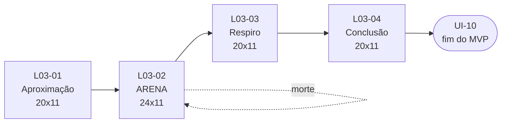
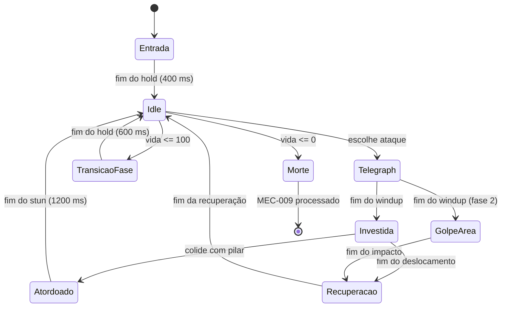

# LVL-03 — Portão do Guardião

> Setor 3 de 16 · **`[MVP]`** · Ato I — O Turno · **última área do recorte**
> Versão: `0.1.0` · Data: `2026-11-13` · Autor: `AGT-02` (Designer de Level) + `AGT-03` (Gameplay)
> Base: [GDD 3.2](../03-conteudo-do-jogo.md) · [Setores e Cenários §4.7](../design-patterns/04-setores-e-cenarios.md) · [Padrões de Level Design §7.8](../design-patterns/07-padroes-de-level-design.md)

**Status:** layout e especificação de combate fechados. Pronto para `.tmj` e para `BKL-011`.

---

## 1. Os 12 campos obrigatórios

| # | Campo | Definição |
|---|---|---|
| 1 | **ID e nome canônico** | `LVL-03` — Portão do Guardião |
| 2 | **Objetivo** | Derrotar o **Guardião da Passagem** (`ENT-003`) e concluir o recorte do MVP. |
| 3 | **Duração e mortes** | 3–5 min na primeira visita (inclui tentativas) · **2–5 mortes esperadas** |
| 4 | **Acento e materiais** | `PAL-03` vermelho rito `#D95555` · laje grande, ferro, estandarte rasgado |
| 5 | **Sinais de ambientação** | estandartes rasgados da Vigília · sinete · vela · chão de laje monumental |
| 6 | **Habilidade de entrada / saída** | Entrada: `HAB-01` (obrigatória, obtida em LVL-02). Saída: nenhuma — o jogo conclui |
| 7 | **Salas** | 4 salas: 20 · **24** · 20 · 20 (× 11) |
| 8 | **O que ensina** | `MEC-009` chefe e conclusão · `MEC-008` oferta de dificuldade · leitura de telegraph |
| 9 | **Set pieces** | `CEN-020` estandarte rasgado · `CEN-021` pilar quebrável · `CEN-002`, `CEN-003` |
| 10 | **Inimigos** | `ENT-003` Guardião da Passagem × 1 · nenhum outro |
| 11 | **Entradas e saídas** | L03-01 ← LVL-02/checkpoint · L03-04 → **conclusão do MVP** (`UI-10`) |
| 12 | **Teste de rastreabilidade** | `TST-009` (recompensa e conclusão 1×) · `TST-008` (oferta de dificuldade) · `TST-013` · `TST-004` (bolsa na arena) |

---

## 2. Fluxo



| Transição | Checkpoint |
|---|---|
| L02-08 → L03-01 | já salvo em L02-08 |
| **L03-01 → L03-02** | **elegível** — o jogador revive na entrada da arena (§8) |
| L03-02 → L03-03 | salva após o chefe |
| L03-03 → L03-04 | salva |

> `DEC-012` — a transição para a arena **é** checkpoint. Sem isso, cada morte custaria a re-traversia de L03-01 (~20 s), e `MEC-008` (3 mortes "no mesmo trecho") não teria escopo definido.

---

## 3. Legenda

| Símbolo | Camada | Significado |
|---|---|---|
| `#` | `ground` + `collision` | sólido |
| `+` | — | abertura de passagem |
| `B` | `objects` | **Guardião da Passagem** (`ENT-003`) |
| `L` | `objects` | pilar quebrável (`CEN-021`) — renderizado como `#` na grade |
| `V` | `decor` | estandarte rasgado (`CEN-020`) |
| `I` | `objects` | recompensa `ITM-004` (equipamento de teste) |
| `P` | `objects` | ponto de salvamento |
| `D` | `objects` | porta dourada · **gatilho de conclusão** |
| `N` | `objects` | inscrição |
| `G` | `decor` | sinete da Vigília |
| `c` | `decor` | vela |

Piso em `y=7`, aberturas em `y=4–6` (`DEC-007`).

---

## 4. Salas

### 4.1 L03-01 — Aproximação · 20×11

```
    00000000001111111111
    01234567890123456789
y0  ####################
y1  #..................#
y2  #..................#
y3  #..................#
y4  +..V....V....V.....+
y5  +..................+
y6  +...............N..+
y7  ####################
y8  ####################
y9  ####################
y10 ####################
```

| Objeto | Pos | Função |
|---|---|---|
| `V` estandartes | (3,4) · (8,4) · (13,4) | `CEN-020`, 3 frames de ondulação a 8 fps |
| `N` inscrição | (16,6) | `LOR` — "PORTÃO 3 · AUTORIZAÇÃO SUSPENSA" |
| **gatilho de música** | x = 10 | `BGM-01` → `BGM-02` (crossfade 1,5 s) |

- **Função:** corredor de tensão. Sem inimigo, sem armadilha.
- **Ensina:** nada — é a pausa antes da prova. Duração ~20 s.
- **Detalhe:** o jogador **ouve** antes de ver. A troca de faixa em x=10 avisa que há algo adiante.

---

### 4.2 L03-02 — Arena do chefe · 24×11

```
    000000000011111111112222
    012345678901234567890123
y0  ########################
y1  #......................#
y2  #......................#
y3  #......................#
y4  +..V........V..........+
y5  +.......##.....##......+
y6  +.......##.....##...B..+
y7  ########################
y8  ########################
y9  ########################
y10 ########################
```

| Elemento | Posição | Função |
|---|---|---|
| spawn do jogador | (1,6) | entrada vinda de L03-01 |
| **pilar 1** | x = 8–9, `y=5–6` | `CEN-021`, **2 tiles de altura**, quebrável |
| **pilar 2** | x = 15–16, `y=5–6` | idem |
| `V` estandartes | (3,4) · (12,4) | `CEN-020` |
| **`B` Guardião** | (20,6) → ocupa x=20–22, `y=4–6` | `ENT-003` |
| saída | col 29… col 23, linhas 4–6 | **trancada até o chefe cair** |

**Conformidade com `PAT-LD-07`:**

| Regra | Status |
|---|---|
| Piso contínuo, sem queda possível | ✅ laje em `y=7` de x=1 a x=22 |
| Largura mínima 24 tiles | ✅ 24 |
| Nenhum coletável durante a luta | ✅ recompensa só em L03-03 |
| Cobertura: no máx. 2 elementos quebráveis | ✅ 2 pilares |
| Entrada com hold 400 ms + nome + fala | ✅ §5.4 |
| Saída só após 0 HP processado 1× | ✅ `MEC-009` |

**Altura dos pilares:** 2 tiles (128 px), não 3. Motivo: com `HAB-01`, o jogador precisa pular **por cima** deles. Um pilar de 3 tiles exigiria 192 px de subida — inalcançável na config A e sem folga confortável nem em B. Com 2 tiles, o salto simples da config canônica **B** (`DEC-014`, 138 px a 60 Hz) passa com 10 px, e o salto duplo (276 px) dá cobertura larga para erros.

---

### 4.3 L03-03 — Respiro pós-chefe · 20×11

```
    00000000001111111111
    01234567890123456789
y0  ####################
y1  #..................#
y2  #..................#
y3  #..................#
y4  +..................+
y5  +..................+
y6  +..c......I...P....+
y7  ####################
y8  ####################
y9  ####################
y10 ####################
```

| Objeto | Pos | Função |
|---|---|---|
| `c` vela | (3,6) | `CEN-002` |
| `I` recompensa | (10,6) | `ITM-004` equipamento de teste (drop do chefe) |
| `P` salvamento | (14,6) | `MEC-007` — salva o recorte concluído |

- **Função:** `PAT-LD-04` — 6 s sem perigo. `BGM-02` → `BGM-03` (quarto seguro).
- **Aceite:** o jogador atravessa em ≤ 10 s, pega o item e salva.

---

### 4.4 L03-04 — Conclusão · 20×11

```
    00000000001111111111
    01234567890123456789
y0  ####################
y1  #..................#
y2  #..................#
y3  #.......G..........#
y4  +..................D
y5  +..................D
y6  +...c..............D
y7  ####################
y8  ####################
y9  ####################
y10 ####################
```

| Objeto | Pos | Função |
|---|---|---|
| `c` vela | (4,6) | `CEN-002` |
| `G` sinete | (8,3) | `CEN-003` |
| `D` porta dourada | (19, 4–6) | dispara `game:completed { scope: 'mvp' }` → `UI-10` |

---

## 5. A luta — especificação de combate

### 5.1 Ficha do chefe (`ENT-003`)

| Atributo | Valor | Observação |
|---|---:|---|
| Vida | **200 HP** | GDD §3.2 |
| Sprite | 192×192 px (3×3 tiles) | `AST-003`, 20 frames |
| **Hurtbox** | 160×176 px | menor que o sprite — regra `PAT-C` anti-hitbox |
| Hitbox de investida | 128×160 px | só durante a execução |
| Dano por impacto | **20 HP** | antes do multiplicador de dificuldade |
| Velocidade de investida | 520 px/s | 5 tiles = 320 px em 0,62 s |
| Peso / empurrão | imune a knockback | não pode sair da arena (clamp por bounds) |

### 5.2 Máquina de estados



### 5.3 Ataques

| ID | Ataque | Fase | Telegraph | Execução | Recuperação | Dano | Saltável? |
|---|---|---|---:|---|---:|---:|---|
| `ATK-01` | **Investida** | 1 e 2 | 800 ms (fase 1) / **600 ms** (fase 2) | 5 tiles a 520 px/s = 620 ms | 1000 ms / **800 ms** | 20 | Sim (pular por cima) |
| `ATK-02` | **Golpe de área** | **só fase 2** | 1000 ms | impacto instantâneo + onda de 3 tiles | 900 ms | 20 | Sim (pular a onda) |
| `ATK-03` | **Choque no pilar** | 1 e 2 | — | pilar quebra, chefe para | **1200 ms de aturdimento** | — | — |

**Telegraph de `ATK-01`** (as 3 fases de `05-animacao` §5.3): corpo agacha e inclina para trás, 5 linhas radiais de tinta (`VFX-006`), contorno `--threat` pulsando a 2 Hz, nota ascendente. **Silêncio na recuperação** — é o sinal auditivo de que a janela abriu.

**Telegraph de `ATK-02`:** ergue os braços; círculo de aviso `--threat` no chão com raio de 3 tiles; som grave crescente. A onda viaja para os dois lados a 400 px/s — **pular** é a resposta.

**`ATK-03` — o pilar é a mecânica de perícia:** se a investida atinge um pilar, o pilar quebra (`CEN-021` → ruína, sem colisão) e o chefe fica **atordoado por 1200 ms** — janela suficiente para **2 golpes**. Dois pilares = 2 janelas extras por tentativa.

> **`DEC-046` — o chefe é derrotável a tiro.** Em jogo, o Guardião **desaparecia ao levar um tiro**
> (`K`): o callback de «projétil × chefe» recebia o **chefe** no parâmetro do projétil — em
> `overlap(grupo, sprite, cb)` o Phaser entrega `(sprite, filhoDoGrupo)` — e desligava-o
> (`active = false`, `visible = false`, corpo desligado). Com o corpo desligado ele deixava de
> intersectar o golpe branco: a luta tornava-se impossível de ganhar, e o mesmo acontecia nos
> outros cinco chefes. A regra está agora num sítio só (`projetilContra`/`projetilDe`, «qual destes
> dois está no pool?») e há teste dedicado (`npm run tiro`), que corre os seis chefes e leva o
> Guardião até 0 HP com a arena a abrir. Nada do combate mudou — o `ATK-03` continua a ser a
> mecânica de perícia que esta secção descreve.

### 5.4 Entrada dramática (`VIS-007`)

| Elemento | Especificação |
|---|---|
| Hold | 400 ms, congelado |
| Nome na tela | `GUARDIÃO DA PASSAGEM`, display, centralizado, 900 ms |
| Fala única | *"O turno não acabou. Volte para a fila."* (1,8 s) |
| Barra de vida do chefe | surge no topo central, `role="progressbar"`, valor percentual no `aria-label` |
| Música | `BGM-02` já em curso desde L03-01 |
| Redução de movimento | mantém hold e textos; **desliga** shake e inclinação de câmera |

### 5.5 Transição de fase (100 HP)

| Elemento | Especificação |
|---|---|
| Gatilho | vida ≤ 100, **uma única vez** |
| Hold | 600 ms |
| Feedback | rugido (`SFX` novo), aura `--threat` + `--gold`, shake 3 px (desativável) |
| Mudança | `ATK-02` desbloqueado; `ATK-01` fica 200 ms mais rápido nos dois lados |
| Acessibilidade | aviso textual/`aria-live`: "O Guardião mudou de postura" |

### 5.6 Morte do chefe (`MEC-009`)

| Elemento | Especificação |
|---|---|
| Processamento | **uma única vez**, idempotente (`PAT-C-07`) |
| Hold | 600 ms + câmera lenta 0,3× por 800 ms (desativável) |
| Desmonte | `VFX-007`, o chefe cai em peças |
| Desbloqueio | saída para L03-03 + `ITM-004` |
| Registro | `game:completed { scope: 'mvp' }` só ao cruzar `D` em L03-04 |

---

## 6. Validação da luta

Calculado a partir de `02-gameplay.md` §2.11 e da tabela de dificuldade (§7).

### 6.1 Golpes necessários

| Arma | Dano | Golpes para 200 HP |
|---|---:|---:|
| Branca | 20 | **10** |
| À distância | 10 | 20 |

### 6.2 Sobrevivência do jogador

Vida efetiva = 100 HP + 50 de escudo = **150**. Multiplicador aplicado ao dano **total, antes do escudo** (`P-23`).

| Dificuldade | Multiplicador | Dano/impacto | Golpes até morrer | Margem de erro |
|---|---:|---:|---:|---:|
| Fácil | 0,75× | 15 HP | 10 | 9 erros |
| Médio | 1,00× | 20 HP | 8 | 7 erros |
| Difícil | 1,25× | 25 HP | 6 | 5 erros |

### 6.3 Ciclo e janelas

| Fase | Windup | Investida | Recuperação | Reposicionamento | Ciclo | Golpes na fase |
|---|---:|---:|---:|---:|---:|---:|
| 1 (200 → 100 HP) | 800 ms | 740 ms | 1.000 ms | 400 ms | **2,94 s** | 5 |
| 2 (100 → 0 HP) | 600 ms | 740 ms | 800 ms | 300 ms | **2,44 s** | 5 |

### 6.4 Tempo até matar (TTK)

| Cenário | TTK |
|---|---:|
| 1 golpe por janela (típico) | **~28 s** (26,9 s + 1,2 s de transição) |
| Usando os 2 pilares (2 janelas extras de 2 golpes) | **~22 s** |
| Só arma à distância (20 golpes) | **~58 s** |

> **Leitura:** a luta dura **22–58 s**, com alvo de ~28 s. Uma sala de 3–5 min se explica por 2–5 tentativas, não por uma luta longa. Se o playtest mostrar TTK acima de 45 s, o ajuste é **vida do chefe**, não dano do jogador — mexer no dano quebraria `TST-002`.

### 6.5 Geometria — por que a investida tem 5 tiles

| Valor | Consequência |
|---|---|
| 8 tiles (512 px) | 0,98 s só de deslocamento; o chefe termina longe e **não há janela utilizável** — o jogador anda 3,4 tiles em 1,0 s |
| **5 tiles (320 px)** | 0,62 s; o chefe passa ~2 tiles além do jogador que pulou → dentro do alcance de 96 px + deslocamento na recuperação |
| 3 tiles | curto demais: o jogador nunca precisa esquivar |

O valor de 8 tiles em `04-setores` §4.7 era estimativa; substituído por 5 tiles com justificativa geométrica.

---

## 7. Dificuldade e retry (`MEC-008`)

| Evento | Comportamento |
|---|---|
| Morte no chefe | respawn em **L03-02 (1,6)**, chefe com 200 HP, jogador com vida/escudo/poder cheios |
| Contador de mortes | escopo = **arena do chefe**; zera ao vencer |
| 3 mortes consecutivas | oferta **recusável** de reduzir dificuldade em `UI-08` (difícil → médio → fácil) |
| Após a campanha | qualquer dificuldade selecionável no mesmo save (`UI-04`) |
| Teste | `TST-008` |

### Bolsa na arena (`MEC-004`) — regra de misericórdia

`[SUPOSIÇÃO]` Morrer dentro da arena deixa a bolsa **na entrada da arena (x=1)**, não no ponto da morte. Justificativa: recuperar a bolsa em uma sala com um chefe ativo é, na prática, impossível — a regra puniria duas vezes.

Se a segunda morte ocorrer antes da recuperação, a bolsa anterior é destruída como manda `MEC-004` (`TST-004`). Ver `P-28`.

---

## 8. Conclusão do MVP (`MEC-009`)

| Passo | O que acontece |
|---|---|
| 1 | Chefe com 0 HP → processamento idempotente, uma vez |
| 2 | Saída destrancada, `ITM-004` disponível em L03-03 |
| 3 | Salvamento automático na transição para L03-03 |
| 4 | Cruzar `D` em L03-04 emite `game:completed { scope: 'mvp' }` |
| 5 | `UI-10`: resultado, **continuar no mesmo save**, créditos, menu |

O jogador **pode** continuar no mesmo save após a conclusão (GDD 1.9) — não há "novo jogo+" no MVP.

---

## 9. Conversão para Tiled

| Item | Definição |
|---|---|
| Arquivo | `public/assets/tilemaps/tm_lvl03_portao.tmj` |
| Tileset | `tm_ruinas` + `tm_portao` (laje monumental) |
| Propriedades | `lvl_id=LVL-03`, `pal=PAL-03`, `bgm=BGM-02`, `amb=AMB-03`, `checkpoint_on_enter=true` |

| Tipo de objeto | Propriedades |
|---|---|
| `boss_spawn` | `ent=ENT-003`, `hp=200`, `phase2_at=100`, `attack_cycle_key=boss_guardiao` |
| `breakable_pillar` | `cen=CEN-021`, `height_tiles`=2, `breaks_on`=`charge`, `stun_ms`=1200 |
| `boss_arena` | `bounds`=`x:1–22`, `lock_exit`=true, `reset_on_death`=true |
| `boss_gate` | `unlock_on`=`boss_defeated` |
| `reward_spawn` | `itm=ITM-004`, `after`=`boss_defeated` |
| `completion_trigger` | `scope`=`mvp`, `emit`=`game:completed` |
| `music_trigger` | `at_x`=10, `to`=`BGM-02`, `fade_ms`=1500 |

**Regra:** todos os tempos de ataque (`800/600/1000/800/1200 ms`) vivem em `src/game/data/tuning.ts`, nunca no `.tmj` (`PAT-C-04`).

---

## 10. Checklist de aprovação

- [x] Dimensões múltiplas de 20×11 — 20, 24, 20, 20
- [x] Arena conforme `PAT-LD-07`: piso contínuo, 24 tiles, sem coletável, 2 quebráveis
- [x] Pilares com 2 tiles de altura (subíveis com salto simples: 138 px contra 128 px na config canônica **B**, `DEC-014`)
- [x] Investida calibrada por geometria (§6.5), não por estimativa
- [x] Telegraph em 3 fases com forma + cor + som (`P2`, `VIS-009`)
- [x] Entrada com hold, nome e uma fala (`VIS-007`, GDD 3.6)
- [x] `MEC-009` idempotente — recompensa e conclusão uma única vez
- [x] `MEC-008` com escopo de trecho e oferta recusável
- [x] Bolsa com regra de misericórdia na arena (`P-28`)
- [x] Checkpoint na entrada da arena (`DEC-012`)
- [x] Testes: `TST-004`, `TST-008`, `TST-009`, `TST-013`
- [x] Um único acento (`PAL-03`)

---

## 11. Desvios registrados

| # | O que mudou | Por quê | IDs afetados |
|---|---|---|---|
| 1 | Investida: 8 tiles → **5 tiles** | Com 8 tiles a recuperação não é utilizável (jogador anda 3,4 tiles em 1,0 s); a luta viraria corrida sem punição | `04-setores` §4.7 |
| 2 | Pilares: 3 tiles → **2 tiles** de altura | 3 tiles exigem 192 px de subida — inalcançável na config A e apertado mesmo em B; 2 tiles sobem com salto simples | `04-setores` §4.7, `DEC-013`, `DEC-014` |
| 3 | Transição para a arena passa a ser **checkpoint** | Sem isso, runback de 20 s por morte e `MEC-008` sem escopo | `PAT-LD-05`, `DEC-012` |
| 4 | Bolsa cai na entrada da arena, não no ponto da morte | Recuperar bolsa com chefe ativo é inviável | `MEC-004`, `P-28` |
| 5 | `ATK-02` (golpe de área) criado | Sem segundo ataque, a fase 2 seria "a mesma luta mais rápida" — sem novidade de leitura | `03-conteudo` §3.2 |

## 12-A. Desvios de implementação (código)

O setor está implementado e verificado (`npm run lvl03`). Estes são os pontos em que o código
**não** seguiu o documento ao pé da letra — nenhum deles muda regra de jogo, só a forma.

| # | O que o documento diz | O que o código faz | Por quê |
|---|---|---|---|
| I-1 | §4 desenha 4 salas com o `B` da arena na coluna 20 | `LevelBuilder` trata `B` como *spawn do chefe* e o remove da colisão | o `B` é marcador de posição, não tile sólido; mantê-lo criaria um bloco invisível no piso |
| I-2 | §5.1 fala em clamp de bounds da arena | `Boss.clampTo(3·TILE, worldWidth − 2·TILE)` a cada quadro | a arena tem 24 tiles e o corpo tem 160 px; sem clamp a investida sai do mundo |
| I-3 | §6 pede "pilar em 3 estados" (`CEN-021`) | o código tem **2** estados visuais (inteiro e ruína) e 1 de colisão (destruído) | a arte é placeholder procedural; o estado "rachado" depende do sprite final (`P-16`) |
| I-4 | §5.3 diz que `ATK-03` rende 1200 ms de aturdimento | medido em **1144–1333 ms** no headless | o `time` do Phaser avança em passos grandes a ~9 FPS; a 60 Hz o valor cai em 1200 ms |
| I-5 | §5.5 prevê a fala de entrada | o texto fica **1,8 s** em `game:text` e sai sozinho | `hold` sem timeout travava a tela se o jogador morresse durante a intro |
| I-6 | `P-28` pergunta onde fica a bolsa | `ITM-004` entra em `GameScene.bag` (memória da sessão), **não** no save | o save de `MEC-007` ainda não tem campo de inventário; `P-28` continua aberta |
| I-7 | §7 pede a oferta de `MEC-008` "após 3 mortes" | conta mortes **na arena** e só oferece degrau **mais fácil** (`hard→medium→easy`), recusável | subir dificuldade por morte seria punição, não misericórdia; `TST-008` cobre os dois caminhos |

Consequência para o próximo agente: `I-3` e `I-6` são dívida de arte/inventário, não de regra;
`I-4` é medição de ambiente, não divergência de tempo de jogo.

---

## 12. Pendências geradas

| ID | Item | Bloqueia |
|---|---|---|
| `P-28` | Confirmar a regra de misericórdia da bolsa em arena de chefe | `BKL-005` |
| `P-29` | Validar em playtest se 200 HP / 5 tiles produz TTK entre 22 e 35 s | `BKL-011` |
| `P-30` | `ATK-02` é criação nova (não consta no GDD §3.2) — aprovar e registrar | `BKL-011` |

---

## Handoff

**Para `AGT-01`** — `CEN-020` estandarte, `CEN-021` pilar em 3 estados (inteiro / rachado / ruína), 20 frames do `AST-003` com poses de windup e aturdimento, `VFX-006` linhas de tensão.
**Para `AGT-03`** — FSM da §5.2, timings da §5.3 em `tuning.ts`, aturdimento por pilar, clamp de bounds da arena, `MEC-009` idempotente, `MEC-008` com escopo de arena.
**Para `AGT-05`** — barra de vida do chefe acessível, `aria-live` da transição de fase, `UI-08` com a oferta de dificuldade.
**Para `AGT-07`** — `TST-009` (idempotência da recompensa), `TST-008` (oferta após 3 mortes), `TST-013` (percurso completo do MVP).

**O próximo agente precisa saber, em 3 linhas:**
1. Investida é de **5 tiles** — se mudar, a janela de punição desaparece; recalibre com a §6.5.
2. Pilares de **2 tiles** são a mecânica de perícia: quebrar um dá 1200 ms de aturdimento = 2 golpes.
3. `MEC-009` precisa ser idempotente: recompensa e conclusão acontecem **uma vez**, mesmo com retry de rede.
