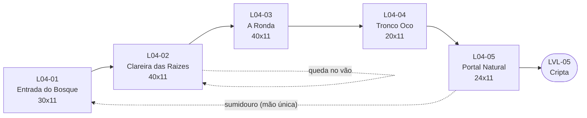

# LVL-04 — Bosque das Cinzas

> Setor 4 de 16 · **`[PÓS]`** · Ato II — A Ronda · **primeira área fora do recorte do MVP**
> Versão: `0.1.0` · Data: `2026-11-13` · Autor: `AGT-02` (Designer de Level) + `AGT-03` (Gameplay)
> Base: [GDD 3.4](../03-conteudo-do-jogo.md) · [Setores e Cenários §4.4 e §4.8](../design-patterns/04-setores-e-cenarios.md) · [Padrões de Level Design §7.8](../design-patterns/07-padroes-de-level-design.md)

> ⚠️ **Escopo `[PÓS]` — leia antes de usar este documento.**
> Este setor **não** faz parte do recorte do MVP (`LVL-01`–`03`). Conforme `D-04` em `PENDENCIAS.md`, ele está especificado em nível de layout completo para **destravar o Ato II e o trabalho de arte**, mas **nome, números e conteúdo narrativo não são canônicos** até aprovação do proprietário. Nenhum agente deve codar este setor antes de `BKL-012` fechar e o MVP estar jogado.

**Status:** layout completo nos 12 campos, grades validadas, alcançabilidade verificada na config canônica **B** (`DEC-014`). Pronto para `.tmj` **quando** o Ato II for aberto.

---

## 1. Os 12 campos obrigatórios

| # | Campo | Definição |
|---|---|---|
| 1 | **ID e nome canônico** | `LVL-04` — Bosque das Cinzas *(nome de trabalho, `[PÓS]`)* |
| 2 | **Objetivo** | Atravessar o bosque e encontrar o caminho para o setor seguinte. **Sem chefe, sem item, sem trava de habilidade nova.** |
| 3 | **Duração e mortes** | 6–9 min na primeira visita · **1–3 mortes esperadas** |
| 4 | **Acento e materiais** | `PAL-04` oliva morto `#A8B26B` · madeira morta, cinza, raiz, musgo seco |
| 5 | **Sinais de ambientação** | árvores mortas sem copa · cinza caindo devagar · raízes que cresceram **por cima** do caminho · lanternas apagadas da Vigília |
| 6 | **Habilidade de entrada / saída** | Entrada: `HAB-01` (salto duplo, obrigatória — herdada de LVL-02). Saída: **nenhuma habilidade nova** |
| 7 | **Salas** | 5 salas: 30 · **40** · **40** · 20 · 24 (× 11) = **154 tiles** |
| 8 | **O que ensina** | usar `HAB-01` **sem pressão** · ler inimigos em formação · ler amplitude como informação |
| 9 | **Set pieces** | `CEN-030` árvore morta · `CEN-031` cinza caindo · `CEN-032` raiz que cresceu sobre o caminho · `CEN-033` lanterna apagada |
| 10 | **Inimigos** | `ENT-002` Sentinela distorcida × 6 (0 · 1 · 3 · 1 · 1) |
| 11 | **Entradas e saídas** | L04-01 ← **LVL-03** (porta dourada) · L04-05 → **LVL-05** Cripta das Engrenagens (porta dourada) |
| 12 | **Teste de rastreabilidade** | `TST-013` (percurso completo) · `TST-005` (`HAB-01` sobrevive à morte) · `TST-001` (salto duplo) · `TST-007` (save) · `TST-004` (bolsa) |

### Propriedades de design deste setor

- **É o respiro do Ato I.** O jogador acabou de matar o Guardião. Este setor existe para o arco dramático descer antes de subir de novo: **zero armadilhas, zero chefes, zero travas de habilidade.** A única fonte de dano são os 6 inimigos comuns, todos evitáveis.
- **A amplitude é a informação.** As duas salas de 40 tiles não são preguiça de layout: depois de LVL-03 (arena de 24, paredes altas, teto de ferro), o jogo abre. O jogador sente a mudança antes de ler qualquer texto.
- **A pergunta do Ato II é feita aqui, e não é respondida aqui.** "O que essas coisas ainda estão fazendo?" — L04-03 põe três Sentinelas marchando em formação, em turnos, sem ninguém para render. A resposta ("cumprindo ordens que ninguém deu") só cai no fim do Ato II, em LVL-08.
- **Sem armadilha, de propósito.** `PAT-LD-09` diz que armadilha existe para punir descuido. Aqui não há nada a punir: o setor testa **deslocamento e leitura**, não reflexo. Ver `P-33` — a hipótese precisa de playtest.

---

## 2. Fluxo



| Transição | Checkpoint |
|---|---|
| LVL-03 → L04-01 | já salvo na conclusão de LVL-03 |
| L04-01 → L04-02 | salva na porta (`D`) de entrada |
| L04-02 → L04-03 | salva ao cruzar a porta |
| **L04-03** | **`P` em (3,6)** — ponto de salvamento manual antes da Ronda |
| L04-04 → L04-05 | salva ao cruzar a porta |
| **L04-05** | **`P` em (4,6)** — antes do portão natural |

> `DEC-012` não se aplica aqui: não há arena. O setor usa o modelo normal de `PAT-LD-05` — portas internas salvam, `P` salva, e nada mais.

---

## 3. Legenda das grades

| Símbolo | Camada | Significado |
|---|---|---|
| `#` | `ground` + `collision` | sólido |
| `=` | `collision` (só topo) | plataforma atravessável *(one-way)* — **raiz** |
| `+` | — | abertura de passagem |
| `D` | `objects` | porta dourada (entrada/saída de área) |
| `.` | — | ar |
| `S` | `objects` | spawn do jogador (`ENT-001`) |
| `E` | `objects` | Sentinela distorcida (`ENT-002`) |
| `P` | `objects` | ponto de salvamento (`UI-09`) |
| `N` | `objects` | inscrição / marco de lore |
| `T` | `decor-back` | árvore morta (`CEN-030`) — **4 tiles de altura, sem colisão** |
| `v` | `decor-back` | emissor de cinza caindo (`CEN-031`) |
| `c` | `decor` | lanterna apagada da Vigília (`CEN-033`) |
| `k` | `decor` | objeto de trabalho abandonado (`CEN-004`) |
| `V` | `objects` | **sumidouro de cinza** (`CEN-034`) — atalho de mão única, `interact` (§6) |

Piso em `y=7` e aberturas em `y=4–6` seguem `DEC-007`.

> **`T` fica em `decor-back`.** A árvore morta é desenhada **atrás** do plano de jogo. Por isso a grade mostra o tronco atravessando as linhas `y3`–`y6` sem colisão: o jogador passa *na frente* dela. Se fosse `decor-front`, o tronco taparia o personagem em todo cruzamento.

---

## 4. Salas

### 4.1 L04-01 — Entrada do Bosque · 30×11

```
    000000000011111111112222222222
    012345678901234567890123456789
y0  ##############################
y1  #.............v.......v......#
y2  #..............v.......v.....#
y3  #.V.......T.......T.......T..#
y4  D.........T.......T.......T..+
y5  D.........T.......T.......T..+
y6  DS....N...T..c....T.......T..+
y7  ##############################
y8  ##############################
y9  ##############################
y10 ##############################
```

| Objeto | Pos | Função |
|---|---|---|
| `S` spawn | (1,6) | entrada pela porta de LVL-03, virado para a direita |
| `D` porta | (0,4)–(0,6) | volta para LVL-03. Autosave ao cruzar |
| `N` marco | (6,6) | `LOR` — **"A RONDA PASSA AQUI TODA NOITE. NINGUÉM ORDENA. ELA NÃO PARA."** (11 palavras) |
| `T` árvores | (10,6) · (18,6) · (26,6) | `CEN-030`, 4 tiles, sem colisão |
| `c` lanterna | (13,6) | `CEN-033`, apagada — a Vigília passou por aqui e não voltou |
| `v` cinza | (14,1) · (15,2) · (22,1) · (23,2) | `CEN-031`, 2 emissores defasados 1,5 s |
| **`V` sumidouro** | (2,3) | **saída do atalho de retorno** (§6). O jogador cai 3 tiles e não pode voltar por ali |
| — | — | **nenhum inimigo** |

- **Função:** soleira. O jogador sai da arena fechada e entra em espaço aberto sem que nada aconteça.
- **Ensina:** nada. É a respiração depois do chefe — mesma lógica de L01-01, agora **depois** de um pico de tensão em vez de antes.
- **Aceite:** atravessar em ≤ 12 s; nenhum inimigo, nenhum dano possível.
- **Nota de ritmo:** 30 tiles (1.920 px) de caminhada antes do primeiro objeto de leitura da Ato II. A inscrição em (6,6) é opcional.

---

### 4.2 L04-02 — Clareira das Raízes · 40×11

```
    0000000000111111111122222222223333333333
    0123456789012345678901234567890123456789
y0  ########################################
y1  #...........v...............v..........#
y2  #...............N.............v........#
y3  #.T...........====..T...............T..#
y4  +.T.....====........T...............T..+
y5  +.T.................T...............T..+
y6  +.T.................T...........E...T..+
y7  ########################...#############
y8  ########################...#############
y9  ########################...#############
y10 ########################...#############
```

| Elemento | Posição | Função |
|---|---|---|
| **raiz A** `=` | x = 8–11, topo em `y=4` | **3 tiles** acima do piso → exige `HAB-01` |
| **raiz B** `=` | x = 14–17, topo em `y=3` | 1 tile acima de A, **2 tiles** de vão horizontal |
| `N` marco | (16,2) | em cima de B — **"PLANTARAM DEPOIS DO FIM. NINGUÉM VOLTOU PARA COLHER."** (8 palavras) |
| **vão** | x = 24–26 | 3 tiles (192 px) no piso. Queda = respawn na entrada, sem dano (`DEC-011`) |
| `E` Sentinela | (32,6) | patrulha de 4 tiles, `has_telegraph=true` |
| `T` árvores | (2,6) · (20,6) · (36,6) | `CEN-030` |
| `v` cinza | (12,1) · (28,1) · (30,2) | `CEN-031` |

- **Função:** a amplitude literal — a sala mais larga do setor (2.560 px), com uma rota alta **opcional** que premia com lore, não com poder.
- **Ensina:** `HAB-01` **em uso livre**. Não há nada perseguindo o jogador enquanto ele sobe. É o oposto do gate de LVL-02, que era sob pressão de trava.
- **Aceite:** o jogador chega ao `N` de (16,2) e volta ao piso; **ou** atravessa reto sem subir. As duas rotas completam a sala.
- **Por que a rota alta é opcional:** `PAT-LD-02` reserva "obrigar" para o tempo 3 (combinar). Aqui o jogador já domina `HAB-01` — cobrar de novo seria repetir a prova, não ensinar.

---

### 4.3 L04-03 — A Ronda · 40×11

```
    0000000000111111111122222222223333333333
    0123456789012345678901234567890123456789
y0  ########################################
y1  #.........v.........v............v.....#
y2  #......................................#
y3  #....T........................T......T.#
y4  +....T........................T......T.+
y5  +....T........................T......T.+
y6  +..P.T..E..##....E.......E....T...N..T.+
y7  ########################################
y8  ########################################
y9  ########################################
y10 ########################################
```

| Elemento | Posição | Função |
|---|---|---|
| `P` save | (3,6) | `UI-09`, manual. Antes da formação |
| `E` Ronda | (8,6) · (17,6) · (25,6) | **3 Sentinelas em formação**, mesma direção, fase travada |
| degrau | x = 11–12, `y=6` | 1 tile — **quebra a linha de tiro** do jogador e a formação |
| `N` marco | (34,6) | **"CONTAGEM: 4 NA SAÍDA. 3 NA VOLTA. NINGUÉM CONTA O QUE FALTA."** (12 palavras) |
| `T` árvores | (5,6) · (30,6) · (37,6) | `CEN-030` |
| `v` cinza | (10,1) · (20,1) · (33,1) | `CEN-031` |

- **Função:** é a cena. Três inimigos marchando em formação, na mesma direção, em ritmo constante, há tempo indeterminado. Não patrulham *para* o jogador; patrulham *apesar* dele.
- **Ensina:** ler um grupo antes de engajar. A formação é previsível — dá para contar o ritmo e escolher onde entrar.
- **Aceite:** o jogador derrota as três (`TST-002`) **ou** atravessa sem combatê-las, usando o degrau e a distância entre elas. As duas rotas são válidas.
- **Como a formação é implementada:** ver §5.

---

### 4.4 L04-04 — Tronco Oco · 20×11

```
    00000000001111111111
    01234567890123456789
y0  ####################
y1  ####################
y2  ####################
y3  #..................#
y4  +..................+
y5  +..................+
y6  +...c..##...E..k...+
y7  ####################
y8  ####################
y9  ####################
y10 ####################
```

| Elemento | Posição | Função |
|---|---|---|
| **teto baixo** | `y0`–`y2` sólidos | interior do tronco — **teto útil em `y=3`** |
| raiz baixa | x = 7–8, `y=6` | degrau de 1 tile (64 px) |
| `E` Sentinela | (12,6) | 1 inimigo, patrulha de 3 tiles |
| `c` lanterna | (4,6) | `CEN-033` |
| `k` objeto | (15,6) | `CEN-004` — ferramenta largada |

- **Função:** contraste. Depois de duas salas de 40 tiles com céu, o jogo aperta. A sala tem 20 tiles de largura, mas só **20 tiles de altura útil desperdiçados** — o teto em `y=3` corta o espaço aéreo pela metade.
- **Ensina:** que `HAB-01` **não resolve tudo**. Aqui o salto duplo é inútil: o teto bloqueia a subida em ~2 tiles. O jogador precisa voltar a andar. É a única sala do setor em que a habilidade não ajuda — e isso é a lição.
- **Aceite:** atravessar em ≤ 10 s; o degrau de 1 tile é o único obstáculo e sobe com salto simples.
- **Nota de segurança:** o teto baixo **não** cria soft lock. Tudo o que o jogador precisa atravessar está a 1 tile no máximo.

---

### 4.5 L04-05 — Portal Natural · 24×11

```
    000000000011111111112222
    012345678901234567890123
y0  ########################
y1  #.....v..........v.....#
y2  #......................#
y3  #.T......T..........T..#
y4  +.T......T....##....T..D
y5  +.T......T....##....T..D
y6  +.T.P...ET....##V.N.T..D
y7  ########################
y8  ########################
y9  ########################
y10 ########################
```

| Elemento | Posição | Função |
|---|---|---|
| **portão natural** | x = 14–15, `y=4`–`y=6` | **parede de raiz de 3 tiles** — a saída do setor |
| `P` save | (4,6) | `UI-09`, antes do portão |
| `E` Sentinela | (8,6) | 1 inimigo, guardando a aproximação |
| `N` marco | (18,6) | **do outro lado do portão** — recompensa por subir |
| `D` porta | (23,4)–(23,6) | saída para **LVL-05**. Autosave ao cruzar |
| **`V` sumidouro** | (16,6) | **`CEN-034`** — atalho para L04-01 (§6). `interact`; a cinza que caiu por 6 min tem de sair por algum lugar |
| `T` árvores | (2,6) · (9,6) · (20,6) | `CEN-030` |
| `v` cinza | (6,1) · (17,1) | `CEN-031` |

- **Função:** o **portão natural** que `04-setores` §4.4 prevê para a transição 04 → 05 ("trava: `HAB-01` salto duplo"). Raízes cresceram por cima do caminho e fecharam a passagem até 3 tiles de altura.
- **Ensina:** que a habilidade **volta a ser trava** depois de um setor inteiro sem trava nenhuma. A lição de L04-04 (nem tudo se resolve saltando) fica de pé: aqui o salto resolve, mas só o duplo.
- **Aceite:** o jogador sobe na parede de raiz (192 px), desce do outro lado e cruza `D`. `TST-001` verde.
- **Sem soft lock:** a parede é simétrica — quem está do lado direito sobe de volta com o mesmo salto duplo. Nenhuma descida é beco sem saída.
- **Nota de lore:** o `N` de (18,6) está **depois** do portão, no caminho de saída, não numa rota opcional. Quem atravessa sempre lê: **"O PORTÃO NÃO FOI FECHADO. FOI CRESCIDO."** (8 palavras).

---

## 5. A Ronda — especificação de comportamento

Esta é a única peça deste setor que **não existe nos três níveis do MVP** e precisa de aval técnico antes de ser implementada (`P-35`).

### 5.1 O problema de design

Três Sentinelas em patrulha normal (`PAT-LD-10`, `ENT-002`) ficam dessincronizadas: cada uma vira na borda quando chega, então em 10 s elas marcham em três direções diferentes. O efeito visual vira "três bichos andando", não "uma tropa cumprindo turno".

### 5.2 A regra

| Propriedade | Valor | Efeito |
|---|---|---|
| `patrol_tiles` | 8 | todas percorrem o mesmo trecho |
| `patrol_sync` | `true` | **fase travada**: todas invertem no mesmo instante |
| `patrol_offset` | 0 · 8 · 16 tiles | deslocamento inicial ao longo do trecho |
| `initial_facing` | `right` (as três) | marcham juntas na mesma direção |

Com `patrol_offset` de 0, 8 e 16, as três ocupam o trecho inteiro e andam como uma coluna: quando a primeira vira, a segunda vira 0,4 s depois. O resultado lê como **formação**, e a formação é o assunto da cena.

### 5.3 Regras de segurança no combate

- **Nunca encurralar** (`PAT-LD-10`): o degrau de x=11–12 e a distância de 8 tiles entre elas garantem espaço de recuo.
- **Morte não quebra a formação:** com uma morta, as outras duas mantêm a fase. Não há re-sincronização, não há "reagrupar". Elas continuam.
- **Engajar uma não acorda as outras:** aggro individual, raio de 6 tiles. É o que permite atravessar sem lutar.

### 5.4 Por que isso é tema, e não enfeite

A pergunta do Ato II é "o que essas coisas ainda estão fazendo?". A resposta visual, dada sem uma linha de diálogo, é: **marchando em formação, em turnos, sem ninguém para render.** Se elas patrulhassem aleatoriamente, a cena seria só um combate. Sincronizadas, a cena é uma **denúncia**.

---

## 6. O atalho de retorno — o sumidouro de cinza

`PAT-LD-08` exige atalho fim→início em todo setor com 4+ salas, e LVL-04 tem 5. Ele faltava desde a primeira versão deste documento (`P-37`).

### 6.1 O que é

**`CEN-034` — Sumidouro de Cinza.** A cinza cai no setor inteiro, sem parar, do primeiro ao último quadro (`CEN-031`). Em 6–9 minutos ela cobriria tudo — e não cobre. **O atalho é a resposta a essa pergunta**, e o jogador pode notá-la antes de usá-lo: debaixo de uma raiz no fim de L04-05 existe uma grade; atrás da grade, um poço.

| Item | Definição |
|---|---|
| Entrada | L04-05, **(16,6)** — passada a parede de raiz, no caminho para a saída |
| Saída | L04-01, **(2,3)** — a cinza cai do dossel sobre a soleira. **É ponto de chegada, não gatilho** (`arrival_only=true`): o jogador que salte até (2,3) não é teleportado de volta |
| Interação | **`interact`** (abaixar / ação) — abrir a grade |
| Mão única | **sim** — a saída é 3 tiles acima do piso e o setor não tem escalada |
| Salva? | **não** (`PAT-LD-05`: atalho ≠ transição elegível) |
| Distância economizada | L04-02 + L04-03 + L04-04 = **100 tiles (6.400 px ≈ 32 s de caminhada)** |

### 6.2 Por que é de mão única e não tem trava

`PAT-LD-08` pede "destravado ao concluir". Este atalho **não tem trava nenhuma**: ele é destravado por **posição** — só existe no fim do setor. Uma passagem de mão única nunca pode ser usada para pular conteúdo, que é a única razão pela qual a trava existiria.

> **Forma (b) de `PAT-LD-08`.** O `07-padroes` §7.9 agora reconhece duas implementações: **máquina** (duas paradas, nos dois sentidos — `LVL-05`, `LVL-08`) e **queda de mão única** (passagem orgânica que termina em queda — `LVL-04`, `LVL-07`). O mundo não precisa de um elevador em cada floresta.

### 6.3 Por que `interact` e não um buraco

Um buraco passivo no caminho da saída vira **queda acidental**: o jogador atravessa o setor, pisa no lugar errado e volta 100 tiles. O `interact` separa **passagem** de **armadilha** — a mesma regra do sumidouro de `LVL-09` §4.6.

### 6.4 O que isso conserta no setor

O setor tinha uma fraqueza registrada em `P-33`: 6–9 min sem armadilha e sem decisão. O sumidouro não adiciona perigo, mas adiciona **uma leitura**: a cinza que cai a manhã inteira tem um destino. O atalho deixa de ser uma conveniência de interface e passa a ser uma peça da ambientação.


## 7. Validação de alcançabilidade

Medido com solver de passo fixo a 60 Hz na **config canônica B** (`DEC-014`: impulso 560, gravidade 1100, velocidade 220 px/s, tile 64 px). Os números abaixo **não** vêm da forma fechada — ver a nota em `04-setores` §4.3.

| Subida | Salto simples | Salto duplo | Correndo + duplo |
|---|---:|---:|---:|
| 0 tiles (mesmo nível) | 220 px | 378 px | 384 px |
| 1 tile (64 px) | 191 px | 359 px | 384 px |
| 2 tiles (128 px) | 139 px | 337 px | 384 px |
| **3 tiles (192 px)** | **0 — impossível** | **308 px** | 384 px |
| 4 tiles (256 px) | 0 — impossível | 264 px | 370 px |

Altura máxima: **138 px** simples (2,15 tiles) · **276 px** duplo (4,31 tiles).

| Obstáculo | Sala | Tipo | Subida | Vão | Exige `HAB-01`? | Resultado |
|---|---|---|---:|---:|---|---|
| raiz A (topo `y=4`) | L04-02 | subida | 192 px | 0 | **sim** | duplo 308 px de alcance ✓ (folga 84 px de altura) |
| raiz A → raiz B | L04-02 | subida + vão | 64 px | 128 px | não | simples 191 px ✓ (folga 63 px) |
| vão do piso (x=24–26) | L04-02 | vão | 0 | 192 px | não | simples 220 px ✓ (folga 28 px) |
| degrau de 1 tile | L04-03 | subida | 64 px | 0 | não | simples 138 px ✓ |
| degrau de 1 tile | L04-04 | subida | 64 px | 0 | não | simples 138 px ✓ |
| **portão natural (x=14–15)** | L04-05 | **subida** | **192 px** | 0 | **sim** | duplo 276 px ✓ (folga 84 px) |
| descida do portão | L04-05 | descida | −192 px | 0 | não | queda livre, sem dano ✓ |

**Resultado: 0 falhas.** Nenhum obstáculo do setor é inalcançável, e apenas **dois** exigem `HAB-01` — as duas raízes altas que o setor usa como progressão vertical e como portão de saída.

> **A trava de saída é vertical, de 3 tiles.** É o mesmo padrão de `DEC-009`: um vão horizontal de qualquer largura seria atravessado correndo + duplo (384 px = 6 tiles). O portão natural funciona porque **é uma subida**, e subida não se atravessa com velocidade.

---

## 8. Salvamento e morte

| Evento | O que acontece | Regra |
|---|---|---|
| Cruza `D` em L04-01 (vinda de LVL-03) | salva | `MEC-007` |
| Interagir com `P` em L04-03 | salva | `MEC-007` |
| Interagir com `P` em L04-05 | salva | `MEC-007` |
| Queda no vão de L04-02 | respawn na entrada da sala, **sem dano**, fade 300 ms | `DEC-011` |
| Morrer para Sentinela | respawn no último checkpoint; inimigos da sala resetam | `MEC-004` |
| Morrer com bolsa | bolsa fica no local; nova morte destrói a anterior | `MEC-004`, `TST-004` |
| Perda de conexão durante save | `UI-11`, operação pausada, retry | `PAT-C-07` |

**Nenhuma morte é irreversível neste setor.** Não há armadilha, não há chefe, não há queda fatal. A morte só vem de combate, e o combate é sempre evitável (`§5.3`).

---

## 9. Conversão para Tiled (`.tmj`)

| Item | Definição |
|---|---|
| Nome do arquivo | `public/assets/tilemaps/tm_lvl04_bosque.tmj` |
| Tileset | `tm_bosque` (`AST-005` — **ID proposto**, ver `P-34`), ~28 tiles, 64×64 |
| Orientação | orthogonal, tile 64×64, 20–40 colunas × 11 linhas por sala |
| Camadas (ordem) | `decor-back` · `ground` · `collision` · `objects` · `decor-front` |
| `collision` | retângulos sobre o `ground`, **nunca** desalinhados |
| Propriedades do mapa | `lvl_id=LVL-04`, `pal=PAL-04`, `bgm=BGM-04`, `amb=AMB-04`, `scope=post` |

### Propriedades dos objetos (camada `objects`)

| Tipo | Propriedades |
|---|---|
| `player_spawn` | `facing`=`right` |
| `enemy` | `ent=ENT-002`, `patrol_tiles`=3–8, `initial_facing`=`right`, `has_telegraph`=true, `patrol_sync`=`true` (só L04-03), `patrol_offset`=0/8/16 (só L04-03) |
| `save_point` | `ui=UI-09`, `checkpoint`=true |
| `door` | `to=LVL-03` (L04-01, `style=gold`, `autosave=true`) · `to=LVL-05` (L04-05, `style=gold`, `autosave=true`) |
| `pit_respawn` | `mode`=`no_damage`, `fade_ms`=300 — vão de L04-02 |
| `lore_marker` | `key`=`lore.lvl04.entrada` / `.raizes` / `.ronda` / `.portao`, `max_words`=25 |
| `decor` | `ast=CEN-030` (back) / `CEN-031` (back) / `CEN-033` / `CEN-004`, `collides`=false |

**Regra de ouro da conversão:** nenhum número de gameplay no `.tmj`. Dano, vida, tempos e física vêm de `src/game/data/tuning.ts` (`PAT-C-04`, `DEC-014`). O mapa aponta a **chave**, não o valor.

---

## 10. Checklist de aprovação (`07-padroes` §7.14)

- [x] Dimensões múltiplas de 20×11 — 30, 40, 40, 20, 24 × 11
- [x] Objetivo de cada sala compreensível em ≤ 3 s
- [x] Respeita a tabela de alcance (§7) — **0 falhas** na config canônica B (`DEC-014`)
- [x] Ensino segue `PAT-LD-02` — aqui só o tempo 4 (**usar livremente**), sem repetir tempos 1–3
- [x] Trava de habilidade só na saída, e é vertical (`DEC-009`)
- [x] Rota crítica funciona com inventário vazio (`PAT-LD-06`)
- [x] Nenhum soft lock: portão simétrico, vão com respawn sem dano, teto baixo não prende
- [x] Densidade de inimigos **abaixo** do teto de `PAT-LD-10` — setor de respiro, 6 inimigos em 154 tiles
- [x] `collision` alinhada ao `ground` (validado pelo gerador de grade)
- [x] Nenhuma ameaça fora da tela nas salas de 40 tiles — todas as Sentinelas estão a ≤ 32 tiles da entrada, visíveis com a câmera padrão
- [x] Paleta com um único acento (`PAL-04`)
- [x] `PAT-LD-08` — atalho de retorno pelo sumidouro, forma de mão única (§6)
- [x] Nenhuma ameaça na saída do atalho: a queda é de 3 tiles, sem dano
- [x] Testes associados: `TST-001`, `TST-004`, `TST-005`, `TST-007`, `TST-013`
- [ ] **Aprovação de escopo:** nome e conteúdo continuam `[PÓS]` (`D-04`) — **não** marcado de propósito

---

## 11. Desvios registrados

| # | O que mudou | Por quê | IDs afetados |
|---|---|---|---|
| 1 | **Zero armadilhas** no setor inteiro | `PAT-LD-09` existe para punir descuido; num setor de respiro não há nada a punir. Risco de tédio assumido e registrado em `P-33` | `PAT-LD-09`, `P-33` |
| 2 | Rota alta de L04-02 é **opcional** e paga em lore | `PAT-LD-02` reserva obrigação para o tempo 3; `HAB-01` já foi cobrada em LVL-02. Repetir a prova não ensina | `PAT-LD-02` |
| 3 | L04-04 tem **teto em `y=3`** (3 linhas sólidas) | É a única sala do jogo até aqui que quebra o teto em `y=0`. Proposital: cria o contraste de amplitude e desativa `HAB-01` sem tirar a habilidade | `DEC-007`, `PAT-LD-01` |
| 4 | `patrol_sync` é **propriedade nova** no schema de objetos | Não existe nos níveis do MVP; sem ela a cena de L04-03 não acontece | `P-35` |
| 5 | Portão de saída em **parede de 2 tiles de espessura** | 1 tile funciona, mas a leitura "raiz grossa" pede massa. A espessura não muda a altura exigida | `CEN-032` |
| 6 | **Atalho de retorno por queda de mão única**, sem trava | `PAT-LD-08` pede destravado ao concluir; posição já impede uso para pular conteúdo (§6.2). É a forma (b) reconhecida em `07-padroes` §7.9 | `PAT-LD-08`, `CEN-034` |

---

## 12-A. Desvios de implementação (código)

O setor está implementado **atrás de flag** (`FLAGS.lvl04 = false`) e verificado por
`npm run lvl04`. Estes são os pontos em que o código não seguiu o documento ao pé da letra.

| # | O documento diz | O código faz | Por quê |
|---|---|---|---|
| I-1 | §3 dá `T` como `decor-back` de 4 tiles | `LevelBuilder` desenha em `depth 2`, sem corpo de colisão | é exatamente o pedido; registrado porque a árvore **atravessa** as linhas `y3–y6` da grade e isso parece erro de colisão para quem lê a grade |
| I-2 | §5.2 fala em `patrol_offset` 0 / 8 / 16 tiles | a fase é **derivada do relógio** (`core/patrol.ts`), sem offsets por inimigo | três offsets em trechos de 8 tiles sairiam do trecho; sincronizar pelo relógio dá o mesmo resultado e mantém a formação mesmo com uma morta (§5.3) |
| I-3 | §6.1 dá o mesmo glifo `V` para entrada e chegada | `glyphs: { V: 'sink' }` em L04-05 e `{ V: 'sink-arrival' }` em L04-01 | a chegada é `arrival_only`: sem grade, sem `interact`, senão o jogador teleportaria de volta ao pousar (`DEC-023`) |
| I-4 | §6.1 diz "cai 3 tiles" | o jogador entra em `y=184` e **pousa** no piso em `y=448` | a queda é a leitura da cena; o teste confere a chegada em `x=160` e a ausência de dano/save |
| I-5 | §4 exige 6 inimigos | a Ronda tem 3 Sentinelas **em formação**; as outras 3 são patrulhas soltas | o código segue a contagem da grade; a formação é ligada por `Room.ronda` só em L04-03 |
| I-6 | §5.2 e `P-35` pedem aval técnico antes de implementar | a Ronda está implementada e **testada**, mas o setor não é jogável no build | `P-35` segue aberto como decisão de *design*; o código só não bloqueia a discussão |

---

## 12. Pendências geradas

| ID | Item | Bloqueia |
|---|---|---|
| `P-33` | **Um setor sem nenhuma armadilha segura a atenção por 6–9 min?** Hipótese: sim, porque a amplitude e a Ronda carregam o ritmo. Se o playtest mostrar tédio, a saída é adicionar **uma** armadilha em L04-02, não distribuir armadilhas pelo setor. | `BKL-012`, vertical slice do Ato II |
| `P-34` | **`AST-005` é o tileset do bosque?** O bloco `AST-001`–`008` não tem catálogo por ID no repositório. Precisa de confirmação de `AGT-01` antes de qualquer arte. | `BKL-012`, `P-16` |
| `P-35` | **`patrol_sync` / `patrol_offset` entram no schema de objetos?** Precisa de aval de `AGT-03` e de `AGT-04` (o editor de mapa precisa expor as duas propriedades). | `BKL-011`, L04-03 |
| `P-36` | **Textos de lore do Ato II.** 4 inscrições neste setor (11 + 8 + 12 + 8 = 39 palavras). Depende de revisão de tom do proprietário — são os primeiros textos do jogo que insinuam a resposta do Ato II. | `BKL-013` |

---

## Handoff

**Para `AGT-01`** — `CEN-030` árvore morta (4 tiles, 3 variantes), `CEN-031` cinza (partícula de 2 px, 1,8 s de queda, 12 px de deriva), `CEN-032` raiz que cresceu (tileset `tm_bosque`, precisa cobrir parede de 2×3), `CEN-033` lanterna apagada. Tileset `tm_bosque` ~28 tiles. **Nada disso antes de `P-34`.**

**Para `AGT-03`** — `patrol_sync` + `patrol_offset` (§5), `pit_respawn` sem dano em L04-02, teto em `y=3` em L04-04 (garantir que o salto duplo é **bloqueado**, não travado), portão simétrico em L04-05.

**Para `AGT-07`** — `TST-013` precisa cobrir **duas** travessias de L04-02: pela rota baixa e pela rota alta. `TST-005` é crítico aqui: `HAB-01` precisa sobreviver à morte para o portão de L04-05 não virar soft lock.

**O próximo agente precisa saber, em 3 linhas:**

1. Este setor **não tem armadilha nenhuma**, de propósito. Não "consertar" isso sem reabrir `P-33`.
2. L04-04 é a única sala do jogo com teto em `y=3` — `HAB-01` fica **bloqueado** ali. É o ponto do setor, não um bug.
3. A cena de L04-03 depende de `patrol_sync` (`P-35`), que **não existe** no schema atual. Sem essa propriedade, a Ronda vira três inimigos aleatórios e o tema se perde.
