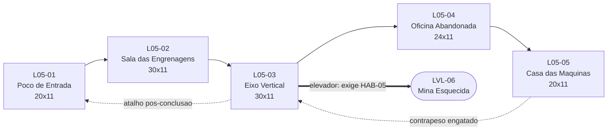

# LVL-05 — Cripta das Engrenagens

> Setor 5 de 16 · **`[PÓS]`** · Ato II — A Ronda · **setor de aquisição de habilidade**
> Versão: `0.1.0` · Data: `2026-11-13` · Autor: `AGT-02` (Designer de Level) + `AGT-03` (Gameplay)
> Base: [GDD 3.4](../03-conteudo-do-jogo.md) · [Setores e Cenários §4.1, §4.2, §4.4 e §4.90](../design-patterns/04-setores-e-cenarios.md) · [Padrões de Level Design §7.1 e §7.9](../design-patterns/07-padroes-de-level-design.md)

> ⚠️ **Escopo `[PÓS]` — leia antes de usar este documento.**
> Fora do recorte do MVP. Especificado completo para destravar o Ato II e o orçamento de arte, mas nome e conteúdo **não são canônicos** (`D-04`). Não codar antes de `BKL-012`.

**Status:** layout completo nos 12 campos, grades validadas, alcançabilidade verificada na config canônica **B** (`DEC-014`). **Este é o primeiro setor do jogo que entrega uma habilidade nova** — e isso muda a natureza do documento: ele especifica um layout *e* uma aquisição.

---

## 1. Os 12 campos obrigatórios

| # | Campo | Definição |
|---|---|---|
| 1 | **ID e nome canônico** | `LVL-05` — Cripta das Engrenagens *(nome de trabalho, `[PÓS]`)* |
| 2 | **Objetivo** | Obter **`HAB-05` Força** na oficina e usar o **contrapeso** para pôr o **elevador de engrenagem** a funcionar, subindo para LVL-06 |
| 3 | **Duração e mortes** | 8–12 min na primeira visita · **2–4 mortes esperadas** |
| 4 | **Acento e materiais** | `PAL-05` bronze `#C98A3E` · bronze fundido, dente de engrenagem, óleo |
| 5 | **Sinais de ambientação** | engrenagens girando **sem carga** · óleo escorrendo pelas paredes · dentes de engrenagem no chão · dedos marcados na graxa |
| 6 | **Habilidade de entrada / saída** | Entrada: `HAB-01` (salto duplo). Saída: **`HAB-05` Força** — obtida aqui |
| 7 | **Salas** | 5 salas: 20 · **30** · **30** · 24 · 20 (× 11) = **124 tiles** |
| 8 | **O que ensina** | `HAB-05` em 4 tempos (`PAT-LD-02`) · verticalidade empilhada · backtracking curto com recompensa |
| 9 | **Set pieces** | `CEN-040` engrenagem gigante · `CEN-041` poço de óleo · `CEN-042` dente no chão · `CEN-043` placa de contrapeso |
| 10 | **Inimigos** | `ENT-002` Sentinela distorcida × 7 (1 · 2 · 1 · 2 · 1) |
| 11 | **Entradas e saídas** | L05-01 ← **LVL-04** (porta) · L05-03 → **LVL-06** (elevador `U`, exige `HAB-05`) |
| 12 | **Teste de rastreabilidade** | `TST-005` (`HAB-05` sobrevive à morte — **crítico aqui**) · `TST-001` · `TST-002` · `TST-007` · `TST-013` |

### Propriedades de design deste setor

- **É o primeiro setor com aquisição de habilidade.** Até aqui, `HAB-01` veio de LVL-02 (que já era a "senha" do MVP). LVL-05 estabelece o padrão metroidvania real: **o jogador chega travado, explora, ganha um verbo novo e destrava o caminho por onde já passou.**
- **`DEC-010` é a espinha:** a habilidade é obtida **antes** de ser exigida. O jogador pega Força em L05-04, *depois* de ver o elevador travado em L05-03.
- **`PAT-LD-03` em três exposições:** (1) o bloco que não cede, em L05-02 — o jogador vê que existe algo pesado; (2) o elevador que não sobe, em L05-03 — ele entende que está travado; (3) a Força pegando e o bloco cedendo em L05-05 — ele reconhece a solução. As três acontecem **antes** de a porta ser resolvida.
- **A trava é a própria saída do setor**, não uma porta no meio. O elevador é ao mesmo tempo a passagem 05 → 06 do grafo (`04-setores` §4.1) e o objeto que o jogador vê travado.

---

## 2. Fluxo



| Transição | Checkpoint |
|---|---|
| LVL-04 → L05-01 | já salvo em L05-05 de LVL-04 |
| L05-01 → L05-02 | salva ao cruzar a porta |
| L05-02 → L05-03 | salva ao cruzar a porta |
| **L05-03** | **`P` em (2,6)** — o hub tem ponto de salvamento manual, e é o único do setor |
| L05-03 → L05-04 | salva ao cruzar a porta |
| L05-04 → L05-05 | salva ao cruzar a porta |
| L05-05 → L05-03 | **volta** pelo corredor de serviço (o contrapeso não tem porta própria) |

> **O setor tem laço, não ramificação.** A rota é linear até L05-05 e depois volta. A volta é curta (2 salas, ~35 s) e o `P` do hub fica no caminho, então morrer no retorno não custa a travessia inteira. Ver `P-26` (inimigos não respawnam no backtracking — assumido).

---

## 3. Legenda das grades

| Símbolo | Camada | Significado |
|---|---|---|
| `#` | `ground` + `collision` | sólido |
| `=` | `collision` (só topo) | **engrenagem-plataforma** atravessável *(one-way)* |
| `+` | — | abertura de passagem |
| `D` | `objects` | porta dourada (entrada de área) |
| `.` | — | ar |
| `E` | `objects` | Sentinela distorcida (`ENT-002`) |
| `A` | `objects` | **dente de engrenagem no chão** (`CEN-001` reskin, ver `11. Desvios`) |
| `B` | `objects` + `collision` | **bloco pesado** — só se move com `HAB-05` |
| `X` | `objects` | **`HAB-05` Força** (`ITM-005`, ID proposto — `P-38`) |
| `U` | `objects` | **elevador de engrenagem** — `requires=HAB-05` |
| `C` | `objects` | placa de contrapeso (`CEN-043`) |
| `P` | `objects` | ponto de salvamento |
| `N` | `objects` | inscrição / marco de lore |
| `W` | `decor-back` | engrenagem gigante (`CEN-040`), sem colisão |
| `o` | `decor` | poço de óleo (`CEN-041`), sem dano |
| `k` | `decor` | objeto de trabalho abandonado (`CEN-004`) |

Piso em `y=7` e aberturas em `y=4–6` seguem `DEC-007`.

---

## 4. Salas

### 4.1 L05-01 — Poço de Entrada · 20×11

```
    00000000001111111111
    01234567890123456789
y0  ####################
y1  #..................#
y2  #.....W......W.....#
y3  #..................#
y4  D.......===........+
y5  D..................+
y6  D....o.....o...oE..+
y7  ####################
y8  ####################
y9  ####################
y10 ####################
```

| Objeto | Pos | Função |
|---|---|---|
| `D` porta | (0,4)–(0,6) | volta para LVL-04. Autosave |
| `W` engrenagens | (6,2) · (13,2) | `CEN-040`, giro lento a 2 rpm, sem colisão |
| `o` óleo | (5,6) · (11,6) · (15,6) | `CEN-041`, mancha, sem dano |
| `=` engrenagem | x = 8–10, topo `y=4` | sobe 3 tiles — rota alta opcional |
| `E` Sentinela | (16,6) | patrulha de 3 tiles |

- **Função:** soleira do Ato II mecânico. Nada trava, nada ensina — mas o material muda: de madeira morta e cinza para bronze e óleo.
- **Aceite:** atravessar em ≤ 12 s. A plataforma de x=8–10 é decoração escalável, não caminho obrigatório.
- **Nota:** `PAT-LD-04` pede respiro depois de L04-05, que era uma trava de salto. Por isso este setor **abre** com uma sala sem obstáculo.

---

### 4.2 L05-02 — Sala das Engrenagens · 30×11

```
    000000000011111111112222222222
    012345678901234567890123456789
y0  ##############################
y1  #................N...........#
y2  #.......W.......====.........#
y3  #.........====........W......#
y4  +...====.....................+
y5  +............................+
y6  +..B..E..o....AA........E..o.+
y7  ##############################
y8  ##############################
y9  ##############################
y10 ##############################
```

| Elemento | Posição | Função |
|---|---|---|
| `=` engrenagem A | x = 4–7, topo `y=4` | sobe **3 tiles** do piso → exige `HAB-01` |
| `=` engrenagem B | x = 10–13, topo `y=3` | 1 tile acima de A, vão de **2 tiles** |
| `=` engrenagem C | x = 16–19, topo `y=2` | 1 tile acima de B, vão de **2 tiles** |
| `N` marco | (17,1) | em cima de C — **"A MÁQUINA NÃO SABE QUE O TURNO ACABOU."** (8 palavras) |
| `A` dentes | (14,6) · (15,6) | `CEN-001` — par **estático** aqui (ver §11, desvio 1) |
| `B` bloco | (3,6) | bloco pesado — **não cede** (1ª exposição de `PAT-LD-03`) |
| `E` Sentinelas | (6,6) · (24,6) | patrulha de 3 e 4 tiles, espaçadas 18 tiles |
| `o` óleo | (9,6) · (27,6) | sem dano |

- **Função:** ensinar a subir em três níveis empilhados, com os dentes de engrenagem punindo queda.
- **Ensina:** `PAT-LD-02` **tempo 3 (combinar)** — verticalidade de `HAB-01` + armadilha de chão. O jogador já sabe as duas coisas separadas: LVL-02 ensinou o salto duplo, LVL-01 ensinou o espinho.
- **Aceite:** o jogador chega ao `N` de (17,1) **e** volta ao piso sem tomar dano; ou sobe até C, pega a lore e desce pelo lado direito.
- **O bloco de (3,6) é deliberadamente inútil.** Ele não trava nada, não esconde nada, e o jogador **pode pular por cima** (1 tile de altura). Existe só para o jogador empurrá-lo, ver que não se move, e guardar a informação. É a exposição 1 de `PAT-LD-03`.

---

### 4.3 L05-03 — Eixo Vertical · 30×11 *(hub)*

```
    000000000011111111112222222222
    012345678901234567890123456789
y0  ##############################
y1  #................N...........#
y2  #.....W........====.....W....#
y3  #........====................#
y4  +..====......................+
y5  +............................+
y6  +.P......o..E...o.........U..+
y7  ##############################
y8  ##############################
y9  ##############################
y10 ##############################
```

| Elemento | Posição | Função |
|---|---|---|
| `P` save | (2,6) | `UI-09`, manual. **Único do setor** |
| **`U` elevador** | (26,6) | `requires=HAB-05`, `dest=LVL-06`. **Travado na chegada** |
| `=` engrenagem A | x = 3–6, topo `y=4` | sobe 3 tiles |
| `=` engrenagem B | x = 9–12, topo `y=3` | 1 tile acima, vão de 2 tiles |
| `=` engrenagem C | x = 15–18, topo `y=2` | 1 tile acima, vão de 2 tiles |
| `N` marco | (17,1) | **"ALGUÉM AINDA DÁ CORDA NISSO. NINGUÉM SABE QUEM."** (10 palavras) |
| `E` Sentinela | (12,6) | patrulha de 3 tiles |
| `W` engrenagens | (6,2) · (24,2) | `CEN-040` |

- **Função:** hub. O jogador entra, vê o elevador à direita, vê que ele não sobe, e a rota segue para a direita — para a oficina. Ao voltar com Força, o elevador é a saída.
- **Ensina:** `PAT-LD-03` **exposição 2** — o obstáculo está visível, é reconhecível como máquina (engrenagem, manivela, óleo), e está a menos de 20 tiles da entrada. Não há como atravessar o setor sem passar por ele.
- **Aceite:** o jogador chega ao `U`, interage, recebe a mensagem de que falta força (`UI-12`, ver §9) e segue para a direita. **Nenhuma tentativa é punida.**
- **Por que o hub tem 3 níveis se não precisa:** o elevador é uma máquina vertical. Uma sala de hub plana com um elevador no canto não venderia a ideia. O empilhamento é o cenário, não a prova — os vãos entre as plataformas são todos de 2 tiles e sobem 1 tile, folgados de propósito.

---

### 4.4 L05-04 — Oficina Abandonada · 24×11

```
    000000000011111111112222
    012345678901234567890123
y0  ########################
y1  #......................#
y2  #..W.............X.....#
y3  #...............====.W.#
y4  +..........====........+
y5  +......................+
y6  +....E..o......o....E.k+
y7  ########################
y8  ########################
y9  ########################
y10 ########################
```

| Elemento | Posição | Função |
|---|---|---|
| **`X` Força** | (17,2) | `HAB-05` (`ITM-005`). Sobre a plataforma de `y=3` |
| `=` plataforma | x = 11–14, topo `y=4` | sobe 3 tiles → exige `HAB-01` |
| `=` plataforma | x = 16–19, topo `y=3` | 1 tile acima, vão de 1 tile |
| `E` Sentinelas | (5,6) · (20,6) | patrulha, espaçadas 15 tiles |
| `W` engrenagens | (3,2) · (21,3) | `CEN-040` |
| `o` óleo | (8,6) · (15,6) | sem dano |
| `k` objeto | (22,6) | `CEN-004` — ferramenta largada |

- **Função:** a oficina onde a Vigília consertava a máquina. É onde a Força está guardada.
- **Ensina:** `PAT-LD-02` **tempo 1 (introduzir)** — a habilidade aparece isolada e segura. O caminho até `X` é só de plataforma: nenhum inimigo está em cima do trajeto de subida, e **nenhum obstáculo exige a habilidade que está sendo dada** (`DEC-010`).
- **Aceite:** o jogador pega `X`, recebe o hold de 400 ms com flash `PAL-05`, e a `UI` deixa claro o que ganhou. `TST-005` verde.
- **Por que a habilidade está no alto e não no chão:** a subida é a última prova de `HAB-01` antes de o setor mudar de assunto. Depois de pegar Força, o jogo deixa de ser sobre pular.

---

### 4.5 L05-05 — Casa das Máquinas · 20×11

```
    00000000001111111111
    01234567890123456789
y0  ####################
y1  #.........##########
y2  #....W....##########
y3  #.......W.##########
y4  +.........##########
y5  +..................#
y6  +..o..E......B...C.#
y7  ####################
y8  ####################
y9  ####################
y10 ####################
```

| Elemento | Posição | Função |
|---|---|---|
| **teto baixo** | `y0`–`y4` sólidos de x=10 a x=19 | corredor de **2 linhas de ar** (y5–y6) |
| `B` bloco | (13,6) | bloco pesado — **primeiro que cede** (`HAB-05`) |
| `C` placa | (17,6) | `CEN-043` contrapeso — recebe o bloco |
| `E` Sentinela | (6,6) | 1 inimigo, na parte alta da sala |
| `W` engrenagens | (5,2) · (8,3) | `CEN-040` |
| `o` óleo | (3,6) | sem dano |

- **Função:** o contrapeso. Empurrar o bloco até a placa engata o elevador de L05-03.
- **Ensina:** `PAT-LD-02` **tempo 2 (praticar)** — repetição sem consequência. Não há perigo no corredor, não há como errar: o bloco só pode ir para a direita, e a placa está no fim.
- **Por que o teto é baixo:** é o que torna o bloco **um obstáculo de verdade**. Com 4 linhas de ar, o jogador pularia em cima do bloco (1 tile de altura) e passaria por cima. Com **2 linhas de ar**, o herói (2 tiles) preenche o corredor exatamente e **não consegue saltar nem 1 px**. O bloco passa a ser parede.
- **Aceite:** o jogador empurra `B` de x=13 até x=17 (4 empurrões), ouve o engate, e volta.
- **Sem soft lock:** depois de engatar, o jogador fica **à esquerda** do bloco e a saída é a **esquerda**. Não existe situação em que ele precise passar por cima do próprio bloco. O corredor é de mão única na prática, e isso é intencional.

---

## 5. `HAB-05` Força — especificação

A habilidade está listada em `04-setores` §4.2 com origem **LVL-05**, mas **não tem ficha numérica** em lugar nenhum. Esta seção propõe uma; a canonização é `P-38`.

### 5.1 O que ela faz

| Verbo | Definição proposta | Onde é usada |
|---|---|---|
| **Empurrar bloco pesado** | andar contra um `pushable_block` move 1 tile a 60 px/s, com *snap* ao alinhar | L05-05 (obrigatório), L05-02 (opcional) |

### 5.2 O que ela **não** faz neste setor

`04-setores` §4.2 também atribui a `HAB-05` "quebrar piso rachado". **Isso não é usado em LVL-05** e não deve ser implementado agora: exigiria um tile novo com estado (rachado → quebrado), um sistema de colisão dinâmica e um critério de "é pesado o bastante". Fica para um setor posterior, quando o verbo de empurrar já estiver provado. Registrar em `P-38`.

### 5.3 Regras

- **Permanente.** Não cai na morte (`MEC-005`). `TST-005` é o teste que importa: morrer depois de pegar Força e voltar ao checkpoint **mantém** a habilidade. Sem isso, o elevador de L05-03 vira soft lock.
- **Não afeta combate.** Não dá dano, não empurra inimigo, não quebra armadura. Se afetasse, viraria uma segunda arma e mudaria o balanceamento de `TST-002`.
- **Não atravessa parede.** O bloco só anda em piso plano; encosta em parede, encosta em outro bloco, encosta em desnível.
- **Feedback de aquisição:** hold de 400 ms + flash `PAL-05` + `UI` de habilidade nova. Mesmo padrão do fragmento de LVL-02 (`ITM-003`), para o jogador reconhecer "isso é permanente".

---

## 6. A verticalidade em 11 linhas — a restrição que define o setor

Este é o setor de "verticalidade mecânica", e é obrigatório registrar **por que ele não tem salas altas**.

`07-padroes` §7.1 fixa: tela lógica **1280 × 704 px**, tile **64 px**, sala padrão **20 × 11 tiles** — "múltiplo exato da tela; **sem rolagem**". Salas largas (30/40) têm **rolagem horizontal**. Não há rolagem vertical: 704 / 64 = **11 linhas exatas**.

**Consequências que o layout obedece:**

| Restrição | Efeito no design |
|---|---|
| 11 linhas, piso em `y=7` | sobram **6 linhas de ar** (`y1`–`y6`) |
| herói ocupa **2 linhas** | o corpo útil é de 5 linhas |
| plataforma na linha `r` → jogador pisa em `r−1` | a plataforma mais alta possível é `y=2` (pisando em `y=1`); `y=1` é inválida, porque o piso seria o teto |
| primeiro degrau a partir do chão | no máximo **3 tiles** (192 px) — 4 tiles (256 px) deixam 20 px de margem e caem na ambiguidade que `PAT-LD-09` proíbe |
| degraus seguintes | **1 tile** por vez, com vãos de 1–2 tiles |

**Portanto a escada vertical máxima deste jogo é: piso `y=6` → `y=4` → `y=3` → `y=2`.** Quatro níveis, sempre. É o que L05-02, L05-03 e L05-04 fazem.

**E a verticalidade real do setor é a que sai dele.** A passagem 05 → 06 é o **elevador de engrenagem** — o único movimento vertical verdadeiro, porque atravessa a fronteira entre áreas e não precisa caber na tela. O setor inteiro é um argumento para esse elevador existir.

> ⚠️ Se a câmera **puder** rolar na vertical, este setor está subaproveitado: ele deveria ter poços de 20+ linhas. Isso está registrado como `P-39` antes de qualquer linha de código, porque refazer um setor de 5 salas depois de arte pronta custa outra ordem de grandeza.

---

## 7. Validação de alcançabilidade

Solver de passo fixo a 60 Hz na **config canônica B** (`DEC-014`: impulso 560, gravidade 1100, velocidade 220 px/s, tile 64 px).

| Subida | Salto simples | Salto duplo |
|---|---:|---:|
| 0 tiles (mesmo nível) | 220 px | 378 px |
| 1 tile (64 px) | 191 px | 359 px |
| 2 tiles (128 px) | 139 px | 337 px |
| **3 tiles (192 px)** | **0 — impossível** | **308 px** |
| 4 tiles (256 px) | 0 — impossível | 264 px |

Altura máxima: **138 px** simples (2,15 tiles) · **276 px** duplo (4,31 tiles).

| Obstáculo | Sala | Subida | Vão | Exige `HAB-01`? | Resultado |
|---|---|---|---:|---:|---|---|
| engrenagem-plataforma | L05-01 | 192 px | 0 | sim | duplo 276 px ✓ (folga 84) |
| engrenagem A | L05-02 | 192 px | 0 | sim | ✓ |
| A → B | L05-02 | 64 px | 128 px | não | simples 191 px ✓ (folga 63) |
| B → C | L05-02 | 64 px | 128 px | não | simples 191 px ✓ |
| bloco de (3,6) | L05-02 | 64 px | 0 | não | simples 138 px ✓ — **pulável, não é trava** |
| engrenagem A | L05-03 | 192 px | 0 | sim | ✓ |
| A → B | L05-03 | 64 px | 128 px | não | ✓ |
| B → C | L05-03 | 64 px | 128 px | não | ✓ |
| plataforma | L05-04 | 192 px | 0 | sim | ✓ |
| plataforma → `X` | L05-04 | 64 px | 64 px | não | simples 191 px ✓ (folga 127) |
| **corredor do contrapeso** | L05-05 | **bloqueado** | — | — | teto em `y=4` impede qualquer salto — só `HAB-05` resolve |

**Resultado: 0 falhas.** A trava de saída do setor **não é de salto** — é de habilidade. É o primeiro setor do jogo em que `HAB-01` não resolve nada no fim.

> **Por que o bloco de L05-05 não pode ser pulado:** o corredor tem as linhas `y0`–`y4` sólidas. O herói ocupa 2 linhas e anda em `y5`–`y6`. Para subir sobre um bloco de 1 linha, ele precisaria ocupar `y4`–`y5`, e `y4` é sólido. **Zero px de salto.** Não é uma trava de altura — é uma trava de espaço. Isso é mais confiável que qualquer número da tabela de alcance, porque não depende de taxa de quadros.

---

## 8. Salvamento e morte

| Evento | O que acontece | Regra |
|---|---|---|
| Cruza `D` em L05-01 | salva | `MEC-007` |
| Interagir com `P` em L05-03 | salva | `MEC-007` |
| Cruza as portas L05-02↔03, 03↔04, 04↔05 | salva | `MEC-007` |
| Morrer após pegar `HAB-05` | respawn no checkpoint **com Força** | `MEC-005`, `TST-005` |
| Morrer em L05-05 depois de engatar o contrapeso | contrapeso **permanece** engatado | ver abaixo |
| Morrer com bolsa | bolsa fica no local | `MEC-004` |
| Perda de conexão durante save | `UI-11`, retry | `PAT-C-07` |

> **O contrapeso é estado de mapa, não de sessão.** Uma vez engatado, ele não volta a desengatar — nem com morte, nem com reload, nem com reentrada na sala. Se voltasse, o jogador teria de refazer L05-04 e L05-05 a cada tentativa no elevador, e o setor passaria de 10 min para 20. Isso precisa estar no save (`PAT-C-07`) e é o item mais importante do handoff para `AGT-03`.

**Nenhuma morte é irreversível e nenhuma trava se perde.** Não há armadilha fatal, não há queda mortal, e o único perigo real são os dentes de engrenagem de L05-02.

---

## 9. Conversão para Tiled (`.tmj`)

| Item | Definição |
|---|---|
| Nome do arquivo | `public/assets/tilemaps/tm_lvl05_cripta.tmj` |
| Tileset | `tm_cripta` (`AST-006` — **ID proposto**, ver `P-38`), ~32 tiles, 64×64 |
| Orientação | orthogonal, tile 64×64, 20–30 colunas × 11 linhas por sala |
| Camadas (ordem) | `decor-back` · `ground` · `collision` · `objects` · `decor-front` |
| Propriedades do mapa | `lvl_id=LVL-05`, `pal=PAL-05`, `bgm=BGM-05`, `amb=AMB-05`, `scope=post` |

### Propriedades dos objetos (`objects`)

| Tipo | Propriedades |
|---|---|
| `enemy` | `ent=ENT-002`, `patrol_tiles`=3–4, `initial_facing`=`right`, `has_telegraph`=true |
| `save_point` | `ui=UI-09`, `checkpoint`=true |
| `door` | `to=LVL-04` (L05-01, `style=gold`, `autosave=true`) |
| `trap_spikes` | `cen=CEN-001`, `mode`=`static`, `skin`=`gear_teeth`, `damage_key`=`spikes` |
| `pushable_block` | `requires=HAB-05`, `push_speed`=60, `snap`=`tile`, `counterweight_id`=`cw_lvl05` (só L05-05) |
| `counterweight_plate` | `id`=`cw_lvl05`, `on_engage`=`elevator_lvl05.power_on` |
| `gear_elevator` | `id`=`elevator_lvl05`, `requires=HAB-05`, `dest=LVL-06`, `alt_dest=LVL-05:entrada`, `powered_by`=`cw_lvl05`, `locked_ui`=`UI-12` |
| `ability_pickup` | `hab=HAB-05`, `itm=ITM-005`, `hold_ms`=400, `pal=PAL-05` |
| `lore_marker` | `key`=`lore.lvl05.maquina` / `.corda`, `max_words`=25 |
| `decor` | `ast=CEN-040` (back) / `CEN-041` / `CEN-004`, `collides`=false |

**Regra de ouro:** nenhum número de gameplay no `.tmj`. `push_speed`, dano e física vêm de `tuning.ts` (`PAT-C-04`, `DEC-014`). O mapa aponta a **chave**.

> **`UI-12` é nova** (mensagem "sem força suficiente"). Não existe no inventário de UI atual — entra em `P-38`.

---

## 10. Checklist de aprovação (`07-padroes` §7.14)

- [x] Dimensões múltiplas de 20×11 — 20, 30, 30, 24, 20 × 11
- [x] Objetivo de cada sala compreensível em ≤ 3 s
- [x] Respeita a tabela de alcance (§7) — **0 falhas** na config canônica B
- [x] Ensino segue `PAT-LD-02` — tempos 1 (L05-04), 2 (L05-05), 3 (L05-02); tempo 4 fica para o setor seguinte
- [x] `DEC-010` respeitado — `HAB-05` é obtida em L05-04, **antes** de ser exigida em L05-03/05
- [x] `PAT-LD-03` em 3 exposições — bloco (L05-02), elevador (L05-03), solução (L05-05)
- [x] `PAT-LD-08` — atalho de retorno: o elevador ganha 2 paradas após a conclusão (`L05-03 ↔ L05-01`)
- [x] Rota crítica funciona com inventário vazio (`PAT-LD-06`)
- [x] Nenhum soft lock: corredor de mão única, saída pelo lado de onde se veio, contrapeso persistente
- [x] Densidade de inimigos conforme `PAT-LD-10` — máx. 2 por sala
- [x] `collision` alinhada ao `ground` (validado pelo gerador de grade)
- [x] Paleta com um único acento (`PAL-05`)
- [x] Testes associados: `TST-001`, `TST-002`, `TST-005`, `TST-007`, `TST-013`
- [ ] **Aprovação de escopo:** `[PÓS]` (`D-04`) — não marcado de propósito
- [ ] **Ficha numérica de `HAB-05`:** pendente (`P-38`)

---

## 11. Desvios registrados

| # | O que mudou | Por quê | IDs afetados |
|---|---|---|---|
| 1 | `CEN-001` entra com **skin de dente de engrenagem**, modo **estático** | O setor não tem armadilha própria, e LVL-04 já foi um setor sem nenhuma. Reaproveitar `CEN-001` com outra pele mantém a mecânica canônica (1 tile, `--threat`) e evita inventar um `CEN` novo sem catálogo canônico. Estático porque cíclico + verticalidade + 2 inimigos seria 3 variáveis novas na mesma sala | `CEN-001`, `PAT-LD-09` |
| 2 | O bloco de L05-02 é **inútil de propósito** | `PAT-LD-03` exige que o obstáculo seja visto antes da chave. Um bloco que trava caminho antes de a habilidade existir seria *soft lock* | `PAT-LD-03`, `DEC-010` |
| 3 | O corredor de L05-05 tem **2 linhas de ar** | É o que torna o bloco impunível de pular. Com 3 linhas, o salto simples (138 px) passaria por cima de um bloco de 1 tile | `PAT-LD-09` |
| 4 | O setor tem **4 níveis verticais e não mais** | Limite físico: 11 linhas de tela, piso em `y=7`, plataforma mais alta em `y=2`. Ver §6 | `07-padroes` §7.1, `P-39` |
| 5 | `HAB-05` faz **só** empurrar bloco, não quebra piso rachado | Quebrar piso exige tile com estado e colisão dinâmica. Provar o verbo simples primeiro | `P-38` |

---

## 12-A. Desvios de implementação (código)

O setor está implementado **atrás de flag** (`FLAGS.lvl05 = false`) e verificado por
`npm run lvl05`. Estes são os pontos em que o código não seguiu o documento ao pé da letra.

| # | O documento diz | O código faz | Por quê |
|---|---|---|---|
| I-1 | §3 usa `X` para `HAB-05` e `B` para bloco | `X` virou `ITM-005` no alfabeto de itens; `B` é resolvido por sala (`glyphs: { B: 'block' }`) | `B` já era o chefe em LVL-03; o significado é da sala (`DEC-023`) |
| I-2 | §5.1: empurrar a 60 px/s com *snap* | tween de 1 tile a 60 px/s (TILE/60 ms) e snap na coluna, disparado pela **intenção de input** | medir pela velocidade resultante nunca dispara: o bloco é sólido e zera a velocidade do jogador ao encostar |
| I-3 | §5.3: "não atravessa parede" | `blockedColumns()` lê a **grade da sala** (`y=6`) | parede é dado do nível, não número à mão; desnível continua bloqueando |
| I-4 | §8: o contrapeso é estado de mapa e vai para o save | o código mantém `counterweight` na cena (sobrevive à morte e à troca de sala), mas **não** grava no `localStorage` | o save de `MEC-007` não tem campo de mapa; `P-74` registra a dívida |
| I-5 | §1: saída por elevador para **LVL-06** | com Força + contrapeso o elevador avisa `LVL-06 FORA DO BUILD · SETOR [PÓS]` | LVL-06 não existe; emitir `game:completed` mentiria sobre o fim do jogo |
| I-6 | §5.2: "quebrar piso rachado" não deve ser implementado | não foi implementado — `P-38` segue aberta | é o próprio documento que pede para adiar |
| I-7 | §4: `HAB-05` é adquirida em L05-04 | a habilidade também é **reaplicada na remontagem da sala** a partir de `collected` | sem isso `TST-005` falha: o `Player` é recriado a cada `mountRoom` e a Força se perdia na morte |

---

## 12. Pendências geradas

| ID | Item | Bloqueia |
|---|---|---|
| `P-37` | **LVL-04 não tem atalho de retorno.** `PAT-LD-08` exige atalho fim→início em todo setor com 4+ salas, e LVL-04 tem 5. Corrigir junto com LVL-05 (que resolve o problema pelo elevador de 2 paradas) | `PAT-LD-08`, LVL-04 |
| `P-38` | **`HAB-05` não tem ficha numérica.** `04-setores` §4.2 lista a habilidade mas não define velocidade de empurrão, se quebra piso rachado, nem se afeta combate. Faltam também `ITM-005`, `AST-006` e `UI-12`, que não têm catálogo canônico | `BKL-011`, `BKL-012` |
| `P-74` | **Contrapeso não persiste no save.** O código guarda o engate na sessão (resistiu à morte no teste), mas `MEC-007` não tem `world_state`. Decidir o escopo: bloco novo no save, ou contrapeso reengatável em LVL-05 | `PAT-C-07`, LVL-05 §8 |
| `P-39` | **Confirmar que não existe rolagem vertical de câmera.** `07-padroes` §7.1 implica isso (20×11 = tela exata), mas nenhum documento afirma explicitamente. Se a câmera **puder** rolar na vertical, LVL-05 deve ser refeito com poços de 20+ linhas antes de qualquer arte | `BKL-001`, LVL-05, setores 06–16 |

---

## Handoff

**Para `AGT-03`** — `pushable_block` com `requires=HAB-05`; **estado do contrapeso persistente no save** (é o item mais crítico deste documento); `gear_elevator` com `powered_by` e duas paradas após a conclusão; `UI-12`; `ability_pickup` com hold de 400 ms e flash `PAL-05`.

**Para `AGT-01`** — `CEN-040` engrenagem gigante (2 rpm, 4 variantes de raio), `CEN-041` poço de óleo (reflexo estático, sem partícula), `CEN-042` dente no chão, `CEN-043` placa de contrapeso com 2 estados (vazia / engatada). Tileset `tm_cripta` ~32 tiles, incluindo as engrenagens-plataforma `=` em 3 alturas de encaixe.

**Para `AGT-07`** — `TST-005` é **o teste do setor**: pegar Força, morrer, voltar ao checkpoint e confirmar que o elevador ainda funciona. Testar também morrer **depois** de engatar o contrapeso — o estado tem de sobreviver ao reload.

**O próximo agente precisa saber, em 3 linhas:**

1. **Este setor entrega `HAB-05`.** Nada nele pode exigir Força antes de L05-04 (`DEC-010`) — se exigir, é soft lock.
2. **A trava de saída não é de salto.** É um corredor de 2 linhas de ar com um bloco dentro: nenhuma quantidade de `HAB-01` resolve.
3. **Não desenhe salas altas.** 11 linhas é a tela inteira; a verticalidade mora no empilhamento de 4 níveis e no elevador. Se `P-39` disser o contrário, este documento é refeito — não remendado.
