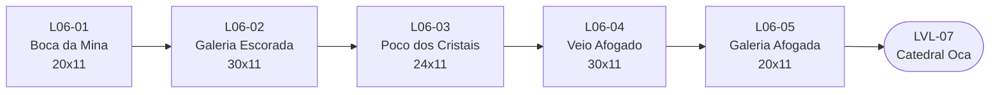

# LVL-06 — Mina Esquecida

> Setor 6 de 16 · **`[PÓS]`** · Ato II — A Ronda · **segundo setor de aquisição de habilidade**
> Versão: `0.1.0` · Data: `2026-11-13` · Autor: `AGT-02` (Designer de Level) + `AGT-03` (Gameplay)
> Base: [GDD 3.4](../03-conteudo-do-jogo.md) · [Setores e Cenários §4.1, §4.2, §4.4 e §4.90](../design-patterns/04-setores-e-cenarios.md) · [Padrões de Level Design §7.9](../design-patterns/07-padroes-de-level-design.md)

> ⚠️ **Escopo `[PÓS]` — leia antes de usar este documento.**
> Fora do recorte do MVP. Especificado completo para destravar o Ato II e o orçamento de arte, mas nome e conteúdo **não são canônicos** (`D-04`). Não codar antes de `BKL-012`.

**Status:** layout completo nos 12 campos, grades validadas, alcançabilidade seca verificada na config canônica **B** (`DEC-014`), travessia aquática verificada por cálculo de fôlego.

> 🔴 **Este documento corrige o grafo do mundo.** `04-setores` §4.2 atribui `HAB-06` Fôlego ao **LVL-07**, mas §4.1 exige `HAB-06` para atravessar **06 → 07**. É uma dependência circular do mesmo tipo que `DEC-010` proíbe. A §6 explica a correção proposta (`P-40`).

---

## 1. Os 12 campos obrigatórios

| # | Campo | Definição |
|---|---|---|
| 1 | **ID e nome canônico** | `LVL-06` — Mina Esquecida *(nome de trabalho, `[PÓS]`)* |
| 2 | **Objetivo** | Descer pela mina, obter **`HAB-06` Fôlego** no veio afogado e atravessar a galeria inundada até LVL-07 |
| 3 | **Duração e mortes** | 9–13 min na primeira visita · **2–4 mortes esperadas** |
| 4 | **Acento e materiais** | `PAL-06` violeta de cristal `#8C7BC7` · escora de madeira, cristal, escuro real |
| 5 | **Sinais de ambientação** | escoras segurando um teto que já cedeu · cristais como **única** fonte de luz · poças que não secam · cordas cortadas |
| 6 | **Habilidade de entrada / saída** | Entrada: `HAB-05` (elevador de LVL-05). Saída: **`HAB-06` Fôlego** — obtida aqui |
| 7 | **Salas** | 5 salas: 20 · **30** · 24 · **30** · 20 (× 11) = **124 tiles** |
| 8 | **O que ensina** | `HAB-06` em 4 tempos (`PAT-LD-02`) · ler escuridão por contraste · água como **tempo**, não como terreno |
| 9 | **Set pieces** | `CEN-050` cristal luminoso · `CEN-051` escora de madeira · `CEN-052` veio d'água · `CEN-053` estaca |
| 10 | **Inimigos** | `ENT-002` Sentinela distorcida × 6 (1 · 2 · 1 · 2 · 0) |
| 11 | **Entradas e saídas** | L06-01 ← **LVL-05** (elevador) · L06-05 → **LVL-07** (galeria inundada, exige `HAB-06`) |
| 12 | **Teste de rastreabilidade** | `TST-005` (`HAB-06` sobrevive à morte — **crítico**) · `TST-001` · `TST-002` · `TST-007` · `TST-013` |

### Propriedades de design deste setor

- **A água não é obstáculo, é cronômetro.** Todo o resto do jogo mede distância em tiles; aqui a unidade é **segundo de fôlego**. É a única mecânica do projeto em que ficar parado mata — e por isso ela vem com uma rede de segurança (§5.3).
- **O escuro não esconde informação.** Não existe sistema de luz no projeto (§7). O setor é escuro na arte e legível na jogabilidade: cristais iluminam o que importa, e nada de gameplay fica fora do campo visível.
- **A descida é de área, não de sala.** Como em LVL-05, 11 linhas é a tela inteira (`07-padroes` §7.1). A mina *desce* porque se entra pelo elevador do topo de LVL-05 e se sai pelo fundo, na água — não porque as salas sejam altas. Ver `P-39`.
- **Sentinelas numa mina abandonada são o tema, não um erro.** A pergunta do Ato II é "o que essas coisas ainda estão fazendo?". A resposta é: patrulhando uma mina que ninguém manda elas patrulharem. Ver `P-42`.

---

## 2. Fluxo



| Transição | Checkpoint |
|---|---|
| LVL-05 → L06-01 | já salvo no elevador de LVL-05 |
| L06-01 → L06-02 | salva ao cruzar a porta |
| L06-02 → L06-03 | salva ao cruzar a porta |
| L06-03 → L06-04 | salva ao cruzar a porta |
| **L06-04** | **`P` em (4,6)** — imediatamente antes da água |
| L06-04 → L06-05 | salva ao cruzar a porta |

> **Rota estritamente linear, sem ramificação** (`PAT-LD-06`). Isso é obrigatório aqui: se existisse um caminho para L06-05 que não passasse por L06-04, o jogador poderia chegar à galeria inundada **sem Fôlego** e ficaria preso num laço de afogamento. Não há atalho, não há sala opcional, não há porta lateral.

---

## 3. Legenda das grades

| Símbolo | Camada | Significado |
|---|---|---|
| `#` | `ground` + `collision` | sólido (rocha, teto, escora petrificada) |
| `=` | `collision` (só topo) | **caixote de escora** atravessável *(one-way)* |
| `~` | `objects` (`water`) | **água** — volume, não sólido. Ver regra abaixo |
| `+` | — | abertura de passagem |
| `D` | `objects` | porta dourada / elevador (entrada e saída de área) |
| `.` | — | ar |
| `E` | `objects` | Sentinela distorcida (`ENT-002`) |
| `A` | `objects` | **estaca de madeira** (`CEN-001` reskin, **cíclica** 1,2 s) |
| `X` | `objects` | **`HAB-06` Fôlego** (`ITM-006`, ID proposto — `P-40`) |
| `P` | `objects` | ponto de salvamento |
| `N` | `objects` | inscrição / marco de lore |
| `V` | `decor-back` | cristal luminoso (`CEN-050`) — **a luz do setor** |
| `t` | `decor-back` | escora de madeira (`CEN-051`), sem colisão |
| `k` | `decor` | objeto de trabalho abandonado (`CEN-004`) |

Piso em `y=7` e aberturas em `y=4–6` seguem `DEC-007`.

> **Regra da água (importante para a implementação).** O volume de água é definido por **retângulo declarado na ficha de cada sala**, não pelo glifo. Um `V` ou `t` desenhado **dentro** do volume é `decor-back` e **não** interrompe a água: a célula continua molhada para efeito de respiração. O glifo `~` existe só para a grade ficar legível — a autoridade é a ficha.

---

## 4. Salas

### 4.1 L06-01 — Boca da Mina · 20×11

```
    00000000001111111111
    01234567890123456789
y0  ####################
y1  #..................#
y2  #....t......t......#
y3  #..................#
y4  D.......===........+
y5  D..................+
y6  D...N..t.k.....V.E.+
y7  ####################
y8  ####################
y9  ####################
y10 ####################
```

| Objeto | Pos | Função |
|---|---|---|
| `D` porta | (0,4)–(0,6) | elevador vindo de LVL-05. Autosave |
| `N` marco | (4,6) | **"O ELEVADOR AINDA FUNCIONA. ALGUÉM O USA."** (7 palavras) |
| `t` escoras | (5,2) · (12,2) · (7,6) | `CEN-051`, madeira vergada |
| `=` caixote | x = 8–10, topo `y=4` | sobe 3 tiles — rota alta opcional |
| `V` cristal | (15,6) | `CEN-050`, primeiro cristal aceso do setor |
| `E` Sentinela | (17,6) | patrulha de 3 tiles |
| `k` objeto | (9,6) | `CEN-004` |
| **Água** | — | nenhuma |

- **Função:** a soleira. O jogador sai de uma cripta de bronze e entra numa mina de madeira apodrecida — a materialidade muda antes de qualquer regra mudar.
- **Ensina:** nada. `PAT-LD-04` aplicado: respiro curto antes do primeiro aperto.
- **Aceite:** atravessar em ≤ 12 s. O cristal de (15,6) é o primeiro aviso de que a luz do setor é violeta.

---

### 4.2 L06-02 — Galeria Escorada · 30×11

```
    000000000011111111112222222222
    012345678901234567890123456789
y0  ##############################
y1  #............................#
y2  #..t......t...N.....t........#
y3  #............====........t...#
y4  +.....====...................+
y5  +............................+
y6  +....E.tV.......AAV....E..t..+
y7  ##############################
y8  ##############################
y9  ##############################
y10 ##############################
```

| Elemento | Posição | Função |
|---|---|---|
| `=` caixote A | x = 6–9, topo `y=4` | sobe **3 tiles** → exige `HAB-01` |
| `=` caixote B | x = 13–16, topo `y=3` | 1 tile acima de A, vão de **2 tiles** |
| `N` marco | (14,2) | em cima de B — **"ESCORARAM O TETO. DEPOIS FORAM EMBORA."** (6 palavras) |
| `A` estacas | (16,6) · (17,6) | `CEN-001` **cíclico**, 1,2 s ativo / 1,2 s inativo |
| `V` cristais | (8,6) · (18,6) | `CEN-050` |
| `t` escoras | (3,2) · (10,2) · (20,2) · (25,3) · (7,6) · (26,6) | `CEN-051` |
| `E` Sentinelas | (5,6) · (23,6) | patrulha de 3 e 4 tiles, espaçadas 18 tiles |
| **Água** | — (só a poça decorativa `CEN-011`, 4 px, sem dano) | — |

- **Função:** a mina em uso. As escoras seguram um teto que já cedeu — a madeira é o que resta entre o jogador e a rocha.
- **Ensina:** `PAT-LD-02` **tempo 3 (combinar)** — subida em plataforma + armadilha no chão. As duas coisas já foram ensinadas separadas; aqui aparecem juntas.
- **Aceite:** chegar ao `N` de (14,2) e voltar ao piso sem dano; ou cruzar reto no piso, desviando das estacas pelo ciclo.
- **Nota sobre as estacas:** cíclicas **aqui e só aqui**. Em L06-03 elas são estáticas. Repetir o ciclo de 1,2 s em duas salas seguidas transformaria o setor num teste de ritmo, e o ritmo não é o assunto dele.

---

### 4.3 L06-03 — Poço dos Cristais · 24×11

```
    000000000011111111112222
    012345678901234567890123
y0  ########################
y1  #................N.....#
y2  #.V.............====V..#
y3  #........V====.........#
y4  +...====..............V+
y5  +......................+
y6  +....t..E...AA....t....+
y7  ########################
y8  ########################
y9  ########################
y10 ########################
```

| Elemento | Posição | Função |
|---|---|---|
| `=` caixote A | x = 4–7, topo `y=4` | sobe 3 tiles |
| `=` caixote B | x = 10–13, topo `y=3` | 1 tile acima, vão de 2 tiles |
| `=` caixote C | x = 16–19, topo `y=2` | 1 tile acima, vão de 2 tiles |
| `N` marco | (17,1) | em cima de C — **"OS CRISTAIS CRESCEM PARA ONDE TEM ÁGUA."** (7 palavras) — a pista do que vem |
| `V` cristais | (2,2) · (8,3) · (20,2) · (22,4) | `CEN-050`, **a única luz da sala** |
| `A` estacas | (12,6) · (13,6) | `CEN-001` **estático** |
| `E` Sentinela | (8,6) | patrulha de 3 tiles |
| `t` escoras | (5,6) · (18,6) | `CEN-051` |
| **Água** | — | — |

- **Função:** o ponto mais escuro do jogo. A sala é legível porque os cristais são **exatamente** onde o jogador precisa olhar: o primeiro no chão, o segundo na plataforma do meio, os dois últimos em cima.
- **Ensina:** que a escuridão não é aleatória. Depois desta sala o jogador sabe que **cristal = caminho**, e essa regra paga em L06-05, quando os cristais são o que impede nadar na direção errada.
- **Aceite:** subir os três níveis até o `N` e descer. A sala não tem água: é a última chance de o jogador errar o salto com consequência baixa antes do mergulho.
- **Nota de direção de arte:** nenhuma célula desta sala pode ficar abaixo do contraste mínimo (§7). O escuro é feito de **ausência de cor saturada**, não de preto sobre preto.

---

### 4.4 L06-04 — Veio Afogado · 30×11

```
    000000000011111111112222222222
    012345678901234567890123456789
y0  ##############################
y1  #..............V..######.....#
y2  #..t....V....t....######.....#
y3  #...............~~######~~~~~#
y4  +...............~~~~~~~~~~~~~+
y5  +...............~~~~~~~~~~~~~+
y6  +.....N...E.....~~~~X~~~~~~~~+
y7  ##############################
y8  ##############################
y9  ##############################
y10 ##############################
```

| Elemento | Posição | Função |
|---|---|---|
| **Água** | x = 16–28, `y=3`–`y=6` | superfície na linha `y=3`. Profundidade: **4 tiles** |
| **Bolsão fechado** | `y0`–`y3` sólidos de x=18 a x=23 | obriga a mergulhar: sob o teto não há ar |
| **`X` Fôlego** | (20,6) | `HAB-06` (`ITM-006`) — no fundo do bolsão |
| `P` save | (4,6) | `UI-09`, **imediatamente antes da água** |
| `N` marco | (6,6) | **"A ÁGUA SUBIU DEPOIS QUE PARARAM DE BOMBEAR."** (7 palavras) |
| `E` Sentinela | (10,6) | patrulha de 3 tiles, em terra |
| `V` cristais | (8,2) · (15,1) | `CEN-050` |
| `t` escoras | (3,2) · (13,2) | `CEN-051` |

- **Função:** o veio que inundou a mina. A habilidade está **dentro da água** — o jogador precisa mergulhar antes de saber nadar bem, e é isso que ensina o que é fôlego.
- **Ensina:** `PAT-LD-02` **tempo 1 (introduzir)**. O primeiro mergulho é curtíssimo: ~3,2 s de submersão, contra 6 s de fôlego base. Há folga de quase o dobro.
- **Aceite:** o jogador mergulha, pega `X`, sobe, recebe o hold de 400 ms com flash `PAL-06` e a barra de fôlego visivelmente maior. `TST-005` verde.
- **Por que o bolsão é fechado:** se o teto sobre `X` fosse aberto, o jogador poderia pegar a habilidade **sem mergulhar** — subindo pela superfície e descendo 1 tile. O bolsão sólido em `y0`–`y3` força a coluna d'água a ser o único caminho.
- **Por que o `P` está aqui e não depois:** é o único ponto de salvamento do setor e fica do lado seco, antes da água. Morrer afogado devolve o jogador aqui com fôlego cheio.

---

### 4.5 L06-05 — Galeria Afogada · 20×11

```
    00000000001111111111
    01234567890123456789
y0  ####################
y1  ####################
y2  ####################
y3  ####################
y4  +~~~~~~~~~~~~~~~~~~D
y5  +~~~~~~~~~~~~~~~~~~D
y6  +~~~t~V~~~~~~~tV~~~D
y7  ####################
y8  ####################
y9  ####################
y10 ####################
```

| Elemento | Posição | Função |
|---|---|---|
| **Teto** | `y0`–`y3` sólidos em toda a largura | galeria fechada: **a sala inteira é submersa** |
| **Água** | x = 1–18, `y=4`–`y=6` | 3 linhas de altura, **19 tiles** de comprimento |
| `t` escoras | (4,6) · (14,6) | `CEN-051`, tombaram sob a água |
| `V` cristais | (6,6) · (15,6) | `CEN-050` — **as únicas luzes**, e são as balizas do caminho |
| `D` porta | (19,4)–(19,6) | saída para LVL-07 |
| `E` inimigos | — | **nenhum.** O perigo aqui é o tempo |
| **Bolsão de ar** | — | **nenhum, de propósito** |

- **Função:** o teste. 19 tiles de água sem ar, com cristais no fundo marcando a rota.
- **Ensina:** `PAT-LD-02` **tempo 4 (testar)** — consequência real. A travessia leva **~7,6 s**; o fôlego base é **6 s**. Não passa. Com `HAB-06` são **20 s**: sobra mais da metade.
- **Por que não há bolsão de ar:** um bolsão no meio dividiria a travessia em duas pernas de ~3,8 s, e **as duas passariam com o fôlego base** — a trava deixaria de existir. O bolsão foi cortado depois de fazer essa conta, não por esquecimento.
- **Aceite:** o jogador entra, nada os 19 tiles, sai em `D`. `TST-013` verde.
- **Rede de segurança:** se o fôlego acabar, o jogador é devolvido à **última superfície respirada** (a entrada da sala) com a barra cheia e 300 ms de fade — **sem dano**. Ver §5.3.

---

## 5. `HAB-06` Fôlego — especificação

A habilidade está listada em `04-setores` §4.2 mas **não tem ficha numérica**. Esta seção propõe uma; a canonização é `P-40`.

### 5.1 O que muda

| Parâmetro | Sem `HAB-06` | Com `HAB-06` |
|---|---:|---:|
| Fôlego máximo | **6 s** | **20 s** |
| Velocidade de nado (horizontal) | 160 px/s | 160 px/s |
| Velocidade de nado (vertical) | 120 px/s | 120 px/s |
| Recuperação ao emergir | imediata | imediata |

> **A natação é universal; o fôlego não.** Qualquer personagem nada. `HAB-06` não ensina a nadar — ela **multiplica por 3,3 o tempo debaixo d'água**. Essa distinção importa porque o primeiro mergulho (L06-04) acontece **antes** da habilidade, e sem natação universal ele seria impossível.

### 5.2 O que ela **não** faz

- **Não dá visão na água.** Não há sistema de luz (§7).
- **Não é velocidade.** Nadar rápido não é um verbo do jogo; a corrida (`HAB-02`) não funciona submerso.
- **Não é combate.** Nenhum inimigo do setor entra na água.

### 5.3 Regra de afogamento

Quando o fôlego chega a zero:

1. Fade de 300 ms.
2. O jogador reaparece na **última superfície em que respirou** — normalmente a entrada da sala.
3. Fôlego restaurado a 100%.
4. **Nenhum dano, nenhuma perda de vida, nenhuma morte contada** (`MEC-004` não é acionado).

Essa regra é o análogo aquático de `DEC-011` (queda em vão não mata). E ela **não** enfraquece a trava: o jogador não pode atravessar uma distância maior que o próprio fôlego, por mais que se afogue. O que ele perde é tempo, não vida.

> Após **2 afogamentos na mesma sala**, mostrar dica de `UI` ("a água é funda demais — falta fôlego"). É a rede de segurança contra um jogador que eventualmente chegue aqui sem `HAB-06` por bug de save.

### 5.4 Permanência

Não cai na morte (`MEC-005`). `TST-005` é o teste crítico do setor: pegar Fôlego, morrer, voltar ao checkpoint e confirmar que a barra continua em 20 s. Sem isso, L06-05 vira soft lock.

---

## 6. 🔴 A contradição do grafo — por que `HAB-06` nasce aqui

Este é o achado mais importante do documento, e ele **não** é sobre level design.

### 6.1 O problema

`04-setores` afirma duas coisas incompatíveis:

| Onde | O que diz |
|---|---|
| §4.1, tabela de conexões | **06 → 07**: passagem inundada, trava **`HAB-06` fôlego** |
| §4.2, tabela de habilidades | **`HAB-06`**: setor de origem **LVL-07** |

Para chegar ao LVL-07 é preciso atravessar a passagem inundada, que exige `HAB-06`. E `HAB-06` só existe no LVL-07. **A habilidade que abre a porta está atrás da porta.**

É exatamente a classe de erro que `DEC-010` já proibiu em LVL-02 ("nenhuma trava pode exigir a habilidade que ela própria concede") — só que agora no nível do mapa do mundo, e não dentro de uma sala.

### 6.2 A segunda evidência: a habilidade não combina com o setor

Mesmo ignorando a circularidade, a atribuição é estranha:

| Setor | Materialidade (`§4.4`) | `HAB-06` Fôlego combina? |
|---|---|---|
| **LVL-06 — Mina Esquecida** | escora de madeira, cristal, **escuro real**; mina | **sim** — minas inundam, e o setor já tem água |
| **LVL-07 — Catedral Oca** | osso, vitral inteiro, vela; escala e silêncio | **não** — uma catedral não tem coluna d'água |

Duas evidências independentes apontam para o mesmo lugar.

### 6.3 A correção proposta

> **`HAB-06` Fôlego é obtida no LVL-06, não no LVL-07.** A linha §4.2 está anotada com a correção e a pendência; a decisão final é do proprietário (`P-40`).

Com isso: a rota 06 → 07 funciona, `DEC-010` é respeitado, e o LVL-07 volta a ser o que a ficha dele diz — escala e silêncio, sem água.

### 6.4 O que acontece se o proprietário recusar

Se `HAB-06` tiver de continuar nascendo em LVL-07, então **a passagem 06 → 07 não pode exigir `HAB-06`**. Nesse caso esta sala (L06-05) precisa ser refeita como uma travessia seca, e a água vira decoração de L06-04 apenas. É uma refeição de 1 dia de trabalho — mas só é barata **agora**, antes da arte.

---

## 7. "Escuro real" sem sistema de luz

A ficha do setor (§4.4) pede **escuro real**. Não existe sistema de luz no projeto: nenhum documento define cone de luz, raio, oclusão ou o que o jogador deixa de ver.

**Decisão deste documento:** escuro é **direção de arte com piso de contraste**, não mecânica.

| Regra | Consequência |
|---|---|
| Nenhuma informação de gameplay fora do visível | nada de plataforma, inimigo ou `X` em célula que o jogador não consegue ler |
| Cristal é a fonte de luz local, e está sempre onde importa | `CEN-050` funciona como sinalização, não como atmosfera |
| Contraste mínimo por célula | nenhuma célula abaixo do piso de legibilidade; o escuro vem de **saturação baixa**, não de preto sobre preto |
| A escuridão não é progressiva | não há "quanto mais fundo, mais escuro" — as salas 04 e 05, as mais fundas, têm cristais mais frequentes |

> Se o proprietário quiser **mecânica** de luz (lanterna, raio, escuridão que apaga), isso é um sistema novo e um `BKL` novo. Registrado em `P-41` — e a resposta muda o orçamento de arte deste setor.

---

## 8. Validação

### 8.1 Partes secas — geometria

Solver de passo fixo a 60 Hz na config canônica **B** (`DEC-014`). Tabela completa em `04-setores` §4.3.

| Obstáculo | Sala | Subida | Vão | Exige `HAB-01`? | Resultado |
|---|---|---|---:|---:|---|---|
| caixote (topo `y=4`) | L06-01 | 192 px | 0 | sim | duplo 276 px ✓ (folga 84) |
| caixote A | L06-02 | 192 px | 0 | sim | ✓ |
| A → B | L06-02 | 64 px | 128 px | não | simples 191 px ✓ (folga 63) |
| caixote A | L06-03 | 192 px | 0 | sim | ✓ |
| A → B → C | L06-03 | 64 px | 128 px | não | simples 191 px ✓ (×2) |

**0 falhas na geometria seca.**

### 8.2 Água — fôlego

A unidade aqui é **segundo**, não tile. Conta: `t = distância / velocidade`.

| Travessia | Distância | Tempo submerso | Fôlego base (6 s) | Com `HAB-06` (20 s) |
|---|---|---:|---|---|
| L06-04 · mergulho até `X` | 3 tiles + 3 tiles de descida | **~3,2 s** | **passa** (folga 2,8 s) | passa |
| L06-05 · galeria completa | 19 tiles × 64 = 1.216 px | **~7,6 s** | **falha** (falta 1,6 s) | **passa** (folga 12,4 s) |

| Obstáculo | Tipo de trava | Resultado |
|---|---|---|
| `X` (L06-04) | nenhuma | alcançável com fôlego base — é o ensino |
| **galeria (L06-05)** | **fôlego** | **inalcançável com 6 s; alcançável com 20 s** |

**A trava de saída é temporal, não espacial.** É a terceira categoria de trava do projeto, depois da geométrica (`DEC-009`) e da espacial (LVL-05, corredor de 2 linhas). Vale registrar: existem agora **três** mecanismos de bloqueio, e cada um depende de um sistema diferente.

---

## 9. Salvamento e morte

| Evento | O que acontece | Regra |
|---|---|---|
| Cruza `D` em L06-01 | salva | `MEC-007` |
| Interagir com `P` em L06-04 | salva | `MEC-007` |
| Cruza as portas 01↔02, 02↔03, 03↔04, 04↔05 | salva | `MEC-007` |
| Fôlego chega a zero | volta à última superfície, fôlego cheio, **sem dano** | §5.3 |
| Morrer para Sentinela | respawn no último checkpoint | `MEC-004` |
| Morrer após pegar `HAB-06` | respawn **com** fôlego de 20 s | `MEC-005`, `TST-005` |
| Morrer com bolsa | bolsa fica no local | `MEC-004`, `TST-004` |
| Perda de conexão durante save | `UI-11`, retry | `PAT-C-07` |

**Nenhuma morte é irreversível.** O setor não tem queda fatal, não tem chefe, e as estacas são a única fonte de dano. A água **nunca** mata — ela devolve.

---

## 10. Conversão para Tiled (`.tmj`)

| Item | Definição |
|---|---|
| Nome do arquivo | `public/assets/tilemaps/tm_lvl06_mina.tmj` |
| Tileset | `tm_mina` (`AST-007` — **ID proposto**, `P-40`), ~30 tiles, 64×64 |
| Orientação | orthogonal, tile 64×64, 20–30 colunas × 11 linhas por sala |
| Camadas (ordem) | `decor-back` · `ground` · `collision` · `objects` · `decor-front` · `water` |
| Propriedades do mapa | `lvl_id=LVL-06`, `pal=PAL-06`, `bgm=BGM-06`, `amb=AMB-06`, `scope=post` |

> **Camada `water` é nova** e entra **depois** de `objects` (a água tinge o que está dentro dela). O volume é pintado como retângulo, não célula a célula — é o que permite a regra da §3.

### Propriedades dos objetos (`objects`)

| Tipo | Propriedades |
|---|---|
| `enemy` | `ent=ENT-002`, `patrol_tiles`=3–4, `initial_facing`=`right`, `has_telegraph`=true |
| `save_point` | `ui=UI-09`, `checkpoint`=true |
| `door` | `to=LVL-05` (L06-01, `style=elevator`) · `to=LVL-07` (L06-05, `style=gold`, `autosave=true`) |
| `trap_spikes` | `cen=CEN-001`, `skin`=`wood_stake`, `mode`=`cyclic` (L06-02, 1,2 s) / `static` (L06-03) |
| `water_volume` | `rect`=x0,y0,x1,y1 · `surface_row` · `breath_drain`=`true` |
| `ability_pickup` | `hab=HAB-06`, `itm=ITM-006`, `hold_ms`=400, `pal=PAL-06` |
| `lore_marker` | `key`=`lore.lvl06.elevador` / `.escoraram` / `.cristais` / `.agua`, `max_words`=25 |
| `decor` | `ast=CEN-050` (back, `light_source=true`) / `CEN-051` (back) / `CEN-004`, `collides`=false |

**Regra de ouro:** nenhum número de gameplay no `.tmj`. Fôlego, velocidades de nado e dano vêm de `tuning.ts` (`PAT-C-04`).

---

## 11. Checklist de aprovação (`07-padroes` §7.14)

- [x] Dimensões múltiplas de 20×11 — 20, 30, 24, 30, 20 × 11
- [x] Objetivo de cada sala compreensível em ≤ 3 s
- [x] Respeita a tabela de alcance (§8.1) — **0 falhas** na geometria seca
- [x] Ensino segue `PAT-LD-02` — tempos 1 (L06-04), 3 (L06-02), 4 (L06-05)
- [x] `DEC-010` respeitado — `HAB-06` é obtida em L06-04, **antes** da galeria de L06-05
- [x] Rota crítica sem ramificação (`PAT-LD-06`) — obrigatório para não existir entrada em L06-05 sem Fôlego
- [x] Nenhum soft lock: afogar não mata, não há queda fatal, a água devolve
- [x] Densidade de inimigos conforme `PAT-LD-10` — máx. 2 por sala; **zero** na sala de água
- [x] Nenhuma ameaça fora da tela em sala de 30 tiles
- [x] `collision` alinhada ao `ground` (validado pelo gerador de grade)
- [x] Paleta com um único acento (`PAL-06`)
- [x] Contraste mínimo respeitado apesar do escuro (§7)
- [x] Testes associados: `TST-001`, `TST-002`, `TST-004`, `TST-005`, `TST-007`, `TST-013`
- [ ] **Aprovação de escopo:** `[PÓS]` (`D-04`) — não marcado de propósito
- [ ] **Origem de `HAB-06` canonizada como LVL-06:** pendente (`P-40`)
- [ ] **Ficha numérica de fôlego e natação:** pendente (`P-40`)

---

## 12. Desvios registrados

| # | O que mudou | Por quê | IDs afetados |
|---|---|---|---|
| 1 | **`HAB-06` movida de LVL-07 para LVL-06** | Dependência circular em §4.1 + habilidade incompatível com a materialidade de LVL-07. Ver §6 | `HAB-06`, `DEC-010`, `P-40` |
| 2 | `CEN-001` entra com **skin de estaca de madeira**; cíclica em L06-02, estática em L06-03 | O setor precisa de uma armadilha que pertença a uma mina. Variar o modo entre as duas salas evita transformar o setor num teste de ritmo | `CEN-001`, `PAT-LD-09` |
| 3 | **Escuro real é arte, não mecânica** | Não existe sistema de luz no projeto. Inventar um aqui custaria mais que o setor inteiro | `P-41` |
| 4 | **L06-05 não tem bolsão de ar** | Um bolsão dividiria a travessia em duas pernas que passariam com fôlego base, e a trava deixaria de existir | `HAB-06`, §8.2 |
| 5 | **Natação é universal; só o fôlego é habilidade** | O primeiro mergulho acontece antes da habilidade. Sem natação universal, `X` seria inalcançável | `HAB-06`, `DEC-010` |
| 6 | Camada `water` nova no `.tmj` | Água precisa tingir o que está dentro dela; e volume por retângulo é o que sustenta a regra da §3 | `07-padroes` §7.13 |

---

## 13. Pendências geradas

| ID | Item | Bloqueia |
|---|---|---|
| `P-40` | **Canonizar `HAB-06` no LVL-06** e aprovar a ficha: fôlego 6 s → 20 s, nado 160/120 px/s, afogamento sem dano, `ITM-006`, `AST-007`. Se recusada, L06-05 é refeita seca (§6.4) | `BKL-011`, `BKL-012` |
| `P-41` | **"Escuro real" é arte ou mecânica?** Não há sistema de luz no projeto. Se mecânica, é `BKL` novo e muda o orçamento de arte do setor | `BKL-012`, `P-16` |
| `P-42` | **`ENT-002` numa mina abandonada** — reskin de cristal ou inimigo próprio? A lore sustenta Sentinelas em qualquer lugar (Ato II), mas o bestiário do Ato II nunca foi definido | `BKL-011`, `P-38` |

---

## Handoff

**Para `AGT-03`** — volume de água por retângulo (não por célula); barra de fôlego; regra de afogamento sem dano (§5.3); `ability_pickup` que **troca o máximo** de fôlego, não adiciona um segundo recurso; camada `water` renderizada depois de `objects`.

**Para `AGT-01`** — `CEN-050` cristal luminoso (4 variantes de aglomerado, é a **única** luz do setor), `CEN-051` escora de madeira (3 estados: firme, vergada, tombada), `CEN-052` veio d'água (fio fino escorrendo pela rocha), `CEN-053` estaca. Tileset `tm_mina` ~30 tiles, incluindo rocha escura com piso de contraste.

**Para `AGT-07`** — `TST-005` é crítico: pegar Fôlego, morrer, confirmar barra de 20 s. Testar também o laço de afogamento na galeria (fôlego acaba → volta à entrada → tenta de novo) para garantir que **não** conta morte e **não** perde vida.

**O próximo agente precisa saber, em 3 linhas:**

1. **`HAB-06` nasce aqui, não em LVL-07.** O grafo do mundo estava circular; este documento propõe a correção e `P-40` decide.
2. **A trava da saída é temporal.** 19 tiles submersos = 7,6 s, contra 6 s de fôlego base. Não é geometria, é cronômetro — e por isso afogar não pode matar, só devolver.
3. **Escuro não esconde nada.** Sem sistema de luz, o setor é escuro na arte e legível no jogo. Não implementar escuridão progressiva.
