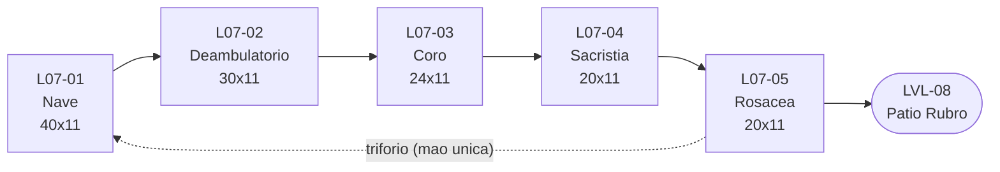

# LVL-07 — Catedral Oca

> Setor 7 de 16 · **`[PÓS]`** · Ato II — A Ronda · **o setor sem trava**
> Versão: `0.1.0` · Data: `2026-11-13` · Autor: `AGT-02` (Designer de Level) + `AGT-03` (Gameplay)
> Base: [GDD 3.4](../03-conteudo-do-jogo.md) · [Setores e Cenários §4.1, §4.4 e §4.90](../design-patterns/04-setores-e-cenarios.md) · [Padrões de Level Design §7.1, §7.4 e §7.9](../design-patterns/07-padroes-de-level-design.md)

> ⚠️ **Escopo `[PÓS]` — leia antes de usar este documento.**
> Fora do recorte do MVP. Especificado completo para destravar o Ato II e o orçamento de arte, mas nome e conteúdo **não são canônicos** (`D-04`). Não codar antes de `BKL-012`.

**Status:** layout completo nos 12 campos, grades validadas, alcançabilidade verificada na config canônica **B** (`DEC-014`).

> 🔴 **Este documento corrige o grafo do mundo pela segunda vez seguida.** `04-setores` §4.1 dá **chefe de área** como trava da conexão **07 → 08**, mas o chefe de área é do **LVL-08** (ficha §4.4: "arena aberta", "chefe médio"), e a conexão **08 → 09** já está travada por "retorno após chefe". Ver §7 e `P-43`.

---

## 1. Os 12 campos obrigatórios

| # | Campo | Definição |
|---|---|---|
| 1 | **ID e nome canônico** | `LVL-07` — Catedral Oca *(nome de trabalho, `[PÓS]`)* |
| 2 | **Objetivo** | Atravessar a catedral e alcançar a **rosácea**, que é a passagem para LVL-08 |
| 3 | **Duração e mortes** | 7–10 min na primeira visita · **1–2 mortes esperadas** |
| 4 | **Acento e materiais** | `PAL-07` osso iluminado `#E8E2D2` · osso, vitral inteiro, vela |
| 5 | **Sinais de ambientação** | arcos de costela que sobem **além do quadro** · vitral intacto, a única cor do jogo até aqui · velas acesas sem ninguém · poeira suspensa que não cai |
| 6 | **Habilidade de entrada / saída** | Entrada: `HAB-06`. Saída: **nenhuma** — o setor não entrega habilidade |
| 7 | **Salas** | 5 salas: **40** · 30 · 24 · 20 · 20 (× 11) = **134 tiles** |
| 8 | **O que ensina** | **nenhuma mecânica nova.** Ensina leitura de espaço: escala, simetria, vazio |
| 9 | **Set pieces** | `CEN-060` vitral inteiro · `CEN-061` arco de costela · `CEN-062` poeira suspensa · `CEN-063` banco |
| 10 | **Inimigos** | `ENT-002` Sentinela distorcida × 5 (1 · 1 · 1 · 1 · 1) — **a menor densidade do jogo** |
| 11 | **Entradas e saídas** | L07-01 ← **LVL-06** · L07-05 → **LVL-08** (rosácea). **Sem trava** — ver §7 |
| 12 | **Teste de rastreabilidade** | `TST-013` (percurso completo) · `TST-002` · `TST-007` · `TST-001` |

### Propriedades de design deste setor

- **É o único setor do jogo sem trava, sem habilidade e sem chefe.** A força dele é a ausência: cinco inimigos em 134 tiles, zero armadilhas obrigatórias, zero obstáculo intransponível. O jogador atravessa uma catedral e sai do outro lado.
- **Isso é ritmo, não preguiça.** Depois de LVL-05 (habilidade) e LVL-06 (habilidade + trava temporal), o jogador precisa de um setor em que **nada dependa dele**. O próximo (LVL-08) é uma arena com chefe médio — o pico do Ato II. O silêncio da catedral é o que dá altura ao pico seguinte.
- **O risco está nomeado.** Setor vazio pode virar setor chato. A hipótese está em `P-44`, e a saída, se o playtest reprovar, é adicionar **uma** seção de plataforma real no Coro — não encher a catedral de inimigos.
- **Uma janela, do primeiro ao último quadro.** O vitral que o jogador vê em L07-01 (x=38) é o mesmo que ele alcança em L07-05. O setor inteiro é a distância entre esses dois pontos.

---

## 2. Fluxo



| Transição | Checkpoint |
|---|---|
| LVL-06 → L07-01 | já salvo em L06-04 |
| L07-01 → L07-02 | salva ao cruzar a porta |
| L07-02 → L07-03 | salva ao cruzar a porta |
| **L07-03** | **`P` em (2,6)** — o único do setor, no meio do caminho |
| L07-03 → L07-04 | salva ao cruzar a porta |
| L07-04 → L07-05 | salva ao cruzar a porta |

> **Linear, sem ramificação e sem laço.** A catedral parece labiríntica — é essa a intenção —, mas a rota é uma só. Confundir o jogador é atmosfera; prendê-lo seria erro.

---

## 3. Legenda das grades

| Símbolo | Camada | Significado |
|---|---|---|
| `#` | `ground` + `collision` | sólido (paredes de osso, piso) |
| `=` | `collision` (só topo) | **arquitrave** atravessável *(one-way)* |
| `+` | — | abertura de passagem |
| `D` | `objects` | porta / passagem de área |
| `.` | — | ar |
| `E` | `objects` | Sentinela distorcida (`ENT-002`) |
| `A` | `objects` | **lasca de osso** (`CEN-001` reskin, **cíclica** 1,2 s) — o teto soltando |
| `P` | `objects` | ponto de salvamento |
| `N` | `objects` | inscrição / marco de lore |
| `R` | `decor-back` | **arco de costela** (`CEN-061`) — sobe de `y1` e é cortado pelo teto |
| `v` | `decor-back` | **vitral** (`CEN-060`) — a única cor |
| `c` | `decor` | vela (`CEN-002`), acesa, sem ninguém |
| `T` | `objects` | **boca do trifório** (`CEN-070`) — passagem de mão única, §5.1 |
| `b` | `decor` | banco de catedral (`CEN-063`), sem colisão |

Piso em `y=7` e aberturas em `y=4–6` seguem `DEC-007`.

---

## 4. Salas

### 4.1 L07-01 — Nave · 40×11

```
    0000000000111111111122222222223333333333
    0123456789012345678901234567890123456789
y0  ########################################
y1  #...R...R...R...R...R...R...R...R.....v#
y2  #...R...R...R...R...R...R...R...R.R...v#
y3  #...R...R...R...R...R...R...R...R.....v#
y4  D..T..................................v+
y5  D.....................................v+
y6  D.....N...b.........c.....b...E........+
y7  ########################################
y8  ########################################
y9  ########################################
y10 ########################################
```

| Objeto | Pos | Função |
|---|---|---|
| `D` porta | (0,4)–(0,6) | vinda de LVL-06. Autosave |
| `R` arcos | x = 4, 8, 12, 16, 20, 24, 28, 32 em `y1`–`y3` | `CEN-061`, **8 arcos a cada 4 tiles** |
| **`v` vitral** | x = 38, `y1`–`y5` | `CEN-060`. **Visível desde a porta**, 2.368 px à frente |
| `N` marco | (6,6) | **"AQUI CABIA TODO MUNDO."** (4 palavras) |
| `b` bancos | (10,6) · (26,6) | `CEN-063` |
| `c` vela | (20,6) | `CEN-002`, no centro exato da nave |
| **`T` trifório** | (3,4) | **saída do atalho de retorno** (§5.1). O jogador sai a 3 tiles do piso e cai na nave |
| `E` Sentinela | (30,6) | patrulha de 4 tiles |
| **Água / armadilhas / plataformas** | — | **nenhuma** |

- **Função:** a afirmação de escala. **40 tiles de chão vazio sob 8 arcos que não cabem na tela.**
- **Ensina:** nada de mecânica. Ensina o espaço: o jogador leva ~12 s para atravessar e não tem o que fazer além de olhar.
- **Aceite:** atravessar em ≤ 15 s, com ou sem combate. A sala não tem como reprovar o jogador.
- **A decisão mais difícil desta sala foi não colocar nada nela.** Um plataforma aqui, um espinho ali, e a nave viraria corredor. O vazio é o conteúdo.

---

### 4.2 L07-02 — Deambulatório · 30×11

```
    000000000011111111112222222222
    012345678901234567890123456789
y0  ##############################
y1  #............................#
y2  #......R.......R......R......#
y3  #......N.......R......b......#
y4  +...=======........=======...+
y5  +............................+
y6  +..c.........c.AA.......E..c.+
y7  ##############################
y8  ##############################
y9  ##############################
y10 ##############################
```

| Elemento | Posição | Função |
|---|---|---|
| `=` arquitrave esq. | x = 4–10, topo `y=4` | sobe **3 tiles** do piso → exige `HAB-01` |
| `=` arquitrave dir. | x = 19–25, topo `y=4` | mesma altura, **vão de 8 tiles** entre as duas |
| `N` marco | (7,3) | em cima da esquerda — **"NÃO HÁ NINGUÉM PARA RECEBER."** (5 palavras) |
| `b` banco | (22,3) | em cima da direita — o banco vazio no lugar mais alto |
| `A` lascas | (15,6) · (16,6) | `CEN-001` **cíclico** — o teto soltando osso |
| `c` velas | (3,6) · (13,6) · (27,6) | `CEN-002` |
| `E` Sentinela | (24,6) | patrulha de 3 tiles |
| `R` arcos | (7,2) · (15,2) · (22,2) | `CEN-061` |

- **Função:** simetria. Duas arquitraves idênticas, duas alturas iguais, e **nenhuma ligação entre elas**.
- **O vão de 8 tiles é deliberado e definitivo.** O salto duplo alcança 5,9 tiles. Um vão de 6 tiles pareceria possível e não é — seria a ambiguidade que `PAT-LD-09` proíbe. Com 8 tiles (512 px), ninguém tenta.
- **Ensina:** que a catedral é grande demais para ser atravessada por cima. O jogador sobe, olha, e desce — a subida é um mirante, não um caminho.
- **Aceite:** subir em uma das arquitraves, ler o marco ou o banco, e voltar ao piso. Nenhuma das duas é obrigatória.

---

### 4.3 L07-03 — Coro · 24×11

```
    000000000011111111112222
    012345678901234567890123
y0  ########################
y1  #.R..............N...R.#
y2  #.R..R.......R.====..R.#
y3  #.R......====........R.#
y4  +..====................+
y5  +......................+
y6  +.P.....E...........c..+
y7  ########################
y8  ########################
y9  ########################
y10 ########################
```

| Elemento | Posição | Função |
|---|---|---|
| `P` save | (2,6) | `UI-09`, único do setor |
| `=` arquitrave A | x = 3–6, topo `y=4` | sobe 3 tiles |
| `=` arquitrave B | x = 9–12, topo `y=3` | 1 tile acima, vão de 2 tiles |
| `=` arquitrave C | x = 15–18, topo `y=2` | 1 tile acima, vão de 2 tiles |
| `N` marco | (17,1) | no alto — **"O CORO CANTAVA PARA UMA NAVE VAZIA."** (7 palavras) |
| `E` Sentinela | (8,6) | patrulha de 3 tiles |
| `c` vela | (20,6) | `CEN-002` |
| `R` arcos | x = 2 e x = 21 (`y1`–`y3`); (5,2) · (13,2) | `CEN-061` |

- **Função:** a única escalada real do setor. Três níveis, os mesmos de LVL-05 e LVL-06 — e é aqui que a repetição do limite de 4 níveis fica visível (§5).
- **Ensina:** onde fica o alto da catedral. O jogador que sobe vê a nave pela abertura de trás (fora do quadro) e entende que estava dentro de algo maior.
- **Aceite:** subir até o `N` e descer. Escalada opcional, como todas as deste setor.

---

### 4.4 L07-04 — Sacristia · 20×11

```
    00000000001111111111
    01234567890123456789
y0  ####################
y1  #..................#
y2  #.....v...R........#
y3  #..................#
y4  +..................+
y5  +..................+
y6  +...N...c....b..E..+
y7  ####################
y8  ####################
y9  ####################
y10 ####################
```

| Elemento | Posição | Função |
|---|---|---|
| `N` marco | (4,6) | **"GUARDARAM O QUE SOBROU. NÃO SOBROU NADA."** (7 palavras) |
| `v` vitral | (6,2) | `CEN-060` — pequeno, o primeiro vitral de perto |
| `R` arco | (10,2) | `CEN-061` |
| `c` vela | (8,6) | `CEN-002` |
| `b` banco | (13,6) | `CEN-063` |
| `E` Sentinela | (16,6) | patrulha de 3 tiles |

- **Função:** **o contraste de câmara.** Depois de 40 tiles de nave, 20 tiles de sacristia. A mesma sala de 20×11 que em LVL-01 parecia normal aqui parece um armário — porque o jogador acabou de atravessar uma nave.
- **Ensina:** a escala se lê por comparação, não por tamanho absoluto. Nenhuma linha de geometria nova foi necessária — só a **ordem** das salas.
- **Aceite:** atravessar em ≤ 10 s e ler o marco.

---

### 4.5 L07-05 — Rosácea · 20×11

```
    00000000001111111111
    01234567890123456789
y0  ####################
y1  #.....R...R.T.vv...#
y2  #.....R...R...vv...#
y3  #.....R...R...vv...#
y4  +.....=======.vv...D
y5  +.............vv...D
y6  +..c....N........E.D
y7  ####################
y8  ####################
y9  ####################
y10 ####################
```

| Elemento | Posição | Função |
|---|---|---|
| **`v` rosácea** | x = 14–15, `y1`–`y5` | `CEN-060`. **O mesmo vitral visto em L07-01**, agora do lado de dentro e a 2 tiles de distância |
| `D` porta | (19,4)–(19,6) | saída para **LVL-08**. Autosave |
| `N` marco | (8,6) | **"O VIDRO ESTÁ INTEIRO. ISSO É O PIOR."** (7 palavras) |
| `R` arcos | x = 6 e x = 10, `y1`–`y3` | `CEN-061` |
| **`=` passarela** | x = 6–12, topo `y=4` | a plataforma sob os arcos. Sobe **3 tiles** — `HAB-01` |
| **`T` trifório** | (12,1) | **`CEN-070`** — boca da galeria, **1 tile acima da cabeça** de quem está na passarela: exige salto deliberado, nunca dispara ao passar (§5.1) |
| `c` vela | (3,6) | `CEN-002` |
| `E` Sentinela | (17,6) | patrulha de 3 tiles, ao pé da rosácea |

- **Função:** o fecho. O jogador atravessou 134 tiles para chegar ao vitral que viu no primeiro quadro — e ele está intacto, num mundo em ruínas.
- **Ensina:** nada. É recompensa visual e é a deixa do Ato II ("o que essas coisas ainda estão fazendo?" — a catedral está inteira porque alguém ainda a mantém).
- **Aceite:** cruzar `D`. `TST-013` verde.
- **Nota de arte:** a rosácea é o único elemento do jogo com saturação alta em `PAL-07`. Todo o resto do setor é osso em `--bone` com contraste baixo. É um acento dentro do acento.

---

## 5. A escala em 11 linhas — como se faz

Este setor pede **escala**, e escala é a coisa mais difícil de fazer quando a tela tem 11 linhas e não rola na vertical (`07-padroes` §7.1, `P-39`).

Não dá para fazer o jogador *subir* uma catedral. Então a escala não é geométrica — é **de leitura**. Seis técnicas, todas usadas aqui:

| # | Técnica | Onde | Por que funciona |
|---|---|---|---|
| 1 | **Repetição ritmada** | 8 arcos a cada 4 tiles na Nave | o olho mede distância por padrão repetido, não por régua |
| 2 | **Transbordo do fundo** | os arcos nascem em `y1` e são cortados pelo teto | o elemento é maior que o quadro — escala se lê pelo que **não cabe** |
| 3 | **Vazio negativo** | `y1`–`y5` vazios em 40 tiles | 2.560 px de nada valem mais que 2.560 px de detalhe |
| 4 | **Contraste de câmara** | Sacristia (20) logo depois da Nave (40) | a mesma sala parece menor do que é, por comparação |
| 5 | **Marco visível de longe** | o vitral em x=38 de L07-01 | dá ao espaço um **fim**, e um fim dá tamanho ao meio |
| 6 | **Ausência de gameplay no chão** | a Nave não tem uma plataforma | sem coisas para fazer, sobra espaço para olhar |
| 7 | **Passar por cima** | o trifório de L07-05 → L07-01 (§5.1) | atravessar a nave **na altura das janelas** dá tamanho ao que está embaixo |

**O que não funciona e foi descartado:** sala alta (não cabe), zoom out da câmera (muda a escala de tudo), cenário em parallax com camadas (não é 2D de tela fixa — conflita com `PAT-LD-01`), e "escada infinita" (seria um segundo setor de verticalidade, e LVL-05 já é isso).

### 5.1 O atalho de retorno: o trifório

`PAT-LD-08` exige atalho fim→início em todo setor com 4+ salas, e este setor tem 5. Ele faltava desde a primeira versão deste documento (`P-45`, fechada).

**`CEN-070` — Trifório.** Toda catedral tem uma galeria estreita acima das arcadas, e é por ela que se anda quando a nave está cheia. Aqui a nave está vazia, e é por ela que se volta.

| Item | Definição |
|---|---|
| Entrada | L07-05, **(12,1)** — boca da galeria, 1 tile acima da cabeça de quem está na passarela de `y=4`. Exige salto deliberado |
| Saída | L07-01, **(3,4)** — a galeria termina num vão sobre a nave; queda de **3 tiles**, sem dano. **É ponto de chegada, não gatilho** (`arrival_only=true`): quem cai ali não volta, e o jogador que salte até (3,4) do piso não é teleportado |
| Trava | **nenhuma.** Destravado por **posição**: só existe no fim do setor |
| Mão única | **sim** — sai 3 tiles acima do piso e o setor não tem escalada |
| Salva? | **não** (`PAT-LD-05`) |
| Distância economizada | L07-02 = **30 tiles (1.920 px ≈ 10 s)** |

**Por que é a sétima técnica de escala.** O jogador que volta atravessa a catedral **acima** dos bancos vazios, na altura do vitral, e vê a nave de um ponto que nenhum quadro anterior mostrou. Ele não está mais dentro da catedral; está dentro da estrutura dela. É a única vez no setor em que a escala é experimentada **pelo corpo** e não pela leitura — e ela é opcional, porque só existe para quem já foi até o fim.

**Por que não tem trava.** Uma passagem de mão única nunca pode ser usada para pular conteúdo, que é a única razão de a trava existir. `PAT-LD-08` pede "destravado ao concluir"; aqui o destravamento é a **posição**, e o `07-padroes` §7.9 reconhece as duas formas: **máquina** (duas paradas, nos dois sentidos — `LVL-05`, `LVL-08`) e **queda de mão única** (passagem orgânica — `LVL-04`, `LVL-07`).

**Por que o setor aceita isso sem quebrar a tese.** O trifório não tem som, não tem luz, não tem inimigo e não tem recompensa. Ele é um caminho vazio em cima de uma igreja vazia. A única coisa que ele adiciona é a altura.

> ⚠️ **`P-39` está deixando de ser curiosidade.** Este é o **terceiro setor seguido** cuja ficha pede movimento vertical que o motor não tem — LVL-05 pediu "verticalidade", LVL-06 pediu "descida", LVL-07 pede "escala". Os três foram resolvidos, mas os três foram resolvidos **apesar** da restrição. Se ela não for confirmada (ou revista) antes de LVL-08, o Ato III — cuja premissa é "o fim é literalmente em cima do começo" — vai colidir com ela de frente.

---

## 6. O silêncio sem tirar acessibilidade

A ficha pede **silêncio**. Há uma armadilha óbvia: fazer do silêncio uma mecânica — "sem som, você não percebe o inimigo" — viola acessibilidade e quebra os agentes `AGT-05` (UI/acessibilidade) e `AGT-06` (áudio).

**Regra do setor:**

| O que é silêncio | O que **não** é |
|---|---|
| BGM ausente; só `AMB-07` (vento dentro de pedra) | ausência de cues de gameplay |
| Nenhum sino, nenhum coro, nenhuma voz | inimigo sem telegraph visual |
| Poeira suspensa que não cai (`CEN-062`) | ameaça escondida pelo áudio |
| Vela que apaga sem som de sopro | feedback de dano silencioso |

> **Todo cue de gameplay deste setor é visual.** `VIS-009` (telegraph) continua valendo integralmente, e `TST-014` (acessibilidade) não pode mudar de resultado por causa do setor. O silêncio é da trilha, não da informação.

---

## 7. 🔴 A trava que estava na linha errada

`04-setores` §4.1 diz que a conexão **07 → 08** é travada por **"chefe de área"**. Isso não fecha com o resto do documento.

### 7.1 As quatro evidências

| # | O que o próprio documento diz | Consequência |
|---|---|---|
| 1 | Ficha §4.4: LVL-07 tem **"—"** na coluna de chefe | não há chefe na catedral |
| 2 | Ficha §4.4: LVL-08 é **"arena aberta"** com **"chefe médio"** | o chefe de área é de LVL-08 |
| 3 | §4.1, linha **08 → 09**: trava **"retorno após chefe"** | só faz sentido se o chefe acabou de ser derrotado **em LVL-08** |
| 4 | Lógica | um chefe não pode trancar a entrada da sala em que ele está |

A trava **"chefe de área"** pertence a **08 → 09** — onde já está, escrita como "retorno após chefe". A linha **07 → 08** está com uma trava que não pode existir.

### 7.2 A correção proposta

> **A conexão 07 → 08 não tem trava.** A rosácea é uma passagem aberta. O jogador atravessa a catedral e entra no Pátio Rubro — onde a arena e o chefe médio o esperam.

Isso é coerente com tudo: LVL-07 não entrega habilidade (§4.2), não tem chefe (§4.4), e LVL-08 é onde o Ato II cobra. E é **melhor design**: o jogador sai de dois setores de trava (LVL-05 espacial, LVL-06 temporal) e entra numa catedral sem porta, para então encontrar o chefe. O alívio antes do pico.

### 7.3 O que acontece se o proprietário recusar

Se 07 → 08 **precisar** de trava, então LVL-07 tem de ganhar um chefe de área — o que contradiz a ficha, destrói a tese de "silêncio", e faz dois setores com chefe em sequência (07 e 08). Nesse caso o setor inteiro é refeito, não remendado. `P-43`.

---

## 8. Validação de alcançabilidade

Solver de passo fixo a 60 Hz na config canônica **B** (`DEC-014`). Tabela completa em `04-setores` §4.3.

| Obstáculo | Sala | Subida | Vão | Exige `HAB-01`? | Resultado |
|---|---|---|---:|---:|---|---|
| arquitrave esq. | L07-02 | 192 px | 0 | sim | duplo 276 px ✓ (folga 84) |
| arquitrave dir. | L07-02 | 192 px | 0 | sim | ✓ |
| **entre as duas arquitraves** | L07-02 | 0 | **512 px (8 tiles)** | — | **inalcançável de propósito** — duplo chega a 378 px (5,9 tiles) |
| arquitrave A | L07-03 | 192 px | 0 | sim | ✓ |
| A → B | L07-03 | 64 px | 128 px | não | simples 191 px ✓ (folga 63) |
| B → C | L07-03 | 64 px | 128 px | não | simples 191 px ✓ |

**Resultado: 0 falhas — e nenhuma trava.** Todos os obstáculos do setor são opcionais; a linha reta no piso atravessa as cinco salas.

> O vão de 8 tiles é o único número crítico deste documento, e ele existe para ser **grande demais**. `PAT-LD-09` proíbe altura ambígua; o mesmo vale para distância. 6 tiles pareceria possível (o dobro do salto simples); 8 tiles não deixa dúvida.

---

## 9. Salvamento e morte

| Evento | O que acontece | Regra |
|---|---|---|
| Cruza `D` em L07-01 | salva | `MEC-007` |
| Interagir com `P` em L07-03 | salva | `MEC-007` |
| Cruza as portas 01↔02, 02↔03, 03↔04, 04↔05 | salva | `MEC-007` |
| Morrer para Sentinela | respawn no último checkpoint | `MEC-004` |
| Morrer com bolsa | bolsa fica no local | `MEC-004` |
| Perda de conexão durante save | `UI-11`, retry | `PAT-C-07` |

**A morte neste setor é sempre opcional.** Não há queda fatal, não há água, e a única fonte de dano são 5 Sentinelas que o jogador pode simplesmente deixar para trás. É o setor mais seguro do jogo — e isso é a intenção.

---

## 10. Conversão para Tiled (`.tmj`)

| Item | Definição |
|---|---|
| Nome do arquivo | `public/assets/tilemaps/tm_lvl07_catedral.tmj` |
| Tileset | `tm_catedral` (`AST-008` — **ID proposto**, `P-44`), ~26 tiles, 64×64 |
| Orientação | orthogonal, tile 64×64, 20–40 colunas × 11 linhas por sala |
| Camadas (ordem) | `decor-back` · `ground` · `collision` · `objects` · `decor-front` |
| Propriedades do mapa | `lvl_id=LVL-07`, `pal=PAL-07`, `bgm=none`, `amb=AMB-07`, `scope=post` |

> **`bgm=none` é uma propriedade válida**, não um bug. O setor não tem trilha; ele tem `AMB-07` (vento dentro de pedra). `AGT-06` precisa aceitar ausência de faixa como valor válido de mapa.

### Propriedades dos objetos (`objects`)

| Tipo | Propriedades |
|---|---|
| `enemy` | `ent=ENT-002`, `patrol_tiles`=3–4, `initial_facing`=`right`, `has_telegraph`=true |
| `save_point` | `ui=UI-09`, `checkpoint`=true |
| `door` | `to=LVL-06` (L07-01, `style=gold`) · `to=LVL-08` (L07-05, `style=rose`, `autosave=true`) |
| `trap_spikes` | `cen=CEN-001`, `skin`=`bone_shard`, `mode`=`cyclic` (só L07-02, 1,2 s) |
| `lore_marker` | `key`=`lore.lvl07.todos` / `.receber` / `.coro` / `.sobrou` / `.inteiro`, `max_words`=25 |
| `decor` | `ast=CEN-060` (back, `saturated=true`, só na rosácea) / `CEN-061` (back, `overflow_top=true`) / `CEN-062` / `CEN-063` / `CEN-002`, `collides`=false |

> **`overflow_top=true`** marca os arcos que devem ser **desenhados cortados pelo teto** — a técnica 2 da §5. Se o artista desenhar o arco inteiro dentro do quadro, a escala desaparece.

**Regra de ouro:** nenhum número de gameplay no `.tmj`. Dano, vida e física vêm de `tuning.ts` (`PAT-C-04`).

---

## 11. Checklist de aprovação (`07-padroes` §7.14)

- [x] Dimensões múltiplas de 20×11 — 40, 30, 24, 20, 20 × 11
- [x] Objetivo de cada sala compreensível em ≤ 3 s
- [x] Respeita a tabela de alcance (§8) — **0 falhas**
- [x] Nenhuma trava de habilidade (o setor não tem trava — §7)
- [x] Rota crítica funciona com inventário vazio (`PAT-LD-06`)
- [x] Nenhum soft lock: nada é intransponível, nada é obrigatório
- [x] Densidade de inimigos conforme `PAT-LD-10` — **a menor do jogo**: 5 em 134 tiles
- [x] Nenhuma ameaça fora da tela na Nave de 40 tiles (a Sentinela está a 30 tiles da entrada, alcançável pela câmera)
- [x] `collision` alinhada ao `ground` (validado pelo gerador de grade)
- [x] Paleta com um único acento (`PAL-07`), com a rosácea como acento interno
- [x] **Todo cue de gameplay é visual** — silêncio não retira informação (§6)
- [x] `PAT-LD-08` — atalho de retorno pelo trifório, forma de mão única (§5.1)
- [x] Testes associados: `TST-001`, `TST-002`, `TST-007`, `TST-013`
- [ ] **Aprovação de escopo:** `[PÓS]` (`D-04`) — não marcado de propósito
- [ ] **Conexão 07 → 08 sem trava:** pendente (`P-43`)
- [ ] **Setor vazio sustenta 7–10 min:** pendente (`P-44`)

---

## 12-A. Desvios de implementação (código)

O setor está implementado **atrás de flag** (`FLAGS.lvl07 = false`) e verificado por
`npm run lvl07`. Estes são os pontos em que o código não seguiu o documento ao pé da letra.

| # | O documento diz | O código faz | Por quê |
|---|---|---|---|
| I-1 | §3 usa `R` para o arco de costela | o glifo continua `R` na grade, mas o significado é da sala: `glyphs: { R: 'arc' }` | `R` é `ITM-006` (Fôlego) no alfabeto global de itens desde LVL-06; o significado é da sala (`DEC-023`) |
| I-2 | §3 usa `v` para vitral | idem: `glyphs: { v: 'stained' }` nas três salas com vitral | `v` é cinza caindo em LVL-04 (`CEN-031`); sem a reinterpretação, a catedral choveria cinza |
| I-3 | §3 usa `T` para a boca do trifório | `glyphs: { T: 'sink' }` em L07-05 e `{ T: 'sink-arrival' }` em L07-01 | `T` é árvore morta em LVL-04/06 (`CEN-030`) |
| I-4 | §5.1: o trifório entra por salto deliberado | a boca tem zona própria e **só dispara por contato** (`mode: 'touch'`), nunca por `E` | o sumidouro de LVL-04 pede `E`; a boca de galeria não pode pedir — quem passa por baixo está andando, não entrando |
| I-5 | §5.1: destino L07-01 (3,4) | destino declarado na **ficha da sala** (`sink: { area, room, at: {tx,ty}, mode }`) e convertido com `TILE` | a cena não inventa coordenada de nível; `PAT-C-04` vale para posições também |
| I-6 | §5, técnica 1: 8 arcos a cada 4 tiles | a grade tem 9 células `R` em L07-01 (8 no ritmo de 4 tiles + 1 solto em x=34, y2) | o arco extra é o do documento (§4.1, `y2`); o ritmo de `x=4…32` está intacto |
| I-7 | §5, técnica 2: arcos cortados pelo teto (`overflow_top`) | o arco é desenhado com no mínimo **3 tiles** de altura a partir da linha onde nasce, sempre encostado no teto | `overflow_top` é propriedade de arte; o código garante que o sprite nunca "termina" dentro do quadro |
| I-8 | §10: a rosácea é `CEN-060` com `saturated=true` | o vitral é **uma peça por grupo** (2×5 tiles em L07-05), não uma célula por tile | desenhar célula a célula produzia duas rosáceas gêmeas lado a lado — o oposto do "acento único" |
| I-9 | §1 campo 4: acento `PAL-07` osso iluminado `#E8E2D2` | o código usa `PAL.bone` (`#E6DFD2`), do único arquivo de paleta do projeto | `palette.ts` só tem PAL-00/PAL-01; uma paleta por setor não existe (`P-76`) |
| I-10 | §10: `bgm=none` | `LVL07_META.bgm = 'none'`; nenhum sistema de áudio foi ligado | o áudio do projeto inteiro é fase posterior (`EVT-006`) |
| I-11 | §2: `P` em (2,6) salva | o save do Coro existe e responde a `E`; **não** há autosave ao cruzar as portas do setor | o autosave por porta é do `mountRoom` (LVL-01…03) e já acontece; o `P` grava o checkpoint da sala |

---

## 12. Desvios registrados

| # | O que mudou | Por quê | IDs afetados |
|---|---|---|---|
| 1 | **07 → 08 não tem trava** | A trava "chefe de área" pertence a 08 → 09. Ver §7 | `§4.1`, `P-43`, `DEC-010` |
| 2 | `CEN-001` entra com skin de **lasca de osso**, só em L07-02 | O teto de uma catedral em ruína solta osso. Uma única aparição mantém o setor silencioso | `CEN-001` |
| 3 | **Nave de 40 tiles sem uma única plataforma** | A ausência de gameplay no chão é a técnica 5 da §5. Qualquer objeto ali transformaria a nave em corredor | `PAT-LD-01` |
| 4 | **Vão de 8 tiles entre as arquitraves** | 6 tiles pareceria possível (378 px de alcance do duplo contra 384 px do vão) e criaria a ambiguidade que `PAT-LD-09` proíbe | `PAT-LD-09` |
| 5 | **`bgm=none`** como valor válido de mapa | O silêncio é a tese do setor. Sem isso, o áudio teria de fingir silêncio | `AGT-06`, §6 |
| 6 | Arcos com `overflow_top=true` | Desenhar o arco inteiro dentro do quadro destrói a escala. O arco **tem** de ser cortado pelo teto | `CEN-061`, §5 |
| 7 | **Atalho de retorno por queda de mão única** (trifório), sem trava | Posição já impede uso para pular conteúdo. O setor não tem máquina nenhuma e não vai ganhar uma por causa de um atalho (§5.1) | `PAT-LD-08`, `CEN-070` |

---

## 13. Pendências geradas

| ID | Item | Bloqueia |
|---|---|---|
| `P-43` | **Remover a trava "chefe de área" de 07 → 08.** Ela pertence a 08 → 09, onde já existe como "retorno após chefe". Quatro evidências no §7.1. Se recusada, LVL-07 precisa de um chefe próprio e o setor é refeito | `BKL-011`, LVL-07, LVL-08 |
| `P-76` | **`PAL-07` não existe no código.** §1 campo 4 pede acento osso iluminado `#E8E2D2`; `src/game/data/palette.ts` só tem PAL-00/PAL-01, e LVL-04/05/06/07 usam `bone`/`stone` emprestados. Decidir: uma paleta por setor (16 conjuntos) ou uma paleta única com acentos | `BKL-012`, `PAT-C-04`, setores 04–16 |
| `P-77` | **O trifório só é verificável por geometria no E2E.** O headless roda a ~9 FPS e o ápice amostrado do salto fica em ~95 px contra os 138 px canônicos, então o teste entra na boca por posicionamento e prova o "não dispara ao passar" por travessia. A prova de salto real depende de máquina com GPU (`P-39`) | `TST-013`, `PAT-LD-08` |
| `P-44` | **O setor mais vazio do jogo se sustenta por 7–10 min?** 5 inimigos, 0 armadilha obrigatória, 0 trava, 0 habilidade. Se o playtest reprovar, a saída é **uma** seção de plataforma real no Coro — não encher a catedral de inimigos. Inclui `AST-008` sem catálogo | `BKL-012`, Ato II |

---

## Handoff

**Para `AGT-01`** — `CEN-060` vitral inteiro (é a **única** cor saturada do setor; a rosácea é o acento), `CEN-061` arco de costela (**precisa** ser desenhado cortado pelo teto, `overflow_top=true`), `CEN-062` poeira suspensa (partícula sem gravidade, 0,3 px/s de deriva), `CEN-063` banco. Tileset `tm_catedral` ~26 tiles.

**Para `AGT-06`** — `bgm=none` é valor válido; `AMB-07` (vento dentro de pedra) é a única camada sonora. **Nenhum cue de gameplay pode depender de áudio neste setor** (§6).

**Para `AGT-07`** — `TST-013` e `TST-014`: o setor não pode mudar o resultado de acessibilidade só porque é silencioso. Verificar que todo telegraph continua visual.

**O próximo agente precisa saber, em 3 linhas:**

1. **O setor não tem trava, e isso é decisão, não esquecimento.** A rosácea está aberta; o chefe é em LVL-08 (`P-43`).
2. **A escala é de leitura, não de geometria.** Arcos cortados pelo teto, 40 tiles de vazio, contraste de câmara. Se alguém "melhorar" a Nave colocando plataformas nela, o setor morre.
3. **Silêncio é da trilha, não da informação.** Todo cue de gameplay continua visual.
