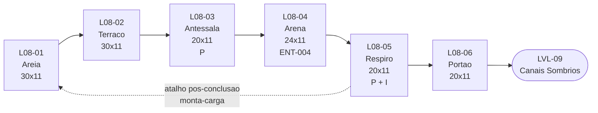
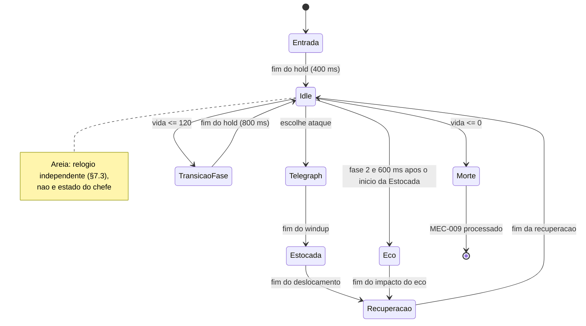

# LVL-08 — Pátio Rubro

> Setor 8 de 16 · **`[PÓS]`** · Ato II — A Ronda · **o pico do Ato II**
> Versão: `0.1.0` · Data: `2026-11-13` · Autor: `AGT-02` (Designer de Level) + `AGT-03` (Gameplay)
> Base: [GDD 3.4](../03-conteudo-do-jogo.md) · [Setores e Cenários §4.1, §4.4 e §4.90](../design-patterns/04-setores-e-cenarios.md) · [Padrões de Level Design §7.1, §7.8 e §7.13](../design-patterns/07-padroes-de-level-design.md)

> ⚠️ **Escopo `[PÓS]` — leia antes de usar este documento.**
> Fora do recorte do MVP. Especificado completo porque é o **pico do Ato II** e o primeiro a exigir ficha de combate fora do MVP, mas nome e conteúdo **não são canônicos** (`D-04`). Não codar antes de `BKL-012`.

**Status:** layout completo nos 12 campos, grades validadas, alcançabilidade verificada na config canônica **B** (`DEC-014`), ficha de combate fechada.

> ⚠️ **Este setor introduz o primeiro chefe que não é do MVP.** `ENT-003` (LVL-03) foi especificado porque o MVP acaba nele. `ENT-004` é especificação nova, e ela é o motivo de existir deste documento: um chefe médio não pode ser um chefe do MVP com mais vida.

---

## 1. Os 12 campos obrigatórios

| # | Campo | Definição |
|---|---|---|
| 1 | **ID e nome canônico** | `LVL-08` — Pátio Rubro *(nome de trabalho, `[PÓS]`)* |
| 2 | **Objetivo** | Atravessar o pátio e **derrotar o Alferes da Ronda**, que tranca a grade para LVL-09 |
| 3 | **Duração e mortes** | 8–12 min na primeira visita · **3–6 mortes esperadas** (o pico do jogo até aqui) |
| 4 | **Acento e materiais** | `PAL-08` terracota `#E0563F` · tijolo, sol vermelho, areia |
| 5 | **Sinais de ambientação** | sol vermelho que **não se move** · areia cobrindo o piso de tijolo · estandartes da Ronda (doze, um por homem que não existe) · correntes sem sino |
| 6 | **Habilidade de entrada / saída** | Entrada: `HAB-06`. Saída: **nenhuma** — o setor paga com um chefe, não com uma habilidade |
| 7 | **Salas** | 6 salas: **30** · 30 · 20 · **24** · 20 · 20 (× 11) = **144 tiles** |
| 8 | **O que ensina** | **areia** (`CEN-064`): atrito de piso. E ensina, por combate, que *perseguir a recuperação do inimigo* deixou de ser seguro |
| 9 | **Set pieces** | `CEN-064` areia · `CEN-065` grade da arena · `CEN-066` monta-carga · `CEN-067` sol vermelho · `CEN-068` corrente de pátio · `CEN-069` estandarte da Ronda |
| 10 | **Inimigos** | `ENT-002` Sentinela distorcida × 4 (1 · 2 · 1 · 0 · 0 · 0) + **`ENT-004` O Alferes da Ronda × 1** — chefe médio |
| 11 | **Entradas e saídas** | L08-01 ← **LVL-07** (rosácea) · L08-06 → **LVL-09** (grade quebrada, `requires=boss_defeated`) |
| 12 | **Teste de rastreabilidade** | `TST-009` (chefe 0 HP → 1×) · `TST-002` · `TST-001` · `TST-013` · `TST-014` |

### Propriedades de design deste setor

- **A trava é um homem, não uma porta.** LVL-05 travou com espaço, LVL-06 com tempo, LVL-07 não travou. LVL-08 trava com **um corpo na frente da grade** — e é o único setor do jogo em que a passagem depende de o jogador ganhar uma luta.
- **Um mecânica nova, ensinada em quatro tempos por quatro salas.** A areia aparece em L08-01 sem perigo (tempo 1), repete-se em L08-02 sem consequência (tempo 2), combina com combate em L08-03 (tempo 3) e **é o chão da arena** (tempo 4). A forma do setor **é** o `PAT-LD-02`.
- **O chefe não é maior: é uma pergunta diferente.** `ENT-003` ensinou "leia o telegraph, puna a recuperação". `ENT-004` **pune exatamente isso** — na fase 2, perseguir a recuperação dele coloca o jogador dentro do eco (§5.5). É a primeira vez que o jogo contradiz uma lição anterior de propósito.
- **"Arena aberta" não quer dizer arena grande — quer dizer arena sem cobertura.** LVL-03 deu dois pilares. LVL-08 dá **zero**. A inversão é o conteúdo.
- **O desgaste é o tema virando regra.** `LOR-03c` (O Caos) é "atrito do mundo se desfazendo", e o Pátio é o único setor do jogo com **as duas forças na mesma sala**: um Distorcido (`LOR-03b`) cumprindo turno num espaço que o Caos está comendo. A areia não é obstáculo — é o Caos, com nome e relógio.
- **O setor mais perigoso do jogo até aqui, e o único onde a morte não é opcional.** LVL-06 e LVL-07 podiam ser atravessados sem morrer. Aqui, não.

> 🔴 **Dependência de `P-43`:** este setor só existe na forma descrita se **07 → 08 não tiver trava**. Se o proprietário recusar `P-43`, LVL-07 ganha chefe e o jogo tem **dois setores com chefe em sequência** (07 e 08) — que é justamente o que o silêncio da catedral existia para evitar.

---

## 2. Fluxo



| Transição | Checkpoint |
|---|---|
| LVL-07 → L08-01 | salva ao cruzar a porta |
| L08-01 → L08-02 | salva ao cruzar a porta |
| L08-02 → L08-03 | salva ao cruzar a porta |
| **L08-03** | **`P` em (17,6)** — na boca da arena |
| L08-03 → L08-04 | **grade fecha atrás do jogador** (`CEN-065`) |
| L08-04 (morte) | respawn **dentro da arena**, em (2,6) — `MEC-008` |
| L08-04 → L08-05 | **grade quebra** ao processar 0 HP (`MEC-009`) · salva |
| L08-05 | **`P` em (3,6)** |
| L08-05 → L08-06 | salva ao cruzar a porta |

> **Linear, com uma exceção deliberada:** a única ramificação do setor é o atalho de volta, e ele só existe depois do chefe (`PAT-LD-08`).

---

## 3. Legenda das grades

| Símbolo | Camada | Significado |
|---|---|---|
| `#` | `ground` + `collision` | sólido (tijolo, muralha do pátio) |
| `=` | `collision` (só topo) | **arquibancada de tijolo** atravessável *(one-way)* |
| `+` | — | abertura de passagem |
| `D` | `objects` | porta / passagem de área |
| `G` | `objects` | **grade da arena** (`CEN-065`) — abre, fecha e quebra |
| `.` | — | ar |
| `E` | `objects` | Sentinela distorcida (`ENT-002`) |
| `L` | `objects` | **O Alferes da Ronda** (`ENT-004`, ID proposto — `P-46`) — chefe médio |
| `s` | `objects` (`sand`) | **areia** (`CEN-064`) — sobreposição de piso, ver regra abaixo |
| `,` | `objects` | **âncora de areia** — dormente; vira `s` no relógio do chefe (§7.3) |
| `m` | `objects` | **monta-carga** (`CEN-066`) — atalho, 2 paradas após a conclusão |
| `P` | `objects` | ponto de salvamento |
| `I` | `objects` | **recompensa do chefe** (`ITM-007`, ID proposto — `P-47`) |
| `N` | `objects` | inscrição / marco de lore |
| `S` | `decor-back` | **sol vermelho** (`CEN-067`) — disco fixo, sem parallax |
| `f` | `decor-back` | estandarte da Ronda (`CEN-069`) |
| `h` | `decor` | corrente de pátio (`CEN-068`), sem colisão |

Piso em `y=7` e aberturas em `y=4–6` seguem `DEC-007`.

> **Regra da areia (importante para a implementação).** A areia é definida por **retângulo declarado na ficha de cada sala**, não pelo glifo contado. Um `E`, `L` ou `P` desenhado **dentro** da areia é um objeto sobre ela: a célula continua sendo areia para efeito de velocidade. Precedente idêntico ao da água em `LVL-06` §3. O glifo `s` existe só para a grade ficar legível.

---

## 4. Salas

### 4.1 L08-01 — Areia · 30×11

```
    000000000011111111112222222222
    012345678901234567890123456789
y0  ##############################
y1  #......................SSS...#
y2  #.......f......f.......SSS...#
y3  #......................SSS...#
y4  D............................+
y5  D............................+
y6  D...ss.......N....m....E...h.+
y7  ##############################
y8  ##############################
y9  ##############################
y10 ##############################
```

| Objeto | Pos | Função |
|---|---|---|
| `D` porta | (0,4)–(0,6) | vinda de **LVL-07** (rosácea). Autosave |
| `+` saída | (29,4)–(29,6) | para L08-02 |
| **`s` areia** | x = 4–5, `y=6` | **a primeira areia do jogo.** 2 tiles, chão plano, nada em volta |
| `N` marco | (13,6) | **"A RONDA PASSA AQUI TODO DIA. NÃO PASSA NINGUÉM."** (10 palavras) |
| `m` monta-carga | (18,6) | **lacrado.** O jogador vê o poço e não pode usar — 3ª exposição de `PAT-LD-03` invertida (§4 do atalho) |
| `E` Sentinela | (23,6) | patrulha de 3 tiles, **de costas** |
| `f` estandartes | (8,2) · (15,2) | `CEN-069` |
| `S` sol vermelho | x = 23–25, `y1`–`y3` | `CEN-067`. **O mesmo sol, 3 metros acima do chão** |
| `h` corrente | (27,6) | `CEN-068` |
| **Armadilhas / plataformas** | — | **nenhuma** |

- **Função:** a chegada e o tempo 1 do `PAT-LD-02`. O jogador pisa em areia pela primeira vez e **nada acontece** — ele aprende o custo sem pagar nada.
- **Por que a areia está a 18 tiles da única Sentinela:** o tempo 1 exige "a mecânica aparece isolada e segura". Um inimigo perto da primeira areia transformaria a introdução em teste.
- **Por que o sol está em cima do chão, e não no céu:** ele não está no céu. Está a três tiles do piso, encostado na muralha, e não se mexe. Ninguém comenta. `N` de L08-02 faz a pergunta.
- **Aceite:** atravessar em ≤ 20 s e pisar na areia sem tomar dano. `TST-013` parcial.

---

### 4.2 L08-02 — Terraço · 30×11

```
    000000000011111111112222222222
    012345678901234567890123456789
y0  ##############################
y1  #............................#
y2  #...........f..........h.....#
y3  #......N...........E.........#
y4  +....=====.......=====.......+
y5  +............................+
y6  +.ss.......E.ss..........ss..+
y7  ##############################
y8  ##############################
y9  ##############################
y10 ##############################
```

| Elemento | Posição | Função |
|---|---|---|
| `=` arquibancada esq. | x = 5–9, topo `y=4` | sobe **3 tiles** do piso → exige `HAB-01` |
| `=` arquibancada dir. | x = 17–21, topo `y=4` | mesma altura, **vão de 7 tiles (448 px)** |
| **`s` areia** | x = 2–3 · 13–14 · 25–26, `y=6` | **tempo 2:** 3 faixas, repetição sem consequência |
| `E` Sentinela | (11,6) | no piso, **entre duas faixas de areia** |
| `E` Sentinela | (19,3) | **em cima** da arquibancada direita, patrulha de 4 tiles |
| `N` marco | (7,3) | em cima da esquerda — **"O SOL NÃO SE MOVE. ISSO NÃO É O SOL."** (8 palavras) |
| `f` estandarte | (12,2) | `CEN-069` |
| `h` corrente | (23,2) | `CEN-068` |

- **Função:** privar a areia de novidade. O jogador atravessa o terraço três vezes pisando nela, combatendo em cima dela e subindo degraus, e para de pensar nela.
- **O vão de 7 tiles é definitivo.** Duplo alcança 5,9 tiles (378 px); 7 tiles são 448 px. Não parece possível e não é — `PAT-LD-09`. Se fosse 5 tiles, seria ambíguo (o duplo quase chega) e o jogador tentaria dez vezes.
- **As Sentinelas em alturas diferentes são a lição de leitura vertical:** uma no piso, uma na arquibancada. O jogador descobre que a arquibancada não é decoração — é onde algo está.
- **Aceite:** cruzar em ≤ 25 s, opcionalmente subir nos dois terraços e ler o marco.

---

### 4.3 L08-03 — Antessala · 20×11

```
    00000000001111111111
    01234567890123456789
y0  ####################
y1  #..................#
y2  #.h................#
y3  #...........N......#
y4  +...====...====....+
y5  +..................+
y6  +.......sEs......P.+
y7  ####################
y8  ####################
y9  ####################
y10 ####################
```

| Elemento | Posição | Função |
|---|---|---|
| `=` plataforma esq. | x = 4–7, topo `y=4` | sobe 3 tiles → `HAB-01` |
| `=` plataforma dir. | x = 11–14, topo `y=4` | **vão de 3 tiles (192 px)** entre as duas |
| **`s` areia** | x = 8–10, `y=6` | **tempo 3:** areia entre as duas plataformas |
| `E` Sentinela | (9,6) | **dentro da areia** — a combinação que o setor existia para fazer |
| `P` save | (17,6) | `UI-09`, **na boca da arena** |
| `N` marco | (12,3) | em cima da direita — **"ESTANDARTE DA RONDA. DOZE HOMENS. DOZE NOMES. NENHUM ROSTO."** (9 palavras) |
| `h` corrente | (2,2) | `CEN-068` |

- **Função:** a sala mais curta e a mais importante. Ela responde a pergunta que o jogador faria ao entrar na arena: *"e se eu lutar em pé de areia?"* — ele já lutou.
- **Por que o `P` está aqui e não em L08-02:** `PAT-LD-05` proíbe checkpoint em sala de desafio. L08-03 tem **um** inimigo, e ele pode ser deixado para trás andando; o `P` fica a 2 tiles da porta da arena, ou seja, na **transição**, que é onde `PAT-LD-05` manda. Sem ele, morrer no chefe custaria 3 salas de caminhada — e o chefe já cobra 3–6 mortes.
- **O vão de 3 tiles é folgado de propósito.** 192 px contra 313 px de salto correndo. Não é trava; é a rota opcional que dá o marco de lore.
- **Aceite:** cruzar em ≤ 15 s, opcionalmente subir e ler o marco. Salvar antes de entrar na arena é **obrigatório** para `TST-009`.

---

### 4.4 L08-04 — Arena · 24×11

```
    000000000011111111112222
    012345678901234567890123
y0  ########################
y1  #...f......SS.....f....#
y2  #..........SS..........#
y3  #......................#
y4  G......................G
y5  G......................G
y6  G....,....,....,..L.,..G
y7  ########################
y8  ########################
y9  ########################
y10 ########################
```

| Elemento | Posição | Função |
|---|---|---|
| `G` grade esq. | (0,4)–(0,6) | **aberta na chegada**, fecha quando o jogador cruza `x ≥ 3` |
| `G` grade dir. | (23,4)–(23,6) | **fechada desde sempre.** É a passagem 08 → 09 do grafo (§8) |
| **`,` âncoras** | x = 5 · 10 · 15 · 20 (`y=6`) | 4 âncoras dormentes; cada uma cobre **3 tiles** (4–6, 9–11, 14–16, 19–21) |
| `L` Alferes | (18,6) | spawn de `ENT-004` |
| `f` estandartes | (4,1) · (18,1) | `CEN-069` |
| `S` sol vermelho | x = 11–12, `y1`–`y2` | `CEN-067` — agora **no alto**, e é a fonte da sombra que o eco usa (§5.5) |
| **Cobertura** | — | **nenhuma.** Zero pilar, zero caixa, zero degrau |
| **Piso** | `y=7`, **plano de ponta a ponta** | 24 tiles contínuos, sem queda possível (`PAT-LD-07`) |

- **"Arena aberta" = sem cobertura, não maior.** 24×11 é exatamente o que `PAT-LD-07` manda, e a ficha do setor não autoriza mexer nisso. O que muda em relação a LVL-03 é o que **não** existe aqui: lá, dois pilares quebráveis eram a mecânica de perícia; aqui, não há onde se esconder.
- **Por que 24 e não 30:** a tela tem 20 tiles. A 24, a câmera rola 4 tiles — o mínimo que ainda faz a arena parecer maior que o quadro. A 30, o chefe sai do enquadramento durante a luta, e um chefe fora da tela é um chefe que mata o jogador por trás da câmera.
- **As 4 âncoras não são decoração:** são os lugares onde o piso vai virar areia. Elas somem do mapa depois de acionadas — o `,` é o estado dormente, o `s` é o estado ativo.
- **Aceite:** derrotar `ENT-004`. `TST-009` — 0 HP processado **uma única vez**.

---

### 4.5 L08-05 — Respiro · 20×11

```
    00000000001111111111
    01234567890123456789
y0  ####################
y1  #..................#
y2  #......f....h......#
y3  #..................#
y4  +..................D
y5  +..................D
y6  +..P....I..N....m..D
y7  ####################
y8  ####################
y9  ####################
y10 ####################
```

| Elemento | Posição | Função |
|---|---|---|
| `+` entrada | (0,4)–(0,6) | vem da arena pela **grade quebrada** |
| `D` saída | (19,4)–(19,6) | para L08-06. Autosave |
| `P` save | (3,6) | `UI-09` |
| `I` recompensa | (8,6) | **`ITM-007`** (ID proposto — `P-47`) |
| `N` marco | (11,6) | **"ELE NÃO ESTAVA ME ESPERANDO. ELE ESTAVA DE SERVIÇO."** (10 palavras) |
| `m` monta-carga | (16,6) | `CEN-066`. **A segunda parada é L08-01** |
| `f` estandarte | (7,2) | `CEN-069` |
| `h` corrente | (12,2) | `CEN-068` |
| **Inimigos** | — | **zero** (`PAT-LD-04`) |

- **Função:** o respiro obrigatório pós-clímax. Seis segundos sem perigo, recompensa e salvamento. É a sala em que o corpo do jogador desacelera.
- **Por que o marco aparece aqui, e não antes:** é a frase que explica o setor inteiro e ela só funciona **depois** de o jogador ter matado um homem que se recusava a parar. Antes da luta, seria uma dica; depois, é um diagnóstico.
- **O monta-carga só aceita passageiro com a grade quebrada.** Antes disso, `locked=true` e o jogador vê o cabo sem carga — a mesma gramática do poço lacrado de L08-01.
- **Aceite:** salvar, recolher `ITM-007`, opcionalmente usar o monta-carga. `PAT-LD-04` verde.

---

### 4.6 L08-06 — Portão · 20×11

```
    00000000001111111111
    01234567890123456789
y0  ####################
y1  #..................#
y2  #....f....h...f....#
y3  #..................#
y4  +..................D
y5  +..................D
y6  +.......N..........D
y7  ####################
y8  ####################
y9  ####################
y10 ####################
```

| Elemento | Posição | Função |
|---|---|---|
| `+` entrada | (0,4)–(0,6) | vem de L08-05 |
| `D` saída | (19,4)–(19,6) | **→ LVL-09** (`requires=boss_defeated`). Autosave |
| `N` marco | (8,6) | **"O TURNO ACABOU. O SERVIÇO NÃO."** (6 palavras) |
| `f` estandartes | (5,2) · (14,2) | `CEN-069`. **Os primeiros estandartes que o vento move** |
| `h` corrente | (10,2) | `CEN-068` |
| **Inimigos** | — | **zero** |

- **Função:** fechar o Ato II. Nada acontece aqui, e é a primeira sala do jogo em que o vento move alguma coisa — porque no pátio inteiro, até este ponto, nada se movia.
- **`requires=boss_defeated` na porta é redundante por geometria, e é de propósito.** A porta é inalcançável sem a grade quebrada; a flag existe para o save não permitir um estado impossível (`PAT-C-07`).
- **Aceite:** cruzar `D`. `TST-013` verde no setor.

---

## 5. A luta — especificação de combate

### 5.1 Ficha do chefe (`ENT-004`)

| Atributo | Valor | Observação |
|---|---:|---|
| Nome de trabalho | **O Alferes da Ronda** | `[PÓS]`, não canônico |
| Facção | `LOR-03b` Distorcido *(corpo)* em `LOR-03c` Caos *(ambiente)* | o setor é o único com as duas forças na mesma sala |
| Vida | **240 HP** | 20% acima de `ENT-003`, e a diferença não é vida — é a segunda fonte de dano |
| Sprite | 192×192 px (3×3 tiles) | `AST-010` (proposto — `P-46`) |
| **Hurtbox** | 128×160 px | menor que o sprite — regra `PAT-C` anti-hitbox |
| Corpo | humanoide, sabre curto, metade do tronco já é areia | a metade muda de lado a cada 8 s |
| Dano por impacto | **20 HP** (sabre) · **15 HP** (eco) | antes do multiplicador de dificuldade |
| Peso / empurrão | imune a knockback | clamp por bounds da arena |
| **Sombra** | projetada pelo `CEN-067`, **direção fixa** | é a explicação física do eco (§5.5) |

### 5.2 Máquina de estados



> **A areia não está na FSM.** Ela corre em paralelo, em relógio próprio. Se ficasse num estado do chefe, morreria com ele — e o desgaste é do **pátio**, não do homem.

### 5.3 Ataques

| ID | Ataque | Fase | Telegraph | Execução | Recuperação | Dano | Resposta correta |
|---|---|---|---:|---|---:|---:|---|
| `ATK-04` | **Estocada** | 1 e 2 | 700 ms | **4 tiles** (256 px) a 640 px/s = 400 ms | 1100 ms / **900 ms** | 20 | **pular** ou sair de linha |
| `ATK-05` | **Chamado da areia** | 1 e 2 | — | aciona 1 âncora (§7.3), 0 dano | — | 0 | **nenhuma — é inevitável** |
| `ATK-06` | **Eco de areia** | **só fase 2** | 600 ms de linha `--gold` no chão | repetição da Estocada **no ponto de partida dela** | — | 15 | **não estar onde ele estava** |

**Telegraph de `ATK-04`:** agacha, sabre atrás do corpo, **uma linha `--threat` desenhada no chão por 4 tiles** na direção do golpe, e som de areia escorrendo. A linha no chão é a inovação: com **zero cobertura**, o jogador não pode usar cenário como referência, então a referência passa a ser o próprio piso.

**`ATK-05` não é um ataque — é o relógio com um nome.** Ele ergue o sabre, a areia da arena responde, e uma âncora vira areia. Não tem dano, não tem esquiva, e não tem telegraph de combate. Se tivesse, o jogador acharia que podia impedir.

**`ATK-06` — a inversão.** Toda a luta de LVL-03 ensinou: *leia, esquive, e **avance** na recuperação*. O eco existe para punir exatamente o "avance". Ele nasce **onde o Alferes estava** quando começou a estocada — ou seja, o lugar para onde o jogador naturalmente corre. A resposta correta em fase 2 é a oposta da fase 1: **passar por ele**, não persegui-lo.

> ⚠️ **Acessibilidade (`VIS-009`, `TST-014`).** Dois telegraphs simultâneos são permitidos **se e somente se** forem distinguíveis por três canais independentes: **cor** (linha `--threat` do corpo × linha `--gold` do eco), **forma** (linha sólida × linha pontilhada) e **som** (areia escorrendo × vidro sob areia). Se um dos três cair, `TST-014` reprova.

### 5.4 Entrada dramática (`VIS-007`)

| Elemento | Especificação |
|---|---|
| Gatilho | jogador cruza `x ≥ 3` na arena |
| Grade | `CEN-065` esquerda **fecha** (600 ms, queda de 3 tiles) |
| Hold | 400 ms, congelado |
| Nome na tela | `O ALFERES DA RONDA`, display, centralizado, 900 ms |
| Fala única | *"Não posso parar. Estou de serviço."* (1,9 s) |
| Barra de vida | topo central, `role="progressbar"`, percentual no `aria-label` |
| Música | **`BGM-01` → `BGM-02`** na queda da grade (`06-audio` §4) |
| Redução de movimento | mantém hold e textos; **desliga** shake e pulso de contraste |

### 5.5 Transição de fase (120 HP)

| Elemento | Especificação |
|---|---|
| Gatilho | vida ≤ 120, **uma única vez** |
| Hold | 800 ms |
| Feedback | ele para de se mover por 800 ms e **a metade de areia do corpo cresce** — a sombra fica no chão, separada |
| Desbloqueio | `ATK-06` ativo; recuperação de `ATK-04` cai de 1100 → 900 ms |
| Fala | *"Se eu parar, eu acabo."* (1,6 s) |
| Acessibilidade | aviso em `aria-live`: "O Alferes mudou de postura — agora ele ataca duas vezes" |

> **A fala da fase 2 é o setor inteiro.** Ele não luta por dever: luta porque parar é morrer. É a resposta à pergunta do Ato II ("o que essas coisas ainda estão fazendo?") dada por quem está fazendo.

### 5.6 Morte do chefe (`MEC-009`)

| Elemento | Especificação |
|---|---|
| Processamento | **uma única vez**, idempotente (`PAT-C-07`) |
| Hold | 600 ms + câmera lenta 0,3× por 800 ms (desativável) |
| Desmonte | ele **não cai em peças**: senta, e a metade de areia o alcança |
| Grade | `CEN-065` direita **quebra** (`VFX-007`), liberando L08-05 |
| Recompensa | `ITM-007` aparece em L08-05 (8,6) |
| Registro | `game:boss { id: 'ENT-004', scope: 'post' }` — **não** é `scope: 'mvp'` |

---

## 6. Validação da luta

### 6.1 Golpes necessários

| Arma | Dano | Golpes para 240 HP |
|---|---:|---:|
| Branca | 20 | **12** |
| À distância | 10 | 24 |

### 6.2 Sobrevivência do jogador

Vida efetiva = 100 HP + 50 de escudo = **150**. Multiplicador sobre o dano total, antes do escudo (`P-23`).

| Dificuldade | Multiplicador | Sabre | Golpes até morrer | Eco | Margem |
|---|---:|---:|---:|---:|---:|
| Fácil | 0,75× | 15 HP | 10 | 11 HP | 9 erros |
| Médio | 1,00× | 20 HP | **7** | 15 HP | **6 erros** |
| Difícil | 1,25× | 25 HP | 6 | 18 HP | 5 erros |

> **A margem cai para 6 erros, contra 7 no `ENT-003`** — e as fontes de erro dobraram. É por isso que este chefe é "médio" e o anterior não era: não é mais vida, é **menos margem com mais coisas para errar**.

### 6.3 Ciclo e janelas

| Fase | Windup | Estocada | Recuperação | Reposicionamento | Ciclo | Golpes na fase |
|---|---:|---:|---:|---:|---:|---:|
| 1 (240 → 120 HP) | 700 ms | 400 ms | 1.100 ms | 400 ms | **2,60 s** | 6 |
| 2 (120 → 0 HP) | 700 ms | 400 ms | 900 ms | 300 ms | **2,30 s** | 6 |

### 6.4 Tempo até matar (TTK)

| Cenário | TTK |
|---|---:|
| 1 golpe por janela (típico) | **~30 s** (15,6 + 13,8 + 0,8 de transição) |
| Perfeito, 2 golpes por janela | **~17 s** |
| Só arma à distância (24 golpes) | **~62 s** |

> **Leitura:** o TTK é quase o mesmo de `ENT-003` (~28 s), de propósito. O que subiu foi a **densidade de erro**, não a duração. Se o playtest reprovar por dificuldade, o ajuste é a **recuperação do `ATK-04`** (1100 → 1200 ms), não a vida — mexer na vida alonga a luta e não a torna mais justa.

### 6.5 Geometria — por que 4 tiles de estocada

| Alcance | Consequência |
|---|---|
| 3 tiles (192 px) | curto demais: o jogador nunca sai de perto, a luta vira trocação |
| **4 tiles (256 px)** | 400 ms de deslocamento; o jogador que pula cai ~1,5 tile atrás dele → **dentro** do alcance do contra-ataque na recuperação de 1100 ms |
| 6 tiles (384 px) | ele termina longe; a recuperação deixa de ser janela e vira passeio |
| 8 tiles (512 px) | o mesmo problema que `LVL-03` §6.5 documentou: a janela desaparece |

> **E o eco usa o mesmo alcance de propósito.** O jogador já sabe o que 4 tiles significam — ele acabou de aprender na fase 1. A fase 2 não ensina um número novo; ela ensina que **o mesmo número, em outro lugar, é outra ameaça**.

---

## 7. A areia — a mecânica de atrito

### 7.1 O que ela é e o que ela não é

| É | Não é |
|---|---|
| sobreposição de piso que reduz a velocidade **no chão** a **0,75×** | dano, queda, morte |
| invisível no ar: pular e cair cancela o efeito | efeito sobre a altura do salto |
| acumulativa: só cresce durante a luta | permanente entre tentativas |
| visível, anunciada e previsível | surpresa, armadilha ou RNG |

**Chave de tuning:** `sandSpeedMultiplier` (valor em `tuning.ts`, `PAT-C-04`). **Nenhum número no `.tmj`.**

### 7.2 Por que não dá dano

Porque dano se cura e o desgaste não. A areia é a única mecânica do jogo que **tira opção em vez de tirar vida** — e é o que o Caos faz no mundo (`LOR-03c`: "não quer nada — é o atrito"). Se ela tirasse vida, seria uma armadilha a mais; tirando velocidade, é um relógio.

### 7.3 O relógio

| Momento | Evento |
|---|---|
| início da luta | timer em 8 s |
| **8 s** | primeira âncora vira areia (`ATK-05`) |
| fase 1 | +1 âncora a cada **10 s** |
| entrada da fase 2 | timer **reinicia em 8 s** |
| fase 2 | +1 âncora a cada **8 s** |
| 4 âncoras ativas | **para.** O piso não degrada mais |

Com TTK típico de 30 s, o jogador vê **3 das 4** âncoras. Com TTK de 62 s (só arma à distância), vê as 4 — e o piso fica 12 de 22 tiles em areia. **A mecânica pune a luta lenta sem nunca impedir a luta.** É a diferença entre pressão e punição.

### 7.4 O ensino em quatro tempos (`PAT-LD-02`)

| Tempo | Sala | Areia | Perigo | O que o jogador aprende |
|---|---|---|---|---|
| 1. **Introduzir** | L08-01 | 1 faixa de 2 tiles, chão plano | 1 Sentinela a **18 tiles**, de costas | "pisar em areia é mais lento — e não dói" |
| 2. **Praticar** | L08-02 | 3 faixas, 6 tiles no total | 2 Sentinelas, uma em cada altura | "eu luto em areia" |
| 3. **Combinar** | L08-03 | 1 faixa de 3 tiles **entre duas plataformas** | 1 Sentinela **dentro** da areia | "a areia pode estar onde eu preciso estar" |
| 4. **Testar** | L08-04 | 4 âncoras que acendem em relógio | `ENT-004` | "a areia não é onde eu estou — é onde eu vou estar" |

> **O tempo 4 é a arena inteira**, e ele só funciona porque os tempos 1 a 3 aconteceram em salas sem chefe. `PAT-LD-02` proíbe pular de 1 para 4 com razão: um jogador que visse areia pela primeira vez **durante** o chefe não teria como distinguir "o piso está lento" de "o jogo está com lag".

### 7.5 A regra que a areia impõe ao layout

> **Nenhum vão horizontal pode ter ponto de decolagem em areia.**

Com 0,75×, o salto de corrida cai de **313 px para 235 px** (−25%): de 4,9 tiles para 3,7. Um vão de 4 tiles atravessável correndo deixa de ser atravessável saindo da areia — e o jogador não tem como saber disso.

No setor, a regra é obedecida por construção: em L08-02 as faixas de areia estão a **≥ 2 tiles** de qualquer decolagem, e as duas decolagens do setor (x=9 e x=17, no topo das arquibancadas) **não têm areia em cima**. Em L08-03, as decolagens do vão de 3 tiles são x=7 e x=11, ambas em plataforma.

> 🔴 **Isso não é verificado por nenhum teste.** O solver de alcançabilidade compara geometria; ele não sabe que existe um modificador de velocidade. Ver `P-48`.

---

## 8. 🔴 A trava 08 → 09 — por que ela mora na arena

`04-setores` §4.1 chama a conexão **08 → 09** de **"grade quebrada"** com trava **"chefe de área — retorno após derrotá-lo"**. Isso está certo, e a implementação é literal:

| Pergunta | Resposta |
|---|---|
| Onde está a grade? | na **arena** (L08-04), em (23,4)–(23,6) — a parede leste |
| Quando ela quebra? | ao processar 0 HP de `ENT-004` (`MEC-009`), **uma única vez** |
| Por que não na porta de L08-06? | porque um jogador que chegasse a L08-06 já teria passado pela arena. A trava **antecede** a porta por geometria |
| Então por que a porta tem `requires=boss_defeated`? | para o save não aceitar um estado impossível (`PAT-C-07`). É redundância defensiva, não a trava |

**E a grade oeste, que fecha atrás do jogador?** É a mesma família (`CEN-065`), com função oposta: a leste impede sair antes do fim, a oeste impede desistir no meio. Nenhuma das duas é a trava do grafo — as duas são `PAT-LD-07`.

> **Consequência para `P-43`:** a leitura de que "o chefe de área" da linha 07 → 08 estava na linha errada fica confirmada por este documento. Aqui o chefe é usado exatamente como `§4.1` descreve — para trancar a **saída** de um setor, depois de derrotado.

---

## 9. Validação de alcançabilidade

Solver de passo fixo a 60 Hz na config canônica **B** (`DEC-014`). Tabela completa em `04-setores` §4.3.

| Obstáculo | Sala | Subida | Vão | Exige `HAB-01`? | Resultado |
|---|---|---|---:|---:|---|---|
| arquibancada esq. | L08-02 | 192 px | 0 | sim | duplo 276 px ✓ (folga 84) |
| arquibancada dir. | L08-02 | 192 px | 0 | sim | ✓ |
| **entre as arquibancadas** | L08-02 | 0 | **448 px (7 tiles)** | — | **inalcançável de propósito** — duplo chega a 378 px |
| plataforma esq. | L08-03 | 192 px | 0 | sim | ✓ |
| **esq → dir** | L08-03 | 0 | 192 px (3 tiles) | **não** | simples correndo 313 px ✓ (folga 121) |
| **esq → dir saindo da areia** | L08-03 | — | 192 px | — | **não se aplica:** as decolagens são em plataforma, não em areia (§7.5) |
| arena | L08-04 | 0 | 0 | — | piso plano de ponta a ponta |

**Resultado: 0 falhas.** A rota crítica é o piso: entra em L08-01, atravessa L08-02 pelo chão, L08-03 pelo chão, luta e sai. **As quatro subidas do setor são opcionais** e existem para dar lore e ponto de vista.

> **O único número crítico deste documento é 448 px** — o vão entre as arquibancadas. Ele é 70 px maior que o alcance do salto duplo: grande o bastante para não parecer possível, pequeno o bastante para não parecer um bug.

---

## 10. Salvamento e morte

| Evento | O que acontece | Regra |
|---|---|---|
| Cruza qualquer porta | salva | `MEC-007` |
| Interagir com `P` (L08-03, L08-05) | salva | `MEC-007` |
| Entra na arena | grade fecha; **estado salvo não muda** | `PAT-LD-07` |
| Morre para `ENT-004` | respawn em L08-04 (2,6), chefe com 240 HP, vida/escudo/poder cheios | `MEC-008` |
| Morre para `ENT-004` | **areia é zerada** — as 4 âncoras voltam a `,` | §10.1 |
| Morre com bolsa | bolsa fica no local da morte | `MEC-004` |
| Perda de conexão durante save | `UI-11`, retry | `PAT-C-07` |

### 10.1 Por que a areia zera na morte

Se persistisse, a arena degradaria a cada tentativa: na quinta, o piso inteiro estaria em 0,75× e o chefe seria mais difícil não por domínio, mas por **acúmulo de tentativas**. Isso pune a repetição, que é a coisa que `MEC-008` existe para tornar barata.

> **A areia é estado de sessão da luta, não estado de mundo.** Ao contrário do contrapeso de `LVL-05` (que é estado de mapa e **tem** de sobreviver ao reload), aqui o correto é o oposto. É o par de regras mais fácil de inverter por engano no código — vai no handoff.

### 10.2 Misericórdia

| Evento | Comportamento |
|---|---|
| 3 mortes consecutivas na arena | oferta **recusável** de reduzir dificuldade (`UI-08`, `MEC-008`) |
| Contador | escopo = **arena**, zera ao vencer |
| Após a campanha | qualquer dificuldade no mesmo save (`UI-04`) |

---

## 11. Conversão para Tiled (`.tmj`)

| Item | Definição |
|---|---|
| Nome do arquivo | `public/assets/tilemaps/tm_lvl08_patio.tmj` |
| Tileset | `tm_patio` (`AST-009` — **ID proposto**, `P-46`), ~30 tiles, 64×64 |
| Orientação | orthogonal, tile 64×64, 20–30 colunas × 11 linhas por sala (arena: 24) |
| Camadas (ordem) | `decor-back` · `ground` · `sand` · `collision` · `objects` · `decor-front` |
| Propriedades do mapa | `lvl_id=LVL-08`, `pal=PAL-08`, `bgm=BGM-01`, `amb=AMB-08`, `scope=post`, `boss_arena=L08-04` |

> **`sand` é camada própria, e não `objects`.** Ela é um volume de piso consultado pelo movimento a cada passo — como `water` em `LVL-06` — e não um objeto com colisão. Se fosse objeto, cada célula de areia viraria um corpo físico a mais na arena.

### Propriedades dos objetos (`objects`)

| Tipo | Propriedades |
|---|---|
| `enemy` | `ent=ENT-002`, `patrol_tiles`=3–4, `initial_facing`=`left`, `has_telegraph`=true |
| `boss` | `ent=ENT-004`, `hp=240`, `phase2_at`=120, `arena=L08-04`, `intro=VIS-007`, `echo_atk=ATK-06`, `echo_delay_ms`=600 |
| `sand_anchor` | `cen=CEN-064`, `width_tiles`=3, `state`=`dormant`, `clock_ms`=8000/10000/8000 (§7.3) |
| `arena_grate` | `cen=CEN-065`, `side`=`west`/`east`, `state`=`open`/`closed`/`broken`, `drop_ms`=600 |
| `save_point` | `ui=UI-09`, `checkpoint`=true |
| `door` | `to=LVL-07` (L08-01, `style=rose`) · `to=LVL-09` (L08-06, `style=iron`, `requires=boss_defeated`) |
| `hoist` | `cen=CEN-066`, `stops`=`[L08-01, L08-05]`, `locked_until`=`boss_defeated` |
| `lore_marker` | `key`=`lore.lvl08.ronda` / `.sol` / `.estandarte` / `.servico` / `.turno`, `max_words`=25 |
| `reward` | `itm=ITM-007`, `spawn_after`=`boss_defeated`, `at`=L08-05 |
| `decor` | `ast=CEN-067` (back, `static=true`) / `CEN-068` / `CEN-069`, `collides`=false |

**Regra de ouro:** nenhum número de gameplay no `.tmj`. Vida do chefe, dano, temporizadores e `sandSpeedMultiplier` vêm de `tuning.ts` (`PAT-C-04`). O mapa aponta a **chave**.

---

## 12. Checklist de aprovação (`07-padroes` §7.14)

- [x] Dimensões múltiplas de 20×11 — 30, 30, 20, **24 (arena, `PAT-LD-07`)**, 20, 20 × 11
- [x] Objetivo de cada sala compreensível em ≤ 3 s
- [x] Respeita a tabela de alcance (§9) — **0 falhas**
- [x] Trava do setor é derrotar `ENT-004` (§8), sem depender de habilidade nova
- [x] Rota crítica funciona com inventário vazio (`PAT-LD-06`)
- [x] Nenhum soft lock: grade oeste impede desistir, grade leste libera ao vencer, atalho destrava depois
- [x] `PAT-LD-02` nos quatro tempos, em quatro salas (§7.4)
- [x] `PAT-LD-04` — L08-05 sem inimigo, com recompensa e save
- [x] `PAT-LD-05` — `P` na transição, não no meio de sala de desafio
- [x] `PAT-LD-07` — piso plano, sem queda, sem coletável na luta, saída só após 0 HP
- [x] `PAT-LD-08` — atalho de retorno pelo monta-carga, 2 paradas após a conclusão
- [x] `PAT-LD-10` — máx. 2 inimigos por sala
- [x] Densidade: 4 Sentinelas + 1 chefe em 144 tiles
- [x] `collision` alinhada ao `ground` (validado pelo gerador de grade)
- [x] Paleta com um único acento (`PAL-08`), sem exceção interna
- [x] Dois telegraphs simultâneos distinguíveis por cor, forma **e** som (§5.3)
- [x] Nenhum vão horizontal com decolagem em areia (§7.5)
- [x] Testes associados: `TST-001`, `TST-002`, `TST-009`, `TST-013`, `TST-014`
- [ ] **Aprovação de escopo:** `[PÓS]` (`D-04`) — não marcado de propósito
- [ ] **Ficha de `ENT-004`** (sprite, `AST-010`, bestiário do Ato II): pendente (`P-46`)
- [ ] **O que é `ITM-007`:** pendente (`P-47`)
- [ ] **Solver não testa modificadores de velocidade:** pendente (`P-48`)

---

## 12-A. Implementação em código (`Estágio 3`)

| Item da ficha | Onde vive | Prova |
|---|---|---|
| 6 salas, 144 tiles | `src/game/data/levels/lvl08.ts` | `lvl08.test.ts` (larguras, teto/piso, 144 tiles) |
| Grade de texto × ficha | `lvl08.doc.test.ts` | 2 testes derivados de `lvl07.doc.test.ts` |
| Areia 0,75× só no chão | `src/core/sand.ts` + `GameScene.pointInSand` | `sand.test.ts` 9/9 · E2E: **0,75** em cima, **1,00** fora e no ar |
| Areia nunca fere | — | E2E: hp **150 → 150** atravessando a faixa |
| Relógio de âncoras (8/10/8 s, máx. 4) | `SAND.clockMs`, `SAND.phases` | E2E: **1 → 2** âncoras, **6** sprites de areia, âncoras em x=5·10·15·20 |
| Areia zera na morte | `GameScene.resetSandOnDeath` | E2E: **3 → 0** depois da morte |
| `ENT-004` 2 fases, 240 HP | `src/core/alferes.ts` + `entities/Alferes.ts` | `alferes.test.ts` 9/9 · E2E: **240 → 120** → `transicao-fase` |
| `ATK-04` estocada, `ATK-06` eco | `ALFERES` em `tuning.ts` | E2E: dano de sabre/eco e melee aplicados na arena |
| `MEC-009` idempotente no 0 HP | `Alferes.takeHit` | E2E: **1** processamento em dois `takeHit` a 0 HP |
| Grade oeste fecha em x ≥ 3 | `GameScene.updateArena` | E2E: `westClosed false → true`, jogador barrado em **x=64** |
| Grade leste quebra no 0 HP | `GameScene.onAlferesDefeated` | E2E: `eastOpen true` |
| Monta-carga (`CEN-066`) | `GameScene.tryHoist` | E2E: antes da vitória, **"O CABO ESTÁ SEM CARGA."** e sem troca de sala |
| `ITM-007` gated | `GameScene` (`bossDefeated`) | E2E: objeto só existe depois da vitória |
| `LVL08` fora do build | `FLAGS.lvl08 = false` | `AREAS`/`AREA_ORDER` em `data/levels/index.ts` |
| Capturas | `docs/capturas/L08-*.png` | `npm run shots08` (7 telas) |

**Desvio de numeração, registado:** a §14 abaixo usa `P-45` para "LVL-07 sem atalho", mas `docs/PENDENCIAS.md` já fechou `P-45` com o trifório. O ID foi mantido aqui para não quebrar as referências cruzadas; a pendência real que sobra do LVL-08 é `P-46`/`P-47`/`P-48`.

---

## 13. Desvios registrados

| # | O que mudou | Por quê | IDs afetados |
|---|---|---|---|
| 1 | **"Arena aberta" implementada como 24×11 sem cobertura**, não como sala maior | `PAT-LD-07` fixa a arena em 24×11 e a ficha não autoriza mudar. "Aberta" é ausência de cobertura — a inversão exata de LVL-03, que deu dois pilares. A 30 tiles o chefe sairia do enquadramento | `PAT-LD-07`, §4.4 |
| 2 | **A trava 08 → 09 mora na grade da arena**, não na porta de L08-06 | É onde ela **antecede** a porta por geometria. A flag na porta é redundância defensiva de save | `§4.1`, `PAT-LD-07`, `PAT-C-07` |
| 3 | **`sand` é camada própria**, não `objects` | É volume de piso consultado por passo, como `water` em LVL-06. Como objeto, cada célula viraria corpo físico na arena | `LVL-06` §3, §11 |
| 4 | **A areia não dá dano** | Dano se cura; desgaste, não. Tirando velocidade ela é relógio; tirando vida seria só mais uma armadilha | `LOR-03c`, §7.2 |
| 5 | **A areia zera na morte** | Persistir faria a 5ª tentativa ser mais difícil por acúmulo, punindo a repetição que `MEC-008` existe para baratear. Oposto do contrapeso de LVL-05 | `MEC-008`, §10.1 |
| 6 | **`ATK-05` não tem telegraph de combate** | Um telegraph sugeriria que dá para impedir. O relógio é inevitável e precisa **parecer** inevitável | §5.3, §7.3 |
| 7 | **Recuperação do `ATK-04` é a válvula de dificuldade**, não a vida | Aumentar vida alonga a luta sem torná-la mais justa; a recuperação é a janela, e a janela é o que o jogador sente | §6.4 |
| 8 | **`P` em L08-03 (com 1 inimigo)** | `PAT-LD-05` proíbe checkpoint em sala de desafio. Ele está a 2 tiles da porta da arena, ou seja, na transição — e sem ele morrer no chefe custa 3 salas, com o chefe cobrando 3–6 mortes | `PAT-LD-05` |
| 9 | **`BGM-01` → `BGM-02` na queda da grade** | `06-audio` §4 já lista `BGM-02` para o setor 08; a troca no gatilho da luta é a mesma gramática usada em L03-01 | `BGM-01`, `BGM-02` |
| 10 | **`grates` é uma peça por coluna, não por célula** | A grade tem 3 tiles de altura; três corpos sobrepostos davam três colisões para uma parede. O `LevelBuilder` agrupa o run vertical e emite **1 peça** com `tiles: 3` | `§4.1`, `CEN-065` |
| 11 | **A areia não é objeto de `decor`** | O glifo `s` desenhava o tile e a ficha `Room.sand` desenhava o retângulo: dois desenhos, e o glifo caía no `else` do render (virava `sigil`). Agora o glifo só marca, quem desenha é a ficha — e a areia é uma **faixa de 18 px no pé do tile**, não um volume | `CEN-064`, §7.1 |
| 12 | **`S` (sol) e `f` (estandarte) precisam de caso no render** | Sem ele caíam no `else` de `decorBack`, que em LVL-04 é o emissor de cinza — o pátio nevava cinza. O sol é **uma peça por grupo 3×3** | `CEN-067`, `CEN-069` |

---

## 14. Pendências geradas

| ID | Item | Bloqueia |
|---|---|---|
| `P-45` | **LVL-07 não tem atalho de retorno.** `PAT-LD-08` exige atalho fim→início em setor com 4+ salas; LVL-07 tem 5 e nenhum. Com LVL-04 (`P-37`), são **dois** setores com a mesma falha — vale decidir se `PAT-LD-08` é regra ou recomendação | `PAT-LD-08`, LVL-04, LVL-07 |
| `P-46` | **`ENT-004` não tem catálogo.** Faltam `AST-010`, o bestiário do Ato II (`P-42`), a ficha de sprite (192×192, 20 frames) e a UI de barra de chefe para chefe não-final | `BKL-012`, LVL-08, LVL-12 |
| `P-47` | **O que é `ITM-007`?** Recompensa de chefe médio. Se for equipamento, duplica o papel de `ITM-004` (LVL-03) e precisa justificar a diferença. Se for chave narrativa, precisa aparecer no grafo | `BKL-011`, LVL-08 |
| `P-48` | 🔴 **O solver de alcançabilidade não testa modificadores de velocidade.** Ele compara geometria de salto; areia, óleo, gelo ou vento mudam o alcance horizontal e podem tornar impossível um vão que o solver aprova. Enquanto não existir essa verificação, **toda mecânica de piso lento é risco de soft lock** | `PAT-LD-06`, `TST-013`, setores 09–16 |

---

## Handoff

**Para `AGT-03`** — `boss` com FSM de 2 fases (§5.2); `ATK-06` como **repetição da Estocada no ponto de partida dela** (não é um segundo inimigo, é um evento — não pode virar corpo na física); `sand_anchor` com relógio **independente** da FSM do chefe; `sandSpeedMultiplier` em `tuning.ts`. **O item mais fácil de errar deste documento:** a areia **zera na morte** (§10.1), ao contrário do contrapeso de LVL-05, que **persiste**.

**Para `AGT-01`** — `CEN-064` areia (3 estados: dormente, ativa, e a transição de 600 ms com o tijolo afundando), `CEN-065` grade (open/closed/broken), `CEN-066` monta-carga, `CEN-067` sol vermelho (**disco fixo, sem parallax** — é ele que projeta a sombra do eco), `CEN-068` corrente (balanço de 2 frames), `CEN-069` estandarte da Ronda (12 variantes de cor, todas rasgadas no mesmo lugar). Tileset `tm_patio` ~30 tiles.

**Para `AGT-06`** — `BGM-01` nas salas 01–03, **`BGM-02` a partir da queda da grade**; `AMB-08` (vento quente, areia; estandarte, correntes) é a única camada em 01–03. Na arena, o ambiente **não pode** competir com os dois telegraphs: os sons de areia escorrendo (`ATK-04`) e de vidro sob areia (`ATK-06`) têm de ser distinguíveis mesmo com `AMB-08` no talo.

**Para `AGT-07`** — `TST-009` (0 HP → 1×, incluindo o caso de morrer **no mesmo frame** em que ele morre), `TST-014` com dois telegraphs simultâneos (cor + forma + som, §5.3), e `TST-013` no setor inteiro. **Testar a areia zerando na morte** — é o cenário em que um bug de persistência passa despercebido e só aparece na 4ª tentativa.

**O próximo agente precisa saber, em 3 linhas:**

1. **Este é o pico do Ato II e o único setor travado por um corpo.** Se a luta não estiver boa, o setor não tem conserto por layout — só por combate.
2. **A areia é o Caos com nome e relógio.** Não é armadilha, não dá dano, não é aleatória, e zera na morte.
3. **A fase 2 pune a lição da fase 1.** Perseguir a recuperação dele é o erro que o eco existe para cobrar. Se alguém "consertar" o eco para ser mais justo, a luta perde a única coisa que ela ensina.
