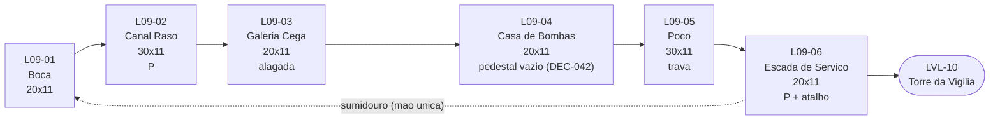

# LVL-09 — Canais Sombrios

> Setor 9 de 16 · **`[PÓS]`** · **Ato III — A Falha** · o setor apertado
> Versão: `0.1.0` · Data: `2026-11-13` · Autor: `AGT-02` (Designer de Level) + `AGT-03` (Gameplay)
> Base: [GDD 3.4](../03-conteudo-do-jogo.md) · [Setores e Cenários §4.1, §4.4 e §4.90](../design-patterns/04-setores-e-cenarios.md) · [Padrões de Level Design §7.1, §7.9 e §7.10](../design-patterns/07-padroes-de-level-design.md)

> ⚠️ **Escopo `[PÓS]` — leia antes de usar este documento.**
> Fora do recorte do MVP. Especificado completo porque entrega `HAB-04` e destrava o Ato III, mas nome e conteúdo **não são canônicos** (`D-04`). Não codar antes de `BKL-012`.

**Status:** layout completo nos 12 campos, grades validadas, alcançabilidade verificada na config canônica **B** (`DEC-014`), ficha de `HAB-04` fechada.

> 🔴 **Este documento encontra um limite geométrico do motor, e ele muda o projeto.** O salto duplo alcança **276 px** e a plataforma mais alta que cabe na grade fica a **256 px** do piso. Ou seja: **nenhuma plataforma do jogo está fora do alcance do salto duplo.** Verticalidade não pode ser trava — em nenhum setor, com nenhuma habilidade. Ver §6.

---

## 1. Os 12 campos obrigatórios

| # | Campo | Definição |
|---|---|---|
| 1 | **ID e nome canônico** | `LVL-09` — Canais Sombrios *(nome de trabalho, `[PÓS]`)* |
| 2 | **Objetivo** | Atravessar o canal seco, sair pelo canal com o **gancho** (`HAB-04` — que **cai de chefe**, `DEC-042`) e subir a escada de serviço para LVL-10 |
| 3 | **Duração e mortes** | 8–11 min na primeira visita · **0–1 mortes esperadas** |
| 4 | **Acento e materiais** | `PAL-09` tijolo molhado · tijolo, água suja, ferro, limo |
| 5 | **Sinais de ambientação** | canal **seco** no meio de uma cidade que já teve água · água que só existe onde vazou · argolas de ferro gastas por mãos · ratos, a única coisa viva do jogo que não ataca |
| 6 | **Habilidade de entrada / saída** | Entrada: `HAB-06` (fôlego). Saída: **`HAB-04` Gancho** (`ITM-008`, ID proposto — `P-51`), **obtido por drop de chefe** desde `DEC-042` |
| 7 | **Salas** | 6 salas: 20 · **30** · 20 · 20 · **30** · 20 (× 11) = **140 tiles** |
| 8 | **O que ensina** | **o gancho** e, por oposição a LVL-07, **como fazer um espaço parecer pequeno** |
| 9 | **Set pieces** | `CEN-071` água de canal · `CEN-072` argola de ferro · `CEN-073` comporta · `CEN-074` arco de tijolo · `CEN-075` rato |
| 10 | **Inimigos** | `ENT-002` Sentinela distorcida × 4 (0 · 1 · 0 · 2 · 1 · 0) |
| 11 | **Entradas e saídas** | L09-01 ← **LVL-08** (grade quebrada) · L09-06 → **LVL-10** (escada de serviço, `requires=HAB-04`) |
| 12 | **Teste de rastreabilidade** | `TST-013` · `TST-005` (habilidade sobrevive à morte) · `TST-007` · `TST-014` · `TST-001` |

### Propriedades de design deste setor

- **É o negativo fotográfico de LVL-07.** A catedral ensinou a ler escala em 11 linhas; o canal ensina a ler **aperto** nas mesmas 11 linhas e com as mesmas regras. Os dois documentos são o par: §5 daqui responde §5 de lá.
- **O medo aqui não é morrer: é não caber.** Nenhuma queda mata (`DEC-011`), a água nunca afoga (`P-40`) e a única fonte de dano são 4 Sentinelas evitáveis. O setor cobra **tempo e ar**, não vida — e é isso que dá a sensação de estar preso.
- **Zero plataformas.** É o único setor do jogo sem uma única plataforma `=`: o piso é o único chão em todas as 6 salas. Onde não há onde pular, o jogador sente o teto.
- **`DEC-010` é a espinha:** o jogador vê a argola intransponível em L09-02, *depois* recebe o gancho em L09-04, e só então atravessa o canal em L09-05.
- **A trava 09 → 10 não está na porta.** Ela é o canal de 8 tiles em L09-05, que antecede L09-06 por geometria — a mesma solução de LVL-08, onde a trava mora na grade da arena.
- **O canal está seco, e isso é lore.** A água do setor vem de vazamentos, não de um rio: o sistema morreu e ficou a marca dele. Água onde ela não deveria estar é mais opressiva que água corrente.

---

## 2. Fluxo



| Transição | Checkpoint |
|---|---|
| LVL-08 → L09-01 | salva ao cruzar a grade quebrada |
| L09-01 → L09-02 | salva ao cruzar a porta |
| **L09-02** | **`P` em (4,6)** |
| L09-02 → L09-03 | salva ao cruzar a porta |
| L09-03 → L09-04 | salva ao cruzar a porta |
| L09-04 → L09-05 | salva ao cruzar a porta |
| **L09-05** | **trava:** o canal de 8 tiles exige `HAB-04` |
| L09-05 → L09-06 | salva ao cruzar a porta |
| **L09-06** | **`P` em (2,6)** |

> **Linear, com uma volta opcional.** A alcova de L09-02 fica atrás do mesmo tipo de vão da trava — mas o que ela guarda é lore, não progresso. O jogador que pega o gancho e volta é recompensado com texto; o que não volta não perde nada.

---

## 3. Legenda das grades

| Símbolo | Camada | Significado |
|---|---|---|
| `#` | `ground` + `collision` | sólido (tijolo, teto abobadado) |
| `+` | — | abertura de passagem |
| `D` | `objects` | porta / passagem de área |
| `.` | — | ar |
| `~` | `objects` (`water`) | **água** — volume declarado na ficha, como em `LVL-06` §3 |
| `E` | `objects` | Sentinela distorcida (`ENT-002`) |
| `o` | `objects` | **argola de ferro** (`CEN-072`) — alvo de `HAB-04` |
| `X` (removido por `DEC-042`) | `objects` | **`HAB-04` Gancho** (`ITM-008`, ID proposto — `P-51`) |
| `V` | `objects` | **sumidouro gradeado** (`CEN-076`) — atalho de mão única, `interact` |
| `P` | `objects` | ponto de salvamento |
| `N` | `objects` | inscrição / marco de lore |
| `g` | `decor` | comporta (`CEN-073`), travada, sem colisão |
| `l` | `decor` | lâmpada de canal (`CEN-002` reskin) |
| `w` | `decor` | **rato** (`CEN-075`) — anda 2 tiles, para, repete. Nunca ataca |
| `v` | `decor-back` | arco de tijolo (`CEN-074`) |

Piso em `y=7` e aberturas em `y=4–6` seguem `DEC-007`. **Nenhuma sala usa `=`**: ver §5.

> **Regra da água.** Igual a `LVL-06`: o volume é **retângulo declarado na ficha da sala**, e um objeto desenhado dentro dele não interrompe a água. O glifo é legibilidade.

---

## 4. Salas

### 4.1 L09-01 — Boca · 20×11

```
    00000000001111111111
    01234567890123456789
y0  ####################
y1  ####################
y2  #....v...V...v.....#
y3  #..................#
y4  D..................+
y5  D..................+
y6  D..l..N....~~~.w...+
y7  ####################
y8  ####################
y9  ####################
y10 ####################
```

| Objeto | Pos | Função |
|---|---|---|
| `D` porta | (0,4)–(0,6) | vinda de **LVL-08** (grade quebrada). Autosave |
| `+` saída | (19,4)–(19,6) | para L09-02 |
| **teto** | `y=0`–`y=1` sólidos | 5 tiles úteis — a sala **mais alta** do setor |
| `~` água | x = 11–13, `y=6` | `CEN-071`, vazamento. 1 tile de profundidade, sem afogamento |
| `l` lâmpada | (3,6) | a única luz do setor que funciona |
| `w` rato | (15,6) | `CEN-075` |
| `N` marco | (6,6) | **"O CANAL ESTÁ SECO. A ÁGUA NÃO SABE DISSO."** (8 palavras) |
| **`V` sumidouro** | (9,2) | **chegada do atalho** (§4.6). Ponto de chegada, **não gatilho** (`arrival_only=true`): o jogador que salte até aqui não é teleportado |
| `v` arcos | (5,2) · (13,2) | `CEN-074`, decor-back |
| **Inimigos** | — | **nenhum** |

- **Função:** a porta de entrada e a frase de tese. O jogador vem de um pátio aberto sob sol vermelho e entra num tubo de tijolo.
- **Por que 5 tiles úteis:** é a sala mais alta do setor, e ela é **mais baixa que qualquer sala de LVL-07**. O contraste tem de acontecer em 3 segundos.
- **Aceite:** atravessar em ≤ 10 s.

---

### 4.2 L09-02 — Canal Raso · 30×11

```
    000000000011111111112222222222
    012345678901234567890123456789
y0  ##############################
y1  ##############################
y2  #...........v.............v..#
y3  #...............o............#
y4  +............................+
y5  +............................+
y6  +.l.P...E.~~............N....+
y7  #############........#########
y8  #############........#########
y9  #############........#########
y10 #############........#########
```

| Elemento | Posição | Função |
|---|---|---|
| **poço** | x = 13–20, `y=7`–`y=10` abertos | **8 tiles (512 px)** de vão seco. Queda = respawn na entrada, sem dano (`DEC-011`) |
| **`o` argola** | (16,3) | `CEN-072`. **Exposição 1 de `PAT-LD-03`** — o jogador vê, não alcança |
| alcova | x = 21–28 | do outro lado do poço. **Só lore** |
| `N` marco | (24,6) | na alcova — **"A VIGÍLIA SUBIA POR AQUI. A ESCADA APODRECEU."** (8 palavras) |
| `P` save | (4,6) | `UI-09` |
| `E` Sentinela | (8,6) | patrulha de 4 tiles |
| `~` água | x = 10–11, `y=6` | `CEN-071`, vazamento raso |
| `l` lâmpada | (2,6) | |
| `v` arcos | (12,2) · (26,2) | `CEN-074` |
| **Plataformas** | — | **nenhuma** |

- **Função:** a exposição da habilidade. O jogador vê um vão de 8 tiles, vê ferro gasto por mãos acima dele, e não tem como atravessar. Ele **não sabe ainda** que existe um gancho — e essa é a informação que fica guardada.
- **Por que o vão é de 8 tiles e não de 6:** o duplo alcança 5,9 tiles (378 px). Seis tiles = 384 px deixariam 6 px de margem, o que é exatamente a ambiguidade que `PAT-LD-09` proíbe. Oito tiles não deixam dúvida.
- **Por que a alcova é opcional:** se ela fosse obrigatória, o setor teria um **soft lock** — o jogador atravessaria o poço antes de ter o gancho. Toda exposição de `PAT-LD-03` tem de ser atravessável *depois*; nunca antes.
- **Aceite:** atravessar em ≤ 25 s, sem cair no poço. Cair devolve à entrada sem dano.

---

### 4.3 L09-03 — Galeria Cega · 20×11

```
    00000000001111111111
    01234567890123456789
y0  ####################
y1  ####################
y2  ####################
y3  #...l.........l....#
y4  +~~~~~~~~~~~~~~~~..+
y5  +~~~~~~~~~~~~~~~~..+
y6  +~~~~~~~~~~~~~~~~wN+
y7  ####################
y8  ####################
y9  ####################
y10 ####################
```

| Elemento | Posição | Função |
|---|---|---|
| **teto** | `y=0`–`y=2` sólidos | **3 tiles úteis** — o mínimo que `DEC-007` permite |
| **água** | x = 1–16, `y=4`–`y=6` | volume cheio até 1 tile do teto. **O jogador nada, não anda** |
| `l` lâmpadas | (4,3) · (14,3) | as duas únicas luzes, **acima da linha d'água** |
| `w` rato | (17,6) | no canto seco |
| `N` marco | (18,6) | **"QUEM CAVOU ISSO NÃO QUERIA QUE ALGUÉM ACHASSE."** (9 palavras) |
| **Inimigos** | — | **nenhum** (luta em água não tem regra definida — ver `P-52`) |
| **Plataformas** | — | **nenhuma** |

- **Função:** o pico de claustrofobia do jogo. 20 tiles de largura, 3 de altura útil, e 90% do volume é água: a sala é um tubo cheio.
- **A conta do fôlego:** 16 tiles = 1.024 px a 120 px/s = **8,5 s**, contra **20 s** de fôlego com `HAB-06`. Sobra metade. Não é para matar — é para apertar.
- **Por que não há inimigo:** um combate submerso exige regra nova (`ENT` sem ataque em água, arma branca submersa, knockback em fluido). O setor não precisa disso para funcionar, e a regra nova custaria mais que a sala.
- **Aceite:** atravessar em ≤ 20 s, sem afogar. Afogar devolve à superfície sem dano (`P-40`).

---

### 4.4 L09-04 — Casa de Bombas · 20×11

```
    00000000001111111111
    01234567890123456789
y0  ####################
y1  ####################
y2  #........v.........#
y3  #..................#
y4  +..................+
y5  +..................+
y6  +..g.......E.N..E..+
y7  ####################
y8  ####################
y9  ####################
y10 ####################
```

| Elemento | Posição | Função |
|---|---|---|
| ~~**`X` gancho**~~ | (7,6) | **removido (`DEC-042`)** — o pedestal ficou vazio; `HAB-04` cai de chefe (8 %, garantia ao 12.º) |
| `g` comporta | (3,6) | `CEN-073`, travada, sem colisão — a máquina que um dia bombeou |
| `E` Sentinelas | (11,6) · (16,6) | patrulhas de 3 e 3 tiles, dessincronizadas |
| `N` marco | (13,6) | **"TRÊS TURNOS POR DIA. NINGUÉM TROCOU O TURNO."** (9 palavras) |
| `v` arco | (9,2) | `CEN-074` |
| **Água** | — | **nenhuma** — a casa de bombas é o único lugar seco do canal |

- **Função:** era entregar a habilidade; desde `DEC-042` é **o lugar onde ela um dia esteve** — o pedestal vazio diz que o gancho existe e não está aqui. A sala continua a única com dois inimigos.
- **Ensina:** nada de travessia. Ensina que aquele lugar já foi operado por gente.
- **Aceite:** sair pelo canal **com** `HAB-04` (que se obtém de chefe, `DEC-042`). `TST-005` — morrer depois de pegar o gancho e voltar ao checkpoint **mantém** a habilidade.

---

### 4.5 L09-05 — Poço · 30×11

```
    000000000011111111112222222222
    012345678901234567890123456789
y0  ##############################
y1  ##############################
y2  #....o....................v..#
y3  #.............o..............#
y4  +............................+
y5  +............................+
y6  +..N...l.............E..l....+
y7  ##########........############
y8  ##########........############
y9  ##########........############
y10 ##########........############
```

| Elemento | Posição | Função |
|---|---|---|
| `o` argola de prática | (5,2) | **sobre piso firme.** Tempo 2: cair não custa nada |
| **canal** | x = 10–17, `y=7`–`y=10` abertos | **8 tiles (512 px)** — a trava 09 → 10 |
| **`o` argola do canal** | (14,3) | a única forma de atravessar |
| `N` marco | (3,6) | **"O FUNDO É FUNDO. NÃO OLHE."** (6 palavras) |
| `l` lâmpadas | (7,6) · (24,6) | |
| `E` Sentinela | (21,6) | do lado de lá — o jogador ouve antes de ver |
| `v` arco | (26,2) | `CEN-074` |
| **Plataformas** | — | **nenhuma** |

- **Função:** a prova. Praticar (argola sobre piso) e testar (argola sobre o vazio) na mesma sala, separados por 5 tiles de chão.
- **Como se atravessa:** da borda em x=9, mira na argola de (14,3) — 5 tiles de distância, dentro dos 6 de alcance —, é puxado, fica pendurado, e **salta do gancho** para a direita. Ver §6.3.
- **Aceite:** chegar ao piso x ≥ 18. Falhar devolve à entrada da sala sem dano (`DEC-011`).

---

### 4.6 L09-06 — Escada de Serviço · 20×11

```
    00000000001111111111
    01234567890123456789
y0  ####################
y1  ####################
y2  #......o....o...l..#
y3  #..................#
y4  +...~~~~~~~~~~~....D
y5  +...~~~~~~~~~~~....D
y6  +.P.~~~~~~~~~~~.V..D
y7  ####################
y8  ####################
y9  ####################
y10 ####################
```

| Elemento | Posição | Função |
|---|---|---|
| `+` entrada | (0,4)–(0,6) | vem de L09-05 |
| **água** | x = 4–14, `y=4`–`y=6` | corredor submerso de 11 tiles (704 px = **5,9 s**) |
| `o` argolas | (7,2) · (12,2) | **acima da água** — puxam o jogador *através* do corredor em **2,5 s** |
| `P` save | (2,6) | `UI-09` |
| `V` sumidouro | (16,6) | `CEN-076`. **`interact` → abre → cai → L09-01.** Atalho de mão única |
| `D` saída | (19,4)–(19,6) | → **LVL-10**. `requires=HAB-04`. Autosave |
| `l` lâmpada | (16,2) | |
| **Inimigos** | — | **nenhum** |

- **Função:** fechar o setor com o gancho fazendo o que só ele faz aqui — **encurtar o ar**. Nadar leva 5,9 s dos 20 de fôlego; com as duas argolas, 2,5 s. Não é trava: é orçamento.
- **Por que o sumidouro tem grade:** o atalho não pode ser um buraco onde o jogador cai sem querer no caminho da saída. `interact` é o que separa "passagem" de "armadilha" — e a mesma regra vale para o de `LVL-04`.
- **Aceite:** cruzar `D`. `TST-013` verde no setor.

---

## 5. A claustrofobia em 11 linhas — como se faz

`LVL-07` documentou como fazer um espaço parecer **grande** numa tela fixa de 11 linhas. Este setor faz o inverso, com as mesmas regras e o mesmo motor. As duas listas são simétricas de propósito.

| # | Técnica | Onde | Por que funciona |
|---|---|---|---|
| 1 | **O teto desce** | L09-03: `y=0`–`y=2` sólidos, **3 tiles úteis** | o jogador vê o teto **antes** de ver qualquer outra coisa |
| 2 | **Largura sem espaço** | 20 tiles de largura, 3 de altura útil | 60 tiles de ar, dos quais o corpo ocupa 2/3 da altura |
| 3 | **Água em vez de ar** | L09-03 é 90% água | não há chão para pisar; o volume é hostil, não decorativo |
| 4 | **Nenhum céu** | as 6 salas têm teto sólido em `y ≤ 2`; **nenhuma tem céu** | o setor mais fechado do jogo é o que tem menos pixels acima do herói |
| 5 | **Curva cega** | a saída nunca está à vista ao entrar | o oposto de L07-01, onde o vitral é visto a 2.368 px |
| 6 | **Som seco** | `AMB-09`: água em canal, tijolo úmido, **sem reverb** | `AMB-07` é reverb extremo; o silêncio molhado é o seu negativo |

**O que não funciona e foi descartado:** corredor de 2 tiles de altura (impossível — `DEC-007` exige 3 para a porta), câmera fechada (muda a escala de tudo, o mesmo motivo que descartou o zoom em LVL-07), escuridão real como mecânica (`P-41` ainda aberto), e teto de água até o topo (afogar viraria morte e quebraria `P-40`).

> **A conclusão negativa, e ela é importante:** **claustrofobia não é verticalidade.** O piso é sempre `y=7` (`DEC-007`), então não há como *descer* mais. Apertar um espaço neste jogo é **encher**, não **reduzir** — e é por isso que L09-03 tem água: a água é o único material que ocupa o espaço que o jogador precisaria.

---

## 6. `HAB-04` Gancho — ficha e um limite do motor

### 6.1 A descoberta: verticalidade não pode ser trava

| Fato | Valor | Fonte |
|---|---:|---|
| Altura da plataforma mais alta que cabe na sala | **4 tiles = 256 px** | piso `y=7`, teto `y=0`; o corpo do herói ocupa 2 tiles → plataforma máxima em `y=3` |
| Alcance do salto duplo | **276 px = 4,3 tiles** | config B, `DEC-014` |

**256 < 276.** Toda plataforma do jogo está dentro do alcance do salto duplo. Não existe — e não pode existir, nesta grade — um lugar acessível só por habilidade vertical.

Isso já era visível em LVL-05, que resolveu a verticalidade empilhando **níveis de 3 tiles** e travando por *espaço* (um corredor de 2 linhas), e em LVL-06, que travou por *tempo* (fôlego). O gancho não pode repetir nenhuma das duas.

> **Consequência: a trava de `HAB-04` é horizontal.** E como `DEC-009` proíbe vão horizontal de 4 tiles (a corrida atravessa) e `PAT-LD-09` proíbe vão ambíguo, o único vão válido é **≥ 8 tiles**: 512 px contra 378 px de salto duplo, **134 px de margem**.

### 6.2 Ficha da habilidade

| Atributo | Valor | Observação |
|---|---:|---|
| Alcance | **6 tiles (384 px)** | hemisfério superior; sem direção pressionada, vai reto para cima |
| Alvo válido | `argola` (`CEN-072`) | **não** pega parede, teto nem inimigo |
| Velocidade de puxada | **900 px/s** | 6 tiles em 0,43 s |
| Posição pendurado | corpo **abaixo** da argola | ocupa as 2 linhas sob a argola |
| **Salto do gancho** | 380 px/s na direção **+** impulso 560 | o salto duplo continua disponível |
| Soltar sem pular | queda vertical pura | sem impulso horizontal |
| É arma? | **não** | não dá dano, não puxa inimigo, não quebra cenário |
| Cancelável | sim, em qualquer ponto | o jogador nunca fica preso num estado |

> **A regra "não é arma" é a mesma de `HAB-05`** (`LVL-05` §6): se o gancho afetasse combate, viraria uma segunda arma e mudaria o balanceamento de `TST-002` sem que ninguém tivesse decidido isso.

### 6.3 A conta da travessia do canal

| Etapa | Valor |
|---|---|
| Borda de partida | x = 9, corpo em `y=5`–`y=6` |
| Argola | (14,3) — **5 tiles de distância**, dentro dos 6 de alcance |
| Pendurado | corpo em `y=3`–`y=4`, **3 tiles acima do piso** |
| Salto do gancho | 380 px/s horizontal + 560 de impulso → subida de 0,509 s e queda de 334 px (0,78 s) = **1,29 s no ar** |
| Alcance horizontal | 380 × 1,29 = **490 px = 7,6 tiles** |
| Necessário | 4 tiles (de x=14 até o piso em x=18) |
| **Folga** | **3,6 tiles** |

**Sem o gancho:** o vão é 512 px e o duplo alcança 378 px. **Faltam 134 px** — e não há corrida que compense, porque o duplo já é o teto.

### 6.4 Ensino em quatro tempos (`PAT-LD-02`)

| Tempo | Sala | Argola | Consequência de falhar | O que o jogador aprende |
|---|---|---|---|---|
| 1. **Introduzir** | L09-02 | (16,3), sobre o poço de 8 tiles | respawn na entrada, sem dano | "existe ferro ali, e eu não alcanço" |
| 2. **Praticar** | L09-05 (oeste) | (5,2), sobre **piso firme** | **nenhuma** | "eu puxo, penduro e salto" |
| 3. **Combinar** | L09-05 (leste) | (14,3), sobre o **canal** | respawn na entrada | "o gancho vence vão, não altura" |
| 4. **Testar** | L09-06 | (7,2) e (12,2), sobre a **água** | menos fôlego, nunca morte | "o gancho também compra ar" |

> **O tempo 4 não mata de propósito.** O setor inteiro é sobre não caber, não sobre morrer (§1). Um "testar" com morte ensinaria a lição errada.

---

## 7. Validação de alcançabilidade

Solver de passo fixo a 60 Hz na config canônica **B** (`DEC-014`).

| Obstáculo | Sala | Tipo | Valor | Resolve com | Resultado |
|---|---|---|---|---:|---|
| poço (alcova opcional) | L09-02 | vão horizontal | 512 px | `HAB-04` (opcional) | intransponível sem gancho — **e opcional** ✓ |
| argola do poço | L09-02 | alvo | 4 tiles ac. / 3 acima | gancho 6 tiles | ✓ |
| água da galeria | L09-03 | fôlego | 16 tiles = **8,5 s** | `HAB-06` (20 s) | ✓ folga 11,5 s |
| argola de prática | L09-05 | alvo | 3 tiles acima | gancho | ✓ |
| **canal** | L09-05 | vão horizontal | **512 px** (duplo 378) | `HAB-04` | **trava 09 → 10** ✓ margem 134 px |
| argola do canal | L09-05 | alvo | 5 tiles ac. / 3 acima | gancho | ✓ |
| água da escada | L09-06 | fôlego | 11 tiles = **5,9 s** | nadar **ou** gancho (2,5 s) | ✓ folga 14,1 s |
| **plataformas** | todas | — | **0 no setor** | — | nada a validar por salto |

**Resultado: 0 falhas.** Nenhuma subida é obstáculo, porque **não há subida** — é o único setor do jogo em que a tabela de alcance vertical fica vazia.

> **O que isso revela:** a tabela de §7 compara altura de obstáculo com alcance de salto. Num setor sem plataformas ela não tem o que medir, e a validação inteira recai sobre **vão horizontal** e **fôlego**. Três setores seguidos (07, 08, 09) agora travam por algo que não é altura: leitura, corpo e distância. `P-39` e `P-50`.

---

## 8. Salvamento e morte

| Evento | O que acontece | Regra |
|---|---|---|
| Cruza qualquer porta | salva | `MEC-007` |
| Interagir com `P` (L09-02, L09-06) | salva | `MEC-007` |
| Cai no poço (L09-02 / L09-05) | respawn na entrada da sala, **sem dano**, fade 300 ms | `DEC-011` |
| Fôlego chega a zero | volta à última superfície, fôlego cheio, **sem dano** | `P-40` |
| Morre para Sentinela | respawn no último checkpoint; **`HAB-04` permanece** | `MEC-004`, `MEC-005` |
| Morre com bolsa | bolsa fica no local | `MEC-004` |
| Usa o sumidouro depois de morto | o sumidouro **não** é checkpoint | §8.1 |

### 8.1 Por que o sumidouro não é checkpoint

Ele é uma passagem, não um ponto de salvamento. Se salvasse, o jogador poderia terminar o setor, voltar por ele e ter um checkpoint em L09-01 — o que faria o caminho de volta ao chefe de área anterior parecer mais curto do que é. `PAT-LD-05` já diz: checkpoint é em **transição elegível**, e atalho não é transição.

---

## 9. Conversão para Tiled (`.tmj`)

| Item | Definição |
|---|---|
| Nome do arquivo | `public/assets/tilemaps/tm_lvl09_canais.tmj` |
| Tileset | `tm_canais` (`AST-012` — **ID proposto**, `P-51`), ~28 tiles, 64×64 |
| Orientação | orthogonal, tile 64×64, 20–30 colunas × 11 linhas por sala |
| Camadas (ordem) | `decor-back` · `ground` · `water` · `collision` · `objects` · `decor-front` |
| Propriedades do mapa | `lvl_id=LVL-09`, `pal=PAL-09`, `bgm=BGM-01`, `amb=AMB-09`, `scope=post` |

### Propriedades dos objetos (`objects`)

| Tipo | Propriedades |
|---|---|
| `enemy` | `ent=ENT-002`, `patrol_tiles`=3–4, `initial_facing`=`left`, `has_telegraph`=true |
| `hook_ring` | `cen=CEN-072`, `radius_px`=32, `grazed`=`true`/`false` (argolas de L09-02 e L09-06 começam gastas) |
| `ability_pickup` | `hab=HAB-04`, `itm=ITM-008`, `hold_ms`=400, `pal=PAL-09` |
| `sinkhole` | `cen=CEN-076`, `trigger`=`interact`, `to=L09-01`, `one_way`=true, `save`=false |
| `save_point` | `ui=UI-09`, `checkpoint`=true |
| `door` | `to=LVL-08` (L09-01, `style=iron`) · `to=LVL-10` (L09-06, `style=iron`, `requires=HAB-04`) |
| `lore_marker` | `key`=`lore.lvl09.seco` / `.vigilia` / `.cavou` / `.fundo` / `.turno`, `max_words`=25 |
| `decor` | `ast=CEN-074` (back) / `CEN-073` / `CEN-075` (`CEN-075` tem `wander_tiles`=2) / `CEN-002`, `collides`=false |

**Regra de ouro:** nenhum número de gameplay no `.tmj`. Alcance do gancho, velocidades, fôlego e profundidade de água vêm de `tuning.ts` (`PAT-C-04`).

---

## 10. Checklist de aprovação (`07-padroes` §7.14)

- [x] Dimensões múltiplas de 20×11 — 20, 30, 20, 20, 30, 20 × 11
- [x] Objetivo de cada sala compreensível em ≤ 3 s
- [x] Respeita a tabela de alcance (§7) — **0 falhas**
- [x] `PAT-LD-02` nos quatro tempos, em quatro momentos (§6.4)
- [x] `PAT-LD-03` em 3 exposições — argola do poço (L09-02), pickup (L09-04), canal (L09-05)
- [x] `DEC-010` — a habilidade é obtida **antes** de ser exigida
- [x] Rota crítica funciona com inventário vazio (`PAT-LD-06`)
- [x] Nenhum soft lock: a alcova é opcional, o canal devolve à entrada, o sumidouro exige `interact`
- [x] `PAT-LD-05` — `P` em transição, sumidouro **não** salva
- [x] `PAT-LD-08` — atalho de retorno pelo sumidouro (forma de mão única, §7.9 do `07-padroes`)
- [x] `PAT-LD-10` — máx. 2 inimigos por sala; 4 no setor
- [x] `collision` alinhada ao `ground` (validado pelo gerador de grade)
- [x] Paleta com um único acento (`PAL-09`)
- [x] **Zero plataformas** — o piso é o único chão do setor (§5)
- [x] Nenhuma sala depende de altura, porque nenhuma altura é trava (§6.1)
- [x] Todo cue de gameplay é visual — a água não esconde inimigo (não há inimigo na água)
- [x] Testes associados: `TST-001`, `TST-005`, `TST-007`, `TST-013`, `TST-014`
- [ ] **Aprovação de escopo:** `[PÓS]` (`D-04`) — não marcado de propósito
- [ ] **Ficha de `HAB-04`** (`ITM-008`, `AST-012`, `UI-13`): pendente (`P-51`)
- [ ] **Luta em água não tem regra:** pendente (`P-52`)

---

## 12-A. Implementação em código (`Estágio 3`)

| Item da ficha | Onde vive | Prova |
|---|---|---|
| 6 salas, 140 tiles | `src/game/data/levels/lvl09.ts` | `lvl09.test.ts` — larguras 20·30·20·20·30·20 |
| Grade de texto × ficha | `lvl09.doc.test.ts` | 2 testes, grades idênticas às publicadas |
| Zero plataformas, zero armadilhas | `LVL09` (nenhum `=` e nenhum `A`) | teste + E2E: `plataformas: 0` |
| Água por ficha da sala | `Room.water` → `waterRect` | E2E: `nadando: true`, fôlego caindo, **hp 150 → 150** ao afogar |
| `HAB-04` Gancho | `src/core/hook.ts` + `Player.hook` | `hook.test.ts` 11/11 · E2E: `pull → hang` em x=928 e salto até **x=1355** |
| Alcance de 6 tiles | `HOOK.reachTiles` + `pickRing` | E2E: puxou da borda (x=620) até a argola (x=928) |
| Salto do gancho (380 + 560) | `Player.updateHook` | E2E: 224 px até o piso leste, `noPisoLeste: true` |
| Trava por vão de 8 tiles | `LVL09[4]` (canal) | unit: 512 − 378 = **134 px** de margem · E2E: sem gancho, cai e volta a **x=90** |
| Sumidouro `interact`, não salva | `Room.sink` (`CEN-076`) | E2E: L09-06 → L09-01 em **x=608**, checkpoint **0 → 0** |
| Rato (`CEN-075`) | `BuiltRoom.rats` + tween de 2 tiles | E2E: o rato anda e **hp 150 → 150** perto dele |
| `ITM-008` permanente (`TST-005`) | `ITEMS['ITM-008']`, `Player.unlockHook` | unit + E2E: `abilities.hook false → true` |
| `LVL09` fora do build | `FLAGS.lvl09 = false` | `AREAS` sim, `AREA_ORDER` não |
| Capturas | `docs/capturas/L09-*.png` | `npm run shots09` (8 telas) |

**Tecla:** `Q` puxa, `ESPAÇO` salta do pendurado, `S` solta (queda vertical pura). Registado em `DEC-024`.

---

## 11. Desvios registrados

| # | O que mudou | Por quê | IDs afetados |
|---|---|---|---|
| 1 | **A trava de `HAB-04` é um vão horizontal de 8 tiles**, não uma subida | O salto duplo (276 px) alcança a plataforma mais alta que cabe na grade (256 px). Não existe altura inalcançável (§6.1) | `DEC-009`, `PAT-LD-09`, `HAB-04` |
| 2 | **`DEC-009` fica mais restritiva na prática:** o vão mínimo válido sobe de 6 para **8 tiles** | Seis tiles = 384 px contra 378 px de duplo = 6 px de margem, que é exatamente a ambiguidade proibida | `DEC-009`, `PAT-LD-09` |
| 3 | **L09-03 não tem inimigo** | Combate submerso exigiria regra nova (ataque, knockback em fluido, telegraph sob água). A sala funciona sem, e a regra custaria mais que a sala | `ENT-002`, `P-52` |
| 4 | **O sumidouro exige `interact`** | Um buraco passivo no caminho da saída vira queda acidental. `interact` separa passagem de armadilha — mesma regra do sumidouro de LVL-04 | `PAT-LD-08`, `CEN-076` |
| 5 | **O canal está seco** | Água corrente implica sistema vivo. Água onde ela não deveria estar é mais opressiva, e o vão seco é o único vão que não pode ser atravessado nadando | §1, `CEN-071` |
| 6 | **A alcova de L09-02 é opcional** | Uma exposição de `PAT-LD-03` que seja obrigatória vira soft lock: o jogador chega nela antes de ter a habilidade | `PAT-LD-03`, `PAT-LD-06` |
| 7 | **A queda de §6.3 está subestimada em 12%** | O documento soma 0,509 s de subida com a queda de 334 px *a partir do ápice*, mas o corpo desce 334 px **abaixo do ponto de partida**: a queda real é `334 + 142` (ápice do impulso de 560). O tempo é **1,43 s** e o alcance é **545 px**, não 1,29 s / 490 px. A folga da travessia aumenta; nenhuma decisão de layout muda | §6.3, `HAB-04`, `P-59` |
| 8 | **`hangPosition` devolve o pé, não o centro** | O `Player` tem origem `(0.5, 1)`. Devolver o centro colocava o herói 59 px abaixo do lugar e o primeiro E2E pousou dentro do canal — o erro ficou registado porque é exatamente o tipo de bug que só uma travessia de verdade encontra | `HAB-04`, §6.2 |
| 9 | **`Q` é a tecla do gancho (`DEC-024`)** | `ESPAÇO` já é o salto **do** pendurado; usar o mesmo botão para puxar e saltar apagaria os dois tempos do estado | `HAB-04`, `MEC-001` |
| 10 | **O rato é decor com tween, não entidade** | `CEN-075` não tem vida, não tem ataque e não colide: dar-lhe corpo físico custaria um corpo por sala para nada. Ele vagueia 2 tiles e para, como a ficha pede | `CEN-075` |
| 11 | **L09-06 não tem marco de lore** | A grade publicada não tem `N` na sala; o texto do sumidouro virou a mensagem do próprio `interact` (`sink.text`), que é onde o jogador o lê | `CEN-076`, §4.6 |

---

## 12. Pendências geradas

| ID | Item | Bloqueia |
|---|---|---|
| `P-49` | 🔴 **Teto em `y=0` × plataformas em `y=2`.** Uma plataforma em `y=2` deixa o corpo do herói (2 tiles) com **zero** folga de cabeça: as linhas 1 e 2 são o corpo, e a linha 0 é o teto sólido. LVL-05 (§4.2, §4.3, §4.4) e LVL-07 (coro de L07-03) usam `y=2`. Decidir: (a) o ponto mais alto utilizável é `y=3` e essas plataformas sobem 1 tile a menos, ou (b) a sala tem 12 linhas com teto em `y=-1` | `PAT-LD-01`, LVL-05, LVL-07, LVL-10 |
| `P-50` | 🔴 **As habilidades verticais não têm onde caber.** `HAB-03` escalada (LVL-10) e `HAB-07` planar (LVL-11) são verticais, mas nenhuma plataforma do jogo está fora do alcance do salto duplo (§6.1). Ou essas habilidades mudam de natureza (velocidade, alcance horizontal, atravessar material), ou o motor precisa de rolagem vertical. **Confirma e agrava `P-39`** | `BKL-001`, LVL-10, LVL-11, Ato III | **→ fechada em LVL-10 por `DEC-015`** (alçapão no teto: 384 px contra os 276 px do duplo). |
| `P-51` | **`HAB-04` não tem catálogo.** Alcance 6 tiles, puxada 900 px/s, salto do gancho 380 px/s, pendurado abaixo da argola; faltam `ITM-008`, `AST-012`, `UI-13` e o comportamento do gancho em água | `BKL-011`, `BKL-012`, LVL-09 |
| `P-52` | **Combate em água não tem regra.** Não existe ficha para inimigo submerso, arma branca submersa nem knockback em fluido. LVL-09 evita a pergunta (L09-03 sem inimigo), mas LVL-11 e LVL-13 vão encontrar | `BKL-011`, LVL-09, LVL-11 |
| `P-59` | 🔴 **O canal de 8 tiles pode ser atravessável sem o gancho.** Medido em LVL-11 (§7.3): salto duplo correndo = **534 px** e a trava de L09-05 é **512 px** → 22 px de folga. Registrada em `docs/PENDENCIAS.md`; **não corrigida aqui** | `LVL-09`, `HAB-04` |

---

## Handoff

**Para `AGT-03`** — `hook` como **estado do jogador**, não como projétil: estados `aim → pull → hang → release`, cancelável em todos. O alvo é só `hook_ring`; não pega parede, teto nem inimigo (§6.2). **O item mais fácil de errar:** o salto do gancho soma impulso horizontal **e** vertical — sem o vertical, a travessia do canal cai de 7,6 para 3,5 tiles e a sala fica impossível (§6.3). `HAB-04` tem de sobreviver à morte (`TST-005`).

**Para `AGT-01`** — `CEN-071` água de canal (2 estados: vazamento raso e corredor cheio), `CEN-072` argola de ferro (2 skins: nova e **gasta por mãos**, que é a pista de `PAT-LD-03`), `CEN-073` comporta travada, `CEN-074` arco de tijolo, `CEN-075` rato (2 tiles de vagueio, para, repete — nunca ataca). Tileset `tm_canais` ~28 tiles. **Direção de arte:** tijolo molhado com brilho especular só até 1 tile acima da linha d'água.

**Para `AGT-06`** — `AMB-09` é **seco**: água em canal, tijolo úmido, respingo, rato. **Sem reverb** — é o negativo de `AMB-07`. `BGM-01` no setor inteiro; nenhuma faixa de chefe. O cue do gancho (impacto de ferro) tem de ser audível sob o ambiente.

**Para `AGT-07`** — `TST-005` é **o teste do setor** (pegar o gancho, morrer, voltar e confirmar que ele ainda funciona). Testar também: cair no poço devolve à entrada sem dano; sumidouro **não** salva; e `TST-013` com o canal atravessado só com o gancho.

**O próximo agente precisa saber, em 3 linhas:**

1. **Nenhuma altura deste jogo é trava.** O duplo alcança 276 px e a plataforma mais alta cabe a 256 px. Se alguém propuser "sobe até X para pegar a habilidade", a resposta é 8 tiles de vão horizontal, não altura (§6.1).
2. **Claustrofobia é encher, não reduzir.** O piso é sempre `y=7`; apertar é derrubar o teto e inundar o volume (§5).
3. **O medo aqui é não caber, não morrer.** Se alguém "melhorar" o setor colocando morte na água ou no poço, ele deixa de ser o setor do aperto.
