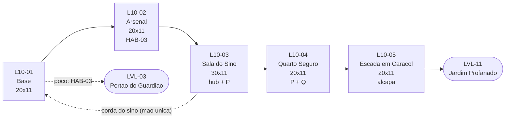

# LVL-10 — Torre da Vigília

> Setor 10 de 16 · **`[PÓS]`** · **Ato III — A Falha** · **o hub**
> Versão: `0.1.0` · Data: `2026-11-13` · Autor: `AGT-02` (Designer de Level) + `AGT-03` (Gameplay)
> Base: [GDD 3.4](../03-conteudo-do-jogo.md) · [Setores e Cenários §4.1, §4.4 e §4.90](../design-patterns/04-setores-e-cenarios.md) · [Padrões de Level Design §7.1, §7.5 e §7.9](../design-patterns/07-padroes-de-level-design.md)

> ⚠️ **Escopo `[PÓS]` — leia antes de usar este documento.**
> Fora do recorte do MVP. Especificado completo porque entrega `HAB-03`, é o hub do mundo e o único setor com quarto seguro fora de LVL-01, mas nome e conteúdo **não são canônicos** (`D-04`). Não codar antes de `BKL-012`.

**Status:** layout completo nos 12 campos, grades validadas, alcançabilidade verificada na config canônica **B** (`DEC-014`), ficha de `HAB-03` fechada.

> 🟢 **Este documento resolve o impasse de `P-39`/`P-50` — e a resposta não era sala mais alta.** A saída da sala sobe para o teto (`DEC-015`): um **alçapão** fica 6 tiles acima do piso e o salto duplo chega a 4,3. É a primeira trava vertical que funciona neste motor, e ela custa **zero** linha nova de grade. Ver §6.

---

## 1. Os 12 campos obrigatórios

| # | Campo | Definição |
|---|---|---|
| 1 | **ID e nome canônico** | `LVL-10` — Torre da Vigília *(nome canônico do GDD §3.4 — o único setor do Ato III com nome que não é de trabalho)* |
| 2 | **Objetivo** | Subir a torre, obter a **garra** (`HAB-03`) e sair pelo **alçapão** do topo para LVL-11 |
| 3 | **Duração e mortes** | 6–9 min na primeira visita · **0–1 mortes esperadas** |
| 4 | **Acento e materiais** | `PAL-10` pedra alta · pedra, ferro, corda, sino rachado |
| 5 | **Sinais de ambientação** | **sino sem badalo** · corda que desce até o chão e sobe para o escuro · ganchos de ferro da Vigília nas paredes · um quarto com cama feita · poeira parada (a torre não tem vento) |
| 6 | **Habilidade de entrada / saída** | Entrada: `HAB-04` gancho. Saída: **`HAB-03` Escalada** (`ITM-009`, ID proposto — `P-53`) |
| 7 | **Salas** | 5 salas: 20 · 20 · **30** · 20 · 20 (× 11) = **110 tiles** |
| 8 | **O que ensina** | **escalada** e, por oposição a LVL-09, **o que é um lugar seguro** |
| 9 | **Set pieces** | `CEN-077` sino sem badalo · `CEN-078` corda do sino · `CEN-079` escada em caracol quebrada · `CEN-080` parede de ganchos · `CEN-081` alçapão · `CEN-082` poço da Vigília |
| 10 | **Inimigos** | `ENT-002` Sentinela distorcida × 5 (1 · 2 · 1 · 0 · 1) |
| 11 | **Entradas e saídas** | L10-01 ← **LVL-09** (escada de serviço) · L10-05 → **LVL-11** (**alçapão**, `requires=HAB-03`) · L10-01 → **LVL-03** (poço da Vigília, `requires=HAB-03`) |
| 12 | **Teste de rastreabilidade** | `TST-005` (habilidade sobrevive à morte) · `TST-013` · `TST-007` · `TST-001` · `TST-014` |

### Propriedades de design deste setor

- **É o único hub do mundo, e hub não é sala grande — é o único lugar onde voltar é barato.** A torre tem três conexões em três direções: para baixo perto (LVL-09, de onde veio), para baixo longe (LVL-03, pelo poço) e para cima (LVL-11, pelo alçapão). Nenhum outro setor tem três.
- **É o único setor com quarto seguro fora de LVL-01.** `BGM-03` (quarto seguro) só toca em 01, 10 e 15 (`06-audio` §4): a torre é um dos três lugares do jogo em que a trilha **não está com pressa**.
- **A pergunta do Ato III é feita aqui e respondida por omissão.** O Ato III pergunta *"quem deu as ordens?"*. O jogador sobe a torre esperando encontrar quem toca o sino — e o sino **não tem badalo**. A Ronda marchou o Ato II inteiro atrás de um sino que não pode soar. A resposta é a mesma do fim do ato: *ninguém: a ordem é a própria ruína*.
- **Zero plataformas, como LVL-09.** A torre não tem degraus soltos — tem paredes com ganchos. É o segundo setor seguido em que a tabela de alcance vertical fica vazia, e aqui isso é o conteúdo.
- **O setor mais seguro do Ato III de propósito.** Depois de LVL-08 (chefe) e LVL-09 (aperto), o jogador precisa de um lugar em que a morte não seja o assunto. E o Ato III ainda tem 4 setores.

---

## 2. Fluxo



| Transição | Checkpoint |
|---|---|
| LVL-09 → L10-01 | salva ao cruzar a porta |
| L10-01 → L10-02 | salva ao cruzar a porta |
| L10-02 → L10-03 | salva ao cruzar a porta |
| **L10-03** | **`P` em (3,6)** — antes do hub |
| L10-03 → L10-04 | salva ao cruzar a porta |
| **L10-04** | **`P` em (3,6)** + **quarto seguro** (`PAT-LD-05`) |
| L10-04 → L10-05 | salva ao cruzar a porta |
| **L10-05** | **alçapão** em (13,0)–(14,0) — exige `HAB-03` |

> **O hub tem uma saída para trás e outra para longe.** A corda do sino devolve ao pé da torre (atalho interno, `PAT-LD-08`); o poço devolve ao **setor 3**, do outro lado do mundo — é o primeiro atalho de longa distância do jogo, e ele só existe depois da garra.

---

## 3. Legenda das grades

| Símbolo | Camada | Significado |
|---|---|---|
| `#` | `ground` + `collision` | sólido (pedra alta) |
| `H` | `ground` + `collision` + `climbable` | **parede de ganchos** (`CEN-080`) — sólida e **agar­rável** por `HAB-03` |
| `^` | `objects` | **alçapão no teto** (`CEN-081`) — passagem **vertical**, ver `DEC-015` (§6) |
| `+` | — | abertura de passagem lateral (`y=4–6`) |
| `D` | `objects` | porta / passagem de área |
| `.` | — | ar |
| `E` | `objects` | Sentinela distorcida (`ENT-002`) |
| `X` | `objects` | **`HAB-03` Escalada** (`ITM-009`, ID proposto — `P-53`) |
| `W` | `objects` | **poço da Vigília** (`CEN-082`) — desce para LVL-03, `requires=HAB-03` |
| `r` | `objects` | **corda do sino** (`CEN-078`) — `interact`, desce para L10-01 |
| `P` | `objects` | ponto de salvamento |
| `Q` | `objects` | quadro de aviso do quarto seguro |
| `N` | `objects` | inscrição / marco de lore |
| `B` | `decor-back` | **sino rachado sem badalo** (`CEN-077`), 3×3 |
| `G` | `decor-back` | escada em caracol quebrada (`CEN-079`) |
| `v` | `decor-back` | janela alta (`CEN-074` reskin) |
| `t` | `decor` | tocha da Vigília (`CEN-002` reskin) — **a torre está acesa** |

Piso em `y=7` e aberturas **laterais** em `y=4–6` seguem `DEC-007`. A abertura **vertical** em `y=0` segue `DEC-015` (§6).

> **`H` é sólido antes de ser agar­rável.** A parede de ganchos não é uma escada: ela bloqueia o passo e bloqueia o salto. O que a garra faz é **permitir usá-la como superfície**, não transformá-la em passagem.

---

## 4. Salas

### 4.1 L10-01 — Base · 20×11

```
    00000000001111111111
    01234567890123456789
y0  #########^^#########
y1  #..................#
y2  #..v............v..#
y3  #..................#
y4  +..................+
y5  +..................+
y6  +.t...N.....E.W..r.+
y7  ####################
y8  ####################
y9  ####################
y10 ####################
```

| Objeto | Pos | Função |
|---|---|---|
| `+` porta | (0,4)–(0,6) | vinda de **LVL-09** (escada de serviço). Autosave |
| `+` saída | (19,4)–(19,6) | para L10-02 |
| **`^` alçapão** | (9,0)–(10,0) | `CEN-081` **lacrado** (`state=sealed`). **Exposição 1 de `PAT-LD-03`** |
| **`W` poço** | (14,6) | `CEN-082` → **LVL-03**. `requires=HAB-03` — o jogador vê e não pode usar |
| `r` corda | (17,6) | **chegada do atalho** do sino. Ponto de chegada, não gatilho (`arrival_only=true`) |
| `E` Sentinela | (12,6) | patrulha de 3 tiles |
| `t` tocha | (2,6) | `CEN-002` reskin. **A torre está acesa** — primeira vez no jogo |
| `N` marco | (6,6) | **"A TORRE ESTÁ DE PÉ. A VIGÍLIA NÃO."** (7 palavras) |
| `v` janelas | (3,2) · (16,2) | `CEN-074` reskin |
| **Plataformas** | — | **nenhuma** |

- **Função:** a soleira do hub e a primeira das três exposições da garra. O jogador vê **um alçapão lacrado no teto, a 6 tiles do chão**, e um **poço gradeado no chão**: os dois são inalcançáveis ou inúteis, e os dois vão ficar disponíveis no fim do setor.
- **Por que a tocha acesa importa:** em todos os setores até aqui a luz vinha de um lugar que ninguém mantinha — vitral, cristal, sol. Aqui alguém acendeu. É a única prova física, em 10 setores, de que há uma mão em algum lugar. E ela conduz ao sino, que não tem badalo.
- **Aceite:** atravessar em ≤ 12 s e ver o alçapão. Nenhuma morte possível.

---

### 4.2 L10-02 — Arsenal · 20×11

```
    00000000001111111111
    01234567890123456789
y0  ####################
y1  #..................#
y2  #....t...v.........#
y3  #..................#
y4  +..................+
y5  +..................+
y6  +..N...X...E...E...+
y7  ####################
y8  ####################
y9  ####################
y10 ####################
```

| Elemento | Posição | Função |
|---|---|---|
| **`X` garra** | (7,6) | **`HAB-03`** (`ITM-009`). Hold de 400 ms + flash `PAL-10` + notificação. **Exposição 3** |
| `t` tocha | (5,2) | a estante pegou fogo e parou |
| `E` Sentinelas | (11,6) · (15,6) | patrulhas de 3 e 3 tiles, dessincronizadas |
| `N` marco | (3,6) | **"ARMÁRIO DO TERCEIRO TURNO. NINGUÉM ASSINOU A DEVOLUÇÃO."** (8 palavras) |
| `v` janela | (9,2) | `CEN-074` reskin |
| **Plataformas** | — | **nenhuma** |

- **Função:** entregar a escalada. O arsenal da Vigília é o único lugar do mundo onde equipamento foi **guardado** em vez de largado — e é por isso que a garra ainda está lá.
- **Por que dois inimigos:** é a única sala do setor onde a coisa desejada está guardada, e o jogador precisa **escolher** entre limpar e pegar.
- **Aceite:** recolher `HAB-03`. `TST-005` — morrer depois e voltar ao checkpoint **mantém** a habilidade.

---

### 4.3 L10-03 — Sala do Sino · 30×11

```
    000000000011111111112222222222
    012345678901234567890123456789
y0  ##############################
y1  #.............BBB............#
y2  #.............BBB..........v.#
y3  #.............BBB............#
y4  D.............r..............+
y5  D.............r..............+
y6  D..P...t......r..N....E..t...+
y7  ##############################
y8  ##############################
y9  ##############################
y10 ##############################
```

| Elemento | Posição | Função |
|---|---|---|
| **`B` sino** | x = 14–16, `y1`–`y3` | `CEN-077`. **3×3, rachado, sem badalo.** Não emite som em nenhum estado |
| **`r` corda** | (14,4)–(14,6) | `CEN-078`. **`interact` → desce para L10-01.** Atalho de mão única (`PAT-LD-08`) |
| `D` porta | (0,4)–(0,6) | vem de L10-02 |
| `+` saída | (29,4)–(29,6) | para L10-04 |
| `P` save | (3,6) | `UI-09` |
| `N` marco | (17,6) | **"O SINO NÃO TEM BADALO. A RONDA ANDA ASSIM MESMO."** (10 palavras) |
| `E` Sentinela | (22,6) | patrulha de 4 tiles, **de costas para o sino** |
| `t` tochas | (7,6) · (25,6) | `CEN-002` reskin |
| `v` janela | (27,2) | `CEN-074` reskin |
| **Plataformas** | — | **nenhuma** |

- **Função:** o coração do setor e a resposta do Ato III. O jogador atravessou o Ato II inteiro vendo Sentinelas marcharem em formação sem ninguém para render. A torre é onde ele espera encontrar quem ordena — e encontra um sino rachado, sem badalo, e uma corda que ninguém puxa.
- **Por que o inimigo está de costas para o sino:** a Sentinela patrulha a torre há tempo indeterminado e nunca olhou para cima. Ela cumpre turno diante de um sino mudo, e isso resume o Ato II.
- **Por que o sino não pode tocar em nenhum estado:** se ele tocasse ao chegar perto, o mistério viraria um efeito. O silêncio dele é a informação — e `AGT-06` não pode usar nem um `SFX` de sino neste setor.
- **Aceite:** atravessar em ≤ 25 s, ler o marco, opcionalmente descer pela corda. Nenhuma morte possível.

---

### 4.4 L10-04 — Quarto Seguro · 20×11

```
    00000000001111111111
    01234567890123456789
y0  ####################
y1  #..................#
y2  #.....v............#
y3  #..................#
y4  +..................+
y5  +..................+
y6  +..P...Q...N..t....+
y7  ####################
y8  ####################
y9  ####################
y10 ####################
```

| Elemento | Posição | Função |
|---|---|---|
| `P` save | (3,6) | `UI-09`. **Quarto seguro:** o único `P` do jogo que não é uma transição (`PAT-LD-05`) |
| `Q` quadro | (7,6) | aviso da Vigília, 2–3 linhas (`LOR-04`) |
| `N` marco | (11,6) | **"DORMIR É UM TURNO TAMBÉM."** (5 palavras) |
| `t` tocha | (14,6) | `CEN-002` reskin, acesa |
| `v` janela | (6,2) | `CEN-074` reskin |
| **Inimigos** | — | **zero** |
| **Trilha** | — | **`BGM-01` → `BGM-03`** ao cruzar a porta |

- **Função:** o lugar em que o jogo desacelera. É o único quarto seguro fora de LVL-01, e ele é seguro por três motivos simultâneos: **nenhum inimigo, nenhuma armadilha, e trilha de quarto seguro**. Nenhum dos três sozinho bastaria.
- **Por que ele fica antes do alçapão:** é o último checkpoint antes de LVL-11. Sem ele, morrer no setor seguinte custaria a subida inteira — e a subida é o conteúdo deste setor.
- **Por que a cama está feita:** porque alguém a fez. A torre acesa, o arsenal guardado e a cama feita são a mesma evidência, e o setor inteiro é feito de achá-la e não encontrar o dono.
- **Aceite:** salvar. `PAT-LD-04` / `PAT-LD-05` verdes.

---

### 4.5 L10-05 — Escada em Caracol · 20×11

```
    00000000001111111111
    01234567890123456789
y0  #############^^#####
y1  #............HH....#
y2  #............HH...G#
y3  #............HH...G#
y4  +............HH...G#
y5  +............HH...G#
y6  +.N...t......HH..EG#
y7  ####################
y8  ####################
y9  ####################
y10 ####################
```

| Elemento | Posição | Função |
|---|---|---|
| `^` alçapão | (13,0)–(14,0) | **`CEN-081` `state=open`** → LVL-11. **É a trava 10 → 11** |
| **`H` parede** | x = 13–14, `y1`–`y6` | `CEN-080`. Sólida e agitável. **6 tiles**, do piso ao teto |
| `+` porta | (0,4)–(0,6) | vem de L10-04 |
| `G` escada | x = 18, `y2`–`y6` | `CEN-079`. **Quebrada** — é o que obriga a escalada |
| `E` Sentinela | (17,6) | **do outro lado** da parede; opcional |
| `t` tocha | (6,6) | `CEN-002` reskin |
| `N` marco | (2,6) | **"SUBIR É SÓ NÃO PARAR."** (5 palavras) |
| **Plataformas** | — | **nenhuma** — e é obrigatório que não haja (§6.3) |

- **Função:** a subida. A escada em caracol original está quebrada no meio; no lugar dela, a Vigília cravou ganchos até o teto. O alçapão está **aberto** — e é a diferença visual entre ele e o lacrado de L10-01 que fecha a exposição 2.
- **Como se atravessa:** encostar na parede de (13–14) com direção pressionada, subir 6 tiles a 90 px/s (**4,3 s**), e entrar no alçapão.
- **Por que o inimigo está do outro lado:** ele é opcional por construção. Quem sobe não o encontra; quem desce do outro lado o encontra. Escolha do jogador, não penalidade.
- **Aceite:** entrar no alçapão. `TST-013` verde no setor.

---

## 5. O hub — o que uma torre resolve

Um hub, neste jogo, não é uma sala grande. É o único lugar do mundo onde **voltar é barato**, e o único em que três caminhos coexistem:

| Conexão | Custo de voltar | Trava |
|---|---|---|
| LVL-09 (de onde veio) | 5 salas, ~110 tiles | — |
| **LVL-03** (o poço, do outro lado do mundo) | **1 transição** | `HAB-03` |
| LVL-11 (para cima) | 1 alçapão | `HAB-03` |

**O poço é o primeiro atalho de longa distância do jogo.** Até aqui, todo atalho reduzia o custo *dentro* de um setor (`PAT-LD-08`). O poço da Vigília conecta o **setor 10 ao setor 3** — e é o que torna o backtracking viável num mundo de 16 setores em serpentina (`DEC-005`): depois dele, revisitar o MVP não é mais uma caminhada de meia hora.

> **Por que o atalho de longa distância fica aqui e não em outro setor:** porque a torre é o ponto mais alto do mundo ocidental e o Portão do Guardião é o ponto mais baixo da mesma linha. O poço não é um elevador instalado por conveniência: é um poço, e poços vão para baixo.

---

## 6. O alçapão — a primeira trava vertical que funciona

### 6.1 O impasse que `P-39`/`P-50` tinha criado

| Fato | Valor |
|---|---:|
| Altura da plataforma mais alta que cabe na sala | **256 px (4 tiles)** |
| Alcance do salto duplo | **276 px (4,3 tiles)** |
| Altura da sala | **704 px = 11 tiles** (`DEC-006`, uma tela exata) |

**Toda plataforma está ao alcance do salto duplo.** Durante três setores, LVL-05 travou por espaço, LVL-06 por tempo e LVL-09 por distância horizontal — porque **altura nunca podia ser trava**. `P-50` perguntava: para que servem `HAB-03` escalada e `HAB-07` planar num mundo onde nada é verticalmente inalcançável?

### 6.2 A resposta: a saída sobe, a sala não

A saída de uma sala **não precisa ser lateral**. `DEC-007` fixou as aberturas em `y=4–6` porque alturas variáveis por porta geram bug de encaixe — mas a regra tratava do caso lateral, entre salas.

> **`DEC-015` — abertura vertical (alçapão).** Uma sala pode ter, além das portas laterais, um **alçapão no teto** em `y=0`, com **2 tiles de largura**, levando à sala de cima. Ele não substitui `DEC-007`: ele acrescenta uma segunda classe de passagem, com regra própria de altura.

**A conta então funciona:**

| Elemento | Valor |
|---|---:|
| Alçapão em `y=0` | **6 tiles (384 px)** acima do topo do piso |
| Salto duplo | 276 px = 4,3 tiles |
| **Falta** | **108 px** |
| Escalada (`HAB-03`) | sobe os 6 tiles, sem limite de altura |
| Resultado | **trava vertical que funciona, com 108 px de margem** |

E ela custa **zero** linha nova de grade: o teto já estava lá. A sala continua com 11 linhas, a tela continua sendo uma tela, e nenhuma câmera precisa rolar.

### 6.3 As três regras que o alçapão impõe

1. **Nenhuma plataforma sob o alçapão.** Uma plataforma a 4 tiles do piso põe o alçapão a 2 tiles dela — e o duplo alcança. O alçapão só é trava porque **o chão é o único lugar de onde se tenta**.
2. **Parede agitável contínua do piso ao teto.** Se a parede parar no meio, o jogador sobe, não tem onde se segurar e cai — ambiguidade proibida por `PAT-LD-09`.
3. **O alçapão é dois sentidos**, como toda porta. Quem sobe pode descer; o que não se pode é **subir sem a garra**.

### 6.4 O que isso resolve

| Pendência | Situação |
|---|---|
| `P-39` (rolagem vertical) | **deixa de bloquear o Ato III.** Nenhum setor precisa de sala mais alta que 11 linhas |
| `P-50` (habilidades verticais) | **fechada.** `HAB-03` trava pelo alçapão; `HAB-07` planar travará por vão horizontal, que já tem régua (`LVL-09` §6.1) |
| `P-49` (folga de cabeça em `y=2`) | **continua aberta** — e agora é mais grave, porque o teto virou superfície de passagem |

---

## 7. `HAB-03` Escalada — ficha e ensino

### 7.1 Ficha

| Atributo | Valor | Observação |
|---|---:|---|
| Adesão | **100 ms** ao encostar em parede `climbable` com direção pressionada | análogo do `coyoteMs` |
| Subida | **90 px/s** | 6 tiles = 384 px = **4,3 s** |
| Descida controlada | **240 px/s** | mais rápida que subir, de propósito |
| Queda livre sem aderência | gravidade **1100 px/s²** | a garra não muda a física de queda |
| Pulo de parede | **420 px/s** perpendicular + 560 vertical | permite alternar entre paredes opostas |
| Paredes válidas | só `climbable=true` (`CEN-080`) | parede comum **não** agarra — é o sinal visual de `PAT-LD-03` |
| Teto | **não atravessa** | só sai pelo alçapão |
| É arma? | **não** | mesma regra de `HAB-05` e `HAB-04` |

### 7.2 Ensino em três exposições (`PAT-LD-03`)

| # | Onde | O que o jogador vê | O que ele conclui |
|---|---|---|---|
| 1 | **L10-01** (2,0)–(10,0) | um alçapão **lacrado** a 6 tiles do chão | "existe um buraco ali em cima e eu não alcanço" |
| 2 | **L10-05** (13,0)–(14,0) | o mesmo alçapão, **aberto**, com uma **parede de ganchos** embaixo | "a diferença é a parede, não o buraco" |
| 3 | **L10-02** (7,6) | a garra no arsenal, com hold de 400 ms e flash | "é isto que estava faltando" |

> **A exposição 2 acontece na porta, e não antes dela.** `PAT-LD-03` pede três contatos, não três salas de antecedência: o jogador reconhece a solução **quando chega nela**, e nesse instante já tem a habilidade. É a mesma gramática de LVL-02 (o fragmento antes da rota alta).

---

## 8. Validação de alcançabilidade

Solver de passo fixo a 60 Hz na config canônica **B** (`DEC-014`).

| Obstáculo | Sala | Tipo | Valor | Falta | Resultado |
|---|---|---|---:|---:|---|
| **alçapão lacrado** | L10-01 | vertical | 384 px | 108 px | intransponível **e selado** ✓ |
| **alçapão aberto** | L10-05 | vertical | 384 px | 108 px | **trava 10 → 11** — só com `HAB-03` ✓ |
| parede de ganchos | L10-05 | superfície | 6 tiles | — | escalada a 90 px/s = 4,3 s ✓ |
| poço da Vigília | L10-01 | objeto | — | — | `requires=HAB-03` (regra, não geometria) ✓ |
| corda do sino | L10-03 | descida | 1 sentido | — | queda controlada, sem dano ✓ |
| **plataformas** | todas | — | **0 no setor** | — | nada a validar por salto |

**Resultado: 0 falhas.** E pela primeira vez desde LVL-05, a coluna "vertical" da tabela **não está vazia** — porque o alçapão devolveu à altura o direito de ser trava.

---

## 9. Salvamento e morte

| Evento | O que acontece | Regra |
|---|---|---|
| Cruza qualquer porta | salva | `MEC-007` |
| **Entra no quarto seguro** | salva; `BGM-01` → `BGM-03` | `PAT-LD-05` |
| Interagir com `P` | salva | `MEC-007` |
| Usa a corda do sino | **não salva** | atalho ≠ transição |
| Usa o poço | **não salva**; troca de setor | `PAT-LD-05` |
| Morre para Sentinela | respawn no último checkpoint; **`HAB-03` permanece** | `MEC-004`, `MEC-005` |
| Morre com bolsa | bolsa fica no local | `MEC-004` |

**Nenhuma morte é obrigatória e nenhuma queda mata.** A torre tem 110 tiles, 5 inimigos e 4 quedas possíveis — todas reversíveis a pé.

---

## 10. Conversão para Tiled (`.tmj`)

| Item | Definição |
|---|---|
| Nome do arquivo | `public/assets/tilemaps/tm_lvl10_torre.tmj` |
| Tileset | `tm_torre` (`AST-013` — **ID proposto**, `P-53`), ~26 tiles, 64×64 |
| Orientação | orthogonal, tile 64×64, 20–30 colunas × 11 linhas por sala |
| Camadas (ordem) | `decor-back` · `ground` · `collision` · `objects` · `decor-front` |
| Propriedades do mapa | `lvl_id=LVL-10`, `pal=PAL-10`, `bgm=BGM-01`, `amb=AMB-10`, `scope=post`, `safe_room=L10-04` |

### Propriedades dos objetos (`objects`)

| Tipo | Propriedades |
|---|---|
| `enemy` | `ent=ENT-002`, `patrol_tiles`=3–4, `initial_facing`=`right`, `has_telegraph`=true |
| `climb_wall` | `cen=CEN-080`, `climbable`=true, `top`=6 — **sempre do piso ao teto** (§6.3) |
| `hatch` | `cen=CEN-081`, `state`=`sealed`/`open`, `to`, `requires`=`HAB-03`, `two_way`=true, `platforms_below`=0 |
| `well` | `cen=CEN-082`, `to=LVL-03`, `requires=HAB-03`, `save`=false, `one_way`=true |
| `bell_rope` | `cen=CEN-078`, `trigger`=`interact`, `to=L10-01`, `one_way`=true, `save`=false |
| `ability_pickup` | `hab=HAB-03`, `itm=ITM-009`, `hold_ms`=400, `pal=PAL-10` |
| `save_point` | `ui=UI-09`, `checkpoint`=true, `type`=`safe_room` (só L10-04) |
| `notice_board` | `lor=LOR-04`, `lines`=3 (só L10-04) |
| `door` | `to=LVL-09` (L10-01, `style=iron`) |
| `lore_marker` | `key`=`lore.lvl10.torre` / `.devolucao` / `.badalo` / `.dormir` / `.subir`, `max_words`=25 |
| `decor` | `ast=CEN-077` (back, `rings`=**false**) / `CEN-079` (back) / `CEN-074` (back) / `CEN-002`, `collides`=false |

> **`rings=false` no sino não é detalhe de arte: é regra.** `AGT-06` não pode emitir nenhum `SFX` associado a este objeto em estado algum (§4.3).

**Regra de ouro:** nenhum número de gameplay no `.tmj`. Velocidade de escalada, aderência, pulo de parede e alcances vêm de `tuning.ts` (`PAT-C-04`).

---

## 11. Checklist de aprovação (`07-padroes` §7.14)

- [x] Dimensões múltiplas de 20×11 — 20, 20, 30, 20, 20 × 11
- [x] Objetivo de cada sala compreensível em ≤ 3 s
- [x] Respeita a tabela de alcance (§8) — **0 falhas**
- [x] `PAT-LD-03` em 3 exposições — alçapão lacrado (L10-01), alçapão aberto (L10-05), garra (L10-02)
- [x] `DEC-010` — a habilidade é obtida **antes** de ser exigida
- [x] Rota crítica funciona com inventário vazio (`PAT-LD-06`)
- [x] Nenhum soft lock: alçapão é dois sentidos, poço é regra, corda é mão única
- [x] `PAT-LD-05` — quarto seguro é o único `P` que não é transição, e é explícito no padrão
- [x] `PAT-LD-08` — atalho interno pela corda do sino (forma de mão única) **e** atalho de longa distância pelo poço
- [x] `PAT-LD-10` — máx. 2 inimigos por sala; 5 no setor
- [x] `collision` alinhada ao `ground` (validado pelo gerador de grade)
- [x] Paleta com um único acento (`PAL-10`)
- [x] **Nenhuma plataforma sob alçapão** (§6.3, regra 1)
- [x] **Parede agitável do piso ao teto** em toda parede de ganchos (§6.3, regra 2)
- [x] `BGM-03` só no quarto seguro; o sino **não** tem `SFX` em nenhum estado
- [x] Testes associados: `TST-001`, `TST-005`, `TST-007`, `TST-013`, `TST-014`
- [ ] **Aprovação de escopo:** `[PÓS]` (`D-04`) — não marcado de propósito
- [ ] **`DEC-015` (alçapão) ratificada:** pendente (`P-53`)
- [ ] **Ficha de `HAB-03`** (`ITM-009`, `AST-013`, `UI-14`): pendente (`P-53`)

---

## 12. Desvios registrados

| # | O que mudou | Por quê | IDs afetados |
|---|---|---|---|
| 1 | **Passagem vertical em `y=0` (`DEC-015`)** | É a única forma de fazer altura ser trava neste motor. A sala continua com 11 linhas e a câmera não rola (§6) | `DEC-007`, `P-39`, `P-50` |
| 2 | **Zero plataformas no setor** | A torre não tem degraus soltos, tem paredes com ganchos. E uma plataforma sob o alçapão destruiria a trava (§6.3) | `PAT-LD-01` |
| 3 | **O sino não emite som em nenhum estado** | Se tocasse ao passar, o mistério viraria efeito. O silêncio é a informação (§4.3) | `AGT-06`, `CEN-077` |
| 4 | **Poço da Vigília: atalho de longa distância 10 ↔ 03** | Primeiro atalho do jogo que cruza setores. É o que torna viável revisitar o MVP num mundo de 16 setores (`DEC-005`) | `PAT-LD-08`, `DEC-005` |
| 5 | **`Q` (quadro de aviso) só aqui e em L01-05** | `LOR-04` diz que o quadro é de baixo impacto e do quarto seguro. Há dois quartos seguros no jogo, então há dois quadros | `LOR-04` |
| 6 | **L10-04 é o último checkpoint antes de LVL-11** | Sem ele, morrer no setor seguinte custaria a subida inteira — e a subida **é** o conteúdo deste setor | `PAT-LD-05` |

---

## 13. Pendências geradas

| ID | Item | Bloqueia |
|---|---|---|
| `P-53` | **`DEC-015` e a ficha de `HAB-03`.** Ratificar a passagem vertical em `y=0` (2 tiles, dois sentidos) e aprovar: adesão 100 ms, subida 90 px/s, descida 240 px/s, pulo de parede 420+560, só `climbable=true`. Faltam `ITM-009`, `AST-013`, `UI-14` | `BKL-001`, `BKL-012`, LVL-10, LVL-11 |
| `P-54` | **O poço 10 ↔ 03 é o único atalho entre setores e não tem ficha.** Nome, skin, tempo de transição, se aceita uso com bolsa, e se sobrevive a reload | `PAT-LD-08`, LVL-03, LVL-10 |
| `P-55` | **A torre acesa contradiz o resto do mundo?** Em 10 setores a luz vem de algo que ninguém mantém; aqui há tochas acesas, arsenal guardado e cama feita. Isso é pista narrativa (alguém ainda sobe) ou inconsistência de arte? Precisa de decisão antes de `AGT-01` desenhar o setor | `BKL-012`, `P-16` |

> **Fechadas nesta rodada:** `P-39` deixa de bloquear o Ato III e `P-50` é fechada por `DEC-015` (§6.4).

---

## Handoff

**Para `AGT-03`** — `climb_wall` como estado do jogador (`cling → up/down → wall_jump`), aderência de 100 ms e **só em `climbable=true`**. `hatch` é uma transição comum com `requires=HAB-03`, dois sentidos. **Os dois itens mais fáceis de errar:** (1) a parede tem de ir do piso ao teto sem interrupção, senão o jogador cai no meio da subida (§6.3); (2) `HAB-03` tem de sobreviver à morte (`TST-005`), ou o alçapão vira soft lock.

**Para `AGT-01`** — `CEN-077` sino 3×3 rachado **sem badalo** (a ausência é o desenho), `CEN-078` corda do sino, `CEN-079` escada em caracol quebrada (a quebra tem de ser legível a 3 tiles), `CEN-080` parede de ganchos (**precisa gritar "agarre aqui"** — é o sinal de `PAT-LD-03`), `CEN-081` alçapão em 2 estados (lacrado e aberto), `CEN-082` poço. Tileset `tm_torre` ~26 tiles.

**Para `AGT-06`** — `BGM-03` **só** em L10-04; `BGM-01` no resto; `AMB-10` (pedra alta, vento lá fora e nenhum dentro). **Nenhum `SFX` de sino, em nenhum estado** (§4.3). O cue de aderência da garra tem de ser audível e distinto do cue de dano.

**Para `AGT-07`** — `TST-005` é o teste do setor. Testar também: o alçapão **não** abre com o salto duplo; nenhuma plataforma existe sob o alçapão; a corda e o poço **não** salvam; e `TST-013` com o setor atravessado só com `HAB-03` no final.

**O próximo agente precisa saber, em 3 linhas:**

1. **A altura voltou a ser trava, e foi de graça.** A saída sobe para o teto (`DEC-015`): o alçapão fica a 6 tiles e o duplo chega a 4,3. Sala mais alta **não** é a resposta — saída mais alta é.
2. **O sino não tem badalo, e isso é o Ato III.** Se alguém fizer o sino tocar, o setor perde a única coisa que ele diz.
3. **Este é o único lugar seguro do Ato III.** A torre acesa, o arsenal guardado e a cama feita são pistas — não decoração. Se `P-55` disser que é inconsistência, o setor é refeito, não remendado.
