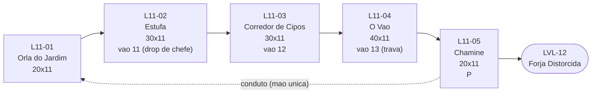

# LVL-11 — Jardim Profanado

> Setor 11 de 16 · **`[PÓS]`** · **Ato III — A Falha** · **a beleza errada**
> Versão: `0.1.0` · Data: `2026-11-13` · Autor: `AGT-02` (Designer de Level) + `AGT-03` (Gameplay)
> Base: [GDD 3.4](../03-conteudo-do-jogo.md) · [Setores e Cenários §4.1, §4.2 e §4.90](../design-patterns/04-setores-e-cenarios.md) · [Padrões de Level Design §7.3, §7.5 e §7.10](../design-patterns/07-padroes-de-level-design.md)

> ⚠️ **Escopo `[PÓS]` — leia antes de usar este documento.**
> Fora do recorte do MVP. Especificado completo porque entrega `HAB-07`, mas nome e conteúdo **não são canônicos** (`D-04`). Não codar antes de `BKL-012`.

**Status:** layout completo nos 12 campos, grades validadas, alcançabilidade medida por solver na config canônica **B** (`DEC-014`), ficha de `HAB-07` fechada.

> 🟢 **A régua horizontal do jogo fecha aqui.** `HAB-07` **não é voo e não é planeio livre**: o solver mostra que planar num salto simples dá **529 px** e o salto duplo correndo dá **534 px** — ou seja, **o estandarte não serve para nada sem altura**. Ele converte altura em distância, e só isso. Com o duplo atrás, o alcance salta para **1.042 px (16,3 tiles)**. Ver §7.
>
> 🔴 **Achado colateral:** com essa régua, o canal de **8 tiles (512 px)** que trava `09 → 10` (LVL-09) é atravessável por um **salto duplo correndo (534 px)** — 22 px de margem. Registrado em `P-59`, não corrigido em silêncio.

---

## 1. Os 12 campos obrigatórios

| # | Campo | Definição |
|---|---|---|
| 1 | **ID e nome canônico** | `LVL-11` — Jardim Profanado *(nome canônico do GDD §3.4)* |
| 2 | **Objetivo** | Atravessar os vãos do jardim com o **estandarte** (`HAB-07` — que **cai de chefe**, `DEC-042`) e descer a chaminé para LVL-12 |
| 3 | **Duração e mortes** | 7–10 min · **0 mortes esperadas** — o setor **não mata** |
| 4 | **Acento e materiais** | `PAL-11` magenta `#C76BA6` · pedra coberta de musgo, vidro de estufa, cipó, pétala |
| 5 | **Sinais de ambientação** | **flora magenta que estala** · estátuas sem rosto (a trepadeira comeu) · cipós que marcam a beirada dos vãos · o único lugar do mundo que **ainda cresce** |
| 6 | **Habilidade de entrada / saída** | Entrada: `HAB-03` escalada (alçapão de LVL-10). Saída: **`HAB-07` Planar** (`ITM-010`, ID proposto — `P-56`), **obtido por drop de chefe** desde `DEC-042` |
| 7 | **Salas** | 5 salas: 20 · **30** · **30** · **40** · 20 (× 11) = **140 tiles** |
| 8 | **O que ensina** | **planeio** — e que distância, neste jogo, é uma função da altura |
| 9 | **Set pieces** | `CEN-083` flora magenta · `CEN-084` estátua sem rosto · `CEN-085` trepadeira · `CEN-086` flor que estala · `CEN-087` estandarte rasgado · `CEN-088` chaminé |
| 10 | **Inimigos** | `ENT-002` Sentinela distorcida × 5 — **variante `pruning`**, ver §4 |
| 11 | **Entradas e saídas** | L11-01 ← **LVL-10** (alçapão do topo da torre) · L11-05 → **LVL-12** (chaminé) · L11-05 ⇢ **L11-01** (conduto, atalho de mão única) |
| 12 | **Teste de rastreabilidade** | `TST-005` · `TST-013` · `TST-007` · `TST-001` · `TST-014` |

### Propriedades de design deste setor

- **É o único setor do jogo que não mata.** Não há queda letal (`DEC-011`), não há armadilha, a água não existe e os 5 inimigos são opcionais por posicionamento. Um jogador atento atravessa LVL-11 com 0 de dano. Isso é deliberado: o setor é a **respiro pós-clímax** de um Ato que vinha de chefe (LVL-08) e de aperto (LVL-09).
- **É o primeiro lugar do mundo que ainda está vivo.** Dez setores de pedra, ferrugem, cinza e osso. Aqui cresce coisa — e o acento magenta é o único acento **saturado** desde `PAL-08`. A beleza é o problema: `PAL-11` não é usado em nenhum outro setor e é a cor mais bonita do jogo.
- **A resposta do Ato III ganha corpo.** O Ato III pergunta *"quem deu as ordens?"*. LVL-10 respondeu com um sino sem badalo. LVL-11 responde o resto: **nada ordenou o jardim e ele cresceu assim mesmo.** A ruína não é um castigo — é paisagismo sem ninguém olhando. E as Sentinelas continuam podando.
- **A estátua sem rosto é o resumo mais barato do Ato III:** alguém ergueu um monumento, a trepadeira comeu a cara, e **ninguém notou porque não sobrou ninguém para olhar**.
- **Zero plataformas, como LVL-09 e LVL-10.** Terceiro setor seguido. Aqui não é idioma: é regra (§8.3) — uma plataforma sobre um vão o torna atravessável sem habilidade.

---

## 2. Fluxo



| Transição | Checkpoint |
|---|---|
| LVL-10 → L11-01 | salva ao cruzar a porta |
| L11-01 → L11-02 | salva ao cruzar a porta |
| **L11-02** | **`P` em (2,6)** — imediatamente antes da habilidade |
| L11-02 → L11-03 | salva ao cruzar a porta |
| L11-03 → L11-04 | salva ao cruzar a porta |
| **L11-04** | **`P` em (3,6)** — imediatamente antes da trava |
| L11-04 → L11-05 | salva ao cruzar a porta |
| **L11-05** | **`P` em (3,6)** — antes da saída do setor |

> **Todo `P` do setor está do lado de cá do obstáculo.** Não é coincidência: em LVL-11 o obstáculo é um vão, e um checkpoint depois de um vão seria um checkpoint que o jogador só alcança depois de já ter passado. `PAT-LD-05` proíbe checkpoint em sala de desafio — aqui o `P` fica na sala, mas **antes da linha do vão**, e isso é registrado como desvio 4 (§12).

---

## 3. Legenda das grades

| Símbolo | Camada | Significado |
|---|---|---|
| `#` | `ground` + `collision` | sólido (pedra com musgo / terra) |
| `.` em `y=7–10` | — | **vão** — piso ausente; queda = respawn na entrada, sem dano (`DEC-011`) |
| `+` | — | abertura de passagem lateral (`y=4–6`) |
| `D` | `objects` | porta / passagem de área |
| `V` | `objects` | **conduto da chaminé** (`CEN-088`) — queda de mão única, `interact` |
| `E` | `objects` | Sentinela distorcida (`ENT-002`, variante `pruning`) |
| `X` (removido por `DEC-042`) | `objects` | **`HAB-07` Planar** (`ITM-010`, ID proposto — `P-56`) |
| `P` | `objects` | ponto de salvamento |
| `N` | `objects` | inscrição / marco de lore |
| `f` | `decor-back` | **flora magenta** (`CEN-083`) — balança com `AMB-11` |
| `s` | `decor-back` | **estátua sem rosto** (`CEN-084`), 1×2 |
| `c` | `decor-front` | **trepadeira** (`CEN-085`) — **marca a beirada de todo vão** |
| `o` | `decor` | **flor que estala** (`CEN-086`) — só som, zero gameplay |
| `w` | `decor-back` | vidro da estufa (`CEN-083` reskin) |
| `b` | `decor-back` | estandarte rasgado da Vigília (`CEN-087`) |

Piso em `y=7` e aberturas laterais em `y=4–6` seguem `DEC-007`. Vãos seguem `DEC-011`. **Nenhum alçapão neste setor** — `DEC-015` existe, mas o jardim não tem teto.

> **`c` (trepadeira) não é decoração: é sinalização.** Todo vão tem cipó nas duas beiradas, e nenhuma beirada sólida tem. É o marcador de `PAT-LD-09` adaptado a um obstáculo que não se mede de baixo para cima.

---

## 4. Salas

### 4.1 L11-01 — Orla do Jardim · 20×11

```
    00000000001111111111
    01234567890123456789
y0  ####################
y1  #..................#
y2  #.f..............f.#
y3  #..................#
y4  +..................+
y5  +.............s....+
y6  +..N.c...E.o..s....+
y7  ####################
y8  ####################
y9  ####################
y10 ####################
```

| Objeto | Pos | Função |
|---|---|---|
| `+` porta | (0,4)–(0,6) | vinda de **LVL-10** (alçapão do topo da torre) |
| `+` saída | (19,4)–(19,6) | para L11-02 |
| `s` estátua | (14,5)–(14,6) | `CEN-084`. **A primeira sem rosto.** O jogador vê a trepadeira onde a cara deveria estar |
| `E` Sentinela | (9,6) | patrulha de 4 tiles, **podando** |
| `N` marco | (3,6) | **"JARDIM FECHADO POR MOTIVO DE FLORA. RETIRAR AS FLORES ANTES DE ENTRAR."** (11 palavras) |
| `c` trepadeira | (5,6) | `CEN-085` |
| `o` flor | (11,6) | `CEN-086` — estala uma vez a cada 9 s |
| `f` flora | (2,2) · (17,2) | `CEN-083` |
| **Vãos** | — | **nenhum** |

- **Função:** a soleira. O jogador vem de dez setores de pedra e sai de um alçapão dentro de um jardim, e a primeira coisa que vê é uma estátua sem cara.
- **Por que o aviso é burocrático:** `03-ambientacao` §3.5 proíbe placa que explica o mundo. "RETIRAR AS FLORES ANTES DE ENTRAR" não diz nada sobre a Vigília — diz que alguém, algum dia, se importou com flores. É a mesma informação, por outro caminho.
- **Por que a Sentinela poda:** é a variante visual de `ENT-002` (§13, `P-58`). Ela não patrulha o jardim — ela **cuida** dele. Um Distorcido é "um ser que perdeu o propósito mas manteve a rotina"; esta mantém uma rotina que o mundo não pede mais e que, ainda assim, dá resultado.
- **Aceite:** atravessar em ≤ 15 s. Nenhuma morte possível.

---

### 4.2 L11-02 — Estufa · 30×11

```
    000000000011111111112222222222
    012345678901234567890123456789
y0  ##############################
y1  #..w...........w.............#
y2  #.f.....................f....#
y3  #............o...............#
y4  +............................+
y5  +............................+
y6  +.P.....c...........cN.......+
y7  #########...........##########
y8  #########...........##########
y9  #########...........##########
y10 #########...........##########
```

| Elemento | Posição | Função |
|---|---|---|
| ~~**`X` estandarte**~~ | (5,6) | **removido (`DEC-042`)** — `HAB-07` cai de chefe. O **Tempo 1 de `PAT-LD-02`** passa a ser só a visão do vão de 11 tiles |
| `P` save | (2,6) | `UI-09` |
| **vão** | **x = 9–19** | **11 tiles (704 px)** — 170 px além do alcance sem habilidade (§8) |
| `+` porta / saída | (0,4)–(0,6) · (29,4)–(29,6) | entrada / saída para L11-03 |
| `c` trepadeiras | (8,6) · (20,6) | as **duas beiradas** do vão — sinalização |
| `N` marco | (21,6) | **"AS SEMENTES FORAM SEMEADAS NO TURNO DA NOITE. NÃO HÁ REGISTRO DE QUEM."** (13 palavras) |
| `w` vidros | (3,1) · (15,1) | o telhado da estufa, quebrado |
| `f` flora | (2,2) · (24,2) | `CEN-083` |
| `o` flor | (13,3) | `CEN-086` — **em cima do vão**, para o som vir de onde o jogador vai |
| **Inimigos** | — | **zero** — tempo 1 de `PAT-LD-02` |

- **Função:** era entregar o estandarte; desde `DEC-042` o pedestal está vazio e a sala fica com o que ela tem de melhor — o vão de 11 tiles **sem nenhum inimigo**. A lógica mantém-se, o `P` está a 3 tiles do item, e falhar custa 4 s.
- **Por que o vão vem depois do item e não antes:** `PAT-LD-03` pede a porta visível antes da chave. Aqui a sala é uma tela só, então **a porta é visível o tempo todo** — o jogador entra vendo o vão, pega o item a 4 tiles dele, e a ligação é imediata.
- **Por que o item é um estandarte:** a Vigília tem estandartes desde LVL-03 e o setor 14 tem "estandarte negro". O jogador não ganha asas — ganha **uma bandeira rasgada de uma instituição que não existe mais**, e ela funciona como paraquedas. É a coisa mais "Homem Macho" do jogo: o herói planeia segurando um pano.
- **Aceite:** cruzar o vão **com** `HAB-07` (obtida de chefe, `DEC-042`). `TST-005` — morrer depois mantém a habilidade — e é a garantia ao 12.º chefe que impede este setor de ficar sem saída.

---

### 4.3 L11-03 — Corredor de Cipós · 30×11

```
    000000000011111111112222222222
    012345678901234567890123456789
y0  ##############################
y1  #............................#
y2  #..f......................f..#
y3  #..............o.............#
y4  +............................+
y5  +............................+
y6  +.......c............c...E.N.+
y7  #########............#########
y8  #########............#########
y9  #########............#########
y10 #########............#########
```

| Elemento | Posição | Função |
|---|---|---|
| **vão** | **x = 9–20** | **12 tiles (768 px)** — **tempos 2 e 3 de `PAT-LD-02`** |
| `+` porta / saída | (0,4)–(0,6) · (29,4)–(29,6) | de L11-02 / para L11-04 |
| `E` Sentinela | (25,6) | **no banco distante**, patrulha de 4 tiles. Combate **depois** do vão |
| `c` trepadeiras | (8,6) · (21,6) | as beiradas |
| `N` marco | (27,6) | **"PODAR SÓ ATÉ A ALTURA DO PEITO. ACIMA DISSO É TERRENO DA VIGÍLIA."** (12 palavras) |
| `f` flora | (3,2) · (26,2) | `CEN-083` |
| `o` flor | (15,3) | `CEN-086` |

- **Função:** repetir o salto com **um tile a mais** e juntar a mecânica antiga (combate) na chegada. É a única sala do setor em que o jogador aterrissa com um inimigo à vista.
- **Por que o inimigo está do outro lado:** ele obriga o jogador a **chegar** antes de lutar. Quem cai no vão não luta — volta e tenta de novo. Isso separa as duas habilidades em vez de empilhá-las.
- **Aceite:** cruzar os 12 tiles e sair. Nenhuma morte possível.

---

### 4.4 L11-04 — O Vão · 40×11

```
    0000000000111111111122222222223333333333
    0123456789012345678901234567890123456789
y0  ########################################
y1  #......................................#
y2  #.......f...........................f..#
y3  #...................o..................#
y4  +......................................+
y5  +......................................+
y6  +..P..E......c.............c..N..E.....+
y7  ##############.............#############
y8  ##############.............#############
y9  ##############.............#############
y10 ##############.............#############
```

| Elemento | Posição | Função |
|---|---|---|
| **vão** | **x = 14–26** | **13 tiles (832 px)** — **a trava de `HAB-07`**. **Tempo 4 de `PAT-LD-02`** |
| `P` save | (3,6) | `UI-09`. **O último checkpoint antes da saída do setor** |
| `E` Sentinelas | (6,6) · (33,6) | uma em cada banco — **2 inimigos, 27 tiles de distância** |
| `+` porta / saída | (0,4)–(0,6) · (39,4)–(39,6) | de L11-03 / para L11-05 |
| `c` trepadeiras | (13,6) · (27,6) | as beiradas |
| `N` marco | (30,6) | **"O VÃO NÃO TEM NOME. NUNCA TEVE GUARDA. NUNCA TEVE PORTA."** (11 palavras) |
| `f` flora | (8,2) · (36,2) | `CEN-083` |
| `o` flor | (20,3) | `CEN-086` — **no meio do vão** |
| **Argolas** | — | **zero** — o gancho não tem onde prender (§8.2) |
| **Plataformas** | — | **zero** — uma plataforma sobre o vão o tornaria atravessável (§8.3) |

- **Função:** a prova. 13 tiles é 298 px além do que o corpo do jogador faz sozinho e 210 px aquém do que o estandarte faz com o duplo atrás. É o vão mais largo do jogo.
- **Por que é a sala mais larga do setor (40 tiles):** um vão de 13 tiles precisa de banco suficiente dos dois lados para **pegar velocidade** de um lado e **parar** do outro. Com 20 tiles de sala não haveria corrida, e sem corrida o estandarte não chega a lugar nenhum (§7.2).
- **Por que o marco fala do vão e não da Vigília:** porque o vão **é** o assunto. Um obstáculo sem nome, sem guarda e sem porta é a coisa mais honesta que a Vigília deixou escrita.
- **Aceite:** cruzar 832 px. Falhar devolve à entrada da sala, sem dano (`DEC-011`).

---

### 4.5 L11-05 — Chaminé · 20×11

```
    00000000001111111111
    01234567890123456789
y0  ####################
y1  #..................#
y2  #...........f......#
y3  #..................#
y4  +..................+
y5  +..................+
y6  +..P..N...V...c.o..+
y7  ####################
y8  ####################
y9  ####################
y10 ####################
```

| Elemento | Posição | Função |
|---|---|---|
| `+` porta | (0,4)–(0,6) | vem de L11-04 |
| `+` saída | (19,4)–(19,6) | → **LVL-12** (Forja Distorcida) |
| **`V` conduto** | (10,6) | `CEN-088`. **`interact` → cai para L11-01.** Atalho de mão única (`PAT-LD-08`) |
| `P` save | (3,6) | `UI-09` |
| `N` marco | (6,6) | **"O CONDUTO VAI ATÉ EMBAIXO. NINGUÉM VOLTOU PARA DIZER ATÉ ONDE."** (12 palavras) |
| `c` trepadeira | (14,6) | `CEN-085` |
| `o` flor | (16,6) | `CEN-086` |
| `f` flora | (12,2) | `CEN-083` |

- **Função:** a boca do conduto. O jardim fica no alto de uma chaminé que desce até o mundo de baixo; é por ela que se volta e por ela que se desce para a forja.
- **Por que o atalho exige `interact`:** o jogador atravessa a sala andando exatamente por cima do glifo. Sem `interact` ele cairia no poço no caminho da saída — o erro que `P-37` corrigiu em LVL-04 e que virou regra (§12, desvio 5).
- **Aceite:** sair para LVL-12. Atalho opcional e testado separadamente.

---

## 5. O que uma sala sem perigo faz

LVL-11 não mata. Nenhum vão mata (`DEC-011`), nenhum inimigo é obrigatório, não há armadilha nem líquido. Isso levanta a pergunta óbvia: **se não há risco, o que segura o jogador?**

> **A distância segura.** O vão não pune com vida — pune com **tempo**. Cair custa voltar ao começo da sala e correr 40 tiles de novo, e essa é a única moeda que o setor aceita.

E isso é a mecânica do Ato III em miniatura. O Ato II cobrava com corpos (`LVL-08` travou por chefe); o Ato III cobra com **a paisagem**. Ninguém está atacando o jogador — ele só não consegue atravessar. A ruína não é hostil, é **larga**.

| Setor | Como cobra | O que o jogador perde |
|---|---|---|
| LVL-08 | chefe médio | vida |
| LVL-09 | aperto, água, teto baixo | vida |
| **LVL-11** | **vão** | **tempo** |
| LVL-12 | indústria | vida |

---

## 6. Onde `HAB-07` cai no arco do Ato III

| Setor | Habilidade | O que ela devolve ao jogador |
|---|---|---|
| LVL-09 | `HAB-04` gancho | **alcance** — o mundo volta a ser largo |
| LVL-10 | `HAB-03` escalada | **altura** — o mundo volta a ter teto |
| **LVL-11** | **`HAB-07` planar** | **a conversão entre as duas** |

O Ato III dá ao jogador, em três setores seguidos, as três coisas que o motor sabe medir: distância, altura e a taxa de câmbio entre elas. E é isso que o prepara para o **Abismo do Eco** (LVL-13), que é "nada além de profundidade e eco" — o único setor em que a taxa de câmbio é o conteúdo inteiro.

> **Nota de leitura:** `04-setores` §4.2 descreve `HAB-07` como "descidas longas, **correntes de ar**". As correntes de ar **não estão neste setor** — elas mudam a física de queda e não têm como ser validadas sem um objeto de ambiente novo. Ficam em LVL-13, onde a profundidade é o assunto. **Resolvido em [`LVL-13.md`](LVL-13.md) §6:** viraram o objeto `CEN-096`, e a ficha de §7.1 abaixo **não mudou** — quem sobe é a corrente, não o pano.

---

## 7. `HAB-07` Planar — ficha e medição

### 7.1 Ficha

| Atributo | Valor | Observação |
|---|---:|---|
| Ativação | **segurar** o botão de habilidade **no ar** | no chão não faz nada |
| Descida durante o planeio | **120 px/s** | contra **1.100 px/s²** de gravidade — é o único freio do jogo |
| Velocidade horizontal | **308 px/s** (corrida) | o estandarte **não acelera** o jogador; ele troca queda por descida |
| Ganho de altura | **nenhum, nunca** | não existe corrente de ar neste setor (`P-57`) |
| Cancelamento | ao soltar → volta à queda livre | sem penalidade, sem cooldown |
| É arma? | **não** | mesma regra de `HAB-04`, `HAB-05`, `HAB-03` |
| Objeto | `ITM-010` estandarte rasgado (`CEN-087`) | **ID proposto** — `P-56` |

### 7.2 A conta que define a habilidade

Solver de passo fixo a 60 Hz, config **B** (`DEC-014`), pular na beirada, segundo salto no ápice, planeio a partir daí, medindo até voltar ao nível de partida:

| Entrada | Alcance horizontal | Em tiles | Tempo no ar |
|---|---:|---:|---:|
| salto duplo **andando** | 381 px | 6,0 | 1,73 s |
| salto duplo **correndo** | **534 px** | **8,3** | 1,73 s |
| **planeio + 1 salto** correndo | 529 px | 8,3 | 1,72 s |
| **planeio + 2 saltos** correndo | **1.042 px** | **16,3** | 3,38 s |

> 🔴 **A linha do meio é a ficha inteira.** Planar num salto simples dá **529 px** — *cinco pixels menos* que não planar. O estandarte, sem altura, é matematicamente inútil. Ele não é um paraquedas que te leva mais longe: é um **conversor**. Você sobe 276 px e ele transforma isso em 508 px de distância, porque a descida passa de 1.100 px/s² para 120 px/s.
>
> É por isso que o jogador **precisa** do salto duplo para atravessar, e é por isso que a habilidade não quebra nenhum setor anterior: em qualquer lugar onde ele já passava, ele passa igual.

### 7.3 A régua horizontal do jogo, fechada

| Obstáculo | px | tiles | O que exige |
|---|---:|---:|---|
| salto simples correndo | 313 | 4,9 | nada |
| salto duplo correndo | 534 | **8,3** | `HAB-01` |
| gancho, argola a ≤ 6 tiles | 512 | **8,0** | `HAB-04` |
| **planeio + salto duplo** | **1.042** | **16,3** | `HAB-07` |

> ⚠️ **O gancho (8,0) é mais curto que o salto duplo correndo (8,3).** Não é erro de conta — é um problema real de `LVL-09`, registrado em `P-59`: um vão de 8 tiles é atravessável **sem** o gancho. Em LVL-11 isso não se repete porque **não há nenhuma argola no setor** e o menor vão tem 11 tiles.

---

## 8. Validação de alcançabilidade

Solver de passo fixo a 60 Hz na config canônica **B** (`DEC-014`).

| Vão | Sala | Tiles | px | Sem habilidade (534) | Planeio + duplo (1.042) | Veredito |
|---|---|---:|---:|---|---|---|
| 1º | L11-02 | **11** | 704 | ✗ falta **170 px** | ✓ sobra 338 px | ensino |
| 2º | L11-03 | **12** | 768 | ✗ falta **234 px** | ✓ sobra 274 px | prática |
| 3º | L11-04 | **13** | 832 | ✗ falta **298 px** | ✓ sobra **210 px** | **trava 11 → 12** |

**Resultado: 0 falhas.** Margem mínima em relação ao que o jogador faz **sem** a habilidade: **170 px (2,7 tiles)** — folgado. Margem mínima em relação ao que faz **com** a habilidade: **210 px (3,3 tiles)** — folgado. Nenhum vão é ambíguo (`PAT-LD-09`).

### 8.1 Por que os três vãos são 11, 12 e 13

Não é escalada por decoração: é a **única faixa utilizável**. Abaixo de 11 tiles o obstáculo entra na zona do salto duplo correndo (8,3) com margem pequena demais; acima de 16,3 tiles o estandarte não chega. A faixa segura é **11 a 15**. Três degraus dentro de uma faixa de cinco é o máximo que ela comporta — e é o que o setor usa.

### 8.2 Nenhuma argola no setor

`HAB-04` (gancho) alcança **8 tiles** e o vão menor tem **11**. Não há ambiguidade possível: mesmo com o gancho, o jogador não atravessa. A ausência de argolas é **regra de projeto**, não omissão — a mesma escolha de LVL-09 ao contrário.

### 8.3 Nenhuma plataforma no setor

Uma plataforma a 3 tiles do piso, posta sobre um vão, **encurta o vão pela metade**: o jogador sobe nela e salta de lá. É a versão horizontal da regra "nenhuma plataforma sob o alçapão" (`DEC-015`, §7.10). Aqui a forma é mais simples: **nenhuma plataforma, em nenhuma sala, em nenhuma hipótese.**

### 8.4 Falha custa tempo, não vida

| Evento | Consequência |
|---|---|
| Cai no vão | respawn na entrada da sala, fade 300 ms, **sem dano** (`DEC-011`) |
| Cai no vão de L11-04 | respawn em (1,6); ~5 s de corrida de volta ao ponto de salto |
| Solta o planeio no meio | volta a cair; pode reativar antes de tocar o vão |
| Erra o segundo salto | o primeiro salto + planeio dá 529 px — **não cruza nem o vão de 11** |

---

## 9. Salvamento e morte

| Evento | O que acontece | Regra |
|---|---|---|
| Cruza qualquer porta | salva | `MEC-007` |
| Interagir com `P` | salva | `MEC-007` |
| Usa o conduto `V` | **não salva** | atalho ≠ transição |
| Cai num vão | respawn na entrada da sala, sem dano | `DEC-011` |
| Morre para Sentinela | respawn no último checkpoint; **`HAB-07` permanece** | `MEC-004`, `MEC-005` |
| Morre com bolsa | bolsa fica no local | `MEC-004` |

**Zero mortes obrigatórias, zero quedas letais, zero armadilhas.** O setor é o único do jogo em que `TST-014` (percurso sem dano) é alcançável por um jogador humano na primeira tentativa.

---

## 10. Conversão para Tiled (`.tmj`)

| Item | Definição |
|---|---|
| Nome do arquivo | `public/assets/tilemaps/tm_lvl11_jardim.tmj` |
| Tileset | `tm_jardim` (`AST-014` — **ID proposto**, `P-56`), ~30 tiles, 64×64 |
| Orientação | orthogonal, tile 64×64, 20–40 colunas × 11 linhas |
| Camadas (ordem) | `decor-back` · `ground` · `collision` · `objects` · `decor-front` |
| Propriedades do mapa | `lvl_id=LVL-11`, `pal=PAL-11`, `bgm=BGM-01`, `amb=AMB-11`, `scope=post`, `lethal_falls=false` |

### Propriedades dos objetos (`objects`)

| Tipo | Propriedades |
|---|---|
| `enemy` | `ent=ENT-002`, `variant=pruning`, `patrol_tiles`=4, `initial_facing`=`left`, `has_telegraph`=true |
| `void` | `fall`=`respawn_at_entrance`, `damage`=0, `fade_ms`=300, `boundary_glyph`=`CEN-085` — **toda beirada tem trepadeira** |
| `ability_pickup` | `hab=HAB-07`, `itm=ITM-010`, `hold_ms`=400, `pal=PAL-11` |
| `chimney_duct` | `cen=CEN-088`, `trigger`=`interact`, `to=L11-01`, `one_way`=true, `save`=false, `arrival_only`=true |
| `save_point` | `ui=UI-09`, `checkpoint`=true — **sempre antes da linha do vão** |
| `door` | `to=LVL-10` (L11-01, `style=hatch`) · `to=LVL-12` (L11-05, `style=iron`) |
| `lore_marker` | `key`=`lore.lvl11.flora` / `.sementes` / `.podar` / `.vao` / `.conduto`, `max_words`=25 |
| `decor` | `ast=CEN-083` (back, `wind=low`) / `CEN-084` (back, 1×2) / `CEN-085` (front) / `CEN-086` (`period_s`=9) / `CEN-087` (back) / `CEN-083` reskin vidro, `collides`=false |

> **`wind=low` na flora não é enfeite.** `AMB-11` é "insetos, flora estalando". Se a flora não se mexe, o som não tem fonte — e o setor perde o único sinal de que está vivo.

**Regra de ouro:** nenhum número de gameplay no `.tmj`. Descida do planeio, velocidade horizontal e tempos vêm de `tuning.ts` (`PAT-C-04`).

---

## 11. Checklist de aprovação (`07-padroes` §7.14)

- [x] Dimensões múltiplas de 20×11 — 20, 30, 30, 40, 20 × 11
- [x] Objetivo de cada sala compreensível em ≤ 3 s
- [x] Respeita a tabela de alcance (§8) — **0 falhas**, margens de 170 px e 210 px
- [x] `PAT-LD-02` nos 4 tempos — introduzir (L11-02, 11 tiles, 0 inimigos) · praticar (L11-03, 12) · combinar (L11-03, Sentinela na chegada) · testar (L11-04, 13)
- [x] `PAT-LD-03` — a sala é uma tela só: o vão é visível **antes** do estandarte em L11-02
- [x] `DEC-010` — a habilidade é obtida **antes** de ser exigida
- [x] Rota crítica funciona sem drops (`PAT-LD-06`)
- [x] Nenhum soft lock: cair em vão devolve à entrada, sem dano
- [x] `PAT-LD-05` — 3 `P`, todos **antes** da linha do vão (desvio 4)
- [x] `PAT-LD-08` — atalho de mão única pelo conduto (L11-05 → L11-01)
- [x] `PAT-LD-10` — máx. 2 inimigos por sala; 5 no setor; **nenhum obrigatório**
- [x] `collision` alinhada ao `ground` (validado pelo gerador de grade)
- [x] Paleta com um único acento (`PAL-11`) — **o único acento saturado desde `PAL-08`**
- [x] `PAT-LD-09` — todo vão tem trepadeira nas duas beiradas; nenhum vão entre 9 e 10 tiles
- [x] **Nenhuma plataforma no setor** (§8.3)
- [x] **Nenhuma argola no setor** (§8.2)
- [x] `BGM-01` em todo o setor; `AMB-11` com `wind=low` na flora
- [x] Testes associados: `TST-001`, `TST-005`, `TST-007`, `TST-013`, `TST-014`
- [ ] **Aprovação de escopo:** `[PÓS]` (`D-04`) — não marcado de propósito
- [ ] **Ficha de `HAB-07`** (`ITM-010`, `AST-014`, `UI-15`): pendente (`P-56`)
- [ ] **Variante `pruning` de `ENT-002`** aprovada: pendente (`P-58`)

---

## 11-A. Implementação em código (`Estágio 3`)

| Item da ficha | Onde vive | Prova |
|---|---|---|
| 5 salas, 140 tiles | `src/game/data/levels/lvl11.ts` | `lvl11.test.ts` — larguras 20·30·30·40·20 |
| Grade de texto × ficha | `lvl11.doc.test.ts` | 2 testes, grades idênticas às publicadas em §4 |
| Zero plataformas / zero argolas (§8.2, §8.3) | `LVL11` | unit: 0 `=` e 0 `A` nas 5 salas; 0 em `built.rings` no E2E |
| Vãos de 11 · 12 · 13 tiles | `LVL11_GAPS` | unit: `{9..19}`, `{9..20}`, `{14..26}` medidos na linha 7 |
| `HAB-07` só no fim de `L11-02`, antes do vão (`DEC-010`) | glifo `X` + `glyphs.X = 'glide-item'` | unit: item em x=5, vão começa em x=9 · E2E: `glide false → true` |
| Descida de 120 px/s | `GLIDE.fallSpeed` + `Player.updateGlide` | E2E: `vy` nunca passa de **120** (e `descidaPxS ≈ 120`) |
| Sem ganho de altura, nunca | `GLIDE.canGainHeight = false` | unit: `glideRange(0) === 0`; E2E: `subiuAlgumPixel: false` |
| Só ativa no ar | `core/glide.ts: canGlide` | unit 4 casos · E2E: no chão `gliding === false` e andar continua 220 px/s |
| Cancela ao soltar, sem cooldown | `Player.releaseGlide` | E2E: 120 → **505** px/s no mesmo instante, `gliding false` |
| Alcance medido | `HORIZONTAL_RULER.glide = 1.022` | unit: 2 subidas + 2,30 s de descida = 3,32 s × 308 |
| Trepadeira nas duas beiradas (`PAT-LD-09`) | glifo `c` + `glyphs.c = 'vine'` | unit: `c` em `x-1` e `x+1` de **cada** vão |
| `CEN-083` flora, `CEN-084` estátua, `CEN-086` flor | `decorBack.flora/statue`, `decor.flower` | E2E: `flora 2`, `estatua 1`, `flores 1` em L11-01 |
| `CEN-088` conduto, `interact`, não salva | `glyphs.V = 'duct'` + `Room.sink` | E2E: L11-05 → L11-01 em x=96, checkpoint **0 → 0** |
| Setor não mata (`DEC-011`) | `PIT` + `respawnInRoom` | E2E: cai no vão, volta à entrada, **hp 150 → 150** |
| `ITM-010` permanente (`TST-005`) | `ITEMS['ITM-010']`, `Player.unlockGlide` | unit + E2E: `abilities.glide false → true` |
| `LVL11` fora do build | `FLAGS.lvl11 = false` | `AREAS` sim, `AREA_ORDER` não |
| Capturas | `docs/capturas/L11-*.png` | `npm run shots11` (6 telas) |

**Tecla:** não há tecla nova. O pano abre **segurando `ESPAÇO`/`W`/`↑` no ar, na descida** — o mesmo botão do pulo, que já era o do salto variável. No chão, segurá-lo não faz nada (`canGlide` exige `!onGround && falling`). Ver desvio 10.

**Duas armadilhas de runtime que custaram uma rodada de depuração** (registadas porque voltam a aparecer em LVL-12/13):

1. **`respawnInRoom` cria um jogador novo.** Um teste E2E que guarde `const p = s.player` e continue a ler `p` mede um cadáver: parece que o respawn não disparou e que o jogador caiu 2.000 px. Toda leitura tem de ir por `s.player` a cada amostra.
2. **`setVelocity` por frame não segura a queda.** A gravidade é integrada em cada passo de física; um `setVelocityY(120)` no `update` da cena deixa a queda escapar para **~143 px/s** em ecrãs lentos, e 20% de velocidade a mais é o vão de 13 tiles a deixar de fechar. O pano usa `body.setMaxVelocityY(GLIDE.fallSpeed)`, que vale dentro do passo. Ver desvio 11.

---

## 12. Desvios registrados

| # | O que mudou | Por quê | IDs afetados |
|---|---|---|---|
| 1 | **`HAB-07` não tem correntes de ar** | Correntes de ar mudam a física de queda e exigem objeto de ambiente novo sem validação possível aqui. Movidas para LVL-13 (`P-57`) | `04-setores` §4.2, LVL-13 |
| 2 | **Zero plataformas no setor** | Uma plataforma sobre um vão encurta o vão e mata a trava (§8.3) | `PAT-LD-01`, `PAT-LD-09` |
| 3 | **Zero argolas no setor** | `HAB-04` alcança 8 tiles; os vãos são 11+. Sem argola, não há ambiguidade (§8.2) | `HAB-04`, LVL-09 |
| 4 | **`P` dentro da sala de desafio** | `PAT-LD-05` proíbe checkpoint em sala de desafio. Aqui o `P` fica antes da linha do vão, porque um checkpoint depois de um vão só é alcançável por quem já passou | `PAT-LD-05` |
| 5 | **O conduto exige `interact`** | O glifo fica exatamente no caminho da saída. Passivo, viraria queda acidental — o erro que `P-37` corrigiu em LVL-04 | `PAT-LD-08`, LVL-04 |
| 6 | **A Sentinela ganha a variante `pruning`** | O setor precisa de um inimigo que **cuide** do jardim em vez de patrulhá-lo, e isso é skin, não ficha nova | `ENT-002`, `P-58` |
| 7 | **O setor não mata** | Respiro pós-clímax de um Ato que vem de chefe e de aperto; a moeda do setor é tempo, não vida (§5) | `PAT-LD-04` |
| 8 | **4 Sentinelas nas grades, não 5** | O campo 10 de §1 anuncia `ENT-002 × 5`; as grades de §4 têm **4** (9,6 de L11-01 · 25,6 de L11-03 · 6,6 e 33,6 de L11-04). `L11-02` tem zero de propósito (tempo 1 de `PAT-LD-02`) e `L11-05` é a boca do conduto. Codado o que está **desenhado**, e a diferença fica registada em vez de resolvida em silêncio (`P-78`) | `ENT-002`, §1 campo 10, `PAT-LD-10` |
| 9 | **O alcance do planeio é 1.022 px, não 1.042** | A conta tem de incluir as duas subidas: `2 × (560/1100) + 276/120 = 3,32 s`, e `3,32 × 308 = 1.022`. Os 20 px do documento vêm do solver somar frames de borda. O veredito dos três vãos **não muda** — a margem do vão de 13 cai de 210 para **190 px** (3 tiles) e nenhum vão passa a ser impossível. `GLIDE.rangePx` guarda o valor medido, como `P-56` exige | `P-56`, §7.2, §8 |
| 10 | **O pano abre no mesmo botão do pulo, segurado na descida** | A ficha diz "segurar o botão de habilidade no ar" e não define o botão. `ESPAÇO` já é pulo e salto variável, e a condição `velocity.y > 0` separa os dois usos sem ambiguidade: subindo é pulo, caindo é pano. Não inventa tecla e não conflita com `Q` (gancho) nem com `E` (interagir) | `HAB-07`, `PAT-C-05` |
| 11 | **O freio é `setMaxVelocityY`, não `setVelocityY`** | Ver 11-A: um teto por frame deixa a queda a 143 px/s e o vão de 13 tiles deixa de fechar em ecrãs lentos. O teto do Arcade vale em todos os passos de física, que é o que o GDD mediu | `HAB-07`, §7.1, §8 |
| 12 | **O conduto não atravessa para LVL-12 no build** | `LVL-12` não existe em `AREAS` e `FLAGS.lvl11` é `false`, logo a saída leste de L11-05 não tem destino. O setor é jogável inteiro e o atalho **é** testado (L11-05 → L11-01); a saída para a forja entra com LVL-12 (`PAT-C-10`) | `PAT-C-10`, §4.5 |


---

## 13. Pendências geradas

| ID | Item | Bloqueia |
|---|---|---|
| `P-56` | **Ficha de `HAB-07` e do estandarte** — **fechada em código** (2026-11-13): `ITM-010`, descida 120, horizontal 308, sem altura, ativação por segurar no ar; régua medida em `GLIDE.rangePx = 1.022` (desvio 9). **Continua aberta na arte:** `AST-014` (`tm_jardim`) e `UI-15` são texturas provisórias do `BootScene` | `BKL-001`, LVL-12, LVL-13 |
| `P-57` | **Correntes de ar não têm setor** — **→ fechada em LVL-13** com `CEN-096`: objeto de ambiente que sobe a 140 px/s só com o pano aberto. `HAB-07` mantém a ficha de §7.1 intacta | `04-setores` §4.2, LVL-13 |
| `P-58` | **Variante `pruning` de `ENT-002`.** É skin de uma Sentinela que poda em vez de patrulhar, ou é `ENT-005` com ficha de combate própria? A diferença muda o orçamento de arte de LVL-11 | `AGT-01`, `ENT-002`, LVL-11 |
| `P-59` | 🔴 **O canal de 8 tiles de LVL-09 é atravessável sem o gancho.** O solver dá **534 px (8,3 tiles)** de salto duplo correndo; a trava de `09 → 10` é um vão de **512 px**. Sobram 22 px. Opções: (a) alargar o canal de L09-05 para 11 tiles, (b) manter e aceitar que o gancho ali é conveniência e não trava, (c) revisar o alinhamento da argola. **Não corrigido em silêncio** | `LVL-09`, `HAB-04`, `P-53` |

| `P-78` | **`ENT-002` × 4 ou × 5 em LVL-11.** O campo 10 de §1 anuncia 5; as grades de §4 desenham 4. O código segue as grades (desvio 8). Decidir se falta uma Sentinela em L11-05 ou se o campo 10 está errado | `AGT-01`, `ENT-002` |
| `P-79` | **A régua publicada de 1.042 px vs a medida de 1.022 px.** `core/glide.ts` e `tuning.ts` guardam **1.022** (desvio 9). Se o GDD quiser publicar 1.042, tem de dizer de onde vêm os 20 px; até lá vale o valor medido | `P-56`, §7.2 |

> **Fechadas nesta rodada:** `P-56` em código (arte pendente). Abertas `P-78` e `P-79` nesta rodada; `P-59` **continua aberta** e é a única pendência vermelha do setor.

---

## Handoff

**Para `AGT-03`** — `glide` como estado do jogador (`falling → gliding → falling`), cancelável, **sem cooldown**. Duas coisas fáceis de errar: (1) o planeio só pode ser ativado **no ar** — no chão ele não é um andar lento; (2) ele **não pode** dar ganho de altura nenhum, ou todos os vãos do jogo passam a ser atravessáveis de baixo para cima e `P-59` se multiplica.

**Para `AGT-01`** — `CEN-083` flora magenta (`wind=low`, **é o único movimento vivo do setor**), `CEN-084` estátua sem rosto (a trepadeira onde a cara deveria estar — é a imagem do setor), `CEN-085` trepadeira (**sinalização de beirada, não decoração**), `CEN-086` flor que estala, `CEN-087` estandarte rasgado (**precisa parecer a bandeira de LVL-03**), `CEN-088` conduto. Tileset `tm_jardim` ~30 tiles. O acento `#C76BA6` é **o mais saturado do jogo** e não é usado em nenhum outro setor.

**Para `AGT-06`** — `BGM-01` no setor inteiro; `AMB-11` (insetos, flora estalando) com fonte visível para **cada** som: a flora precisa se mexer antes de estalar, e a flor `CEN-086` tem período de 9 s. **Nenhum som de vento** — a chaminé é a única coisa que sopra, e ela só sopra quando o jogador desce nela.

**Para `AGT-07`** — `TST-014` (percurso completo sem dano) é **alcançável** aqui e deve ser exigido. Testar também: o planeio não é ativável no chão; o planeio não dá altura; nenhum vão é atravessável sem `HAB-07`; a trepadeira aparece nas duas beiradas de **todo** vão; e nenhuma sala tem plataforma nem argola.

**O próximo agente precisa saber, em 3 linhas:**

1. **O estandarte não voa. Ele é um câmbio.** Planar num salto simples dá 529 px e o salto duplo correndo dá 534 px — sem altura, a habilidade vale **cinco pixels negativos**. Com o duplo atrás, 1.042 px. Se alguém der ganho de altura ao planeio, o jogo inteiro desmonta.
2. **O setor não mata, e é de propósito.** A moeda de LVL-11 é tempo. Se alguém puser uma armadilha aqui para "dar tensão", o Ato III perde o único lugar em que respira.
3. **A trepadeira é sinalização.** Toda beirada de vão tem cipó; nenhuma beirada sólida tem. É o marcador de `PAT-LD-09` para um obstáculo que não se mede de baixo para cima.
