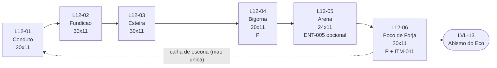
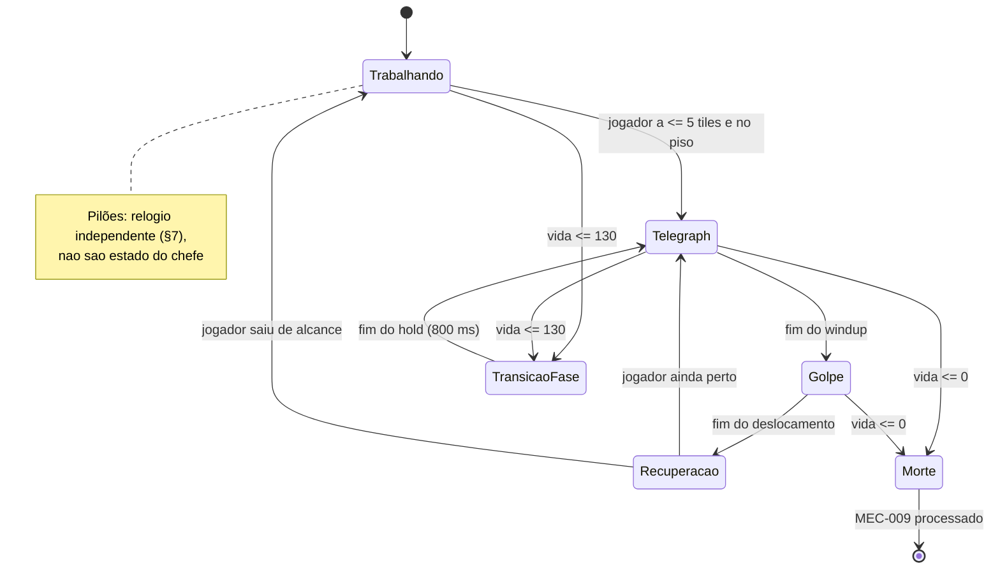

# LVL-12 — Forja Distorcida

> Setor 12 de 16 · **`[PÓS]`** · **Ato III — A Falha** · **a fábrica que não parou**
> Versão: `0.1.0` · Data: `2026-11-13` · Autor: `AGT-02` (Designer de Level) + `AGT-03` (Gameplay)
> Base: [GDD 3.4](../03-conteudo-do-jogo.md) · [Setores e Cenários §4.1, §4.4 e §4.90](../design-patterns/04-setores-e-cenarios.md) · [Padrões de Level Design §7.8, §7.11 e §7.14](../design-patterns/07-padroes-de-level-design.md)

> ⚠️ **Escopo `[PÓS]` — leia antes de usar este documento.**
> Fora do recorte do MVP. Especificado completo porque tem o **segundo chefe médio** do jogo e fecha a lore dos Distorcidos, mas nome e conteúdo **não são canônicos** (`D-04`). Não codar antes de `BKL-012`.

**Status:** layout completo nos 12 campos, grades validadas, ficha de combate de `ENT-005` fechada com TTK e margem de erro medidas, alcançabilidade verificada.

> 🟢 **Este setor não entrega habilidade nenhuma — e isso é o ponto.** O kit do jogador **fecha em LVL-11**: `HAB-01` a `HAB-07`, sete habilidades, todas obtidas. De LVL-12 em diante o jogo **para de dar e começa a pedir**. A Forja é o primeiro setor em que o jogador entra com tudo o que vai ter até o fim.
>
> 🔴 **O chefe não tranca a porta.** `04-setores` §4.1 registra `12 → 13` com trava **"—"**, e aqui isso é levado ao pé da letra: **a forja não tem porta.** O jogador pode atravessar a arena correndo em **4,36 s** e sair sem matar o Forjador. O que ele perde é `ITM-011`. Ver §8.

---

## 1. Os 12 campos obrigatórios

| # | Campo | Definição |
|---|---|---|
| 1 | **ID e nome canônico** | `LVL-12` — Forja Distorcida *(nome canônico do GDD §3.4)* |
| 2 | **Objetivo** | Descer a forja e sair pelo poço para LVL-13. **O chefe é opcional** |
| 3 | **Duração e mortes** | 6–9 min sem chefe · 8–12 min com chefe · **1–2 mortes esperadas** |
| 4 | **Acento e materiais** | `PAL-12` · bigorna, fogo, corrente, escória, fuligem |
| 5 | **Sinais de ambientação** | **a esteira ainda anda** · peças em brasa esfriando no chão · correntes penduradas que balançam sem vento · **dois pilões batendo sem ninguém operando** |
| 6 | **Habilidade de entrada / saída** | Entrada: `HAB-07` planar (o vão de LVL-11). Saída: **nenhuma** — o kit está completo desde LVL-11 |
| 7 | **Salas** | 6 salas: 20 · **30** · **30** · 20 · **24** · 20 (× 11) = **144 tiles** |
| 8 | **O que ensina** | nada novo. **Cobra tudo o que o jogador tem**, num lugar onde o perigo não é do chefe |
| 9 | **Set pieces** | `CEN-089` forno · `CEN-090` esteira de montagem · `CEN-091` forja do Forjador · `CEN-092` pilão · `CEN-093` calha de escória · `CEN-094` corrente pendurada |
| 10 | **Inimigos** | `ENT-002` Sentinela × 5 (1 · 2 · 2 · 0 · 0 · 0) + **chefe médio `ENT-005` O Forjador** (opcional) |
| 11 | **Entradas e saídas** | L12-01 ← **LVL-11** (conduto) · L12-06 → **LVL-13** (poço de forja) · L12-06 ⇢ **L12-01** (calha de escória, mão única) |
| 12 | **Teste de rastreabilidade** | `TST-006` (chefe) · `TST-007` · `TST-013` · `TST-014` · `TST-001` |

### Propriedades de design deste setor

- **É a revelação de onde vêm os Distorcidos.** A esteira de L12-03 monta Sentinelas. Elas saem **incompletas** — falta uma peça que nunca chegou — e caminham assim mesmo. Isso não é um detalhe de arte: é a explicação física de por que todo inimigo do jogo é um corpo com a rotina intacta e o propósito faltando. Responde `P-42` e `P-58` sem precisar de um `ENT` novo (§7).
- **O perigo do setor não é o chefe.** Dois pilões batem na arena em relógio próprio, e **batem mesmo se o jogador não entrar**. A forja não está atacando: está trabalhando. Pela primeira vez o obstáculo e o antagonista são coisas separadas.
- **O chefe não tem porta.** `04-setores` §4.1 registra `12 → 13` com trava "—". Em vez de inventar uma, o setor assume: **não há grade, não há tranca, não há fuga bloqueada.** Quem quiser luta fica; quem não quiser atravessa em 4,36 s (§8).
- **A música é a única do setor que muda por escolha do jogador.** `BGM-02` só entra quando a luta começa. Um jogador que atravessa correndo ouve `BGM-01` do começo ao fim — e nunca sabe que havia um chefe.
- **Zero plataformas pelo quarto setor seguido.** LVL-09, 10, 11 e 12. Isso deixa de ser idioma e passa a ser assinatura do Ato III: **nada de arquitetura fácil.**

---

## 2. Fluxo



| Transição | Checkpoint |
|---|---|
| LVL-11 → L12-01 | salva ao cruzar a porta |
| L12-01 → L12-02 | salva ao cruzar a porta |
| L12-02 → L12-03 | salva ao cruzar a porta |
| L12-03 → L12-04 | salva ao cruzar a porta |
| **L12-04** | **`P` em (3,6)** — última sala segura antes da arena (`PAT-LD-05`) |
| L12-04 → L12-05 | salva ao cruzar a porta |
| **L12-05 (arena)** | **sem checkpoint** — é sala de desafio (`PAT-LD-05`) |
| L12-05 → L12-06 | salva ao cruzar a porta |
| **L12-06** | **`P` em (3,6)** + `ITM-011` (se o chefe caiu) — respiro (`PAT-LD-04`) |

> **A arena é a única sala do setor sem `P`.** É a única em que o jogador pode morrer sem ter escolhido um caminho errado — e por isso é a única que não salva.

---

## 3. Legenda das grades

| Símbolo | Camada | Significado |
|---|---|---|
| `#` | `ground` + `collision` | sólido (pedra de forja, chapa, tijolo refratário) |
| `+` | — | abertura de passagem lateral (`y=4–6`) |
| `D` | `objects` | porta / passagem de área |
| `.` | — | ar |
| `E` | `objects` | Sentinela distorcida (`ENT-002`) |
| `F` | `objects` | **O Forjador** (`ENT-005`, ID proposto — `P-60`) — chefe médio, **opcional** |
| `!` | `objects` | **pilão** (`CEN-092`) — armadilha em relógio próprio, 25 HP |
| `I` | `objects` | **recompensa do chefe** (`ITM-011`, ID proposto — `P-61`) |
| `V` | `objects` | **calha de escória** (`CEN-093`) — queda de mão única, `interact` |
| `P` | `objects` | ponto de salvamento |
| `N` | `objects` | inscrição / marco de lore |
| `h` | `decor-back` | **forno** (`CEN-089`) — fonte de luz e calor do setor |
| `e` | `decor-back` | **esteira de montagem** (`CEN-090`) — anda, sempre no mesmo sentido |
| `j` | `decor` | **forja / bigorna** (`CEN-091`), sem colisão |
| `c` | `decor` | **corrente pendurada** (`CEN-094`), sem colisão, balança |

Piso em `y=7` e aberturas em `y=4–6` seguem `DEC-007`.

> **Não há vãos nem alçapões neste setor.** Um poço de lava seria uma queda letal, e `DEC-011` proíbe queda que mata. A forja é sólida: o perigo dela é **fogo e metal**, não altura. O poço de forja da saída é um conduto, não um abismo.

---

## 4. Salas

### 4.1 L12-01 — Conduto · 20×11

```
    00000000001111111111
    01234567890123456789
y0  ####################
y1  #..................#
y2  #.....c..c......h..#
y3  #..................#
y4  +..................+
y5  +..................+
y6  +..N........E....V.+
y7  ####################
y8  ####################
y9  ####################
y10 ####################
```

| Objeto | Pos | Função |
|---|---|---|
| `+` porta | (0,4)–(0,6) | vinda de **LVL-11** (conduto da chaminé) |
| `+` saída | (19,4)–(19,6) | para L12-02 |
| **`V` boca da calha** | (17,6) | `CEN-093`. **Chegada** do atalho, `arrival_only=true` |
| `E` Sentinela | (12,6) | patrulha de 3 tiles |
| `N` marco | (3,6) | **"O CONDUTO VENTILA A FORJA. NÃO BLOQUEAR. NÃO DESCER."** (9 palavras) |
| `h` forno | (16,2) | `CEN-089` — o primeiro calor do setor |
| `c` correntes | (6,2) · (9,2) | `CEN-094` |

- **Função:** a queda. O jogador desce o conduto de LVL-11 e cai dentro de uma sala quente. Não há transição suave: o setor muda de temperatura na primeira tela.
- **Por que a calha chega aqui:** é o duto mais baixo da forja. Quem desce por ela volta ao começo — e é isso que faz o atalho ser útil depois (§2).
- **Aceite:** atravessar em ≤ 15 s.

---

### 4.2 L12-02 — Fundição · 30×11

```
    000000000011111111112222222222
    012345678901234567890123456789
y0  ##############################
y1  #............................#
y2  #...c.h..c..c..........h..c..#
y3  #.............h..............#
y4  +............................+
y5  +............................+
y6  +..N......E.........E........+
y7  ##############################
y8  ##############################
y9  ##############################
y10 ##############################
```

| Elemento | Posição | Função |
|---|---|---|
| `+` porta / saída | (0,4)–(0,6) · (29,4)–(29,6) | de L12-01 / para L12-03 |
| `E` Sentinelas | (10,6) · (20,6) | patrulhas de 3 e 3 tiles, dessincronizadas |
| `h` fornos | (6,2) · (14,3) · (23,2) | `CEN-089` — **três, e os três acesos** |
| `c` correntes | (4,2) · (9,2) · (12,2) · (26,2) | `CEN-094` |
| `N` marco | (3,6) | **"TURNO DA NOITE: 400 PEÇAS. TURNO DO DIA: 0. NINGUÉM CONFERIU."** (11 palavras) |

- **Função:** mostrar que a fábrica funciona. Três fornos acesos, correntes balançando, duas Sentinelas andando — e nenhum operário.
- **Por que o marco conta turnos:** é a única informação do setor que é **numérica**, e é a mais assustadora. Não é uma fábrica abandonada: é uma fábrica que produziu 400 peças num turno e ninguém conferiu a saída.
- **Aceite:** atravessar em ≤ 20 s. 2 inimigos, nenhum obrigatório.

---

### 4.3 L12-03 — Esteira · 30×11

```
    000000000011111111112222222222
    012345678901234567890123456789
y0  ##############################
y1  #............................#
y2  #...c...................c.h..#
y3  #............................#
y4  +............................+
y5  +........eeeeeeeeeeeee.......+
y6  +...N.......E.....E..........+
y7  ##############################
y8  ##############################
y9  ##############################
y10 ##############################
```

| Elemento | Posição | Função |
|---|---|---|
| **`e` esteira** | x = 9–21, `y=5` | `CEN-090`. **Anda sempre para a direita**, sem fim |
| `+` porta / saída | (0,4)–(0,6) · (29,4)–(29,6) | de L12-02 / para L12-04 |
| `E` Sentinelas | (12,6) · (18,6) | **em cima da esteira** — são as peças que saíram |
| `h` forno | (26,2) | `CEN-089` |
| `c` correntes | (4,2) · (24,2) | `CEN-094` |
| `N` marco | (4,6) | **"A ESTEIRA NÃO PARA. A PEÇA QUE FALTA NÃO CHEGOU."** (12 palavras) |

- **Função:** a revelação. A esteira monta Sentinelas e a peça que falta **nunca chegou** — e elas saem incompletas e caminham. É a origem dos Distorcidos, entregue sem uma linha de diálogo.
- **Por que as duas Sentinelas estão em cima da esteira:** porque acabaram de ser feitas. Um jogador atento repara que elas não vêm de lugar nenhum — saem do fundo da sala, sobre a esteira, e andam para a direita.
- **Por que a esteira é `decor-back` e não colisão:** se ela movesse o jogador, viraria uma mecânica de transporte que precisaria de ficha, ensino e validação (`P-62` pergunta se isso é desejável em LVL-13). Aqui ela **é a informação**, não o obstáculo.
- **Aceite:** atravessar em ≤ 25 s. O jogador sai sabendo de onde vêm os inimigos do jogo.

---

### 4.4 L12-04 — Bigorna · 20×11

```
    00000000001111111111
    01234567890123456789
y0  ####################
y1  #..................#
y2  #.........c.....h..#
y3  #..................#
y4  +..................+
y5  +..................+
y6  +..P...N.....j.....+
y7  ####################
y8  ####################
y9  ####################
y10 ####################
```

| Elemento | Posição | Função |
|---|---|---|
| `+` porta / saída | (0,4)–(0,6) · (19,4)–(19,6) | de L12-03 / para L12-05 (arena) |
| **`P` save** | (3,6) | `UI-09`. **Última sala segura** (`PAT-LD-05`) |
| `j` forja | (13,6) | `CEN-091` — a bigorna de mão, grande, com a marca da Vigília |
| `h` forno | (16,2) | `CEN-089` |
| `c` corrente | (10,2) | `CEN-094` |
| `N` marco | (7,6) | **"ZONA DA BIGORNA. ENTRAR SÓ COM ORDEM ESCRITA."** (9 palavras) |
| **Inimigos** | — | **zero** (`PAT-LD-04`: respiro antes do desafio) |

- **Função:** o último lugar calmo. Uma sala com uma bigorna, um save e nenhum inimigo, entre a fábrica e a arena.
- **Por que o marco é o melhor do setor:** o jogador vai entrar na arena e lutar (ou não) **sem ordem escrita**, e é exatamente o que a placa proíbe. Ninguém está lá para conferir. É o Ato III em nove palavras.
- **Aceite:** salvar. `PAT-LD-04` e `PAT-LD-05` verdes.

---

### 4.5 L12-05 — Arena · 24×11

```
    000000000011111111112222
    012345678901234567890123
y0  ########################
y1  #......................#
y2  #....c.........c....h..#
y3  #......................#
y4  +......................+
y5  +...........j..........+
y6  +..N...!....F....!.....+
y7  ########################
y8  ########################
y9  ########################
y10 ########################
```

| Elemento | Posição | Função |
|---|---|---|
| **`F` O Forjador** | (12,6) | `ENT-005`. **Chefe médio opcional.** Ficha em §5 |
| **`!` pilões** | (7,6) · (17,6) | `CEN-092`. 25 HP cada, relógio próprio, defasados em meio período (§7) |
| `j` forja | (12,5) | `CEN-091` — atrás dele, acesa |
| `+` porta / saída | (0,4)–(0,6) · (23,4)–(23,6) | de L12-04 / para L12-06 |
| `N` marco | (3,6) | **"NÃO FALAR COM O FORJADOR. ELE NÃO RESPONDE."** (9 palavras) |
| `h` forno | (20,2) | `CEN-089` |
| `c` correntes | (5,2) · (15,2) | `CEN-094` |
| **Plataformas** | — | **nenhuma** — é arena (`PAT-LD-07`) |
| **Cobertura** | — | **nenhuma** — regra de `PAT-LD-07`, e a única cobertura do jogo é de LVL-03 |

- **Função:** o desafio opcional. 24 tiles é a medida padrão de arena do jogo (`LVL-03`, `LVL-08`).
- **Por que não há grade:** porque a forja não tem porta (§8). Sem grade, não há lock-in, e sem lock-in o jogador escolhe.
- **Aceite:** cruzar de (1,6) a (22,6) em **4,36 s** correndo, ou matar o Forjador (§6).

---

### 4.6 L12-06 — Poço de Forja · 20×11

```
    00000000001111111111
    01234567890123456789
y0  ####################
y1  #..................#
y2  #...c...........h..#
y3  #..................#
y4  +..................+
y5  +..................+
y6  +..P...I...V..N....+
y7  ####################
y8  ####################
y9  ####################
y10 ####################
```

| Elemento | Posição | Função |
|---|---|---|
| `+` porta | (0,4)–(0,6) | vem de L12-05 |
| `+` saída | (19,4)–(19,6) | → **LVL-13** (Abismo do Eco) |
| **`P` save** | (3,6) | `UI-09` |
| **`I` recompensa** | (7,6) | **`ITM-011`** — só existe se `ENT-005` morreu (`MEC-009`) |
| **`V` calha** | (11,6) | `CEN-093`. `interact` → **L12-01**. Atalho de mão única (`PAT-LD-08`) |
| `N` marco | (14,6) | **"ESCÓRIA: DESCER PELA CALHA. NÃO É ESCADA."** (8 palavras) |
| `h` forno | (16,2) | `CEN-089` |
| **Inimigos** | — | **zero** — respiro pós-clímax (`PAT-LD-04`) |

- **Função:** o respiro depois da arena, com ou sem luta. Sala sem inimigo, com save, recompensa condicional e o atalho de volta.
- **Por que o respiro existe mesmo se o jogador não lutou:** `PAT-LD-04` pede 6 s de sala sem perigo depois de toda sala de "testar" — e atravessar a arena sob fogo **é** a prova, mesmo sem chefe.
- **Por que o atalho exige `interact`:** o glifo está no caminho da saída. Passivo, viraria queda acidental — o erro que `P-37` corrigiu em LVL-04.
- **Aceite:** salvar, sair para LVL-13.

---

## 5. A luta — especificação de combate

### 5.1 Ficha do chefe (`ENT-005`)

| Atributo | Valor | Observação |
|---|---:|---|
| Nome de trabalho | **O Forjador** | `[PÓS]`, não canônico |
| Facção | `LOR-03b` Distorcido | sem `Caos` na sala — **a forja é só trabalho** |
| Vida | **260 HP** | 20 acima de `ENT-004`, e a diferença não é vida — é o **metrônomo** |
| Sprite | 192×192 px (3×3 tiles) | `AST-015` (proposto — `P-60`) |
| **Hurtbox** | 128×160 px | menor que o sprite — regra `PAT-C` anti-hitbox |
| Corpo | humanoide curvado, avental de couro, **a metade de baixo do rosto não existe** | ele não olha para cima porque não tem para onde olhar |
| Dano por impacto | **22 HP** (corrente) · **18 HP** (peça em brasa) · **20 HP** (onda de bigorna) | antes do multiplicador |
| Peso / empurrão | imune a knockback | clamp por bounds da arena |
| **Engajamento** | **não trava a saída.** Sem grade, sem lock-in | §8 |
| **Atravessa a arena?** | **não persegue além de x = 21** | ele não sai do posto de trabalho |

### 5.2 Máquina de estados



> **`Trabalhando` é um estado de verdade, e é o único chefe do jogo que tem um.** Ele martela a bigorna e ignora o jogador. Se o jogador sai do alcance, ele **volta a trabalhar** — não persegue, não ruge, não espera. A luta só existe enquanto alguém estiver perto.

### 5.3 Ataques

| ID | Ataque | Fase | Telegraph | Execução | Recuperação | Dano | Resposta correta |
|---|---|---|---:|---|---:|---:|---|
| `ATK-10` | **Corrente** | 1 e 2 | 800 ms | arco de **5 tiles** (320 px) a 700 px/s = 460 ms | 900 ms / **750 ms** | 22 | **pular** ou sair do arco |
| `ATK-11` | **Peça em brasa** | 1 e 2 | 500 ms | projétil reto, 6 tiles, **quica 1 vez** | 700 ms | 18 | **esquivar para o lado** — pular não resolve |
| `ATK-12` | **Onda de bigorna** | **só fase 2** | 600 ms | golpe no chão; a onda percorre **6 tiles** do piso | 650 ms | 20 | **pular** — a onda é baixa |
| — | **Pilão** | 1 e 2 | 900 ms | não é ataque dele: `CEN-092`, relógio próprio | — | **25** | **andar** — a posição é fixa |

**Telegraph de `ATK-10`:** ele larga o martelo e **puxa a corrente para trás**, com a ponta brilhando. A corrente é o único objeto do setor que reflete a luz do forno, e é assim que o jogador sabe que ela vai sair.

**`ATK-11` — por que pular não resolve.** A peça em brasa viaja na altura do peito e quica uma vez no chão. Um jogador que aprendeu em LVL-03/08 a "pular na recuperação" morre aqui. A resposta é lateral, e é a primeira vez no jogo que a resposta padrão está errada.

**`ATK-12` — a onda é o eco do `ATK-06` com outra roupa.** Em LVL-08 o eco punha uma ameaça **onde o chefe estava**; aqui a onda é uma ameaça **que atravessa o piso**, e o contrário do eco: ela exige **sair do chão**, não do lugar. Duas lutas, duas inversões, dois botões diferentes.

> ⚠️ **Acessibilidade (`VIS-009`, `TST-014`).** Três ameaças simultâneas no piso da arena (`ATK-10`, `ATK-12`, pilão) só são permitidas porque se distinguem por **três canais independentes**: **cor** (corrente branca, onda vermelha, pilão laranja), **forma** (arco, linha de piso, sombra circular) e **som** (metal, pedra, ferro caindo). Se um cair, `TST-014` reprova.

### 5.4 Entrada dramática (`VIS-007`)

| Elemento | Especificação |
|---|---|
| Gatilho | jogador cruza `x ≥ 6` na arena **e** está no piso |
| Grade | **nenhuma** — a forja não tem porta (§8) |
| Hold | 400 ms, congelado |
| Nome na tela | `O FORJADOR`, display, centralizado, 900 ms |
| Fala única | *"Está quente. Não fica muito tempo."* (1,7 s) |
| Barra de vida | topo central, `role="progressbar"`, percentual no `aria-label` |
| Música | **`BGM-01` → `BGM-02`** no fim do hold |
| Redução de movimento | mantém hold e textos; **desliga** shake e pulso de contraste |

> **A fala não é uma ameaça.** É uma observação de trabalho dito a quem entrou na oficina. Ele não sabe quem é o jogador e não pergunta. É a primeira fala do jogo que **não é sobre o jogo**.

### 5.5 Transição de fase (130 HP)

| Elemento | Especificação |
|---|---|
| Gatilho | vida ≤ 130, **uma única vez** |
| Hold | 800 ms |
| Feedback | ele **atira o martelo fora**, pega a corrente com as duas mãos e a forja atrás dele estala |
| Desbloqueio | `ATK-12` ativo; recuperação de `ATK-10` cai 900 → **750 ms**; **pilões de 6 s para 4,5 s** |
| Fala | *"Agora eu esquento."* (1,4 s) |
| Acessibilidade | aviso em `aria-live`: "O Forjador acelerou o ritmo — os pilões batem mais rápido" |

> **A fase 2 não dá um ataque novo ao jogador: ela acelera o relógio.** O `ATK-12` é um golpe, mas o que muda a luta é `4,5 s` em vez de `6 s` nos pilões. É a única transição de fase do jogo em que o **cenário** fica mais difícil junto.

### 5.6 Morte do chefe (`MEC-009`)

| Elemento | Especificação |
|---|---|
| Processamento | **uma única vez**, idempotente (`PAT-C-07`) |
| Hold | 600 ms + câmera lenta 0,3× por 800 ms (desativável) |
| Desmonte | ele **termina a peça** e senta. A corrente escorrega da mão dele |
| Grade | **nenhuma** — não havia o que abrir |
| Recompensa | `ITM-011` aparece em L12-06 (7,6) |
| Pilões | **param** na morte dele (§7.5) |
| Registro | `game:boss { id: 'ENT-005', scope: 'post', optional: true }` |

> **Único chefe do jogo com `optional: true` no registro.** Se a telemetria mostrar que a maioria dos jogadores passa sem lutar, a decisão de §8 está certa — e isso é dado, não falha.

---

## 6. Validação da luta

### 6.1 Golpes necessários

| Arma | Dano | Golpes para 260 HP |
|---|---:|---:|
| Branca | 20 | **13** |
| À distância | 10 | 26 |

### 6.2 Sobrevivência do jogador

Vida efetiva = 100 HP + 50 de escudo = **150**. Multiplicador sobre o dano total, antes do escudo (`P-23`).

| Dificuldade | Mult. | Corrente | Erros | Pilão | Erros | Peça | Erros |
|---|---:|---:|---:|---:|---:|---:|---:|
| Fácil | 0,75× | 16 HP | 9 | 18 HP | 8 | 13 HP | 11 |
| Médio | 1,00× | **22 HP** | **6** | **25 HP** | **5** | 18 HP | 8 |
| Difícil | 1,25× | 27 HP | 5 | 31 HP | 4 | 22 HP | 6 |

> **A margem é 6, igual a `ENT-004`** — mas as fontes de erro passaram de duas para **três**, e a terceira (`CEN-092`) não é dele. É por isso que este é o último chefe antes do Trono: a margem não encolheu, o **número de coisas que podem dar errado** cresceu.

### 6.3 Ciclo e janelas

| Fase | Windup | Golpe | Recuperação | Reposicionamento | Ciclo | Golpes na fase |
|---|---:|---:|---:|---:|---:|---:|
| 1 (260 → 130 HP) | 800 ms | 460 ms | 1.100 → **900 ms** | 400 ms | **2,56 s** | 7 |
| 2 (130 → 0 HP) | 800 ms | 460 ms | **750 ms** | 300 ms | **2,31 s** | 6 |

### 6.4 Tempo até matar (TTK)

| Cenário | TTK |
|---|---:|
| 1 golpe por janela (típico) | **~33 s** (17,9 + 13,9 + 0,8 de transição) |
| Perfeito, 2 golpes por janela | **~18 s** |
| Só arma à distância (26 golpes) | **~64 s** |

> **Leitura:** o TTK é ~10% maior que `ENT-004` (~30 s) e ~18% maior que `ENT-003` (~28 s). A progressão é deliberadamente rasa — **o jogo não fica mais longo, fica mais cheio.** Se o playtest reprovar, o ajuste é a recuperação do `ATK-10` (900 → 1000 ms), não a vida: mexer na vida alonga a luta e não a torna mais justa.

### 6.5 Geometria — por que 5 tiles de corrente

| Alcance | Consequência |
|---|---|
| 3 tiles (192 px) | o arco não cobre a arena; o jogador fica longe e a luta vira tiro ao alvo |
| **5 tiles (320 px)** | 460 ms de arco; o jogador que pula cai ~1,5 tile atrás → **dentro** do alcance do `ATK-11` na recuperação |
| 7 tiles (448 px) | ele cobre a arena inteira; não há posição segura e o pilão deixa de importar |
| 9 tiles (576 px) | a arena tem 24 tiles: o arco chega perto da entrada e o jogador não consegue nem se aproximar |

> **E o arco de 5 tiles obriga o pilão a ser útil.** Com uma zona segura de 5 tiles, o jogador aprenderia a ficar na borda. Os pilões em (7,6) e (17,6) ficam **dentro** dessa borda, e é isso que impede o jogo de virar "ficar longe e atirar" (§7).

---

## 7. O pilão — o metrônomo

### 7.1 O que ele é e o que ele não é

| É | Não é |
|---|---|
| `CEN-092`, objeto de ambiente com colisão de dano | ataque do chefe |
| relógio próprio, independente da FSM | animação de `ENT-005` |
| posição **fixa** e conhecida (x = 7 e x = 17) | perseguição |
| 25 HP, o maior dano único do jogo | morte instantânea |
| desviável **andando** | desviável só com precisão de quadro |
| **para quando o chefe morre** | desliga quando o jogador sai |

### 7.2 Por que ele não é do chefe

Se o pilão fosse um estado da FSM de `ENT-005`, ele morreria com o chefe — e a forja ficaria silenciosa depois da luta. Não fica: **é uma fábrica.**

E há uma consequência de projeto: com o pilão fora da FSM, o jogador que **não luta** também tem que lidar com ele. Atravessar a arena correndo não é grátis.

### 7.3 O relógio

| Fase | Período por pilão | Defasagem entre os dois | Batidas por segundo no piso |
|---|---:|---:|---:|
| 1 | **6,0 s** | 3,0 s | 0,33 |
| 2 | **4,5 s** | 2,25 s | 0,44 |

> **A defasagem de meio período é o que faz a arena ter compasso.** Com os dois em fase, haveria um instante seguro e um instante duplamente perigoso. Defasados, o piso nunca fica 3 s inteiros limpos — e nunca fica impossível.

### 7.4 O ensino em quatro tempos (`PAT-LD-02`)

| Tempo | Onde | O que acontece |
|---|---|---|
| 1. **Introduzir** | L12-02, L12-03 (`h`, calor) | o setor estabelece que a forja está ativa **sem** perigo |
| 2. **Praticar** | entrada da arena, x = 1–4 | o primeiro pilão bate em x = 7 e o jogador vê o ciclo inteiro de longe |
| 3. **Combinar** | arena, x = 5–10 | pilão + corrente ao mesmo tempo |
| 4. **Testar** | arena, x = 11–20 | pilão + corrente + peça; e na fase 2, + onda |

> **O tempo 2 é de graça.** O pilão de x = 7 bate antes de o jogador chegar nele, e o de x = 17 bate do outro lado da arena. O jogador vê **dois ciclos completos** antes de encostar em qualquer coisa.

### 7.5 A regra que o pilão impõe

> **Os pilões param na morte de `ENT-005`.**

Não por compaixão: porque quem bate é ele. A bigorna é dele. É a única coisa da arena que **depende** do chefe estar vivo, e é o que faz a morte dele significar alguma coisa — o setor fica mais silencioso.

---

## 8. 🔴 O chefe que não tranca a porta

`04-setores` §4.1 registra a conexão `12 → 13` com trava **"—"**. Três setores antes, `08 → 09` está registrado como "chefe de área". A diferença é deliberada e este setor a assume:

| Setor | Chefe | Trava a saída? | Como |
|---|---|---|---|
| LVL-03 | `ENT-003` | **sim** | conclusão do chefe (`04-setores` §4.1) |
| LVL-08 | `ENT-004` | **sim** | grade da arena (`CEN-065`) |
| **LVL-12** | **`ENT-005`** | **não** | **não há grade, não há porta, não há lock-in** |

**A justificativa é espacial, não narrativa.** O jogador entra na arena em (1,6) e sai em (22,6). A 308 px/s, isso são **4,36 s**. O Forjador não persegue além de x = 21, o arco dele tem 5 tiles e a recuperação é de 900 ms. Ele **não consegue impedir** ninguém de atravessar — e é por isso que não tranca: **um homem que não pode fechar uma porta não é uma porta.**

**O custo de pular a luta é `ITM-011`.** E é um custo honesto: o jogador que corre chega a LVL-13 sem a recompensa, e a recompensa não é necessária para nada (`P-61`). A escolha é permanente e informada — a placa de L12-04 diz para não entrar sem ordem escrita, e ele entra sem ordem escrita.

> **O que NÃO é justificativa:** "o jogador pode voltar depois". Ele não pode — o caminho de volta é a calha (`V`), que desce para L12-01, e a arena fica atrás de L12-04 de novo. Voltar é possível, mas custa 4 salas. É uma segunda chance caro o bastante para a escolha pesar e barata o bastante para não ser punição.

---

## 9. Validação de alcançabilidade

| Obstáculo | Sala | Valor | Necessário | Veredito |
|---|---|---|---:|---|
| plataforma mais alta | — | **0 no setor** | — | nada a validar por salto |
| vão | — | **0 no setor** | — | nada a validar por planeio |
| alçapão | — | **0 no setor** | — | `DEC-015` não é usado aqui |
| parede de ganchos | — | **0 no setor** | — | — |
| **travessia da arena** | L12-05 | 21 tiles = 1.344 px | 4,36 s a 308 px/s | **atravessável sempre** ✓ |
| fuga do arco | L12-05 | 5 tiles = 320 px | 460 ms a 700 px/s | esquiva lateral de 1 tile ✓ |

**Resultado: 0 falhas — e a tabela está vazia pela primeira vez no Ato III.** Não há uma única travessia de habilidade neste setor: **o kit está completo desde LVL-11** (§1). O que o setor valida é combate, não geometria.

---

## 10. Salvamento e morte

| Evento | O que acontece | Regra |
|---|---|---|
| Cruza qualquer porta | salva | `MEC-007` |
| Interagir com `P` | salva | `MEC-007` |
| Atravessa a arena sem lutar | salva ao cruzar a porta de L12-06 | igual a qualquer transição |
| **Entra na arena** | **não salva** — sala de desafio | `PAT-LD-05` |
| Morre para `ENT-005` | respawn no `P` de L12-04 | `MEC-004` |
| Morre na arena | **o chefe volta com 260 HP e os pilões reiniciam o ciclo** | `MEC-004` |
| Morre com bolsa | bolsa fica no local | `MEC-004` |
| Usa a calha `V` | **não salva** | atalho ≠ transição |

> **O chefe não tem checkpoint próprio.** Morrer na arena devolve ao `P` de L12-04 — três tiles de porta e uma sala. É a repetição mais curta de chefe do jogo, de propósito: a luta é **opcional**, e uma luta opcional com repetição longa é uma luta que o jogador não tenta duas vezes.

---

## 11. Conversão para Tiled (`.tmj`)

| Item | Definição |
|---|---|
| Nome do arquivo | `public/assets/tilemaps/tm_lvl12_forja.tmj` |
| Tileset | `tm_forja` (`AST-016` — **ID proposto**, `P-60`), ~34 tiles, 64×64 |
| Orientação | orthogonal, tile 64×64, 20–30 colunas × 11 linhas |
| Camadas (ordem) | `decor-back` · `ground` · `collision` · `objects` · `decor-front` |
| Propriedades do mapa | `lvl_id=LVL-12`, `pal=PAL-12`, `bgm=BGM-01`, `amb=AMB-12`, `scope=post`, `boss=BKL-008` |

### Propriedades dos objetos (`objects`)

| Tipo | Propriedades |
|---|---|
| `enemy` | `ent=ENT-002`, `patrol_tiles`=3, `initial_facing`=`left`, `has_telegraph`=true |
| `boss` | `ent=ENT-005`, `hp`=260, `phase_at`=130, `gate`=**`none`**, `optional`=true, `leash_x`=21 |
| `hammer` | `cen=CEN-092`, `damage`=25, `period_s`=6.0, `offset_s`=3.0, `telegraph_ms`=900, `stops_on_boss_death`=true |
| `conveyor` | `cen=CEN-090`, `dir`=`right`, `speed_px_s`=40, `collides`=false |
| `slag_chute` | `cen=CEN-093`, `trigger`=`interact`, `to=L12-01`, `one_way`=true, `save`=false, `arrival_only`=true |
| `boss_reward` | `itm=ITM-011`, `spawn_only_if`=`boss.ENT-005.dead` |
| `save_point` | `ui=UI-09`, `checkpoint`=true (L12-04, L12-06) |
| `door` | `to=LVL-11` (L12-01, `style=hatch`) · `to=LVL-13` (L12-06, `style=iron`) |
| `lore_marker` | `key`=`lore.lvl12.conduto` / `.turnos` / `.esteira` / `.bigorna` / `.forjador` / `.escoria`, `max_words`=25 |
| `decor` | `ast=CEN-089` (back, `glow`) / `CEN-090` (back) / `CEN-091` / `CEN-094` (`sway`=true), `collides`=false |

> **`gate=none` no objeto `boss` não é omissão.** É o campo que implementa §8, e `AGT-07` deve ter um teste que **falhe** se alguém puser `gate=arena` aqui.

**Regra de ouro:** nenhum número de gameplay no `.tmj`. Vida, dano, períodos e recuperações vêm de `tuning.ts` (`PAT-C-04`).

---

## 12. Checklist de aprovação (`07-padroes` §7.14)

- [x] Dimensões múltiplas de 20×11 — 20, 30, 30, 20, **24**, 20 × 11
- [x] Objetivo de cada sala compreensível em ≤ 3 s
- [x] Respeita a tabela de alcance (§9) — **0 falhas, tabela vazia por ausência de travessia**
- [x] `PAT-LD-07` — arena de 24 tiles, **zero cobertura**, **zero plataforma**
- [x] `PAT-LD-04` — L12-04 (antes) e L12-06 (depois) sem inimigo
- [x] `PAT-LD-05` — **arena sem checkpoint**; `P` em L12-04 e L12-06
- [x] `PAT-LD-08` — atalho de mão única pela calha (L12-06 → L12-01)
- [x] `PAT-LD-10` — máx. 2 inimigos por sala; 5 no setor
- [x] `PAT-LD-02` no pilão — os 4 tempos são **do ambiente**, não do chefe (§7.4)
- [x] `collision` alinhada ao `ground` (validado pelo gerador de grade)
- [x] Paleta com um único acento (`PAL-12`)
- [x] `BGM-02` só na luta; `BGM-01` no resto
- [x] **`gate=none`** no chefe, e a saída existe sem matá-lo (§8)
- [x] Pilões **param** na morte do chefe (§7.5)
- [x] Testes associados: `TST-001`, `TST-006`, `TST-007`, `TST-013`, `TST-014`
- [ ] **Aprovação de escopo:** `[PÓS]` (`D-04`) — não marcado de propósito
- [ ] **Ficha de `ENT-005`** (`AST-015`, `AST-016`, `UI-16`): pendente (`P-60`)
- [ ] **Economia de `ITM-011`:** pendente (`P-61`)

---

## 13. Desvios registrados

| # | O que mudou | Por quê | IDs afetados |
|---|---|---|---|
| 1 | **O chefe não tranca a saída** | `04-setores` §4.1 diz "—" e a forja não tem porta. Ele não consegue impedir a travessia (§8) | `04-setores` §4.1, `PAT-LD-07` |
| 2 | **Os pilões não são da FSM do chefe** | Se fossem, morreriam com ele — e a fábrica não morre com o operário (§7.2) | `ENT-005`, `CEN-092` |
| 3 | **O pilão dá 25 HP, o maior dano único do jogo** | É o único perigo do jogo que não vem de um corpo; precisa ser memorável sem ser letal | `P-23`, `ENT-005` |
| 4 | **Zero plataformas, zero vãos, zero alçapões** | Quarto setor seguido sem plataforma; o kit fecha em LVL-11 e o setor valida combate, não geometria | `PAT-LD-01`, LVL-09–11 |
| 5 | **A esteira é `decor-back`, não transporte** | Movimento de plataforma exigiria ficha, ensino e validação. Aqui ela é **informação**, não obstáculo (§4.3) | `CEN-090`, `P-62` |
| 6 | **`ITM-011` é condicional** | Recompensa que não existe se o chefe não cair é o único jeito de a luta opcional ter preço (§8) | `MEC-009`, `P-61` |
| 7 | **`setImmovable` saiu do corpo do chefe** | Contra um corpo **estático** do Arcade ninguém se separa: marcá-lo imóvel o fazia **cair pelo piso**. A imunidade a knockback (§5.1) vem de `takeHit` nunca aplicar velocidade — não do corpo | `ENT-005`, `PAT-C` |
| 8 | **O desenho da onda mostra a faixa inteira; o dano segue o frente** | O golpe precisa de leitura antes de chegar; desenhar só o frente deixaria a ameaça invisível no primeiro frame. O custo é o inverso — a faixa anuncia mais do que já está a acontecer (`P-80`) | `ATK-12`, `VIS-009` |
| 9 | **A fase 2 não troca o sprite** | `§5.5` pede que ele atire o martelo fora; a arte placeholder é **um** sprite, e a troca fica para `AST-015` (`P-81`) | `ENT-005`, `AST-015` |
| 10 | **A esteira não corre** | `CEN-090` "anda sempre para a direita"; o código desenha a cinta e pulsa o alfa. Scroll contínuo pede textura em tira (`P-82`) | `CEN-090` |
| 11 | **O relógio dos pilões começa na montagem da sala** | Montar em `mountRoom` é o que garante a defasagem de meio período desde o primeiro instante, com ou sem luta (§7.3) | `CEN-092` |

---

## 14. Pendências geradas

| ID | Item | Bloqueia |
|---|---|---|
| `P-60` | **Ficha de `ENT-005` O Forjador.** Aprovar: 260 HP, fase em 130, `ATK-10` corrente 5 tiles/22, `ATK-11` peça 18 com 1 quique, `ATK-12` onda 20, `leash_x=21`, `engage=5 tiles no piso`. Faltam `AST-015`, `AST-016` (`tm_forja`), `UI-16` | `BKL-001`, `BKL-008`, `BKL-012`, LVL-12 |
| `P-61` | 🔴 **Economia de `ITM-011`.** `04-setores` §4.1 diz que `14 → 15` exige **"2 chaves de chefe"**, e o jogo tem **3** chefes que dão recompensa (`ITM-004`, `ITM-007`, `ITM-011`). Se a porta exige 2 de 3, pular a luta de LVL-12 é uma escolha **permanente e válida**. Se exige as 3, o chefe deixa de ser opcional e §8 cai. **Decidir antes de LVL-14.** Depende de `P-47` | `LVL-14`, `LVL-12`, `P-47` |
| `P-62` | **Canonizar a origem dos Distorcidos.** L12-03 revela que eles são montados numa esteira **com uma peça faltando**. Isso explica `ENT-002` inteiro e sustenta `P-42` e `P-58`, mas é uma afirmação de lore forte: confirmar com `LOR-03b` antes de `AGT-01` desenhar a esteira | `LOR-03b`, `AGT-01`, `P-42`, `P-58` |

> **Fechadas nesta rodada:** nenhuma. `P-59` (canal de 8 tiles de LVL-09) continua aberta e **não afeta** este setor.
>
> **Abertas pela implementação:** `P-80` (onda × desenho), `P-81` (martelo da fase 2) e `P-82` (elos da esteira) — ver [`PENDENCIAS.md`](../PENDENCIAS.md) § *LVL-12 em código*.

---

## Handoff

**Para `AGT-03`** — `boss` com **`gate=none`** (§8): sem lock-in, sem trava de saída. `ENT-005` tem um estado `Trabalhando` que **não persegue** e para o qual ele **volta** se o jogador sair de alcance. Os pilões são objeto de ambiente com relógio próprio, defasados em meio período, e **param na morte do chefe**. Três coisas fáceis de errar: (1) pôr `gate=arena` "por segurança" — isso mata §8; (2) ligar o pilão à FSM do chefe; (3) deixar a peça em brasa (`ATK-11`) ser esquivável por salto — ela viaja na altura do peito e **exige** resposta lateral.

**Para `AGT-01`** — `CEN-089` forno (`glow`, três acesos em L12-02 e **nenhum operário**), `CEN-090` esteira de montagem (**peças incompletas, sempre para a direita** — é a imagem que explica o jogo), `CEN-091` forja, `CEN-092` pilão (**sombra circular no piso como telegraph**), `CEN-093` calha de escória, `CEN-094` corrente pendurada (`sway`). Tileset `tm_forja` ~34 tiles. O rosto de `ENT-005` tem uma metade que **não existe** — desenhar o vazio, não escondê-lo.

**Para `AGT-06`** — `BGM-01` no setor; **`BGM-02` só se a luta começar**. `AMB-12` (fornos, metal, correntes). Cada pilão precisa de som **próprio e posicional**: é o metrônomo, e o jogador tem de poder contar a batida de olhos fechados. **Os fornos não podem silenciar entre salas** — a forja é contínua de L12-01 a L12-06.

**Para `AGT-07`** — `TST-006` (chefe) e um teste específico: **a saída tem de ser alcançável sem matar `ENT-005`**, e ele deve falhar se alguém puser uma grade. Testar também: pilão para na morte do chefe; peça em brasa não é esquivável por salto; morrer na arena reinicia o chefe com 260 HP; e `ITM-011` não aparece se ele estiver vivo.

**O próximo agente precisa saber, em 3 linhas:**

1. **A forja não tem porta.** `gate=none`. O chefe é opcional e a travessia custa 4,36 s e no máximo um golpe. Se alguém puser uma grade "para dar peso", o setor perde a única coisa que ele afirma sobre o Ato III.
2. **Os pilões não são do chefe.** Relógio próprio, posição fixa, param quando ele morre. Eles são a fábrica, não o homem.
3. **A esteira explica o jogo.** Sentinelas saem incompletas de uma linha de montagem que não parou, e andam assim mesmo. Se `P-62` for negada, o setor é refeito — não remendado.
