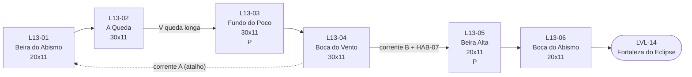

# LVL-13 — Abismo do Eco

> Setor 13 de 16 · **`[PÓS]`** · **Ato III — A Falha** *(último setor do ato)* · **vertigem**
> Versão: `0.1.0` · Data: `2026-11-13` · Autor: `AGT-02` (Designer de Level) + `AGT-03` (Gameplay)
> Base: [GDD 3.4](../03-conteudo-do-jogo.md) · [Setores e Cenários §4.1, §4.2 e §4.90](../design-patterns/04-setores-e-cenarios.md) · [Ambientação e Mundo §3.4](../design-patterns/03-ambientacao-e-mundo.md) · [Áudio e Ambiencia §4](../design-patterns/06-audio-e-ambiencia.md)

> ⚠️ **Escopo `[PÓS]` — leia antes de usar este documento.**
> Fora do recorte do MVP. Especificado completo porque **fecha o Ato III** e resolve `P-57` (correntes de ar), mas nome e conteúdo **não são canônicos** (`D-04`). Não codar antes de `BKL-012`.

**Status:** layout completo nos 12 campos, grades validadas, ficha da corrente de ar (`CEN-096`) fechada, alcançabilidade verificada na config canônica **B** (`DEC-014`).

> 🟢 **`P-57` está resolvida, e a resposta preserva o invariante de LVL-11.** As correntes de ar não dão altura ao estandarte: **é a corrente que sobe, o estandarte só impede a queda.** Fora de uma corrente, `HAB-07` continua descendo a 120 px/s e não ganha um pixel. Dentro de uma, o jogador sobe a **140 px/s** — e só se estiver com o pano aberto. §6.
>
> 🟢 **E isso resolve a verticalidade do setor sem rolagem de câmera.** O abismo desce por queda (`V`) e sobe por corrente (`CEN-096`) até um **alçapão em `y=0`** (`DEC-015`): 6 tiles, 384 px, contra os 276 px do salto duplo. **O abismo é vertical sem a tela ser vertical.**

---

## 1. Os 12 campos obrigatórios

| # | Campo | Definição |
|---|---|---|
| 1 | **ID e nome canônico** | `LVL-13` — Abismo do Eco *(nome canônico do GDD §3.4)* |
| 2 | **Objetivo** | Descer ao fundo do abismo e subir pela corrente de ar até a beira alta, para sair em LVL-14 |
| 3 | **Duração e mortes** | 6–9 min · **0–1 mortes esperadas** — e nenhuma por queda (`DEC-011`) |
| 4 | **Acento e materiais** | `PAL-13` índigo `#6B5AA6` · rocha, estaca velha, vazio, vento |
| 5 | **Sinais de ambientação** | **o eco de 700 ms** · fundo sem fundo (parallax mínimo) · estacas de corda que não chegaram · **vento que sobe** · nenhum material construído |
| 6 | **Habilidade de entrada / saída** | Entrada: `HAB-07` planar (o vão de LVL-11). Saída: **`HAB-07` planar + `CEN-096` corrente de ar** |
| 7 | **Salas** | 6 salas: 20 · **30** · **30** · **30** · 20 · 20 (× 11) = **150 tiles** |
| 8 | **O que ensina** | **corrente de ar** — o único objeto de ambiente que dá altura ao jogador |
| 9 | **Set pieces** | `CEN-095` eco visual · `CEN-096` corrente de ar · `CEN-097` fundo do abismo · `CEN-098` estaca de corda · `CEN-099` boca do poço |
| 10 | **Inimigos** | `ENT-002` Sentinela × 5 (1 · 2 · 1 · 0 · 0 · 1) |
| 11 | **Entradas e saídas** | L13-01 ← **LVL-12** (poço de forja) · L13-06 → **LVL-14** (Fortaleza do Eclipse) · L13-04 ⇢ **L13-01** (corrente A, atalho) |
| 12 | **Teste de rastreabilidade** | `TST-001` · `TST-005` · `TST-013` · `TST-014` |

### Propriedades de design deste setor

- **O setor não tem material próprio.** Todo outro setor tem um bioma: tijolo, osso, cristal, bronze, areia. O abismo tem **vazio e vento**. É o único do jogo que não construiu nada — e essa é a leitura literal da ficha do GDD: *"nada além de profundidade e eco"*.
- **É o único setor cujo conteúdo é gerado pelo jogador.** O eco de `AMB-13` devolve o som do próprio jogador com 700 ms de atraso; o `CEN-095` devolve o sprite. Nada aqui foi composto, desenhado ou escrito para ser visto — **tudo é o que o jogador trouxe.**
- **É o primeiro setor em que a saída é mais alta que a entrada.** LVL-09, 10, 11 e 12 terminaram no mesmo nível ou abaixo. Aqui o jogador desce 40 braças e sai **acima** de onde entrou (§8).
- **Zero plataformas pelo quinto setor seguido** — e aqui não é assinatura, é necessidade: um abismo não tem onde pregar uma tábua.
- **É o setor mais barato do Ato III em arte.** Um `decor-back` de três camadas, cinco objetos e nenhum tileset novo de verdade (`CEN-097` é um gradiente). Um setor de clímax de ato que custa menos que LVL-07 é uma vitória de orçamento.

---

## 2. Fluxo



| Transição | Checkpoint |
|---|---|
| LVL-12 → L13-01 | salva ao cruzar a porta |
| L13-01 → L13-02 | salva ao cruzar a porta |
| **L13-02 → L13-03** | **queda longa de 3 s** — salva **antes** de cair, e no destino |
| **L13-03** | **`P` em (3,6)** — o único checkpoint do fundo |
| L13-03 → L13-04 | salva ao cruzar a porta |
| **L13-04 → L13-05** | corrente B, `requires=HAB-07` — **a trava 13 → 14** |
| **L13-05** | **`P` em (3,6)** — na beira alta, imediatamente após a subida |
| L13-05 → L13-06 | salva ao cruzar a porta |
| L13-06 → LVL-14 | salva ao cruzar a porta |
| L13-04 → L13-01 | corrente A — **atalho, não salva** |

> **O `P` de L13-05 existe porque a subida não é uma sala.** `PAT-LD-04` pede 6 s sem perigo depois de todo teste; a corrente é o teste do setor, e a sala seguinte é o respiro. Sem esse `P`, morrer em L13-06 custaria a descida inteira mais a subida.

---

## 3. Legenda das grades

| Símbolo | Camada | Significado |
|---|---|---|
| `#` | `ground` + `collision` | rocha (o único sólido do setor) |
| `+` | — | abertura de passagem lateral (`y=4–6`) |
| `D` | `objects` | porta / passagem de área |
| `.` | — | ar |
| `a` | `objects` | **corrente de ar** (`CEN-096`) — coluna de 3×6, y=1–6, **ver §6** |
| `^` | `objects` | **alçapão no teto** (`CEN-081` reskin, `DEC-015`) — 2 tiles em `y=0` |
| `V` | `objects` | **queda longa** (`CEN-099`) — 1 sentido, `interact`, 3 s |
| `E` | `objects` | Sentinela distorcida (`ENT-002`) |
| `P` | `objects` | ponto de salvamento |
| `N` | `objects` | inscrição / marco de lore |
| `o` | `objects` | **boca do poço** (`CEN-099`) — chegada da corrente A, `arrival_only` |
| `b` | `decor-back` | **fundo do abismo** (`CEN-097`) — camada de vazio |
| `k` | `decor-back` | **estaca de corda** (`CEN-098`) — a corda que não chegou |
| `e` | `decor` | **marca de eco** (`CEN-095`) — onde o eco é audível e visível |

Piso em `y=7` e aberturas em `y=4–6` seguem `DEC-007`. Alçapões seguem `DEC-015`.

> **`a` não é colisão.** A corrente é uma **região declarada** (retângulo de 3×6), como a areia de `LVL-08` §3 e a água de `LVL-06`. O glifo existe só para a grade ficar legível; o motor lê o retângulo da ficha da sala.

---

## 4. Salas

### 4.1 L13-01 — Beira do Abismo · 20×11

```
    00000000001111111111
    01234567890123456789
y0  ####################
y1  #..................#
y2  #.b.k....k......b..#
y3  #..................#
y4  +..................+
y5  +..................+
y6  +...o..N....E...e..+
y7  ####################
y8  ####################
y9  ####################
y10 ####################
```

| Objeto | Pos | Função |
|---|---|---|
| `+` porta | (0,4)–(0,6) | vinda de **LVL-12** (poço de forja) |
| `+` saída | (19,4)–(19,6) | para L13-02 |
| **`o` boca** | (4,6) | `CEN-099`. **Chegada da corrente A** (atalho), `arrival_only=true` |
| `E` Sentinela | (12,6) | patrulha de 3 tiles |
| `N` marco | (7,6) | **"ABISMO SEM FUNDO REGISTRADO. NÃO MEDIR."** (6 palavras) |
| `e` eco | (16,6) | `CEN-095` |
| `b` fundo | (2,2) · (16,2) | `CEN-097` |
| `k` estacas | (4,2) · (9,2) | `CEN-098` |

- **Função:** a beira. O jogador vem de uma forja quente e entra num lugar sem parede de fundo. É a única sala do jogo em que **o `decor-back` é maior que o `ground`**.
- **Por que a boca do poço está aqui e não na borda:** ela é o que sobra da corrente A. O jogador passa por ela na descida sem saber o que é, e volta por ela no atalho.
- **Aceite:** atravessar em ≤ 12 s.

---

### 4.2 L13-02 — A Queda · 30×11

```
    000000000011111111112222222222
    012345678901234567890123456789
y0  ##############################
y1  #............................#
y2  #....b.k......k.....b...k..b.#
y3  #............................#
y4  +............................#
y5  +............................#
y6  +..N....E.......E...e.....V..#
y7  ##############################
y8  ##############################
y9  ##############################
y10 ##############################
```

| Elemento | Posição | Função |
|---|---|---|
| `+` porta | (0,4)–(0,6) | de L13-01 |
| **`V` queda** | (26,6) | `CEN-099`. **`interact` → L13-03.** 3 s, sem dano |
| `E` Sentinelas | (8,6) · (16,6) | patrulhas de 4 e 4 tiles |
| `N` marco | (3,6) | **"A CORDA TINHA 40 BRAÇAS. NÃO CHEGOU."** (8 palavras) |
| `e` eco | (20,6) | `CEN-095` — **o eco aqui é o mais longo do jogo** |
| `b` fundo | (5,2) · (20,2) · (27,2) | `CEN-097` |
| `k` estacas | (7,2) · (14,2) · (24,2) | `CEN-098` — três, e a terceira está a 2 tiles do vão |
| **Saída** | — | **só a queda.** Não há porta no lado direito |

- **Função:** a descida. A sala é uma beirada que acaba: não há parede à direita, há um vão, e o vão é a saída.
- **Por que a queda exige `interact`:** o jogador atravessa a sala andando na direção dela. Passiva, seria queda acidental no caminho — o erro que `P-37` corrigiu em LVL-04. Ele precisa **decidir** cair.
- **Por que as três estacas estão em ordem:** 7, 14, 24 — cada uma mais perto do vão que a anterior. A última está a 2 tiles. Alguém tentou medir o abismo três vezes e desistiu na terceira. `CEN-098` conta isso sem uma palavra.
- **Aceite:** cruzar 30 tiles e decidir cair.

---

### 4.3 L13-03 — Fundo do Poço · 30×11

```
    000000000011111111112222222222
    012345678901234567890123456789
y0  ##############################
y1  #............................#
y2  #.....b...........b.......b..#
y3  #............................#
y4  +............................+
y5  +............................+
y6  +..P....N.....E.......e......+
y7  ##############################
y8  ##############################
y9  ##############################
y10 ##############################
```

| Elemento | Posição | Função |
|---|---|---|
| `+` porta | (0,4)–(0,6) | chegada da queda de L13-02 |
| `+` saída | (29,4)–(29,6) | para L13-04 |
| **`P` save** | (3,6) | `UI-09`. **O único checkpoint do fundo** |
| `E` Sentinela | (14,6) | patrulha de 5 tiles |
| `N` marco | (8,6) | **"QUEM GRITAR AQUI ESCUTA A SI MESMO. ISSO CONTA COMO REGISTRO."** (12 palavras) |
| `e` eco | (22,6) | `CEN-095` |
| `b` fundo | (6,2) · (18,2) · (26,2) | `CEN-097` — **o fundo ainda tem fundo** |

- **Função:** o fundo. E o fundo não é o chão: é um piso de rocha com a camada de vazio **ainda embaixo**. O jogador chegou ao fundo do abismo e o abismo continua.
- **Por que o `P` fica na entrada:** é o ponto mais distante de qualquer ameaça e o mais próximo da queda. Morrer em L13-04 devolve aqui, a 26 tiles da corrente — repetição curta.
- **Aceite:** salvar e sair.

---

### 4.4 L13-04 — Boca do Vento · 30×11

```
    000000000011111111112222222222
    012345678901234567890123456789
y0  ########^^##########^^########
y1  #......aaa.........aaa.......#
y2  #..k...aaa....b....aaa....b..#
y3  #......aaa.........aaa.......#
y4  +......aaa.........aaa.......#
y5  +......aaa.........aaa.......#
y6  +..N...aaa....e....aaa...e...#
y7  ##############################
y8  ##############################
y9  ##############################
y10 ##############################
```

| Elemento | Posição | Função |
|---|---|---|
| `+` porta | (0,4)–(0,6) | de L13-03 |
| **`a` corrente A** | x = 7–9, `y1`–`y6` | `CEN-096` → alçapão em (8,0)–(9,0) → **L13-01** (atalho) |
| **`a` corrente B** | x = 19–21, `y1`–`y6` | `CEN-096` → alçapão em (20,0)–(21,0) → **L13-05** (**a trava 13 → 14**) |
| `N` marco | (3,6) | **"CORRENTE ASCENDENTE. USAR COM AS DUAS MÃOS LIVRES."** (8 palavras) |
| `e` eco | (14,6) · (25,6) | `CEN-095` |
| `b` fundo | (14,2) · (26,2) | `CEN-097` |
| `k` estaca | (3,2) | `CEN-098` |
| **Inimigos** | — | **zero** — o momento não precisa de plateia |
| **Saída** | — | **só os dois alçapões.** Não há porta no lado direito |

- **Função:** a subida, e a única bifurcação do setor. Duas colunas de vento na mesma sala, 12 tiles de distância, com dois destinos diferentes: **A volta para trás, B vai para frente.**
- **Por que o inimigo não existe aqui:** o jogador precisa de silêncio para ouvir a corrente e de espaço para errar a subida. Um Sentinela nesta sala transformaria uma decisão espacial num combate — e `PAT-LD-10` diz "0" para sala de respiro.
- **Por que as duas correntes são idênticas:** porque a diferença não é a corrente, é o alçapão. A escolha é do jogador, e o cenário não a indica — quem sobe pela coluna errada descobre em 2,74 s.
- **Aceite:** subir pela corrente B até o alçapão. `TST-013` verde.

---

### 4.5 L13-05 — Beira Alta · 20×11

```
    00000000001111111111
    01234567890123456789
y0  ####################
y1  #..................#
y2  #....b..k.....b....#
y3  #..................#
y4  +..................+
y5  +..................+
y6  +..P...N...e.......+
y7  ####################
y8  ####################
y9  ####################
y10 ####################
```

| Elemento | Posição | Função |
|---|---|---|
| `+` porta | (0,4)–(0,6) | chegada da corrente B |
| `+` saída | (19,4)–(19,6) | para L13-06 |
| **`P` save** | (3,6) | `UI-09`. **Respiro pós-teste** (`PAT-LD-04`) |
| `E` Sentinela | — | **zero** |
| `N` marco | (7,6) | **"BEIRA ALTA. SEM GRADE. SEM CONFERÊNCIA."** (6 palavras) |
| `e` eco | (11,6) | `CEN-095` |
| `b` fundo | (5,2) · (14,2) | `CEN-097` |
| `k` estaca | (8,2) | `CEN-098` |

- **Função:** o respiro. Depois de 2,74 s subindo de pano aberto, o jogador precisa de uma sala sem nada — e é a primeira sala do jogo cujo marco diz **"SEM CONFERÊNCIA"**: ninguém verificou esta beirada.
- **Por que `e` está no meio da sala:** é onde o eco tem a resposta mais limpa. O jogador dá dois passos e escuta os dois passos de volta.
- **Aceite:** salvar. `PAT-LD-04` verde.

---

### 4.6 L13-06 — Boca do Abismo · 20×11

```
    00000000001111111111
    01234567890123456789
y0  ####################
y1  #..................#
y2  #.......b...k...b..#
y3  #..................#
y4  +..................+
y5  +..................+
y6  +....N....e..E.....+
y7  ####################
y8  ####################
y9  ####################
y10 ####################
```

| Elemento | Posição | Função |
|---|---|---|
| `+` porta | (0,4)–(0,6) | de L13-05 |
| `+` saída | (19,4)–(19,6) | → **LVL-14** (Fortaleza do Eclipse) |
| `E` Sentinela | (13,6) | patrulha de 3 tiles — **a última do Ato III** |
| `N` marco | (5,6) | **"A ORDEM FOI DADA. NÃO CONSTA O NOME."** (8 palavras) — **fecho do Ato III** |
| `e` eco | (10,6) | `CEN-095` |
| `b` fundo | (8,2) · (16,2) | `CEN-097` |
| `k` estaca | (12,2) | `CEN-098` |

- **Função:** a boca. O abismo fica atrás; a Fortaleza do Eclipse aparece à frente. É a última sala do Ato III e a única que **aponta para o ato seguinte sem dizer nada sobre ele**.
- **Aceite:** sair para LVL-14.

---

## 5. O eco — o único setor cujo conteúdo é o jogador

`06-audio` §4 já especificou `AMB-13`: *"eco de tudo que o jogador faz, retorno atrasado 700 ms"*, e a regra é explícita — **é efeito de bus, não `SFX` duplicado**. Este documento não inventa nada: só usa.

O que o setor faz com isso:

| O que o jogador faz | O que o abismo devolve | Onde |
|---|---|---|
| anda | os passos, 700 ms depois | todas as salas |
| salta | o impacto da queda, 700 ms depois | todas |
| ataca | o metal, 700 ms depois | todas |
| **cai pela `V`** | **o vento, por 3 s, depois nada** | L13-02 |
| sobe pela corrente | **o vento de volta, mais grave** | L13-04 |

> **É a tese do Ato III em forma de áudio.** O Ato III pergunta *"quem deu as ordens?"* e LVL-10 respondeu com um sino sem badalo; LVL-11, com um jardim que cresceu sem ordem; LVL-12, com uma esteira que produz sem comprador. **LVL-13 fecha com a coisa mais simples possível: o abismo não tem voz própria.** Ele devolve a sua. A "ordem" que a Ronda cumpre é exatamente isso — uma repetição de alguém que não está mais lá.

E o `CEN-095` faz o mesmo no visual: uma silhueta do jogador, 700 ms atrasada, com 30% de opacidade, atrás dele. Não é um fantasma: é uma **cópia técnica**. Ela não reage, não olha, não ameaça.

> ⚠️ **Acessibilidade (`VIS-009`).** A silhueta de eco é desligada por padrão em `reduce_motion` — uma cópia do jogador atrás dele é exatamente o tipo de elemento que confunde leitura de posição. O eco **sonoro** permanece (é informação), o **visual** sai.

---

## 6. O que `P-57` perguntava — a corrente de ar

### 6.1 A pergunta

`04-setores` §4.2 descrevia `HAB-07` como *"descidas longas, correntes de ar"*, mas LVL-11 mediu que o estandarte **não ganha um pixel de altura** (planar num salto simples dá 529 px, *menos* que o salto duplo correndo, 534 px). Se as correntes dessem altura ao **estandarte**, a invariante de LVL-11 cairia e todos os vãos do jogo passariam a ser atravessáveis de baixo para cima.

### 6.2 A resposta: quem sobe é a corrente

| Situação | O que acontece | Quem manda |
|---|---|---|
| queda livre, sem pano | gravidade **1.100 px/s²** | a física |
| pano aberto, fora de corrente | desce a **120 px/s** (teto de velocidade) | `HAB-07` |
| **pano aberto, dentro de `CEN-096`** | **sobe a 140 px/s** | **a corrente** |
| pano aberto, no chão | nada | — |
| **sem pano, dentro de `CEN-096`** | **cai igual a qualquer lugar** | a física |

> **O estandarte não sobe: ele impede a queda, e a corrente empurra.** É a diferença entre um paraquedas e um elevador. `HAB-07` continua sem ganho de altura em **todos** os setores anteriores, e a régua horizontal de LVL-11 (§7.3) continua verdadeira ao pé da letra.

### 6.3 Por que 140 e não 120

| Subida | Consequência |
|---|---|
| 120 px/s | igual à descida do pano: o jogador **fica parado na coluna**, sem subir nem descer. Ambíguo — `PAT-LD-09` proíbe |
| **140 px/s** | sobe 20 px/s mais rápido do que desceria. Os 6 tiles levam **2,74 s** e o jogador sente que está subindo |
| 200 px/s | 1,92 s; rápido demais para o setor mais lento do jogo |

> **A margem de 20 px/s é pequena de propósito.** A corrente não é um elevador confortável: é uma força que **quase** não basta. Se o jogador soltar o pano por 1 s, ele perde 1,7 s de subida — e a sala tem só 6 tiles de altura para recuperar.

### 6.4 As regras que a corrente impõe

1. **A coluna vai do piso ao teto, sem buraco** — se parar no meio, o jogador sobe 3 tiles, sai da coluna e cai. Mesma regra da parede de ganchos (`DEC-015` §6.3).
2. **O alçapão fica no topo da coluna, e nada mais.** Não há plataforma sob o alçapão (regra de `DEC-015`) e não há segunda forma de subir: o alçapão está a 384 px, o duplo alcança 276 px.
3. **O alçapão é dois sentidos.** Quem sobe pode descer — e descer de lá é uma queda de 6 tiles, sem dano.
4. **A corrente não é portátil.** `CEN-096` existe onde está desenhada e em nenhum outro lugar. Nenhum setor anterior ganha uma coluna por causa disto.

---

## 7. Validação de alcançabilidade

Solver de passo fixo a 60 Hz na config canônica **B** (`DEC-014`).

| Obstáculo | Sala | Tipo | Valor | Sem `HAB-07` | Com `HAB-07` | Veredito |
|---|---|---|---:|---|---|---|
| alçapão A e B | L13-04 | vertical | **384 px** | ✗ duplo alcança 276 → falta **108 px** | ✗ **só sobe dentro da corrente** | trava ✓ |
| **corrente A/B** | L13-04 | coluna | 3×6 tiles | ✗ cai | ✓ **2,74 s a 140 px/s** | única subida ✓ |
| queda de L13-02 | L13-02 | `V` | 3 s | ✓ | ✓ | sem dano (`DEC-011`) |
| plataformas | — | — | **0 no setor** | — | — | nada a validar |
| vãos | — | — | **0 no setor** | — | — | nada a validar |

**Resultado: 0 falhas.** E há **duas travas independentes** sobre a mesma saída, o que é deliberado:

> **O alçapão exige `HAB-07` *e* `CEN-096`.** Ter o pano não basta (o pano não sobe); ter a corrente não basta (sem pano, ela não segura). A trava 13 → 14 é a **conjunção das duas** — e é a única do jogo que exige um objeto de ambiente junto com uma habilidade.

### 7.1 Por que não há soft lock

| Pergunta | Resposta |
|---|---|
| Dá para entrar em L13-03/04 sem `HAB-07`? | **Não.** O vão de 13 tiles de LVL-11 e o conduto de LVL-12 exigem o pano |
| `HAB-07` pode ser perdida? | **Não** (`MEC-005`, `TST-005`) |
| Dá para sair de L13-04 sem subir? | Sim: porta a oeste para L13-03, e a corrente A sobe para L13-01 |
| E se o jogador subir pela corrente A por engano? | Volta a L13-01 e desce de novo. Custo: 2 salas. **Não é soft lock** |

---

## 8. A queda longa — 3 segundos

| Parâmetro | Valor | Observação |
|---|---:|---|
| Duração | **3.000 ms** | a transição mais longa do jogo (todas as outras: ≤ 600 ms) |
| Conteúdo | fade para preto 600 ms · **1.800 ms de vento + eco** · fade de volta 600 ms | o preto não é vazio: é o abismo |
| Redução de movimento | **900 ms**, sem parallax de queda | `VIS-009` |
| Dano | **0** | `DEC-011` |
| Checkpoint | salva **antes** e **depois** | `PAT-LD-05` |

> **A profundidade do setor não está na grade: está na transição.** A sala tem 11 linhas como todas as outras; o abismo tem 3 s. É a única vez no jogo em que o **tempo** substitui o **espaço** — e é o que faz "vertigem" caber num jogo de uma tela por sala.

`AGT-07` deve ter um teste que **reprove** se a queda causar dano, e um que **aprove** se ela for ≤ 900 ms em `reduce_motion`.

---

## 9. O fim do Ato III — o que este setor fecha

| Setor | Objeto | O que ele diz sobre "quem deu as ordens?" |
|---|---|---|
| LVL-09 | canais secos | a água foi desviada e ninguém consertou |
| LVL-10 | **sino sem badalo** | a Ronda marcha atrás de um som que não pode existir |
| LVL-11 | **jardim sem jardineiro** | nada ordenou o jardim e ele cresceu — a ruína é paisagismo |
| LVL-12 | **esteira sem comprador** | a fábrica continua produzindo soldados para um exército que não existe |
| **LVL-13** | **o eco** | **a ordem não veio de lugar nenhum: é a repetição de uma voz que já não está** |

> **A resposta do ato — *"ninguém: a ordem é a própria ruína"* — é literalmente a definição de eco.** Um eco é um som que continua depois que a fonte parou. O abismo não tem voz: ele devolve a do jogador com 700 ms de atraso, e o jogador é a única fonte que restou. A Ronda é o eco da Vigília.

E o último marco do ato (**"A ORDEM FOI DADA. NÃO CONSTA O NOME."**) é a mesma frase escrita por um burocrata: alguém deu a ordem, ela existe, e o nome de quem a deu não está no papel. Não porque foi escondido — **porque nunca houve ninguém para assinar.**

---

## 10. Salvamento e morte

| Evento | O que acontece | Regra |
|---|---|---|
| Cruza qualquer porta | salva | `MEC-007` |
| Interagir com `P` | salva | `MEC-007` |
| **Cai pela `V` de L13-02** | salva **antes** da queda e ao chegar | `PAT-LD-05` |
| Usa a corrente A | **não salva** | atalho ≠ transição |
| Usa a corrente B | **não salva** | é passagem, não transição — o save é o `P` de L13-05 |
| Cai de um alçapão | queda de 6 tiles, **sem dano** | `DEC-011` |
| Morre para Sentinela | respawn no último checkpoint | `MEC-004` |
| Morre com bolsa | bolsa fica no local | `MEC-004` |

**Zero quedas letais. Zero armadilhas. 5 inimigos, nenhum obrigatório.** O perigo do setor é **espacial e temporal**, não físico: perder a subida custa 2,74 s e uma segunda tentativa.

---

## 11. Conversão para Tiled (`.tmj`)

| Item | Definição |
|---|---|
| Nome do arquivo | `public/assets/tilemaps/tm_lvl13_abismo.tmj` |
| Tileset | `tm_abismo` (`AST-017` — **ID proposto**, `P-63`), ~14 tiles (o menor do jogo), 64×64 |
| Orientação | orthogonal, tile 64×64, 20–30 colunas × 11 linhas |
| Camadas (ordem) | `decor-back` (3 sub-camadas de parallax) · `ground` · `collision` · `objects` · `decor-front` |
| Propriedades do mapa | `lvl_id=LVL-13`, `pal=PAL-13`, `bgm=BGM-01`, `amb=AMB-13`, `scope=post`, `echo_ms=700`, `lethal_falls=false` |

### Propriedades dos objetos (`objects`)

| Tipo | Propriedades |
|---|---|
| `enemy` | `ent=ENT-002`, `patrol_tiles`=3–5, `initial_facing`=`right`, `has_telegraph`=true |
| `updraft` | `cen=CEN-096`, `w`=3, `h`=6, `rise_px_s`=140, `requires`=`HAB-07`, `from_y`=6, `to_y`=0 — **retângulo declarado, não glifo contado** |
| `hatch` | `cen=CEN-081`, `state`=`open`, `to`, `requires`=`HAB-07`, `two_way`=true, `platforms_below`=0 |
| `long_fall` | `cen=CEN-099`, `trigger`=`interact`, `to=L13-03`, `one_way`=true, `fall_ms`=3000, `reduced_motion_ms`=900, `damage`=0, `save`=true |
| `echo_marker` | `cen=CEN-095`, `delay_ms`=700, `ghost_opacity`=0.3, `off_in`=`reduce_motion` |
| `save_point` | `ui=UI-09`, `checkpoint`=true (L13-03, L13-05) |
| `door` | `to=LVL-12` (L13-01, `style=hatch`) · `to=LVL-14` (L13-06, `style=iron`) |
| `lore_marker` | `key`=`lore.lvl13.abismo` / `.corda` / `.registro` / `.corrente` / `.beira` / `.ordem`, `max_words`=25 |
| `decor` | `ast=CEN-097` (back, `parallax`=0.2, **desligado em `reduce_motion`**) / `CEN-098` (back) / `CEN-095` (front, `ghost`), `collides`=false |

> **`lethal_falls=false` no mapa inteiro.** Um abismo que mata quebraria `DEC-011` e transformaria o setor no único lugar do jogo em que o medo é de cair. O medo aqui é **não subir**.

**Regra de ouro:** nenhum número de gameplay no `.tmj`. Subida 140, descida 120, eco 700 e queda 3.000 vêm de `tuning.ts` (`PAT-C-04`).

---

## 12. Checklist de aprovação (`07-padroes` §7.14)

- [x] Dimensões múltiplas de 20×11 — 20, 30, 30, 30, 20, 20 × 11
- [x] Objetivo de cada sala compreensível em ≤ 3 s
- [x] Respeita a tabela de alcance (§7) — **0 falhas**
- [x] `DEC-010` — a habilidade (`HAB-07`, LVL-11) é obtida **antes** de ser exigida
- [x] `DEC-015` — alçapão em `y=0`, 2 tiles, dois sentidos, **nenhuma plataforma abaixo**
- [x] `PAT-LD-03` — o jogador vê a corrente A na descida (L13-01 `o`) e as duas correntes ao chegar em L13-04
- [x] `PAT-LD-04` — L13-05 é respiro puro após a subida
- [x] `PAT-LD-05` — `P` em L13-03 e L13-05; **L13-04 (a subida) não salva**
- [x] `PAT-LD-08` — atalho pela corrente A (L13-04 → L13-01), forma **(a) máquina com duas paradas**
- [x] `PAT-LD-09` — 140 px/s contra 120: **20 px/s de margem**, nunca ambíguo
- [x] `PAT-LD-10` — máx. 2 inimigos por sala; 5 no setor; **L13-04 e L13-05 com zero**
- [x] `collision` alinhada ao `ground` (validado pelo gerador de grade)
- [x] Paleta com um único acento (`PAL-13` índigo)
- [x] `BGM-01` no setor inteiro; `AMB-13` como **efeito de bus**, não `SFX` duplicado
- [x] `lethal_falls=false` em todas as salas
- [x] A queda longa respeita `VIS-009` (900 ms em `reduce_motion`)
- [x] Testes associados: `TST-001`, `TST-005`, `TST-013`, `TST-014`
- [ ] **Aprovação de escopo:** `[PÓS]` (`D-04`) — não marcado de propósito
- [ ] **Ficha de `CEN-096`** (`AST-017`, `UI-17`): pendente (`P-63`)
- [ ] **Queda longa de 3 s** aprovada por playtest: pendente (`P-64`)

---

## 13. Desvios registrados

| # | O que mudou | Por quê | IDs afetados |
|---|---|---|---|
| 1 | **Correntes de ar viram objeto de ambiente, não de `HAB-07`** | Se o pano ganhasse altura, todos os vãos do jogo seriam atravessáveis de baixo para cima (§6.2) | `HAB-07`, `04-setores` §4.2, `P-57` |
| 2 | **A subida da corrente é 140 px/s, não 120** | A 120 o jogador ficaria parado na coluna — ambiguidade que `PAT-LD-09` proíbe (§6.3) | `PAT-LD-09`, `CEN-096` |
| 3 | **A queda de L13-02 dura 3 s** | A profundidade do setor mora na transição, não na grade (§8) | `VIS-009`, `P-64` |
| 4 | **A silhueta de eco é desligada em `reduce_motion`** | Uma cópia do jogador atrás dele confunde leitura de posição (§5) | `VIS-009`, `CEN-095` |
| 5 | **Zero plataformas, zero vãos, zero armadilhas** | Quinto setor seguido sem plataforma; um abismo não tem onde pregar tábua | `PAT-LD-01` |
| 6 | **A trava 13 → 14 exige habilidade + ambiente** | Primeira conjunção do jogo: o pano não sobe e a corrente não segura (§7) | `DEC-015`, `HAB-07`, `CEN-096` |
| 7 | **O setor não tem tileset próprio de verdade** | `CEN-097` é gradiente e o resto é rocha. Um clímax de ato mais barato que LVL-07 (§1) | `AST-017`, orçamento |
| 8 | **A coluna declarada vai ao teto (`topRow = 0`), a grade desenha 6 tiles** | Se a região parasse em `y=1`, o corpo subiria 3 tiles, sairia da coluna **antes** de o topo alcançar o alçapão e cairia no meio da subida — o erro que o handoff manda evitar (§6.4) | `CEN-096`, `DEC-015` |
| 9 | **O alçapão da coluna manda antes da regra geral de `DEC-015`** | A regra geral é "sala seguinte"; a corrente A **volta**. Sem essa precedência, `changeRoom(roomIndex + 1)` levava a coluna A para L13-05 e o atalho deixava de existir (§4.4) | `DEC-015`, `PAT-LD-08` |
| 10 | **A subida desliga a gravidade do corpo enquanto sopra** | `setVelocity` por frame é comido pelo passo da física e a subida sairia a ~120 px/s em vez de 140 — o mesmo motivo que fez o pano usar teto e não impulso (`DEC-026`) | `CEN-096`, `PAT-C-04` |
| 11 | **A queda longa salva no destino mudando `checkpointRoom`** | `persist()` grava o envelope, mas o respawn lê `checkpointRoom`: sem a linha, morrer em L13-03 devolvia o jogador à beira (§8, `PAT-LD-05`) | `PAT-LD-05`, `DEC-011` |

---

## 14. Pendências geradas

| ID | Item | Bloqueia |
|---|---|---|
| `P-63` | **Ficha de `CEN-096` corrente de ar.** Aprovar: coluna 3×6, subida 140 px/s, **só com `HAB-07` ativo**, do piso ao teto sem interrupção, saída por alçapão `DEC-015`. Faltam `AST-017` (`tm_abismo`, ~14 tiles — o menor do jogo) e `UI-17` | `BKL-001`, `BKL-012`, LVL-13 |
| `P-64` | **A queda longa de 3 s.** É a transição mais longa do jogo (todas as outras ≤ 600 ms) e a única em que o preto tem função. Precisa de playtest: 3 s é vertigem ou é espera? Alternativas: 2 s, ou queda visível sem fade. Depende de `VIS-009` | `VIS-009`, LVL-13 |

> **Abertas pela implementação:** `P-83` (o eco não tem áudio) e `P-84` (as correntes são retângulos, não partículas) — ver [`PENDENCIAS.md`](../PENDENCIAS.md) § *LVL-13 em código*.
>
> **Fechadas nesta rodada:** 🟢 **`P-57`** — *"correntes de ar não têm setor"*. Resolvida aqui: viram **objeto de ambiente** (`CEN-096`), não ganho de altura de `HAB-07` (§6). `HAB-07` mantém a ficha de LVL-11 §7.1 intacta, e a régua horizontal de 1.042 px continua verdadeira.

---

## Handoff

**Para `AGT-03`** — `updraft` é **região declarada** (retângulo 3×6), não colisão: dentro dela, com `HAB-07` ativo, a velocidade vertical vira **+140 px/s**; sem o pano, nada muda. `long_fall` é transição com `fall_ms=3000`, `damage=0`, e **salva antes e depois**. `AMB-13` é **efeito de bus** com 700 ms — não duplicar `SFX`. Três coisas fáceis de errar: (1) dar ganho de altura ao pano fora da corrente — isso quebra os 66 setores anteriores; (2) pôr dano na queda — `DEC-011`; (3) deixar a coluna com um buraco no meio, e o jogador cair de 3 tiles no meio da subida.

**Para `AGT-01`** — `CEN-095` eco (`ghost`, 0.3 de opacidade, **desligado em `reduce_motion`**), `CEN-096` corrente (o ar precisa ser **visível**: partículas subindo, e a coluna tem de ser legível a 12 tiles de distância), `CEN-097` fundo do abismo (3 camadas de parallax, gradiente — **não desenhar nada**, é o setor mais barato em arte do ato), `CEN-098` estaca de corda (**três, em ordem, a última a 2 tiles do vão**), `CEN-099` boca. Tileset `tm_abismo` ~14 tiles.

**Para `AGT-06`** — `BGM-01` no setor inteiro; `AMB-13` (eco de tudo, 700 ms) **como bus**, e o eco tem de ser mais longo em L13-02 que em qualquer outra sala. **Nenhum som de vento ambiente**: o vento só existe onde há corrente, e é assim que o jogador a encontra no escuro. O eco é o único áudio do jogo que o jogador compõe.

**Para `AGT-07`** — Testes: a subida exige **pano + corrente juntos** (falha se qualquer um dos dois bastar); a queda **não dá dano**; a queda cai para ≤ 900 ms em `reduce_motion`; a corrente não funciona fora de `CEN-096`; e o `CEN-096` **não pode dar ganho de altura a `HAB-07` em nenhum outro setor** (teste de regressão de LVL-11).

**O próximo agente precisa saber, em 3 linhas:**

1. **Quem sobe é a corrente, não o pano.** `HAB-07` continua sem ganhar um pixel de altura; dentro de `CEN-096` ele sobe 20 px/s mais rápido do que desceria. Se alguém inverter isso, os 66 setores anteriores viram outro jogo.
2. **O abismo não tem voz.** Ele devolve a do jogador com 700 ms de atraso — e essa é a resposta do Ato III inteira: a ordem é um eco de alguém que não está mais lá. Não componha trilha nova para este setor.
3. **A profundidade está na transição, não na grade.** 3 s de queda, 0 de dano. Se a queda matar, o medo do setor deixa de ser não subir e passa a ser cair — e isso é outro jogo, também.
