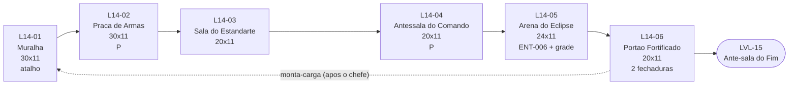
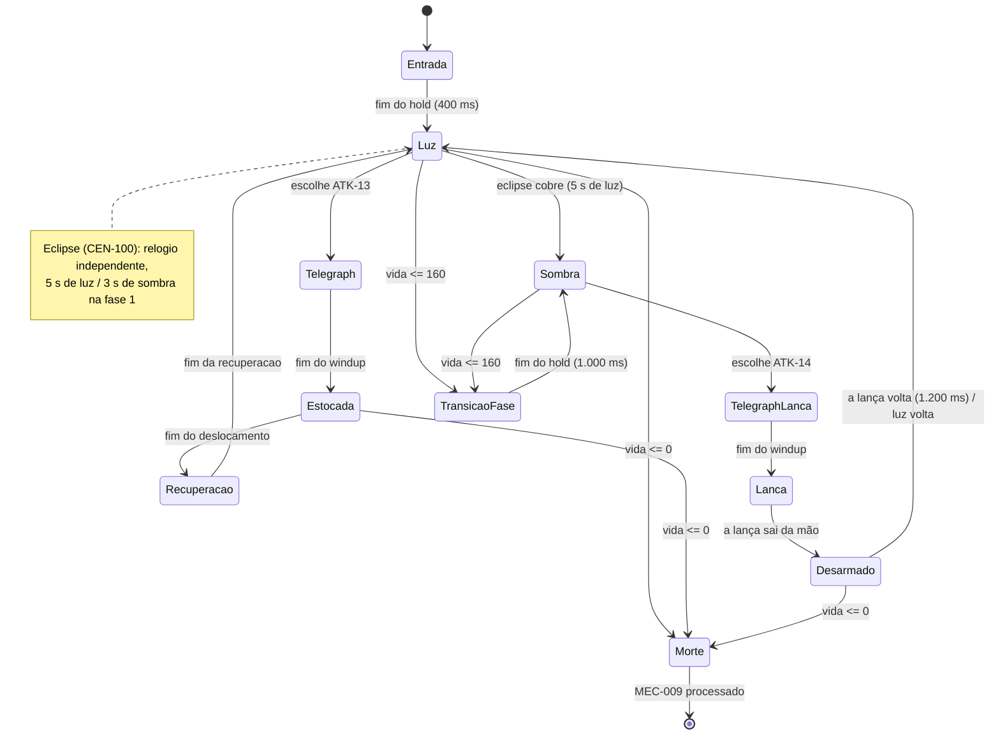

# LVL-14 — Fortaleza do Eclipse

> Setor 14 de 16 · **`[PÓS]`** · **Ato IV — O Trono** *(primeiro setor do ato)* · **poder institucional**
> Versão: `0.1.0` · Data: `2026-11-13` · Autor: `AGT-02` (Designer de Level) + `AGT-03` (Gameplay)
> Base: [GDD 3.4](../03-conteudo-do-jogo.md) · [Setores e Cenários §4.1, §4.4 e §4.90](../design-patterns/04-setores-e-cenarios.md) · [Ambientação e Mundo §3.4](../design-patterns/03-ambientacao-e-mundo.md) · [Padrões de Level Design §7.8](../design-patterns/07-padroes-de-level-design.md)

> ⚠️ **Escopo `[PÓS]` — leia antes de usar este documento.**
> Fora do recorte do MVP. Especificado completo porque tem o **chefe alto** e resolve `P-61`, mas nome e conteúdo **não são canônicos** (`D-04`). Não codar antes de `BKL-012`.

> 🟢 **`P-61` está resolvida — por `DEC-016`, e a resposta estava no próprio grafo.**
> `14 → 15` exige **2 chaves de chefe**. O jogo tem 3 chefes com recompensa, mas **dois deles são obrigatórios por construção**: o chefe de LVL-03 fecha `03 → 04` e o de LVL-08 fecha `08 → 09`. Logo o jogador **sempre** chega a LVL-14 com 2 chaves — e a terceira (`ITM-011`, LVL-12) **não tem fechadura**. É isso que torna a luta de LVL-12 opcional de verdade. Ver §8.
>
> 🟢 **E é por isso que este chefe pode trancar a porta sem contradizer LVL-12.** `PAT-LD-07` manda que toda arena de chefe só abra a saída com 0 HP processado. **LVL-12 foi a exceção** (§8 de lá); LVL-14 é a regra.

---

## 1. Os 12 campos obrigatórios

| # | Campo | Definição |
|---|---|---|
| 1 | **ID e nome canônico** | `LVL-14` — Fortaleza do Eclipse *(nome canônico do GDD §3.4)* |
| 2 | **Objetivo** | Atravessar a fortaleza, derrotar **`ENT-006` O Comandante** e abrir o portão de duas fechaduras para LVL-15 |
| 3 | **Duração e mortes** | 7–10 min · **2–4 mortes esperadas** (o chefe mais difícil do jogo até aqui) |
| 4 | **Acento e materiais** | `PAL-14` azul-noite `#5A6BB0` · muralha, estandarte negro, eclipse, ferro |
| 5 | **Sinais de ambientação** | **o eclipse atravessa o céu em 8 s** · estandartes negros de luto permanente · **600 lugares na praça de armas e ninguém nela** · marcha distante que nunca chega |
| 6 | **Habilidade de entrada / saída** | Entrada: `HAB-07` + `CEN-096` (a travessia de LVL-13). Saída: **2 chaves de chefe** (`DEC-016`) — o jogador já as tem |
| 7 | **Salas** | 6 salas: **30** · **30** · 20 · 20 · **24** · 20 (× 11) = **144 tiles** |
| 8 | **O que ensina** | nada novo. **Cobra a leitura que o jogador treinou em 13 setores** — e dá a primeira ordem do jogo |
| 9 | **Set pieces** | `CEN-100` eclipse · `CEN-101` monta-carga · `CEN-102` estandarte negro · `CEN-103` fechadura de chave · `CEN-104` ameia · `CEN-105` porta da fortaleza |
| 10 | **Inimigos** | `ENT-002` Sentinela × 5 (2 · 2 · 1 · 0 · 0 · 0) + **chefe alto `ENT-006` O Comandante** |
| 11 | **Entradas e saídas** | L14-01 ← **LVL-13** · L14-06 → **LVL-15** (portão fortificado) · L14-06 ⇢ **L14-01** (monta-carga, atalho) |
| 12 | **Teste de rastreabilidade** | `TST-006` · `TST-007` · `TST-015` · `TST-014` · `TST-001` |

### Propriedades de design deste setor

- **É o primeiro lugar do jogo onde alguém dá uma ordem — e é dirigida ao jogador.** O Ato III inteiro perguntou *"quem deu as ordens?"* e a resposta foi "ninguém". O Ato IV abre com o contrário: o Comandante olha para o jogador e diz **"Você está de serviço. Assuma o posto."** É a primeira ordem com destinatário em 13 setores, e o jogador responde lutando com ele.
- **É a fortaleza de uma instituição, não de um vilão.** Não há tesouro, trono nem altar. Há uma praça de armas com capacidade para 600 pessoas e nenhuma, um estandarte de luto permanente e uma antessala onde se espera ordem. O poder institucional do GDD é literalmente **capacidade ociosa**.
- **É o único setor em que o cenário muda de regra no meio da luta.** O eclipse (`CEN-100`) não é ataque, não é dano e não é do chefe: é um **relógio do céu** que decide a que distância a luta acontece (§7).
- **É onde as duas chaves que o jogador carrega desde LVL-03 viram chaves.** Ele nunca soube. `ITM-004` era "equipamento de teste" do MVP e vira uma fechadura em LVL-14, e a chave que sobra **não tem porta** (§8).
- **Zero plataformas pelo sexto setor seguido** — e aqui a fortaleza é plana de propósito: uma praça de armas é plana.

---

## 2. Fluxo



| Transição | Checkpoint |
|---|---|
| LVL-13 → L14-01 | salva ao cruzar a porta |
| L14-01 → L14-02 | salva ao cruzar a porta |
| **L14-02** | **`P` em (3,6)** |
| L14-02 → L14-03 | salva ao cruzar a porta |
| L14-03 → L14-04 | salva ao cruzar a porta |
| **L14-04** | **`P` em (3,6)** — última sala segura antes da arena (`PAT-LD-05`) |
| L14-04 → L14-05 | salva ao cruzar a porta; **a grade fecha** |
| **L14-05 (arena)** | **sem checkpoint** — sala de desafio (`PAT-LD-05`) |
| L14-05 → L14-06 | salva ao cruzar a porta; **a grade quebra** (`MEC-009`) |
| **L14-06** | **`P` em (3,6)** — respiro (`PAT-LD-04`) |
| L14-06 → LVL-15 | o portão de 2 fechaduras |

> **O monta-carga só existe depois do chefe**, porque a única passagem para L14-06 é a grade dele. Não é uma trava extra: é `PAT-LD-07` fazendo o trabalho dela.

---

## 3. Legenda das grades

| Símbolo | Camada | Significado |
|---|---|---|
| `#` | `ground` + `collision` | sólido (muralha, pedra negra, ferro) |
| `+` | — | abertura de passagem lateral (`y=4–6`) |
| `G` | `objects` | **grade da arena** (`CEN-065`) — fecha na entrada, quebra com 0 HP |
| `.` | — | ar |
| `E` | `objects` | Sentinela distorcida (`ENT-002`) |
| `C` | `objects` | **O Comandante** (`ENT-006`, ID proposto — `P-66`) — chefe alto |
| `M` | `objects` | **monta-carga** (`CEN-101`) — atalho, 2 paradas |
| `K` | `objects` | **fechadura de chave** (`CEN-103`) — 2 no portão |
| `P` | `objects` | ponto de salvamento |
| `N` | `objects` | inscrição / marco de lore |
| `y` | `decor-front` | **eclipse** (`CEN-100`) — estado global de luz, §7 |
| `f` | `decor-back` | **estandarte negro** (`CEN-102`) |
| `w` | `decor-back` | **ameia / muralha** (`CEN-104`) |

Piso em `y=7` e aberturas em `y=4–6` seguem `DEC-007`.

> **`G` na borda não é erro de grade.** A grade é a porta da arena e ocupa as três linhas de abertura em `x=23` — mesmo desenho de `L08-04`, mesma camada, mesmo objeto.

---

## 4. Salas

### 4.1 L14-01 — Muralha · 30×11

```
    000000000011111111112222222222
    012345678901234567890123456789
y0  ##############################
y1  #............................#
y2  #....w........w...f......w...#
y3  #............................#
y4  +............................+
y5  +............................+
y6  +..M...N....E.........E......+
y7  ##############################
y8  ##############################
y9  ##############################
y10 ##############################
```

| Objeto | Pos | Função |
|---|---|---|
| `+` porta | (0,4)–(0,6) | vinda de **LVL-13** |
| `+` saída | (29,4)–(29,6) | para L14-02 |
| **`M` monta-carga** | (3,6) | `CEN-101`. **Chegada do atalho** — 2 paradas com L14-06 |
| `E` Sentinelas | (12,6) · (22,6) | patrulhas de 4 e 4 tiles |
| `N` marco | (7,6) | **"MURALHA NORTE. SENTIDO ÚNICO. NÃO HÁ VOLTA REGISTRADA."** (7 palavras) |
| `w` ameias | (5,2) · (14,2) · (25,2) | `CEN-104` |
| `f` estandarte | (18,2) | `CEN-102` |

- **Função:** o caminho de ronda da muralha. A primeira coisa que o jogador vê da fortaleza é o **lado de fora dela**, e o lado de fora é uma passarela onde alguém andou em fila por muito tempo.
- **Por que o atalho desemboca aqui:** é o mesmo caminho de ronda. O monta-carga da muralha sobe do portão até a passarela; é assim que a fortaleza movia carga entre a entrada e o alto.
- **Aceite:** atravessar em ≤ 20 s.

---

### 4.2 L14-02 — Praça de Armas · 30×11

```
    000000000011111111112222222222
    012345678901234567890123456789
y0  ##############################
y1  #............................#
y2  #.......f.....w.....f.....w..#
y3  #............................#
y4  +............................+
y5  +............................+
y6  +..P...N...E.........E.......+
y7  ##############################
y8  ##############################
y9  ##############################
y10 ##############################
```

| Elemento | Posição | Função |
|---|---|---|
| `+` porta / saída | (0,4)–(0,6) · (29,4)–(29,6) | de L14-01 / para L14-03 |
| **`P` save** | (3,6) | `UI-09` |
| `E` Sentinelas | (11,6) · (21,6) | patrulhas de 4 e 5 tiles |
| `N` marco | (7,6) | **"PRAÇA DE ARMAS. CAPACIDADE: 600. PRESENTES: 0."** (7 palavras) |
| `f` estandartes | (8,2) · (20,2) | `CEN-102` |
| `w` ameias | (14,2) · (26,2) | `CEN-104` |

- **Função:** a escala da instituição, medida em vazio. A praça comporta 600 e tem duas Sentinelas.
- **Por que o marco é o melhor número do setor:** "CAPACIDADE: 600. PRESENTES: 0." é a fortaleza inteira em sete palavras. Não precisa de conceito, de vilão nem de tragédia — precisa de uma contagem.
- **Aceite:** atravessar em ≤ 22 s.

---

### 4.3 L14-03 — Sala do Estandarte · 20×11

```
    00000000001111111111
    01234567890123456789
y0  ####################
y1  #..................#
y2  #........ff.....w..#
y3  #..................#
y4  +..................+
y5  +..................+
y6  +....N.......E.....+
y7  ####################
y8  ####################
y9  ####################
y10 ####################
```

| Elemento | Posição | Função |
|---|---|---|
| `+` porta / saída | (0,4)–(0,6) · (19,4)–(19,6) | de L14-02 / para L14-04 |
| `E` Sentinela | (13,6) | patrulha de 4 tiles, **de frente para o estandarte** |
| `f` estandarte | (9,2)–(10,2) | `CEN-102` — **2 tiles, o maior do jogo** |
| `w` ameia | (16,2) | `CEN-104` |
| `N` marco | (5,6) | **"ESTANDARTE NEGRO: LUTO OFICIAL PERMANENTE. NÃO SUBSTITUIR."** (7 palavras) |

- **Função:** o único lugar do jogo em que o jogador vê o estandarte da facção que ele vem enfrentando desde LVL-01 — e ele é **negro**, e o luto é **permanente por regulamento**.
- **Por que a Sentinela está de frente para ele:** ela não patrulha a sala, ela **monta guarda** para um pano. É o Ato I ("por que ninguém mais veio?") respondido em uma pose.
- **Aceite:** atravessar em ≤ 15 s.

---

### 4.4 L14-04 — Antessala do Comando · 20×11

```
    00000000001111111111
    01234567890123456789
y0  ####################
y1  #..................#
y2  #....w.......f.....#
y3  #..................#
y4  +..................+
y5  +..................+
y6  +..P...N...........+
y7  ####################
y8  ####################
y9  ####################
y10 ####################
```

| Elemento | Posição | Função |
|---|---|---|
| `+` porta / saída | (0,4)–(0,6) · (19,4)–(19,6) | de L14-03 / para L14-05 (arena) |
| **`P` save** | (3,6) | `UI-09`. **Última sala segura** (`PAT-LD-05`) |
| `N` marco | (7,6) | **"ANTESSALA DO COMANDO. ESPERAR ORDEM."** (4 palavras) |
| `f` estandarte | (13,2) | `CEN-102` |
| `w` ameia | (5,2) | `CEN-104` |
| **Inimigos** | — | **zero** (`PAT-LD-04`) |

- **Função:** o respiro antes do chefe mais difícil, e a sala mais curta em conteúdo do setor: um save, uma placa de quatro palavras e um estandarte.
- **Por que a placa tem quatro palavras:** porque é uma **sala de espera**. "ESPERAR ORDEM" é a instrução inteira. O jogador entra, lê, e percebe que está fazendo exatamente o que a placa manda — esperando uma ordem que vai chegar na sala seguinte.
- **Aceite:** salvar. `PAT-LD-04` e `PAT-LD-05` verdes.

---

### 4.5 L14-05 — Arena do Eclipse · 24×11

```
    000000000011111111112222
    012345678901234567890123
y0  ########################
y1  #..........y...........#
y2  #...f..............f...#
y3  #......................#
y4  +......................G
y5  +......................G
y6  +...........C..........G
y7  ########################
y8  ########################
y9  ########################
y10 ########################
```

| Elemento | Posição | Função |
|---|---|---|
| **`C` O Comandante** | (12,6) | `ENT-006`. **Chefe alto.** Ficha em §5 |
| **`G` grade** | (23,4)–(23,6) | `CEN-065`. Fecha na entrada, **quebra com 0 HP** (`PAT-LD-07`) |
| `y` eclipse | (11,1) | `CEN-100` — **estado global de luz**, §7 |
| `+` porta | (0,4)–(0,6) | de L14-04 |
| `f` estandartes | (4,2) · (19,2) | `CEN-102` |
| **Cobertura** | — | **zero** (`PAT-LD-07`) |
| **Coletáveis** | — | **zero** durante a luta |
| **Queda** | — | **impossível** — piso contínuo |

- **Função:** a arena. 24×11, piso contínuo, nenhuma cobertura, nenhum lugar para se esconder — porque o que muda aqui não é o terreno, é **a luz**.
- **Por que não há cobertura:** o eclipse já cria e destrói a distância segura a cada 8 s. Cobertura somada a isso daria ao jogador uma posição que o chefe não pode contestar, e o relógio do céu deixaria de importar.
- **Aceite:** `PAT-LD-07` inteiro verde; `TST-006` com TTK dentro de §6.

---

### 4.6 L14-06 — Portão Fortificado · 20×11

```
    00000000001111111111
    01234567890123456789
y0  ####################
y1  #..................#
y2  #.......w.......f..#
y3  #..................#
y4  +..................+
y5  +..................+
y6  +..P...M...N...KK..+
y7  ####################
y8  ####################
y9  ####################
y10 ####################
```

| Elemento | Posição | Função |
|---|---|---|
| `+` porta | (0,4)–(0,6) | vem da grade quebrada de L14-05 |
| `+` saída | (19,4)–(19,6) | → **LVL-15**. **O portão de duas fechaduras** |
| **`K` fechaduras** | (15,6) · (16,6) | `CEN-103`. **2**, lado a lado. `requires=keys>=2` (`DEC-016`) |
| **`M` monta-carga** | (7,6) | `CEN-101`. `interact` → **L14-01** (`PAT-LD-08`) |
| **`P` save** | (3,6) | `UI-09` |
| `N` marco | (11,6) | **"PORTÃO FORTIFICADO. DUAS CHAVES. UMA SOBRA."** (6 palavras) |
| `f` estandarte | (16,2) | `CEN-102` |
| `w` ameia | (8,2) | `CEN-104` |
| **Inimigos** | — | **zero** (`PAT-LD-04`) |

- **Função:** o portão, e a revelação de §8. Duas fechaduras lado a lado, e o jogador descobre que carrega as duas desde o Ato I e o Ato II.
- **Por que a placa diz "UMA SOBRA":** porque a Vigília **sabia**. O regulamento do portão prevê três chefes e duas fechaduras. A terceira chave é uma sobra prevista por escrito — o que significa que o mundo já contava com alguém pulando uma luta.
- **Aceite:** atravessar para LVL-15. `TST-015` (portão) verde.

---

## 5. A luta — especificação de combate

### 5.1 Ficha do chefe (`ENT-006`)

| Atributo | Valor | Observação |
|---|---:|---|
| Nome de trabalho | **O Comandante** | `[PÓS]`, não canônico |
| Facção | `LOR-03b` Distorcido *(corpo)* em `LOR-03c` Caos *(céu)* | o eclipse não é dele — ele **obedece** ao eclipse |
| Vida | **320 HP** | o mais alto do jogo até aqui; 20 acima de `ENT-005` |
| Sprite | 192×192 px (3×3 tiles) | `AST-018` (proposto — `P-66`) |
| **Hurtbox** | 128×160 px | menor que o sprite — regra `PAT-C` anti-hitbox |
| Corpo | alto, imóvel, lança comprida, **capa com o estandarte negro** | ele não anda: **gira** em torno do próprio eixo |
| Dano por impacto | **26 HP** (estocada) · **24 HP** (lança arremessada) | antes do multiplicador |
| Peso / empurrão | imune a knockback | clamp por bounds da arena |
| **Movimento** | **não se desloca.** Pivota em 8 direções no lugar | é o único chefe do jogo que não muda de x |
| **Voz** | **fala três vezes**: entrada, fase 2 e morte | o chefe mais falante do jogo, e o único que dá ordem |

### 5.2 Máquina de estados



> **`Luz` e `Sombra` são estados do chefe *e* do céu ao mesmo tempo** — é a única vez no jogo em que o céu entra na FSM. `CEN-100` corre em relógio próprio, mas o chefe **reage** a ele: na luz ele só tem `ATK-13`; na sombra, só `ATK-14`.

### 5.3 Ataques

| ID | Ataque | Fase | Telegraph | Execução | Recuperação | Dano | Resposta correta |
|---|---|---|---:|---|---:|---:|---|
| `ATK-13` | **Estocada** | **só na luz** | 700 ms | **6 tiles** (384 px) a 640 px/s = 600 ms | 1.000 ms / **850 ms** | 26 | **sair de linha** — pular não resolve (a lança é alta) |
| `ATK-14` | **Lançar a lança** | **só na sombra** | 800 ms | projétil reto, **7 tiles** (448 px), 500 px/s | — | 24 | **afastar-se** — é a única resposta |
| — | **Desarmado** | — | — | **1.200 ms sem ataque**, a lança volta voando | — | 0 | **avançar e bater** — **a janela** |
| `ATK-15` | **A ordem** | **fase 2** | — | não é ataque: o eclipse **inverte** (5/3 → 3/5) | — | 0 | nenhuma |

**Telegraph de `ATK-13`:** ele **gira** até a direção do jogador e a lança desce à altura do quadril, com a ponta brilhando. Não há linha no chão — a referência é **o corpo dele**, porque ele não se move.

**Telegraph de `ATK-14`:** ele ergue a lança acima da cabeça e a sombra no chão **encurta** (o eclipse). O projétil leva 900 ms para atravessar 7 tiles e **não é instantâneo** — dá para ver chegando.

**`ATK-15` — o eclipse inverte.** Na fase 1 são 5 s de luz e 3 s de sombra; na fase 2 são 3 s de luz e 5 s de sombra. **O tempo total continua 8 s.** Ele não fica mais rápido: **fica mais noite.**

> ⚠️ **Acessibilidade (`VIS-009`, `TST-014`).** O estado de sombra **não pode reduzir o contraste** abaixo do piso de legibilidade: na sombra, o `ground` mantém ≥ 3:1 contra as silhuetas por **luz de contorno** nos personagens (`VIS-004`). O eclipse escurece o céu, **não a arena**. Se a arena ficar ilegível, `TST-014` reprova.

### 5.4 Entrada dramática (`VIS-007`)

| Elemento | Especificação |
|---|---|
| Gatilho | jogador cruza `x ≥ 3` na arena |
| Grade | `G` em `x=23` **fecha** (600 ms) — e `CEN-065` na entrada também, se `AGT-03` quiser simetria |
| Hold | 400 ms, congelado |
| Nome na tela | `O COMANDANTE`, display, centralizado, 900 ms |
| **Fala única** | ***"Você está de serviço. Assuma o posto."*** (1,8 s) |
| Barra de vida | topo central, `role="progressbar"`, percentual no `aria-label` |
| Música | **`BGM-01` → `BGM-02`** no fechamento da grade |
| Redução de movimento | mantém hold e textos; **desliga** shake e o giro do eclipse |

> **Esta é a primeira ordem do jogo com destinatário.** O Ato III inteiro provou que a Ronda cumpre ordens que ninguém deu; aqui alguém olha para o jogador e **dá uma**. Ela não é uma ameaça, não é um desafio e não é uma provocação: é **escalação de serviço**. E a resposta do jogador — atacar — é a primeira recusa da Vigília em 14 setores.

### 5.5 Transição de fase (160 HP)

| Elemento | Especificação |
|---|---|
| Gatilho | vida ≤ 160, **uma única vez** |
| Hold | 1.000 ms (o mais longo do jogo — a fala precisa caber) |
| Feedback | ele **finca a lança no chão**, o eclipse escurece de uma vez e a proporção do ciclo inverte |
| Desbloqueio | `ATK-15`: ciclo 5/3 → **3/5**; recuperação de `ATK-13` cai 1.000 → **850 ms** |
| Fala | ***"Eu não pedi o posto. Ninguém pede."*** (1,5 s) |
| Acessibilidade | aviso em `aria-live`: "O eclipse mudou — a escuridão agora dura mais que a luz" |

> **A fala da fase 2 é o Ato IV inteiro.** Ninguém é promovido: sobra-se no posto. O Comandante não foi escolhido, não quis e não pode sair — e é por isso que ele escala o jogador. O Ato IV pergunta *"e agora, quem manda?"*, e a resposta do GDD (*"ele — e é um trabalho de merda"*) começa aqui, na boca de quem já está no cargo.

### 5.6 Morte do chefe (`MEC-009`)

| Elemento | Especificação |
|---|---|
| Processamento | **uma única vez**, idempotente (`PAT-C-07`) |
| Hold | 600 ms + câmera lenta 0,3× por 800 ms (desativável) |
| Desmonte | ele **entrega a lança**, não cai. A capa com o estandarte negro escorrega |
| Fala | ***"É seu."*** (0,8 s) — a única fala do jogo com duas palavras e nenhum verbo |
| Grade | `G` **quebra** (`VFX-007`), liberando L14-06 |
| Recompensa | **`keys += 1`** (`DEC-016`) — sem item no chão |
| Eclipse | **para** no estado em que estiver (§7.4) |
| Registro | `game:boss { id: 'ENT-006', scope: 'post', optional: false }` |

> **"É seu" não é entrega de item.** É a passagem do posto. O jogador não ganha uma arma nova — ganha uma vaga. E é exatamente o que ele vai ocupar em LVL-16.

---

## 6. Validação da luta

### 6.1 Golpes necessários

| Arma | Dano | Golpes para 320 HP |
|---|---:|---:|
| Branca | 20 | **16** |
| À distância | 10 | 32 |

### 6.2 Sobrevivência do jogador

Vida efetiva = 100 HP + 50 de escudo = **150**. Multiplicador sobre o dano total, antes do escudo (`P-23`).

| Dificuldade | Mult. | Estocada | Erros | Lança | Erros | Margem efetiva |
|---|---:|---:|---:|---:|---:|---:|
| Fácil | 0,75× | 19 HP | 7 | 18 HP | 8 | **7** |
| Médio | 1,00× | **26 HP** | **5** | **24 HP** | **6** | **5** |
| Difícil | 1,25× | 32 HP | 4 | 30 HP | 5 | **4** |

> **A margem é 5, contra 6 de `ENT-004` e `ENT-005`.** É o primeiro chefe do jogo que **encolhe** a margem, e é de propósito: até aqui a progressão era "mesma margem, mais coisas". No chefe alto o GDD cobra outra coisa — **menos margem**. Um erro a menos por luta é o que separa "difícil" de "alto".

### 6.3 Ciclo e janelas

| Fase | Estado | Windup | Golpe | Recuperação | Ciclo | Janelas por ciclo de céu |
|---|---|---:|---:|---:|---:|---:|
| 1 | **luz (5 s)** | 700 ms | 600 ms | 1.000 ms | **2,70 s** | ~2 |
| 1 | **sombra (3 s)** | 800 ms | 500 ms (voo) | **1.200 ms desarmado** | **2,50 s** | **1 grande** |
| 2 | **luz (3 s)** | 700 ms | 600 ms | 850 ms | **2,55 s** | ~1 |
| 2 | **sombra (5 s)** | 800 ms | 500 ms | 1.200 ms | 2,50 s | **~2** |

### 6.4 Tempo até matar (TTK)

| Cenário | TTK |
|---|---:|
| 1 golpe por janela (típico) | **~39 s** (20,0 + 18,0 + 1,0 de transição) |
| Perfeito, punindo toda janela desarmada | **~26 s** |
| Só arma à distância (32 golpes) | **~78 s** |

> **Leitura:** o TTK quebra a progressão rasa dos outros chefes (28 s → 30 s → 33 s → **39 s**) e o faz por acúmulo, não por resistência: são 16 golpes em vez de 13, e as janelas ficam **mais frequentes** na fase 2. Quem entendeu o eclipse termina a fase 2 mais rápido que a fase 1. Se o playtest reprovar, o ajuste é a **recuperação do `ATK-13` em fase 1** (1.000 → 1.100 ms), nunca a vida.

### 6.5 Geometria — por que ele não anda

| Modelo | Consequência |
|---|---|
| chefe móvel | o jogador resolve tudo correndo; a distância nunca é uma decisão |
| **chefe fixo que gira** | a arena tem 24 tiles e o chefe ocupa **1**; a decisão de distância é **toda do jogador** |
| chefe fixo com alcance curto | o jogador fica longe e atira; a luta morre em 78 s |
| **fixo com 6 tiles de estocada e 7 de lança** | a luz **exige** aproximação (6 tiles) e a sombra **exige** afastamento (7) — a mesma arena muda de tamanho duas vezes a cada 8 s |

> **É o único chefe do jogo que não muda de x, e é o único cuja arena muda de tamanho.** Os dois fatos são o mesmo fato: se ele andasse, o jogador não precisaria ser ele a decidir a distância.

---

## 7. O eclipse — o relógio do céu

### 7.1 O que ele é e o que ele não é

| É | Não é |
|---|---|
| `CEN-100`, estado global de luz em relógio próprio | ataque do chefe |
| 8 s por ciclo (5 luz / 3 sombra na fase 1) | dano de área |
| o que **decide qual ataque o chefe tem** | o que decide o ataque do jogador |
| visível no céu e na sombra do piso | uma tela de escuridão |
| **para quando o chefe morre** | termina quando a luta termina |

### 7.2 Por que ele não é do chefe

Mesma regra dos pilões de LVL-12 (§7.2 de lá): o céu não pertence a ninguém. `CEN-100` corre em relógio próprio e o chefe **reage** a ele — a dependência é de mão única. Se o eclipse estivesse na FSM, ele morreria com o homem, e a fortaleza ficaria com sol permanente.

### 7.3 O ciclo

| Fase | Luz | Sombra | Total | O que o jogador aprende |
|---|---:|---:|---:|---|
| **1** | **5 s** | **3 s** | 8 s | a sombra é o intervalo, a luz é o trabalho |
| **2** | **3 s** | **5 s** | 8 s | **agora a sombra é o trabalho** |

> **O total não muda. Só a proporção.** É a única transição de fase do jogo em que nada fica mais rápido e tudo fica mais difícil — e é o que faz o jogador sentir que **o mundo** mudou de lado, não o inimigo.

### 7.4 A regra que o eclipse impõe

> **O eclipse para na morte de `ENT-006`.**

Como os pilões de LVL-12: quem obedece ao céu é ele. Sem ele, o céu fica como estiver — e o jogador sai da arena com o sol onde estava. Se sair na sombra, sai na sombra.

### 7.5 Ensino em quatro tempos (`PAT-LD-02`)

| Tempo | Onde | O que acontece |
|---|---|---|
| 1. **Introduzir** | L14-01 `w`/`CEN-104` | o céu já está eclipsado; o jogador atravessa o setor **inteiro** sob ele |
| 2. **Praticar** | L14-02, 03, 04 | a sombra vai e volta a cada 8 s, sem consequência nenhuma |
| 3. **Combinar** | arena, fase 1 | sombra + luz + estocada + lança |
| 4. **Testar** | arena, fase 2 | a proporção invertida, com a vida baixa |

> **O tempo 1 é o setor inteiro.** O jogador passa 4 salas vendo o eclipse mudar antes de ele significar qualquer coisa. Quando a luta começa, ele **já sabe o ciclo de cor** — e é por isso que nenhum tutorial é necessário.

---

## 8. 🔴 As duas fechaduras e a chave que não abre nada

### 8.1 O problema (`P-61`)

`04-setores` §4.1 registra `14 → 15` com trava **"2 chaves de chefe"**. O jogo tem **3** chefes com recompensa (`ITM-004` LVL-03, `ITM-007` LVL-08, `ITM-011` LVL-12), mas nenhum deles é definido como chave — e `ITM-011` é a recompensa de um chefe que LVL-12 declarou **opcional** (§8 de lá). Se o portão exigisse as três, o chefe de LVL-12 deixaria de ser opcional e a decisão de LVL-12 cairia.

### 8.2 A solução: `DEC-016` — chave é contador, não item

> **`DEC-016` — Chave de chefe é um contador, não um item.** Todo `MEC-009` bem-sucedido incrementa `keys`. O Portão Fortificado de L14-06 exige **`keys ≥ 2`**. A UI exibe `keys / 2` e **não** exibe um terceiro slot.

Consequências, todas verificáveis:

| Fato | Consequência |
|---|---|
| `03 → 04` fecha com o chefe de LVL-03 | `keys ≥ 1` **garantido** |
| `08 → 09` fecha com o chefe de LVL-08 | `keys ≥ 2` **garantido** antes de LVL-14 |
| `12 → 13` **não** fecha com o chefe de LVL-12 | `keys` pode ser **2 ou 3** em L14-06 |
| O portão exige `≥ 2` | **abre nos dois casos** |
| A UI mostra `x / 2` | o jogador com 3 vê `3 / 2` — **e entende sozinho** |

> **Não é uma concessão: é o que o grafo já dizia.** Os dois chefes obrigatórios são obrigatórios *porque fecham portas*. Um jogo em que a chave obrigatória vem de um chefe opcional teria um soft lock — e `PAT-LD-06` proíbe exatamente isso. O portão de duas fechaduras só é desenhável se as duas chaves vierem de portas que já estavam fechadas.

### 8.3 A terceira chave não tem porta, e a placa diz isso

`L14-06` tem um marco de seis palavras: **"PORTÃO FORTIFICADO. DUAS CHAVES. UMA SOBRA."**

O jogador que lutou em LVL-12 chega com `3 / 2`; o que correu chega com `2 / 2`. **Os dois passam**, e o que lutou carrega uma chave a mais que não abre nada — e o regulamento da Vigília **previu** essa sobra por escrito.

> **É a resposta do setor ao Ato IV.** O Ato IV pergunta *"e agora, quem manda?"*. A fortaleza responde com um procedimento que funciona mesmo quando um item sobra: **a instituição não precisa que você seja completo, só que você tenha o mínimo.** O jogador pode ter feito tudo ou quase tudo, e o portão abre igual. É burocrático, é injusto e é exatamente o que uma fortaleza faz.

### 8.4 O que `ITM-011` faz, então

| Opção | Situação |
|---|---|
| Abrir uma terceira fechadura | ❌ não existe — a placa diz "uma sobra" |
| Ser equipamento (como `ITM-004`) | ⚠️ depende de `P-47` |
| **Não fazer nada agora** | ✅ **é a posição deste documento** — e vira `P-65` |
| Fazer algo em LVL-16 | 🔶 **proposta registrada em `P-65`** |

---

## 9. Validação de alcançabilidade

| Obstáculo | Sala | Valor | Necessário | Veredito |
|---|---|---|---|---|
| plataforma mais alta | — | **0 no setor** | — | nada a validar |
| vão / alçapão / corrente | — | **0 no setor** | — | nada a validar |
| **estocada do chefe** | L14-05 | 6 tiles = 384 px | 600 ms a 640 px/s | saída lateral de 1 tile basta ✓ |
| **lança arremessada** | L14-05 | 7 tiles = 448 px | 500 px/s → 900 ms de voo | visível e desviável ✓ |
| **janela desarmada** | L14-05 | 1.200 ms | ~3 golpes possíveis | janela real ✓ |

**Resultado: 0 falhas.** Terceiro setor seguido com a tabela de geometria vazia — o kit está fechado desde LVL-11 e **o jogo não pede mais travessia, pede combate**.

---

## 10. Salvamento e morte

| Evento | O que acontece | Regra |
|---|---|---|
| Cruza qualquer porta | salva | `MEC-007` |
| Interagir com `P` | salva | `MEC-007` |
| **Entra na arena** | **não salva**; a grade fecha | `PAT-LD-05`, `PAT-LD-07` |
| Morre para `ENT-006` | respawn no `P` de L14-04; **o chefe volta com 320 HP e o eclipse reinicia no começo da luz** | `MEC-004` |
| Morre na arena **3×** | oferta de dificuldade | `MEC-008` |
| Usa o monta-carga | **não salva** | atalho ≠ transição |
| Matou o chefe | **`keys += 1`** e `MEC-009` marcado | `DEC-016` |

> **O eclipse reinicia no começo da luz** porque o jogador precisa entrar na luta com a mesma informação da primeira tentativa. Reiniciar na sombra faria a segunda tentativa começar com outra regra.

---

## 11. Conversão para Tiled (`.tmj`)

| Item | Definição |
|---|---|
| Nome do arquivo | `public/assets/tilemaps/tm_lvl14_fortaleza.tmj` |
| Tileset | `tm_fortaleza` (`AST-019` — **ID proposto**, `P-66`), ~30 tiles, 64×64 |
| Orientação | orthogonal, tile 64×64, 20–30 colunas × 11 linhas |
| Camadas (ordem) | `decor-back` · `ground` · `collision` · `objects` · `decor-front` (**eclipse**) |
| Propriedades do mapa | `lvl_id=LVL-14`, `pal=PAL-14`, `bgm=BGM-01`, `amb=AMB-14`, `scope=post`, `boss=BKL-009` |

### Propriedades dos objetos (`objects`)

| Tipo | Propriedades |
|---|---|
| `enemy` | `ent=ENT-002`, `patrol_tiles`=4–5, `initial_facing`=`left`, `has_telegraph`=true |
| `boss` | `ent=ENT-006`, `hp`=320, `phase_at`=160, `gate`=`arena`, `optional`=false, `mobile`=false |
| `eclipse` | `cen=CEN-100`, `cycle_s`=8, `light_s`=5, `shadow_s`=3, `invert_at_phase`=2, `stops_on_boss_death`=true |
| `arena_gate` | `cen=CEN-065`, `side`=`east`, `closes_on`=`enter`, `breaks_on`=`MEC-009` |
| `key_lock` | `cen=CEN-103`, `count`=2, `requires`=`keys>=2`, `ui_denominator`=2 |
| `lift` | `cen=CEN-101`, `stops`=[`L14-01`,`L14-06`], `unlock`=`boss.ENT-006.dead` |
| `save_point` | `ui=UI-09`, `checkpoint`=true (L14-02, L14-04, L14-06) |
| `door` | `to=LVL-13` (L14-01, `style=iron`) · `to=LVL-15` (L14-06, `style=fortified`) |
| `lore_marker` | `key`=`lore.lvl14.muralha` / `.praca` / `.estandarte` / `.antessala` / `.portao`, `max_words`=25 |
| `decor` | `ast=CEN-102` (back) / `CEN-104` (back) / `CEN-105`, `collides`=false |

> **`mobile=false` no objeto `boss`** é o §6.5, e `AGT-07` deve ter um teste que **reprove** se ele mudar de `x` durante a luta.

**Regra de ouro:** nenhum número de gameplay no `.tmj`. Vida, dano, ciclo do eclipse e janela desarmada vêm de `tuning.ts` (`PAT-C-04`).

---

## 12. Checklist de aprovação (`07-padroes` §7.14)

- [x] Dimensões múltiplas de 20×11 — 30, 30, 20, 20, **24**, 20 × 11
- [x] Objetivo de cada sala compreensível em ≤ 3 s
- [x] Respeita a tabela de alcance (§9) — **0 falhas**
- [x] `PAT-LD-07` — arena 24×11, piso contínuo, **zero queda, zero coletável, zero cobertura**, saída só com 0 HP
- [x] `PAT-LD-04` — L14-04 (antes) e L14-06 (depois) sem inimigo
- [x] `PAT-LD-05` — **arena sem checkpoint**; `P` em L14-02, L14-04 e L14-06
- [x] `PAT-LD-02` no eclipse — os 4 tempos são **do céu**, e o tempo 1 é o setor inteiro (§7.5)
- [x] `PAT-LD-08` — monta-carga com 2 paradas (L14-06 ↔ L14-01), forma **(a) máquina**
- [x] `PAT-LD-10` — máx. 2 inimigos por sala; 5 no setor
- [x] `collision` alinhada ao `ground` (validado pelo gerador de grade)
- [x] Paleta com um único acento (`PAL-14` azul-noite)
- [x] `BGM-02` só na luta; `BGM-01` no resto
- [x] **O eclipse para na morte do chefe** (§7.4) e **não reduz contraste** (§5.3)
- [x] **`keys ≥ 2`** no portão, e o jogador **sempre** chega com 2 (`DEC-016`, §8)
- [x] Testes associados: `TST-001`, `TST-006`, `TST-007`, `TST-014`, `TST-015`
- [ ] **Aprovação de escopo:** `[PÓS]` (`D-04`) — não marcado de propósito
- [ ] **Ratificação de `DEC-016`** e UI de `keys / 2`: pendente (`P-65`)
- [ ] **Ficha de `ENT-006`** (`AST-018`, `AST-019`, `UI-18`): pendente (`P-66`)

---

## 13. Desvios registrados

| # | O que mudou | Por quê | IDs afetados |
|---|---|---|---|
| 1 | **Chave de chefe é contador, não item (`DEC-016`)** | É a única forma de o portão de 2 fechaduras não criar soft lock nem tirar o caráter opcional de LVL-12 (§8.2) | `04-setores` §4.1, `PAT-LD-06`, `P-61` |
| 2 | **O chefe alto tranca a porta — e LVL-12 não trancava** | `PAT-LD-07` manda que toda arena só abra com 0 HP. LVL-12 foi a **exceção documentada**; LVL-14 é a regra | `PAT-LD-07`, LVL-12 §8 |
| 3 | **O Comandante não se desloca** | Se ele andasse, o jogador não precisaria decidir a distância — e é a distância que o eclipse controla (§6.5) | `ENT-006`, `CEN-100` |
| 4 | **A fase 2 não acelera nada: inverte a proporção** | O total do ciclo continua 8 s. O mundo muda de lado, o inimigo não fica mais rápido (§7.3) | `ENT-006`, `VIS-009` |
| 5 | **A sombra não escurece a arena, só o céu** | Contraste de leitura é piso de acessibilidade (`VIS-004`, `TST-014`); luz de contorno nos personagens (§5.3) | `VIS-004`, `VIS-009` |
| 6 | **Zero plataformas pelo sexto setor seguido** | Uma praça de armas é plana, e o kit está fechado desde LVL-11 | `PAT-LD-01`, LVL-09–13 |
| 7 | **A fala de morte tem duas palavras e nenhum verbo** | *"É seu."* — é passagem de posto, não entrega de item (§5.6) | `LOR-04`, `VIS-007` |

---

## 14. Pendências geradas

| ID | Item | Bloqueia |
|---|---|---|
| `P-65` | 🔴 **Ratificar `DEC-016` e decidir o que a terceira chave faz.** Aprovar: `keys` como contador, portão em `≥ 2`, UI `x / 2` sem terceiro slot. E decidir se `ITM-011` **faz algo em LVL-16** (o Trono) — proposta: nada, e a placa "UMA SOBRA" já é a resposta. Depende de `P-47` | `LVL-15`, `LVL-16`, `P-47`, `P-61` |
| `P-66` | **Ficha de `ENT-006` O Comandante.** Aprovar: 320 HP, fase em 160, `ATK-13` estocada 6 tiles/26 só na luz, `ATK-14` lança 7 tiles/24 só na sombra, **desarmado 1.200 ms**, `mobile=false`, `gate=arena`. Faltam `AST-018`, `AST-019` (`tm_fortaleza`), `UI-18` | `BKL-001`, `BKL-009`, `BKL-012`, LVL-14 |
| `P-67` | **Luz de contorno na sombra.** O estado `shadow` do `CEN-100` precisa de uma regra de arte não-ambígua (espessura, cor, distância) para manter ≥ 3:1. Sem ela, `TST-014` reprova e o setor fica ilegível para parte dos jogadores | `VIS-004`, `VIS-009`, `AGT-01` |

> **Fechadas nesta rodada:** 🟢 **`P-61`** — *"economia de `ITM-011`"*. Resolvida por **`DEC-016`**: os dois chefes obrigatórios dão exatamente as 2 chaves exigidas, e a terceira não tem fechadura (§8). A ratificação virou `P-65`.

---

## Handoff

**Para `AGT-03`** — `boss` com `mobile=false` e `gate=arena`. `eclipse` (`CEN-100`) em **relógio próprio**, com dois estados que **mudam a tabela de ataques do chefe** (luz → `ATK-13`; sombra → `ATK-14`), ciclo 8 s que **inverte** na fase 2 (5/3 → 3/5) e **para** na morte dele. `keys` é **contador** (`DEC-016`), incrementado por `MEC-009`. Quatro coisas fáceis de errar: (1) deixar o eclipse na FSM do chefe; (2) fazer a fase 2 acelerar em vez de inverter; (3) escurecer a arena junto com o céu — `TST-014` reprova; (4) exigir 3 chaves no portão, que trava o jogador que pulou LVL-12.

**Para `AGT-01`** — `CEN-100` eclipse (**dois estados**, `decor-front`; a sombra escurece o **céu**, não o piso), `CEN-101` monta-carga, `CEN-102` estandarte negro (**o de L14-03 tem 2 tiles e é o maior do jogo**), `CEN-103` fechadura, `CEN-104` ameia, `CEN-105` porta. Tileset `tm_fortaleza` ~30 tiles. **A luz de contorno na sombra é obrigatória** (`P-67`) — sem ela o setor não passa em `TST-014`.

**Para `AGT-06`** — `BGM-01` na fortaleza; **`BGM-02` só na luta**. `AMB-14` (marcha distante, bandeira, porta pesada) — **a marcha nunca chega**, e é o som mais importante do setor. O eclipse precisa de um cue de transição **curto e por posição**, não só visual: o jogador tem de saber que a sombra caiu sem olhar o céu.

**Para `AGT-07`** — `TST-015` (portão) é o teste do setor: **o portão abre com `keys = 2` e com `keys = 3`**, e **não** abre com `keys = 1` nem `0`. Testar também: o chefe não muda de x; o eclipse para na morte dele; a fase 2 inverte sem acelerar; a sombra mantém contraste; e morrer na arena reinicia o eclipse no começo da luz.

**O próximo agente precisa saber, em 3 linhas:**

1. **Esta é a primeira ordem do jogo com destinatário.** *"Você está de serviço. Assuma o posto."* — e o jogador responde lutando. Se a fala for cortada, o Ato IV perde a entrada.
2. **O eclipse não é do chefe e não escurece a arena.** Ele decide a **distância** a cada 8 s; a fase 2 inverte a proporção e não acelera nada. Quem escurecer o piso reprova `TST-014`.
3. **Duas fechaduras, três chefes, uma sobra.** `DEC-016`: `keys ≥ 2`. O portão abre igual para quem lutou em LVL-12 e para quem correu — e é isso que mantém a luta de lá opcional.
