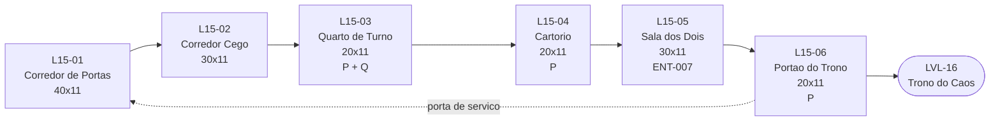
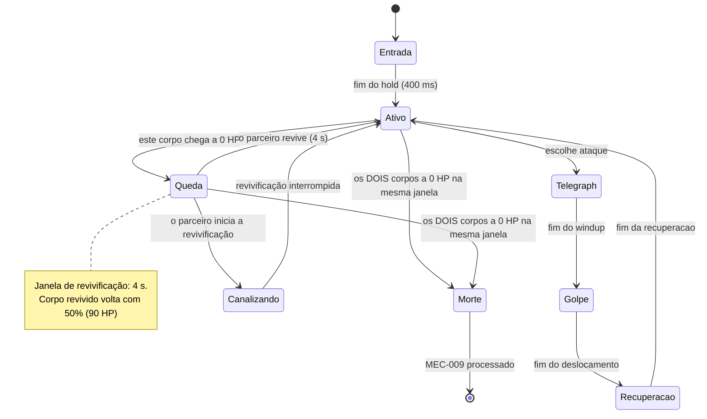

# LVL-15 — Ante-sala do Fim

> Setor 15 de 16 · **`[PÓS]`** · **Ato IV — O Trono** · **suspensão**
> Versão: `0.1.0` · Data: `2026-11-13` · Autor: `AGT-02` (Designer de Level) + `AGT-03` (Gameplay)
> Base: [GDD 3.4](../03-conteudo-do-jogo.md) · [Setores e Cenários §4.1, §4.4 e §4.90](../design-patterns/04-setores-e-cenarios.md) · [Áudio e Ambiencia §4](../design-patterns/06-audio-e-ambiencia.md) · [Padrões de Level Design §7.8 e §7.9](../design-patterns/07-padroes-de-level-design.md)

> ⚠️ **Escopo `[PÓS]` — leia antes de usar este documento.**
> Fora do recorte do MVP. Especificado completo porque tem o **guardião duplo** — o último combate antes do Trono — mas nome e conteúdo **não são canônicos** (`D-04`). Não codar antes de `BKL-012`.

> 🟢 **Este é o setor do silêncio, e ele existe para responder LVL-13.** O abismo devolvia tudo o que o jogador fazia (`AMB-13`, eco de 700 ms). A ante-sala **não devolve nada** (`AMB-15`: *silêncio absoluto*). É a primeira sala do jogo com **zero eco** — e a última porta antes do fim.
>
> 🟢 **E a luta mais estranha do jogo acontece ao som de `BGM-03`.** `06-audio` §4 lista a trilha de quarto seguro para os setores **01, 10 e 15** — e o setor 15 tem o guardião duplo. O último combate antes do Trono é **pontuado como sala de descanso**, e isso não é erro de tabela: é a tese do setor (§7).

---

## 1. Os 12 campos obrigatórios

| # | Campo | Definição |
|---|---|---|
| 1 | **ID e nome canônico** | `LVL-15` — Ante-sala do Fim *(nome canônico do GDD §3.4)* |
| 2 | **Objetivo** | Atravessar o corredor de portas, vencer **`ENT-007` O Guardião Duplo** e abrir o Portão do Trono |
| 3 | **Duração e mortes** | 8–12 min · **2–4 mortes esperadas** |
| 4 | **Acento e materiais** | `PAL-15` cinza-osso `#B9B2A8` · cinza, osso, porta lacrada, carimbo |
| 5 | **Sinais de ambientação** | **silêncio absoluto** · cinza caindo devagar · **seis portas lacradas** num corredor · nenhum som que não seja do jogador |
| 6 | **Habilidade de entrada / saída** | Entrada: `keys ≥ 2` (portão de LVL-14). Saída: **conclusão do guardião duplo** |
| 7 | **Salas** | 6 salas: **40** · **30** · 20 · 20 · **30** · 20 (× 11) = **160 tiles** |
| 8 | **O que ensina** | nada novo. **É a última prova de leitura do jogo** — e a única que exige equilíbrio em vez de reflexo |
| 9 | **Set pieces** | `CEN-106` porta de serviço · `CEN-107` porta lacrada · `CEN-108` parede de cinza-osso · `CEN-109` cinza caindo · `CEN-110` carimbo |
| 10 | **Inimigos** | `ENT-002` Sentinela × 5 (2 · 2 · 0 · 1 · 0 · 0) + **`ENT-007` O Guardião Duplo — um chefe, dois corpos** |
| 11 | **Entradas e saídas** | L15-01 ← **LVL-14** · L15-06 → **LVL-16** (Portão do Trono) · L15-06 ⇢ **L15-01** (porta de serviço, dois sentidos) |
| 12 | **Teste de rastreabilidade** | `TST-006` · `TST-007` · `TST-016` · `TST-014` · `TST-001` |

### Propriedades de design deste setor

- **É o único setor do jogo com `AMB-15` = silêncio absoluto, e isso é uma resposta.** LVL-13 devolvia ao jogador o som dele mesmo com 700 ms de atraso. A ante-sala **não devolve nada**: as portas estão lacradas, não há eco, não há vento, não há máquina. Depois do abismo que repetia tudo, o jogo entrega um corredor que não repete nada.
- **É o terceiro e último quarto seguro do jogo.** `BGM-03` toca nos setores 01, 10 e 15 — os dois primeiros são descanso e o terceiro é **o último intervalo antes do fim**. E o mesmo `BGM-03` toca na arena (§7.2).
- **O guardião duplo não guarda o Trono: guarda o procedimento.** Ele fala em coro, pede "dois carimbos", revive o parceiro porque *"falta um"* e encerra com "protocolo encerrado". É o Ato IV inteiro — uma instituição que continua funcionando perfeitamente sem ninguém dentro.
- **É a única luta do jogo que exige equilíbrio em vez de reflexo.** Os quatro chefes anteriores cobraram distância (LVL-03), duas ameaças (LVL-08), ritmo (LVL-12) e luz (LVL-14). Este cobra **aritmética**: os dois precisam cair na mesma janela.
- **Zero plataformas pelo sétimo setor seguido.** Um corredor é plano, e o jogo já não pede travessia desde LVL-13.

---

## 2. Fluxo



| Transição | Checkpoint |
|---|---|
| LVL-14 → L15-01 | salva ao cruzar a porta |
| L15-01 → L15-02 | salva ao cruzar a porta |
| L15-02 → L15-03 | salva ao cruzar a porta |
| **L15-03** | **`P` em (3,6)** + **quarto seguro** + `Q` (`BGM-01` → `BGM-03`) |
| L15-03 → L15-04 | salva ao cruzar a porta |
| **L15-04** | **`P` em (3,6)** — última sala segura antes da arena |
| L15-04 → L15-05 | salva ao cruzar a porta; **a grade fecha** |
| **L15-05 (arena)** | **sem checkpoint** (`PAT-LD-05`) |
| L15-05 → L15-06 | salva ao cruzar a porta; **a grade quebra** (`MEC-009`) |
| **L15-06** | **`P` em (3,6)** — respiro (`PAT-LD-04`) |
| L15-06 → LVL-16 | o Portão do Trono |

> **Dois `P` a duas salas de distância (L15-03 e L15-04), e o segundo é o último checkpoint do jogo antes do fim.** Não é redundância: é a repetição de chefe mais curta possível, porque a luta dos dois é a mais longa do jogo.

---

## 3. Legenda das grades

| Símbolo | Camada | Significado |
|---|---|---|
| `#` | `ground` + `collision` | sólido (pedra de cinza-osso) |
| `+` | — | abertura de passagem lateral (`y=4–6`) |
| `G` | `objects` | **grade da arena** (`CEN-065`) — fecha na entrada, quebra com 0 HP |
| `.` | — | ar |
| `E` | `objects` | Sentinela distorcida (`ENT-002`) |
| **`O`** | `objects` | **corpo do Guardião Duplo** (`ENT-007`) — **dois, um `ent`** (§5.1) |
| `T` | `decor-back` | **porta lacrada** (`CEN-107`) — 3 tiles de altura, 6 no setor |
| `S` | `objects` | **porta de serviço** (`CEN-106`) — `interact`, dois sentidos (`PAT-LD-08` forma (c)) |
| `P` | `objects` | ponto de salvamento |
| `Q` | `objects` | **quadro de aviso** (`LOR-04`) — o terceiro e último do jogo |
| `N` | `objects` | inscrição / marco de lore |
| `w` | `decor-back` | **parede de cinza-osso** (`CEN-108`) |
| `c` | `decor-front` | **cinza caindo** (`CEN-109`) — sem colisão, sem som |

Piso em `y=7` e aberturas em `y=4–6` seguem `DEC-007`.

> **`T` não é passagem.** As portas lacradas ocupam as três linhas de uma abertura (`y=4–6`) **e não têm colisão**: o jogador atravessa a parede de pedra do lado delas. Elas existem para o corredor **parecer** um corredor de portas, e para o jogador contar quantas não abrem.

---

## 4. Salas

### 4.1 L15-01 — Corredor de Portas · 40×11

```
    0000000000111111111122222222223333333333
    0123456789012345678901234567890123456789
y0  ########################################
y1  #......................................#
y2  #...w..............................w...#
y3  #......................................#
y4  +.......T.........T...........T........+
y5  +.......T.........T...........T........+
y6  +....N..T....E....T.......E...T........+
y7  ########################################
y8  ########################################
y9  ########################################
y10 ########################################
```

| Objeto | Pos | Função |
|---|---|---|
| `+` porta | (0,4)–(0,6) | vinda de **LVL-14** |
| `+` saída | (39,4)–(39,6) | para L15-02 |
| **`T` portas lacradas** | x = 8 · 18 · 30, `y4`–`y6` | `CEN-107`. **Três**, e nenhuma abre |
| `E` Sentinelas | (13,6) · (26,6) | patrulhas de 4 e 5 tiles |
| `N` marco | (5,6) | **"CORREDOR DE PORTAS. TODAS LEVAM AO MESMO LUGAR. NÃO ABRIR."** (9 palavras) |
| `w` paredes | (4,2) · (35,2) | `CEN-108` |

- **Função:** o corredor, e o primeiro corredor largo do jogo (40 tiles). A largura é o assunto: o jogador atravessa uma sala que comporta uma fila e não tem ninguém nela.
- **Por que as portas estão lacradas e não abertas:** uma porta que não abre é uma **decisão**; uma porta aberta para o nada é um bug. A Vigília lacrou tudo antes de sair, e o jogador vê o lacre.
- **Aceite:** atravessar em ≤ 25 s e contar as três portas.

---

### 4.2 L15-02 — Corredor Cego · 30×11

```
    000000000011111111112222222222
    012345678901234567890123456789
y0  ##############################
y1  #............................#
y2  #...........w..............w.#
y3  #............................#
y4  +......T........T......T.....+
y5  +......T........T......T.....+
y6  +...N..T...E....T...E..T.....+
y7  ##############################
y8  ##############################
y9  ##############################
y10 ##############################
```

| Elemento | Posição | Função |
|---|---|---|
| `+` porta / saída | (0,4)–(0,6) · (29,4)–(29,6) | de L15-01 / para L15-03 |
| **`T` portas lacradas** | x = 7 · 16 · 23, `y4`–`y6` | `CEN-107`. **As três últimas** do jogo |
| `E` Sentinelas | (11,6) · (20,6) | patrulhas de 4 e 4 tiles |
| `N` marco | (4,6) | **"LACRADAS POR FIM DE TURNO. NÃO HÁ TURNO SEGUINTE."** (9 palavras) |
| `w` paredes | (12,2) · (27,2) | `CEN-108` |

- **Função:** o segundo corredor, mais estreito e mais curto — o jogador já entendeu o padrão e agora ele aperta.
- **Por que "não há turno seguinte":** é o Ato IV em nove palavras. Lacraram as portas no fim do expediente e o expediente acabou. A frase não explica a ruína: ela **registra o motivo de uma tarefa**.
- **Aceite:** atravessar em ≤ 20 s.

---

### 4.3 L15-03 — Quarto de Turno · 20×11

```
    00000000001111111111
    01234567890123456789
y0  ####################
y1  #..................#
y2  #....w.........w...#
y3  #..................#
y4  +..................+
y5  +..................+
y6  +..P...Q...N.......+
y7  ####################
y8  ####################
y9  ####################
y10 ####################
```

| Elemento | Posição | Função |
|---|---|---|
| `+` porta / saída | (0,4)–(0,6) · (19,4)–(19,6) | de L15-02 / para L15-04 |
| **`P` save** | (3,6) | `UI-09`. **Quarto seguro** (`PAT-LD-05`) |
| **`Q` quadro** | (7,6) | `LOR-04`. **O terceiro e último quadro de aviso do jogo** — ver abaixo |
| `N` marco | (11,6) | **"AQUI DORME QUEM ESPERA O POSTO."** (7 palavras) |
| `w` paredes | (5,2) · (15,2) | `CEN-108` |
| **Inimigos** | — | **zero** |
| **Trilha** | — | **`BGM-01` → `BGM-03`** ao cruzar a porta |

**O quadro de aviso (`Q`), 5 linhas, ~30 palavras:**

> ```
> TURNO DA NOITE: POSTO VAGO.
> TURNO DO DIA: POSTO VAGO.
> SUBSTITUTO: NINGUÉM DESIGNADO.
> O POSTO PERMANECE ABERTO ATÉ PREENCHIMENTO.
> ASSINATURA: —
> ```

- **Função:** o último quarto seguro do jogo, e o único lugar em que a instituição **admite** por escrito o que aconteceu.
- **Por que este é o quadro mais importante do jogo:** ele não descreve a ruína, não menciona o Caos e não tem inimigo. É uma escala de turno com uma vaga. E a última linha — **`ASSINATURA: —`** — amarra LVL-13 ("NÃO CONSTA O NOME"), LVL-03 (a Vigília vazia) e LVL-16 (ele assume o posto). É o único texto do jogo que precisa ser lido **duas vezes**.
- **Por que "O POSTO PERMANECE ABERTO ATÉ PREENCHIMENTO" é a chave do Ato IV:** é a única frase do jogo que **autoriza** alguém a sentar no Trono. Estava lá desde o começo, num quadro de aviso de um quarto de turno.
- **Aceite:** salvar e ler. `PAT-LD-04`, `PAT-LD-05` e `LOR-04` verdes.

---

### 4.4 L15-04 — Cartório · 20×11

```
    00000000001111111111
    01234567890123456789
y0  ####################
y1  #..................#
y2  #.........w.....c..#
y3  #..................#
y4  +..................+
y5  +..................+
y6  +..P...N.....E.....+
y7  ####################
y8  ####################
y9  ####################
y10 ####################
```

| Elemento | Posição | Função |
|---|---|---|
| `+` porta / saída | (0,4)–(0,6) · (19,4)–(19,6) | de L15-03 / para L15-05 (arena) |
| **`P` save** | (3,6) | `UI-09`. **Última sala segura antes da arena** |
| `E` Sentinela | (13,6) | patrulha de 4 tiles, **de costas para a saída** |
| `N` marco | (7,6) | **"CARTÓRIO. PROTOCOLO DE ENTREGA: DOIS CARIMBOS. NENHUM A MENOS."** (9 palavras) |
| `w` parede | (10,2) | `CEN-108` |
| `c` cinza | (16,2) | `CEN-109` |

- **Função:** o cartório — o lugar em que a entrega do posto é registrada. E a placa **antecipa a mecânica do chefe**: dois carimbos, nenhum a menos.
- **Por que a Sentinela está de costas para a saída:** ela não guarda a porta, cuida do balcão. Mesmo idioma de L12-03 e L14-03: quem perdeu o propósito manteve a rotina, e a rotina agora é **atender um cartório sem fila**.
- **Aceite:** salvar. `PAT-LD-05` verde.

---

### 4.5 L15-05 — Sala dos Dois · 30×11

```
    000000000011111111112222222222
    012345678901234567890123456789
y0  ##############################
y1  #............................#
y2  #....w.........c.........w...#
y3  #............................#
y4  +............................G
y5  +............................G
y6  +.........O.........O........G
y7  ##############################
y8  ##############################
y9  ##############################
y10 ##############################
```

| Elemento | Posição | Função |
|---|---|---|
| **`O` corpos** | (10,6) · (20,6) | `ENT-007`. **Dois corpos, um chefe.** 10 tiles entre eles |
| **`G` grade** | (29,4)–(29,6) | `CEN-065`. Fecha na entrada, quebra com 0 HP |
| `+` porta | (0,4)–(0,6) | de L15-04 |
| `w` paredes | (5,2) · (25,2) | `CEN-108` |
| `c` cinza | (15,2) | `CEN-109` |
| **Cobertura** | — | **zero** |
| **Coletáveis** | — | **zero** durante a luta |
| **Queda** | — | **impossível** — piso contínuo |
| **Trilha** | — | **`BGM-03`** — **a trilha de quarto seguro** (§7.2) |

- **Função:** a arena. **30×11** em vez dos 24×11 de `PAT-LD-07`, porque dois corpos separados por 10 tiles não cabem em 24 sem prender o jogador entre eles (§13, desvio 1).
- **Por que a sala é simétrica:** os dois se posicionam em (10,6) e (20,6) e **nunca trocam de lado**. A simetria é a informação: o jogador precisa saber que os dois são equivalentes, porque matar um mais rápido que o outro não resolve nada (§5.5).
- **Aceite:** `PAT-LD-07` verde **com as exceções registradas**; `TST-016` (duplo) verde.

---

### 4.6 L15-06 — Portão do Trono · 20×11

```
    00000000001111111111
    01234567890123456789
y0  ####################
y1  #..................#
y2  #.....w.........w..#
y3  #..................#
y4  +..................+
y5  +..................+
y6  +..P....S...N......+
y7  ####################
y8  ####################
y9  ####################
y10 ####################
```

| Elemento | Posição | Função |
|---|---|---|
| `+` porta | (0,4)–(0,6) | vem da grade quebrada de L15-05 |
| `+` saída | (19,4)–(19,6) | → **LVL-16** (Trono do Caos) |
| **`S` porta de serviço** | (8,6) | `CEN-106`. **`interact`, dois sentidos → L15-01** (`PAT-LD-08` forma (c)) |
| **`P` save** | (3,6) | `UI-09`. **Respiro** (`PAT-LD-04`) |
| `N` marco | (12,6) | **"PORTÃO DO TRONO. A CHAVE É O POSTO."** (7 palavras) |
| `w` paredes | (6,2) · (16,2) | `CEN-108` |
| **Inimigos** | — | **zero** — o último respiro do jogo |

- **Função:** o portão, sem fechadura. Não há chave, não há `keys`, não há carimbo: **"A CHAVE É O POSTO"**, e o jogador já o recebeu de `ENT-006` em LVL-14 ("É seu").
- **Por que a porta de serviço fica aqui:** num corredor de seis portas lacradas, **uma funciona** — e é a que dá para trás. O atalho é o próprio tema do setor: a única porta que abre é a que não leva ao Trono.
- **Aceite:** salvar e sair para LVL-16.

---

## 5. A luta — especificação de combate

### 5.1 Ficha do chefe (`ENT-007`)

| Atributo | Valor | Observação |
|---|---:|---|
| Nome de trabalho | **O Guardião Duplo** | `[PÓS]`, não canônico |
| Facção | `LOR-03b` Distorcido | **é o único chefe do jogo que não é um indivíduo** |
| **Corpos** | **2**, idênticos, simétricos | `O` em (10,6) e (20,6); **nunca trocam de lado** |
| Vida | **180 HP por corpo · 360 no total** | 18 golpes de arma branca |
| Sprite | 128×128 px (2×2 tiles) **cada** | `AST-020` (proposto — `P-68`) |
| Hurtbox | 96×112 px | menor que o sprite |
| Corpo | baixo, **sem rosto**, avental de arquivo, **um carimbo em cada mão** | eles não carregam arma: carregam **instrumento** |
| Dano por impacto | **20 HP** (lanterna) · **12 HP** (selo) | antes do multiplicador |
| Movimento | **desloca-se devagar** (90 px/s) mas **não persegue** | mantém a distância do parceiro |
| Voz | **coro** — os dois falam a mesma frase, no mesmo instante | 3 falas |

> **Um chefe, dois corpos.** No registro de `MEC-009` isso é **uma** entrada (`ENT-007`), e a luta só é considerada encerrada quando os dois corpos caem **na mesma janela**. `PAT-LD-07` exige 1 chefe por arena — a exigência é sobre a **entidade**, e ela é respeitada (§13, desvio 1).

### 5.2 Máquina de estados



> **`Queda` não é `Morte`.** É o único chefe do jogo com um estado intermediário entre cair e morrer — e é ele que dá nome ao setor: o corpo fica **suspenso** até o outro carimbar.

### 5.3 Ataques

| ID | Ataque | Quando | Telegraph | Execução | Recuperação | Dano | Resposta correta |
|---|---|---|---:|---|---:|---:|---|
| `ATK-16` | **Lanterna** | sempre | 700 ms | arco de **4 tiles** (256 px) | 1.000 ms | 20 | **pular** ou sair do arco |
| `ATK-17` | **Selo** | sempre, **um por corpo** | 600 ms | projétil lento, 6 tiles, 400 px/s | 800 ms | 12 | **esquivar** |
| — | **Suspensão** | **2 selos no jogador** | — | o jogador fica **imóvel por 800 ms** | — | 0 | nenhuma — **é a consequência** |
| — | **Revivificação** | um corpo caído | 4.000 ms de canalização | o corpo volta com **90 HP** | — | 0 | **causar 30 de dano** no que canaliza |
| `ATK-18` | **Protocolo** | **corpo isolado** | — | em vez de atacar, ele **recua** e fica a 8+ tiles | — | 0 | **alcançá-lo** |

**Telegraph de `ATK-16`:** ergue o carimbo como um martelo e o avental de arquivo abre. Não há linha no chão: os dois corpos são pequenos e o arco é curto — a informação é **o braço**.

**`ATK-17` e a suspensão — o nome do setor.** Cada corpo pode aplicar **um** selo. Com **dois** selos no jogador ao mesmo tempo, ele fica **imóvel por 800 ms** — nada de dano, nada de knockback: só **suspenso**. É a única perda de controle do jogo, e ela dura menos que o windup de `ATK-16` (700 ms + 256 px de arco), então **nunca é morte garantida**. É constrangimento, não punição.

> ⚠️ **Acessibilidade (`VIS-009`, `TST-014`).** Perda de controle é o item mais caro do orçamento de acessibilidade. Regras: (1) teto de **800 ms**; (2) os dois selos são **visíveis e contáveis** — o HUD mostra **1/2** e **2/2**; (3) `aria-live` anuncia "suspenso" e "liberado"; (4) `reduce_motion` **mantém** a suspensão (é mecânica) mas remove o efeito de arrasto visual.

**`ATK-18` — o protocolo do corpo isolado.** Quando um dos dois cai, o outro **não fica mais agressivo**: ele recua para 8+ tiles e **canaliza a revivificação**. Isso inverte a expectativa de todos os chefes anteriores — o jogador espera uma fase 2 furiosa e recebe um funcionário recuando para preencher um formulário.

### 5.4 Entrada dramática (`VIS-007`)

| Elemento | Especificação |
|---|---|
| Gatilho | jogador cruza `x ≥ 4` na arena |
| Grade | `G` em `x=29` **fecha** (600 ms) |
| Hold | 400 ms, congelado |
| Nome na tela | `O GUARDIÃO DUPLO`, display, centralizado, 900 ms |
| **Fala única (em coro)** | ***"Protocolo de entrega. Dois carimbos."*** (1,6 s) |
| Barra de vida | topo central, **duas barras finas** lado a lado, `role="progressbar"`, com `aria-label` "corpo 1 de 2" |
| Música | **`BGM-01` → `BGM-03`** — **não `BGM-02`** (§7.2) |
| Redução de movimento | mantém hold e textos; **desliga** a cinza e o pulso de contraste |

> **"Dois carimbos" é a mecânica e é o tema na mesma frase.** O jogador ouve a regra da luta 1,6 s antes de ela começar, e a regra é a mesma do `Q` de L15-03 e do `N` de L15-04: dois carimbos, nenhum a menos.

### 5.5 A revivificação — o coração da luta

| Elemento | Especificação |
|---|---|
| Gatilho | um corpo chega a 0 HP enquanto o outro está vivo |
| Estado do corpo caído | **`Queda`** — no chão, visível, **não removido** |
| Ação do sobrevivente | inicia **canalização de 4.000 ms** (`ATK-18`), recuando |
| Interrupção | **30 de dano** no corpo que canaliza **durante a janela** |
| Se interromper | o sobrevivente volta a `Ativo`; o caído **continua em `Queda`**; nova janela de 4 s começa |
| Se completar | o caído volta com **90 HP (50%)** e a luta reinicia do zero naquele corpo |
| Sem limite | **a revivificação é infinita** — não há soft lock e não há teto de tentativas |

> **Por que a revivificação é infinita e por que isso é bom:** um chefe duplo com ressurreição limitada ensina o jogador a **esperar**. Um com ressurreição infinita ensina a **não matar um de cada vez**. O erro que o jogo quer punir não é a lentidão — é a **assimetria**. E como a punição é só tempo, o jogador que erra aprende em 4 s.

### 5.6 Morte do chefe (`MEC-009`)

| Elemento | Especificação |
|---|---|
| Gatilho | **os dois corpos a 0 HP simultaneamente** (na mesma janela de 4 s) |
| Processamento | **uma única vez**, idempotente (`PAT-C-07`) |
| Hold | 600 ms + câmera lenta 0,3× por 800 ms (desativável) |
| Desmonte | os dois **carimbam o próprio avental** e sentam |
| Fala (em coro) | ***"Protocolo encerrado."*** (1,2 s) |
| Grade | `G` **quebra** (`VFX-007`), liberando L15-06 |
| Recompensa | **`keys += 1`** (`DEC-016`) — contador, sem item |
| Música | `BGM-03` **continua** até o jogador sair da arena |
| Registro | `game:boss { id: 'ENT-007', scope: 'post', bodies: 2, optional: false }` |

> **"Protocolo encerrado" é a última fala de inimigo do jogo antes do Trono** — e ela não é uma derrota. É o carimbo. Os dois morreram fazendo o trabalho, e o trabalho era exatamente esse.

---

## 6. Validação da luta

### 6.1 Golpes necessários

| Arma | Dano | Golpes (360 HP) | Golpes por corpo |
|---|---:|---:|---:|
| Branca | 20 | **18** | 9 |
| À distância | 10 | 36 | 18 |

### 6.2 Sobrevivência do jogador

Vida efetiva = 100 HP + 50 de escudo = **150**.

| Dificuldade | Mult. | Lanterna | Erros | Selo | Erros | **Margem efetiva** |
|---|---:|---:|---:|---:|---:|---:|
| Fácil | 0,75× | 15 HP | 10 | 9 HP | 16 | **5** |
| Médio | 1,00× | **20 HP** | **7** | **12 HP** | **12** | **4** |
| Difícil | 1,25× | 25 HP | 6 | 15 HP | 10 | **3** |

> **A margem nominal é 7, mas a efetiva é 4** — porque há **dois** corpos atacando, e a taxa de ataques no jogador é o dobro. É a primeira luta do jogo em que a margem não se lê na tabela de dano: ela se lê na **taxa**. E é por isso que cada corpo bate menos (20) do que o Comandante (26).

### 6.3 Ciclo e janelas

| Estado | Windup | Golpe | Recuperação | Ciclo por corpo | Ciclo efetivo (2 corpos) |
|---|---:|---:|---:|---:|---:|
| `Ativo` (dois de pé) | 700 ms | 300 ms | 1.000 ms | 2,00 s | **1,00 s** |
| `Queda` (um de pé) | 700 ms | 300 ms | 1.000 ms | 2,00 s | 2,00 s |
| **Canalizando** | — | — | — | — | **4,00 s de janela** |

### 6.4 Tempo até matar (TTK)

| Cenário | TTK |
|---|---:|
| Típico (mata um, interrompe, mata o outro) | **~48 s** (18 golpes × ~2,4 s + 1 janela perdida) |
| Perfeito (os dois descem juntos) | **~34 s** |
| Errado (mata um, deixa reviver 2×) | **~65 s** |

> **É a luta mais longa do jogo, e a única em que o TTK depende do jogador e não do chefe.** Quem entende "dois carimbos" termina em 34 s; quem não entende fica em 65 s. É a maior amplitude de TTK do jogo, e é a medida de quanto o setor ensinou.
>
> **Progressão final:** 28 s (LVL-03) → 30 s (LVL-08) → 33 s (LVL-12) → 39 s (LVL-14) → **48 s (LVL-15)**. O TTK cresce 70% em cinco chefes, e a vida total cresce 240 → 320 → 360. **É o último chefe antes do Trono e ele é o mais longo — mas não o mais mortal.**

### 6.5 Geometria — por que 30 tiles e 10 de separação

| Configuração | Consequência |
|---|---|
| 24×11 com os dois a 6 tiles | o jogador fica **entre** eles; o arco de 4 tiles de cada um cobre a arena inteira |
| **30×11 com 10 tiles de separação** | há **dois** espaços seguros (fora do arco de cada um) e **um** corredor central entre eles |
| 40×11 | os dois ficam longe demais e o jogador mata um sem o outro reagir |
| 30×11 com os dois a 4 tiles | um arco cobre o outro e não há espaço seguro nenhum |

> **Os 10 tiles são o número que faz a luta existir.** Eles precisam estar perto o bastante para o jogador não poder ignorar um, e longe o bastante para haver onde ficar. É a mesma conta de LVL-12 §6.5 (5 tiles de arco), aplicada a dois corpos em vez de um.

---

## 7. O silêncio — o anti-eco

### 7.1 O que `AMB-15` faz

`06-audio` §4 define `AMB-15` como **"nada — silêncio absoluto"**, com "batida de coração `[SUPOSIÇÃO]`". Este documento assume a versão literal: **nada.**

| Setor | Ambientes | O que o jogador ouve do mundo |
|---|---|---|
| LVL-13 Abismo do Eco | `AMB-13` | **tudo o que ele mesmo faz, 700 ms atrasado** |
| **LVL-15 Ante-sala do Fim** | **`AMB-15`** | **nada** |

> **São o mesmo experimento com o resultado invertido.** O abismo era um lugar onde o mundo repetia o jogador; a ante-sala é um lugar onde o mundo **não responde**. E não responde porque está **lacrado** — as seis portas têm lacre, e um lacre é a resposta correta: alguém fechou e assinou embaixo.

### 7.2 Por que a luta toca `BGM-03`

`06-audio` §4 lista `BGM-03` (quarto seguro, 45 s, não-tensa) para os setores **01, 10 e 15**. Um setor com chefe normalmente levaria `BGM-02` — `03`, `08`, `12`, `14` e `16` têm chefe e têm `BGM-02`. **LVL-15 tem chefe e não tem `BGM-02`.**

> **Isso não é furo na tabela: é a tabela.** Os dois guardiões não são um clímax — são um **expediente**. Eles não rugem, não perseguem, não ficam furiosos quando um cai: eles recuam e preenchem um formulário. A trilha de quarto seguro é a informação de que **esta luta não é o fim de nada**; ela é o último procedimento antes da porta.

E há uma consequência mecânica: **com `BGM-03` e sem `AMB-15`, o jogador ouve os próprios passos e os carimbos.** É o único combate do jogo em que o feedback sonoro é a única coisa no ar — e por isso a suspensão de 800 ms é legível: quando o som para, ele está suspenso.

### 7.3 A regra que o silêncio impõe

> **Nenhum objeto deste setor pode ter som ambiente.**

Nada de cinza caindo com `SFX` (`CEN-109` é **mudo**), nada de porta rangendo (`CEN-107` é **muda**), nada de coração — a `[SUPOSIÇÃO]` de `06-audio` é **descartada** para o setor, porque um coração é um som que o jogador não faz, e a ante-sala não tem nada que não seja dele.

---

## 8. O corredor de portas

Seis portas lacradas em duas salas (3 + 3). Elas são decoração **com função narrativa**, e é bom que a contagem feche:

| Contagem | O que ela diz |
|---|---|
| **6 portas** | o corredor servia **seis turnos** |
| **6 lacres** | os seis turnos acabaram |
| **0 portas que abrem** | não há turno seguinte |
| **1 porta de serviço** (L15-06) | a única que abre é a que **não** leva ao Trono |

> **O atalho do setor é a resposta do setor.** `PAT-LD-08` ganha sua terceira forma aqui (§13, desvio 2): num corredor de portas lacradas, a única que funciona é a de serviço — e ela leva para trás.

---

## 9. Validação de alcançabilidade

| Obstáculo | Sala | Valor | Necessário | Veredito |
|---|---|---|---|---|
| plataforma / vão / alçapão / corrente | — | **0 no setor** | — | nada a validar |
| **lanterna** | L15-05 | 4 tiles = 256 px | salto simples (138 px) + 1 tile lateral | desviável ✓ |
| **selo** | L15-05 | 6 tiles, 400 px/s | 960 ms de voo | desviável ✓ |
| **suspensão** | L15-05 | 800 ms | windup 700 + arco 256 px | **nunca é morte garantida** ✓ |
| **revivificação** | L15-05 | 4.000 ms · 30 de dano | 2 golpes | interrompível ✓ |

**Resultado: 0 falhas.** Quarto setor seguido com a tabela de geometria vazia. O jogo não pede mais travessia desde LVL-13 — pede **combate**, e este pede aritmética.

---

## 10. Salvamento e morte

| Evento | O que acontece | Regra |
|---|---|---|
| Cruza qualquer porta | salva | `MEC-007` |
| Interagir com `P` | salva | `MEC-007` |
| **Entra na arena** | **não salva**; a grade fecha | `PAT-LD-05`, `PAT-LD-07` |
| **Mata um corpo só** | **não é `MEC-009`** — o outro revive | §5.5 |
| Morre para `ENT-007` | respawn no `P` de L15-04; **os dois corpos voltam com 180 HP** | `MEC-004` |
| Morre na arena **3×** | oferta de dificuldade | `MEC-008` |
| Usa a porta de serviço | **não salva** | atalho ≠ transição |
| Mata os dois na janela | **`keys += 1`** e `MEC-009` marcado | `DEC-016` |

> **A revivificação reinicia do zero na morte do jogador.** Um corpo revivido que sobrevivesse a uma morte dele faria a segunda tentativa começar com a luta já meio vencida — e o chefe deixa de ser uma prova.

---

## 11. Conversão para Tiled (`.tmj`)

| Item | Definição |
|---|---|
| Nome do arquivo | `public/assets/tilemaps/tm_lvl15_antesala.tmj` |
| Tileset | `tm_antesala` (`AST-021` — **ID proposto**, `P-68`), ~20 tiles, 64×64 |
| Orientação | orthogonal, tile 64×64, 20–40 colunas × 11 linhas |
| Camadas (ordem) | `decor-back` · `ground` · `collision` · `objects` · `decor-front` (cinza) |
| Propriedades do mapa | `lvl_id=LVL-15`, `pal=PAL-15`, `bgm=BGM-01`, `amb=AMB-15`, `scope=post`, `ambient_sfx=none` |

### Propriedades dos objetos (`objects`)

| Tipo | Propriedades |
|---|---|
| `enemy` | `ent=ENT-002`, `patrol_tiles`=4–5, `initial_facing`=`right`, `has_telegraph`=true |
| `boss` | `ent=ENT-007`, **`bodies`=2**, `hp_per_body`=180, `gate`=`arena`, `optional`=false, `simultaneous_death_window_ms`=4000, `revive_pct`=50, `interrupt_damage`=30 |
| `arena_gate` | `cen=CEN-065`, `side`=`east`, `closes_on`=`enter`, `breaks_on`=`MEC-009` |
| `sealed_door` | `cen=CEN-107`, `collides`=false, **`sfx`=none**, `count`=3 por sala |
| `service_door` | `cen=CEN-106`, `trigger`=`interact`, `to=L15-01`, `two_way`=true, `save`=false |
| `save_point` | `ui=UI-09`, `checkpoint`=true (L15-03, L15-04, L15-06) |
| `notice_board` | `lor=LOR-04`, `lines`=5 (só L15-03) |
| `door` | `to=LVL-14` (L15-01, `style=fortified`) · `to=LVL-16` (L15-06, `style=throne`) |
| `lore_marker` | `key`=`lore.lvl15.portas` / `.lacre` / `.turno` / `.cartorio` / `.trono`, `max_words`=25 |
| `decor` | `ast=CEN-108` (back) / `CEN-109` (front, **`sfx`=none**), `collides`=false |

> **`ambient_sfx=none` no mapa inteiro** é §7.3. `AGT-07` deve ter um teste que **reprove** qualquer `SFX` ambiente neste setor.

**Regra de ouro:** nenhum número de gameplay no `.tmj`. Vida, dano, janela, interrupção e suspensão vêm de `tuning.ts` (`PAT-C-04`).

---

## 12. Checklist de aprovação (`07-padroes` §7.14)

- [x] Dimensões múltiplas de 20×11 — **40**, **30**, 20, 20, **30**, 20 × 11
- [x] Objetivo de cada sala compreensível em ≤ 3 s
- [x] Respeita a tabela de alcance (§9) — **0 falhas**
- [x] `PAT-LD-07` — **arena 30×11 e 2 corpos: dois desvios registrados** (§13, desvio 1); piso contínuo, zero coletável, zero cobertura, saída só com 0 HP
- [x] `PAT-LD-04` — L15-03 (quarto seguro) e L15-06 (respiro) sem inimigo
- [x] `PAT-LD-05` — **arena sem checkpoint**; `P` em L15-03, L15-04 e L15-06
- [x] `PAT-LD-08` — **porta de serviço, forma (c)** (§13, desvio 2)
- [x] `PAT-LD-10` — máx. 2 inimigos por sala; 5 no setor
- [x] `collision` alinhada ao `ground` (validado pelo gerador de grade)
- [x] Paleta com um único acento (`PAL-15` cinza-osso)
- [x] **`BGM-03` no quarto seguro e na arena; `BGM-02` ausente de propósito** (§7.2)
- [x] **`AMB-15` = silêncio absoluto; nenhum `SFX` ambiente no setor** (§7.3)
- [x] **A suspensão tem teto de 800 ms e HUD 1/2–2/2** (§5.3)
- [x] `Q` (`LOR-04`) com 5 linhas, ~30 palavras, dentro do orçamento de 90
- [x] Testes associados: `TST-001`, `TST-006`, `TST-007`, `TST-014`, `TST-016`
- [ ] **Aprovação de escopo:** `[PÓS]` (`D-04`) — não marcado de propósito
- [ ] **Ficha de `ENT-007`** (`AST-020`, `AST-021`, `UI-19`): pendente (`P-68`)
- [ ] **Ratificação dos dois desvios de `PAT-LD-07`:** pendente (`P-69`)

---

## 13. Desvios registrados

| # | O que mudou | Por quê | IDs afetados |
|---|---|---|---|
| 1 | **Arena de 30×11 com dois corpos** (a regra é 24×11 e 1 chefe) | Dois corpos a 10 tiles de separação não cabem em 24 sem prender o jogador entre eles. **A entidade continua sendo 1** — `PAT-LD-07` fala de chefe, não de corpo (§5.1, §6.5) | `PAT-LD-07`, `ENT-007` |
| 2 | **`PAT-LD-08` ganha a forma (c): porta de serviço** | Atalho bidirecional por `interact`, sem veículo e sem altura. É o mais barato dos três e o único que serve a um corredor plano (§8) | `PAT-LD-08`, `CEN-106` |
| 3 | **O chefe fala em coro** | Dois corpos com uma voz só: três falas simultâneas. Nenhum outro chefe tem coro (§5.4) | `VIS-007`, `LOR-04` |
| 4 | **A luta toca `BGM-03` e não `BGM-02`** | É um expediente, não um clímax: os dois recuam e preenchem formulário em vez de enfurecer (§7.2) | `06-audio` §4, `BGM-02`, `BGM-03` |
| 5 | **A revivificação é infinita** | Punição limitada ensina a esperar; ilimitada ensina a não matar um de cada vez. E como a punição é só tempo, o erro custa 4 s (§5.5) | `ENT-007` |
| 6 | **A suspensão de 800 ms é a única perda de controle do jogo** | É o nome do setor. Teto de 800 ms, HUD contável e `aria-live` — constrangimento, não punição (§5.3) | `VIS-009`, `TST-014` |
| 7 | **Nenhum `SFX` ambiente no setor — inclusive a cinza e as portas** | Um lacre é mudo. E a `[SUPOSIÇÃO]` de batida de coração em `06-audio` é **descartada**: um coração é um som que o jogador não faz (§7.3) | `AMB-15`, `CEN-107`, `CEN-109` |
| 8 | **O par não tem fase 2 — a barra mostra `1/2`** | A §5.3 diz que o sobrevivente **recua** em vez de enfurecer. Uma "FASE 2" na barra contradiria o único chefe do jogo que fica *menos* agressivo ao perder. O contador de corpos vai no nome (`O GUARDIÃO DUPLO · 1/2`) e a barra é uma só, de 360 | `VIS-007`, `ENT-007` |
| 9 | **A revivificação recomeça a cada interrupção, sem contador** | A §5.5 diz "nova janela de 4 s começa". Com 30 de dano a cada 4 s, a revivificação é de fato **infinita** — e o E2E prova: quatro interrupções seguidas e o caído continua em `queda` com 0 HP | `ENT-007`, `TST-016` |
| 10 | **O sobrevivente abandona o golpe para canalizar** | `ATK-18` é prioridade sobre `telegraph`/`golpe`/`recuperacao`. Sem isso a janela de 4 s podia começar 1 s atrasada e o jogador leria "o corpo não reviveu" como bug | `ENT-007`, `PAT-LD-07` |
| 11 | **O teto da suspensão é `SUSPEND.maxMs` (`tuning`), não o número do chamador** | `Player.suspend()` corta em 800 ms mesmo que alguém peça mais. É o primeiro estado de perda de controle do projeto e vira precedente (`P-70`) | `VIS-009`, `P-70` |
| 12 | **A porta de serviço é `Room.sink` com `mode: 'interact'`** | `PAT-LD-08` forma (c): o mesmo mecanismo do sumidouro de LVL-04, sem veículo e sem altura. `save: false` porque atalho ≠ transição | `PAT-LD-08`, `CEN-106` |

---

## 14. Pendências geradas

| ID | Item | Bloqueia |
|---|---|---|
| `P-68` | **Ficha de `ENT-007` O Guardião Duplo.** Aprovar: **1 entidade, 2 corpos**, 180 HP cada, janela de morte simultânea **4.000 ms**, revivificação infinita com 50%, interrupção a **30 de dano**, `ATK-16` lanterna 4 tiles/20, `ATK-17` selo 6 tiles/12, suspensão **800 ms** com 2 selos. Faltam `AST-020`, `AST-021` (`tm_antesala`), `UI-19` (barra dupla) | `BKL-001`, `BKL-010`, `BKL-012`, LVL-15 |
| `P-69` | 🔴 **Ratificar os dois desvios de `PAT-LD-07`.** (a) Arena de **30×11** em vez de 24×11; (b) **dois corpos** para um chefe. A regra diz "24×11, piso contínuo, 1 chefe". Se a regra for mantida ao pé da letra, o guardião duplo precisa de outra solução — e a luta de equilíbrio desaparece | `Proprietário` | `PAT-LD-07`, LVL-15, LVL-16 |
| `P-70` | **Suspensão: 800 ms é o teto de perda de controle do jogo.** Confirmar o teto, o HUD contável (1/2–2/2) e o comportamento em `reduce_motion`. É o primeiro estado de perda de controle do projeto e vira precedente para qualquer efeito futuro | `AGT-07` | `VIS-009`, `TST-014`, LVL-15 |

### O que o código já resolveu (2026-11-13)

| ID | Situação no build |
|---|---|
| `P-68` | **`ENT-007` implementado** (`core/duo.ts`, `entities/Guardiao.ts`, `GUARDIAO` em `tuning.ts`): **2 corpos × 180 HP**, janela de morte simultânea de 4.000 ms, revivificação **infinita** com 50%, interrupção a 30 de dano acumulado, `ATK-16` 4 tiles/20, `ATK-17` 6 tiles/12 e suspensão de 800 ms com dois selos. Faltam `AST-020`/`AST-021`/`UI-19` (barra dupla de verdade) |
| `P-69` | **Implementado como o documento pede**: arena de **30×11** com **dois corpos** e `PAT-LD-07` aplicado à **entidade** (1 chefe), não ao corpo. Medido: os dois nascem a **10 tiles** um do outro e a grade só cede com os dois a 0 HP. A ratificação do desvio continua aberta |
| `P-70` | **Implementado**: `SUSPEND.maxMs = 800` no `tuning`, `Player.suspend()` corta no teto, o HUD mostra `1 / 2` e `2 / 2` e a suspensão é anunciada por `aria-live`. Medido: **1 selo não segura** e **2 seguram 724 ms** |
| `P-87` | **novo** — a barra do chefe é **uma só** (360) com `1/2` no nome, não duas barras finas como a §5.4 pede: `game:boss` carrega um único `hp`. A UI de `UI-19` resolve isso quando existir |
| `P-88` | **novo** — a suspensão não tem **efeito de arrasto visual** (o `reduce_motion` da §5.3 pede que ele exista e seja desligável). Hoje ela só trava a entrada, o que é mais seguro e menos legível |

> **Verificado com o jogo a correr** (`tests/lvl15.mjs`, 7 capturas): 3 portas lacradas por corredor (9 células cada, `TTT`), o quadro com as 5 linhas, os dois corpos a 10 tiles, **um corpo caído não encerra a luta** (o outro canaliza e o caído volta com 90 HP), **quatro interrupções seguidas** mantêm o caído no chão com 0 HP, os **dois** juntos processam `MEC-009` e a grade cede, **1 selo não suspende** e **2 suspendem por 724 ms**, e a porta de serviço leva de L15-06 a L15-01.

> **Fechadas nesta rodada:** nenhuma. `P-65` (a sobra de `DEC-016`) continua aberta e é a última decisão de design do jogo — ela se resolve em LVL-16.

---

## Handoff

**Para `AGT-03`** — `boss` com **`bodies=2`** e `hp_per_body=180`; `MEC-009` dispara **uma vez**, quando os dois estão a 0 HP dentro de **4.000 ms**. Um corpo em `Queda` **não** é morte: o outro entra em canalização de 4 s, interrompível a 30 de dano, e revive o caído com 50%. `ATK-18` faz o sobrevivente **recuar**, não enfurecer. Quatro coisas fáceis de errar: (1) disparar `MEC-009` com um corpo só; (2) limitar o número de revivificações; (3) deixar a suspensão passar de 800 ms; (4) tocar `BGM-02` na luta.

**Para `AGT-01`** — `CEN-106` porta de serviço (**a única que abre**), `CEN-107` porta lacrada (**6 no setor, todas iguais, todas mudas**), `CEN-108` parede de cinza-osso, `CEN-109` cinza caindo (**muda** e lenta), `CEN-110` carimbo. Tileset `tm_antesala` ~20 tiles. Os dois corpos de `ENT-007` são **idênticos e simétricos** — não diferenciar por cor, forma ou tamanho: a luta depende de eles serem equivalentes.

**Para `AGT-06`** — `BGM-01` nos corredores; **`BGM-03` no quarto de turno *e* na arena**, e **nunca `BGM-02`**. `AMB-15` = **nada**: nenhum `SFX` ambiente, incluindo as portas lacradas e a cinza. A suspensão precisa de um cue de **silêncio** — quando o som para, o jogador está suspenso. É o setor mais silencioso do jogo e o silêncio é o conteúdo.

**Para `AGT-07`** — `TST-016` (duplo) é o teste do setor: **`MEC-009` não dispara com um corpo vivo**; a janela de 4 s funciona; a revivificação é ilimitada e interrompível; a suspensão nunca passa de 800 ms e o HUD conta 1/2 e 2/2. Testar também: **nenhum `SFX` ambiente**, e `BGM-02` **nunca** toca neste setor.

**O próximo agente precisa saber, em 3 linhas:**

1. **É um chefe, dois corpos.** `MEC-009` só conta com os dois no chão dentro de 4 s, e a revivificação é infinita. Se alguém limitar as revivificações, a luta vira "mate um devagar" e perde o único ensinamento que ela tem.
2. **Esta luta toca `BGM-03` e o setor não tem ambiência.** Os guardiões são um expediente, não um clímax. `BGM-02` aqui é erro, não escolha.
3. **O quadro de aviso de L15-03 é o texto mais importante do jogo.** "O POSTO PERMANECE ABERTO ATÉ PREENCHIMENTO. ASSINATURA: —" é o que autoriza o Trono. Se for cortado, LVL-16 perde a licença.
