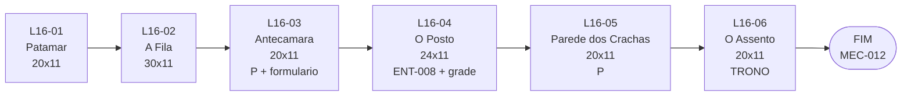
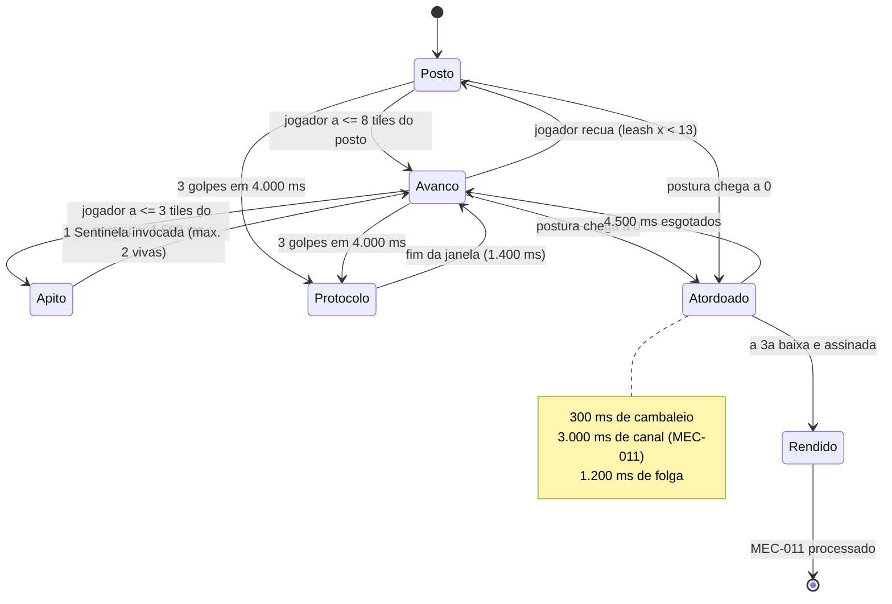

# LVL-16 — Trono do Caos

> Setor 16 de 16 · **`[PÓS]`** · **Ato IV — O Trono (fecho)** · **conclusão**
> Versão: `0.1.0` · Data: `2026-11-13` · Autor: `AGT-02` (Designer de Level) + `AGT-03` (Gameplay)
> Base: [GDD 3.4](../03-conteudo-do-jogo.md) · [Setores e Cenários §4.1, §4.4 e §4.90](../design-patterns/04-setores-e-cenarios.md) · [Ambientação e Mundo §3.4](../design-patterns/03-ambientacao-e-mundo.md) · [Áudio e Ambiencia §6](../design-patterns/06-audio-e-ambiencia.md) · [Padrões de Level Design §7.8 e §7.15](../design-patterns/07-padroes-de-level-design.md)

> ⚠️ **Escopo `[PÓS]` — leia antes de usar este documento.**
> Fora do recorte do MVP. É o **último setor do jogo** e o único que fecha o arco inteiro, mas nome e conteúdo **não são canônicos** (`D-04`). Não codar antes de `BKL-012`.

> 🟢 **O jogo termina onde começou.** `DEC-005` põe o Trono **acima das Ruínas da Vigília** e proíbe atalho até ele. A última sala tem uma **varanda** (`CEN-115`) de onde se vê o setor 01 lá embaixo — e não se pode descer. O fim é literalmente em cima do começo, e o jogo faz o jogador olhar.

> 🟢 **É o primeiro chefe do jogo que não pode ser morto.** Os cinco anteriores tinham vida; `ENT-008` **não tem**. Ele tem **postura**, e a luta se vence **assinando três baixas** num posto de guarda. Quem tentar matá-lo vai bater nele para sempre — e é essa a última lição do jogo (§5).

> 🟢 **E o Caos não aparece.** `LOR-03c` é *"não quer nada — é o atrito do mundo se desfazendo"*. Atrito não tem corpo, então ele não é um chefe: ele é **o chão** (`CEN-113`). E, como em LVL-08, **ele não tira vida — tira opção**.

---

## 1. Os 12 campos obrigatórios

| # | Campo | Definição |
|---|---|---|
| 1 | **ID e nome canônico** | `LVL-16` — Trono do Caos *(nome canônico do GDD §3.4)* |
| 2 | **Objetivo** | Atravessar o último andar, **dar baixa em `ENT-008` O Plantonista** e **assumir o posto** |
| 3 | **Duração e mortes** | 10–14 min *(inclui o fim)* · **2–4 mortes esperadas** |
| 4 | **Acento e materiais** | `PAL-16` vinho `#7B2E4A` · pedra nua, vinho, vazio |
| 5 | **Sinais de ambientação** | **o zumbido do vazio** · **40 crachás e um prego vazio** · uma fila com **senha 000** · a varanda que mostra as Ruínas da Vigília lá embaixo |
| 6 | **Habilidade de entrada / saída** | Entrada: nenhuma nova (`keys`, conclusão de `ENT-007`). Saída: **nenhuma — o jogo termina** |
| 7 | **Salas** | 6 salas: 20 · **30** · 20 · **24** · 20 · 20 (× 11) = **134 tiles** |
| 8 | **O que ensina** | nada novo — e ensina **o contrário** de tudo: que a última luta não se resolve com dano |
| 9 | **Set pieces** | `CEN-111` posto de guarda · `CEN-112` distribuidor de senha · `CEN-113` o desgaste · `CEN-114` trono partido · `CEN-115` varanda · `CEN-116` quadro de crachás |
| 10 | **Inimigos** | `ENT-002` Sentinela × 3 (1 · 2 · 0 · 0 · 0 · 0) + **`ENT-008` O Plantonista — chefe final** |
| 11 | **Entradas e saídas** | L16-01 ← **LVL-15** (Portão do Trono) · **L16-06 = fim do jogo** (não há porta leste) |
| 12 | **Teste de rastreabilidade** | `TST-018` · `TST-001` · `TST-006` · `TST-007` · `TST-014` |

### Propriedades de design deste setor

- **É o único chefe do jogo que não pode ser morto.** `ENT-008` tem `damageable=false`. O jogador bate nele e a barra que enche é de **postura**, não de vida. Isso inverte a leitura de 15 setores e é a razão de o setor existir (§5.5).
- **É o único chefe da primeira facção.** Os cinco anteriores são `LOR-03b` Distorcidos — seres que perderam o propósito e mantiveram a rotina. `ENT-008` é `LOR-03a` **Vigília**: ele não perdeu nada. Ele está de serviço, corretamente, e é o único que está.
- **O Caos não tem corpo, e isso é fidelidade ao `LOR-03c`.** Ele já apareceu como areia em LVL-08 (tirando velocidade) e agora aparece como **chão** (tirando piso). Nas duas vezes **não causou um único ponto de dano** — porque o Caos não quer nada. Regra que os dois setores estabelecem: **`LOR-03c` nunca tira vida; tira opção** (§5.6).
- **É o setor mais vazio do jogo em inimigos e o mais longo em experiência.** Três Sentinelas em 134 tiles, e o chefe. Depois de LVL-15 (corredores cheios de portas lacradas), o último andar é **despovoado**.
- **Zero plataformas pelo oitavo setor seguido.** O jogo termina no chão — não há um único pulo entre a porta e o trono.
- **É o único setor com duas trilhas em sequência e nenhuma nos corredores** (§8.1). `bgm=none` no mapa inteiro, `BGM-02` na arena, `BGM-04` no fim — e `BGM-04` não toca em nenhum outro lugar do jogo.
- **O último texto do jogo não é um quadro de aviso: é um crachá.** LVL-15 fechou o `LOR-04` com o terceiro e último quadro ("ASSINATURA: —"). O jogo não tinha mais o que afixar numa parede — tinha o que **preencher** (§7.4).

---

## 2. Fluxo



| Transição | Checkpoint |
|---|---|
| LVL-15 → L16-01 | salva ao cruzar a porta |
| L16-01 → L16-02 | salva ao cruzar a porta |
| L16-02 → L16-03 | salva ao cruzar a porta |
| **L16-03** | **`P` em (3,6)** — última sala segura antes da arena; **o formulário** (§5.5) |
| L16-03 → L16-04 | salva ao cruzar a porta; **a grade fecha** |
| **L16-04 (arena)** | **sem checkpoint** (`PAT-LD-05`) |
| L16-04 → L16-05 | salva ao cruzar a porta; **a grade abre na 3ª baixa** (`MEC-011`) |
| **L16-05** | **`P` em (3,6)** — respiro (`PAT-LD-04`); **`BGM-04` começa aqui** |
| L16-05 → L16-06 | salva ao cruzar a porta |
| **L16-06** | **`P` não existe** — não há para onde voltar em caso de morte, porque não há morte aqui |
| L16-06 → fim | **`MEC-012`** — sentar. Não há saída leste |

> **É o único setor do jogo sem atalho de retorno** (`PAT-LD-08`, §13 desvio 4). O padrão existe para baratear a revisita — e não há revisita depois do fim. A última porta que ainda dá para trás é a **porta de serviço de L15-06**, no setor anterior.

---

## 3. Legenda das grades

| Símbolo | Camada | Significado |
|---|---|---|
| `#` | `ground` + `collision` | sólido (pedra nua) |
| `+` | — | abertura de passagem lateral (`y=4–6`) |
| `G` | `objects` | **grade da arena** (`CEN-065`) — fecha na entrada, abre na 3ª baixa |
| `.` | — | ar |
| `E` | `objects` | Sentinela distorcida (`ENT-002`) |
| **`O`** | `objects` | **corpo de `ENT-008` O Plantonista** — 1 corpo, 3 tiles de altura com a lanterna |
| **`K`** | `objects` | **posto de guarda** (`CEN-111`) — cadeira, lanterna e apito; **o alvo de `MEC-011`** |
| `S` | `objects` | **distribuidor de senha** (`CEN-112`) — `interact`, mostra `SENHA ATUAL: 000` |
| `P` | `objects` | ponto de salvamento |
| `C` | `objects` | **quadro de crachás** (`CEN-116`) — 40 crachás, 41 pregos |
| `T` | `objects` | **trono partido** (`CEN-114`) — `interact`, `MEC-012` |
| `V` | `decor-back` | **varanda** (`CEN-115`) — sem colisão; mostra LVL-01 embaixo |
| `N` | `objects` | placa / inscrição |
| `w` | `decor-back` | parede de pedra nua |
| `c` | `decor-back` | **cadeira vazia** — sem colisão, seis na sala, nenhuma ocupada |
| `v` | `decor-front` | **luz de vinho** (`PAL-16`) — sem colisão, sem som |

Piso em `y=7` e aberturas em `y=4–6` seguem `DEC-007`.

> **`O` e `K` são adjacentes de propósito.** Ele está **em cima do posto**: o corpo de `ENT-008` (hurtbox 96 px = 1,5 tile) cobre `x=20–21,5`, e o posto está em `x=21`. Enquanto ele estiver de pé, **não existe posição** de onde o jogador consiga alcançar o posto. É a luta inteira em uma linha de grade.

---

## 4. Salas

### 4.1 L16-01 — Patamar · 20×11

```
    00000000001111111111
    01234567890123456789
y0  ####################
y1  #..................#
y2  #....w....v...w....#
y3  #..................#
y4  +..................+
y5  +..................+
y6  +..N......E........+
y7  ####################
y8  ####################
y9  ####################
y10 ####################
```

| Objeto | Pos | Função |
|---|---|---|
| `+` porta | (0,4)–(0,6) | vinda de **LVL-15** |
| `+` saída | (19,4)–(19,6) | para L16-02 |
| `E` Sentinela | (10,6) | patrulha de 5 tiles |
| `N` marco | (3,6) | **"PATAMAR. ACIMA SÓ SOBE QUEM VAI FICAR."** (8 palavras) |
| `w` paredes | (5,2) · (14,2) | pedra nua |
| `v` luz | (10,2) | `PAL-16`, sem colisão |

- **Função:** o patamar — o último degrau do jogo, e a primeira sala em que o vinho aparece. A luz vem de cima, não de uma vela: é o primeiro indício de que o andar inteiro é iluminado pelo que está no fim dele.
- **Por que a placa não é um aviso:** os avisos da Vigília acabaram em LVL-15 (`ASSINATURA: —`). O que sobra é **placa de orientação** — e ela é a única do jogo que fala do futuro do jogador em vez de uma tarefa de alguém.
- **Aceite:** atravessar em ≤ 15 s e ler a placa.

---

### 4.2 L16-02 — A Fila · 30×11

```
    000000000011111111112222222222
    012345678901234567890123456789
y0  ##############################
y1  #............................#
y2  #...c.c.c.c.c.c...v......w...#
y3  #............................#
y4  +............................+
y5  +............................+
y6  +..N....S....E.......E.......+
y7  ##############################
y8  ##############################
y9  ##############################
y10 ##############################
```

| Elemento | Posição | Função |
|---|---|---|
| `+` porta / saída | (0,4)–(0,6) · (29,4)–(29,6) | de L16-01 / para L16-03 |
| **`S` distribuidor** | (8,6) | `CEN-112`. `interact` → mostra **`SENHA ATUAL: 000`** |
| `c` cadeiras | (4,2) · (6,2) · (8,2) · (10,2) · (12,2) · (14,2) | seis desenhadas; a sala implica **quarenta** |
| `E` Sentinelas | (13,6) · (21,6) | patrulhas de 4 e 5 tiles |
| `N` marco | (3,6) | **"FILA DO POSTO. UMA CADEIRA POR VAGA. NENHUMA OCUPADA."** (9 palavras) |
| `w` parede | (25,2) | pedra nua |
| `v` luz | (18,2) | `PAL-16` |

- **Função:** a sala de espera do posto. Ela existe porque a instituição esperava **voluntários** — e a senha nunca foi retirada. `000` não é um bug de display: é o número de pessoas que se ofereceram em toda a história do lugar.
- **Por que `000` e não `001`:** `001` sugeriria que alguém veio e desistiu. `000` diz o que o resto do jogo diz — a Vigília não foi abandonada, ela **nunca foi procurada**.
- **Por que há inimigos numa sala de espera:** são os únicos três do setor, e eles estão esperando também. Nenhum deles é obstáculo de passagem: as patrulhas de 4 e 5 tiles deixam o corredor inteiro livre.
- **Aceite:** atravessar em ≤ 20 s, interagir com `S` e ver `000`.

---

### 4.3 L16-03 — Antecâmara · 20×11

```
    00000000001111111111
    01234567890123456789
y0  ####################
y1  #..................#
y2  #....w....v...w....#
y3  #..................#
y4  +..................+
y5  +..................+
y6  +..P....N..........+
y7  ####################
y8  ####################
y9  ####################
y10 ####################
```

| Elemento | Posição | Função |
|---|---|---|
| `+` porta / saída | (0,4)–(0,6) · (19,4)–(19,6) | de L16-02 / para L16-04 (arena) |
| **`P` save** | (3,6) | `UI-09`. **Última sala segura do jogo** |
| **`N` formulário** | (8,6) | `LOR-06`. **O texto que ensina `MEC-011`** — ver abaixo |
| `w` paredes | (5,2) · (14,2) | pedra nua |
| `v` luz | (10,2) | `PAL-16` |
| **Inimigos** | — | **zero** |
| **Trilha** | — | **`bgm=none`** — o zumbido de `AMB-16` é a única camada |

**O formulário (`N`), 5 linhas, ~19 palavras:**

> ```
> BAIXA DE POSTO
> 1. DESEQUILIBRE O OCUPANTE.
> 2. ASSINE.
> 3. SÃO NECESSÁRIAS TRÊS ASSINATURAS.
> NÃO É NECESSÁRIO MATAR.
> ```

- **Função:** o único tutorial do jogo que ensina a **não** fazer o que o jogo ensinou por 15 setores.
- **Por que ele é um formulário e não uma placa de dica:** `PAT-LD-03` exige 3 exposições antes da trava, e `PAT-LD-02` proíbe pular do "introduzir" para o "testar". Um formulário de RH é o veículo que o mundo já usa — o jogador leu escalas de turno (LVL-15), protocolos de entrega (LVL-15) e cartórios (LVL-15). Ele **já sabe ler esse tipo de papel**; o que ele não sabe é que esse papel é a instrução da luta.
- **Por que a última linha é a mais importante:** *"NÃO É NECESSÁRIO MATAR."* é a única frase do jogo que dá permissão para não matar alguém. O jogador que a lê e ignora vai passar 100 s batendo num homem invulnerável (§6.4).
- **Aceite:** salvar e ler o formulário. `PAT-LD-03` e `PAT-LD-04` verdes.

---

### 4.4 L16-04 — O Posto · 24×11 · **arena**

```
    000000000011111111112222
    012345678901234567890123
y0  ########################
y1  #......................#
y2  #....w.....v.....w.....#
y3  #......................#
y4  +......................G
y5  +......................G
y6  +...................OK.G
y7  ########################
y8  ########################
y9  ########################
y10 ########################
```

| Elemento | Posição | Função |
|---|---|---|
| **`O` chefe** | (20,6) | `ENT-008`. Hurtbox 96×176 px — cobre `x=20–21,5`, **em cima do posto** |
| **`K` posto** | (21,6) | `CEN-111`. **O alvo de `MEC-011`** — inalcançável enquanto ele estiver de pé |
| **`G` grade** | (23,4)–(23,6) | `CEN-065`. Fecha na entrada, **abre na 3ª baixa** |
| `+` porta | (0,4)–(0,6) | de L16-03 |
| `w` paredes | (5,2) · (17,2) | pedra nua |
| `v` luz | (11,2) | `PAL-16` |
| **`CEN-113` desgaste** | piso inteiro | `x=1`–`x=22`. **Não é desenhado na grade: é o piso** (§5.6) |
| **Cobertura** | — | **zero** |
| **Coletáveis** | — | **zero** durante a luta |
| **Trilha** | — | **`BGM-02`** — e é a única vez que ela toca depois de LVL-14 |

- **Função:** a arena, e ela tem **24×11** — a medida exata de `PAT-LD-07`, sem desvio de tamanho. O que muda não é o tamanho da sala: é o que a sala **é**.
- **Por que o posto fica encostado na parede leste:** o chefe não guarda a porta do trono — **guarda a cadeira em que ele mesmo está sentado há trinta e um anos**. A posição do posto no canto é a informação: não há nada atrás dele para proteger, e ele não sabe disso.
- **Por que a arena é a sala mais vazia do jogo:** sem cobertura, sem coletável e sem plataforma, a única coisa que o jogador pode fazer com o cenário é **não ficar parado** — e é exatamente isso que `CEN-113` cobra (§5.6).
- **Aceite:** `PAT-LD-07` verde **com as três exceções registradas** (§13, desvios 1–3); `TST-018` verde.

---

### 4.5 L16-05 — Parede dos Crachás · 20×11

```
    00000000001111111111
    01234567890123456789
y0  ####################
y1  #..................#
y2  #....w....v....w...#
y3  #..................#
y4  +..................+
y5  +..................+
y6  +..P...C....N......+
y7  ####################
y8  ####################
y9  ####################
y10 ####################
```

| Elemento | Posição | Função |
|---|---|---|
| `+` porta / saída | (0,4)–(0,6) · (19,4)–(19,6) | da grade quebrada de L16-04 / para L16-06 |
| **`C` quadro** | (7,6) | `CEN-116`. **40 crachás em 41 pregos** — o último vazio |
| **`P` save** | (3,6) | `UI-09`. Respiro (`PAT-LD-04`) |
| `N` marco | (12,6) | **"QUARENTA CRACHÁS. QUARENTA E UM PREGOS. O ÚLTIMO ESTÁ VAZIO."** (11 palavras) |
| `w` paredes | (5,2) · (15,2) | pedra nua |
| `v` luz | (10,2) | `PAL-16` |
| **Inimigos** | — | **zero** — o último respiro do jogo |
| **Trilha** | — | **`BGM-04` começa aqui** e vai até o fim |

- **Função:** o respiro pós-clímax — o único `PAT-LD-04` que o jogador atravessa **devagar**, porque a sala é a única do jogo que responde uma pergunta que ele fez no setor 01.
- **Por que 40 crachás:** cada crachá é um turno. O jogador passou 15 setores achando que a Vigília estava vazia há muito tempo; a parede diz que houve **quarenta pessoas** e que todas foram embora levando o próprio nome, e que o prego 41 já estava posto **antes** de alguém se candidatar. O posto não ficou vago por acidente: ele tem uma vaga aberta por projeto.
- **Por que `BGM-04` começa aqui e não na arena:** a trilha do Trono (75 s, `06-audio` §4) não é uma trilha de luta. Ela começa quando a luta acaba, e é longa o suficiente para atravessar 4 salas de caminhada e o fim — **ela não faz loop** (§8.1).
- **Aceite:** salvar. `PAT-LD-04` verde. O jogador deve sair sabendo que o prego 41 é dele.

---

### 4.6 L16-06 — O Assento · 20×11 · **fim do jogo**

```
    00000000001111111111
    01234567890123456789
y0  ####################
y1  #..................#
y2  #.....w..v...w...v.#
y3  #..................#
y4  +..................#
y5  +..................#
y6  +..N.......T....V..#
y7  ####################
y8  ####################
y9  ####################
y10 ####################
```

| Elemento | Posição | Função |
|---|---|---|
| **`T` trono** | (11,6) | `CEN-114`. `interact` → **`MEC-012`** |
| **`V` varanda** | (16,6) | `CEN-115`. `decor-back`, sem colisão — **mostra as Ruínas da Vigília (LVL-01) 300 m abaixo** |
| `+` porta | (0,4)–(0,6) | vem de L16-05 |
| **`+` leste** | — | **não existe.** A parede leste é sólida em `y=4–6` |
| `N` marco | (3,6) | **"O POSTO É VITALÍCIO."** (4 palavras) |
| `w` paredes | (6,2) · (13,2) | pedra nua |
| `v` luz | (9,2) · (17,2) | `PAL-16` |
| **Inimigos** | — | **zero** |
| **Saída** | — | **nenhuma** — `MEC-012` encerra o jogo |

- **Função:** a última sala, e é **o único ponto final do mapa**. As outras 89 salas sempre têm uma saída — porta lateral, alçapão `DEC-015`, vão ou queda; esta tem a **parede leste sólida em `y=4–6`**, o **teto sólido em `y=0`** (nenhum alçapão) e o piso contínuo. A única porta é a que traz o jogador, e ela fecha o ciclo: L16-06 não é um corredor com uma parede no fim, é uma **sala** — a primeira do jogo em que não há para onde ir.
- **Por que a varanda existe:** `DEC-005` decidiu que o Trono fica acima das Ruínas da Vigília e **sem atalho**. A varanda é o pagamento dessa decisão: o jogador vê o setor em que começou, entende o circuito em serpentina inteiro de uma vez — e não pode descer. Ver de onde se veio é diferente de voltar.
- **Por que o trono é partido:** `04-setores` §4.4 fixou "trono partido, vinho, vazio" desde o primeiro dia. Um trono partido não é um símbolo de poder: é **mobília danificada que ninguém trocou**. E é o que faz a última fala do jogo funcionar (§7.3).
- **Aceite:** `MEC-012` processa **uma única vez**, idempotente; o save final grava `completed=true`; a tela de créditos abre com pausa disponível.

---

## 5. A luta — especificação de combate

### 5.1 Ficha do chefe (`ENT-008`)

| Atributo | Valor | Observação |
|---|---:|---|
| Nome de trabalho | **O Plantonista** | `[PÓS]`, não canônico |
| Facção | **`LOR-03a` A Vigília** | **o único chefe da primeira facção** |
| **Vida** | **nenhuma** | `damageable=false` — **o único chefe invulnerável do jogo** |
| **Postura** | **100 · 125 · 150** | uma por baixa; golpe = **25** (§5.5) |
| Sprite | **128 × 192 px** (2×3 tiles) | `AST-022` (proposto — `P-71`) |
| Hurtbox | **96 × 176 px** | inclui a **lanterna na vara** (1 tile acima da cabeça) |
| Corpo | homem alto, casaco de guarda remendado, **lanterna numa vara**, apito no peito | não carrega arma: carrega **o equipamento do posto** |
| Dano | **18** (ronda) · **22** (contra-ataque) | antes do multiplicador |
| Movimento | **110 px/s**, e **nunca a oeste de `x=13`** | ele guarda o posto, não a porta |
| Postura — decaimento | **15/s após 2.000 ms** sem golpe | impede acumular postura de longe |
| Atordoamento | **4.500 ms** | `300` cambaleio + `3.000` canal + `1.200` folga (§5.5) |
| Imunidade pós-atordoamento | **6.000 ms** | impede stun-lock |
| Contra-ataque | **3 golpes em 4.000 ms** → `Protocolo` | §5.3 |
| Voz | **individual, uma vez por estado** | 3 falas, nenhuma em combate |

> **`DEC-017` registra a decisão:** o chefe final não tem vida, tem postura, e a luta se vence por baixa. A ratificação do proprietário é `P-72`.
>
> **Ele não tem vida, e isso não é uma piada de design.** Uma instituição não se mata; ela se **dá baixa**. O chefe final de um jogo sobre turnos e protocolos é um **formulário preenchido**, e a barra que o HUD mostra não é vida: é postura (`UI-20`). A regra de `PAT-LD-07` que fala de "0 HP processado" simplesmente não se aplica a ele (§13, desvio 2).

### 5.2 Máquina de estados



> **`Atordoado` não é uma fase 2: é a única janela do jogo que o jogador abre sozinho.** Nos cinco chefes anteriores, a janela vinha do chefe (transição de vida, eclipse, revivificação). Aqui ela vem de **três golpes a mais do que ele aguenta** — e é o jogador que decide quando ela acontece.

### 5.3 Ataques

| ID | Ataque | Quando | Telegraph | Execução | Recuperação | Dano | Resposta correta |
|---|---|---|---:|---|---|---:|---|
| `ATK-19` | **Ronda** | em `Avanço` | 600 ms (ergue a lanterna) | **caminha 3 tiles** a 110 px/s com a lanterna acesa; zona perigosa de **2 tiles (128 px)** em volta | 900 ms | 18 | **sair da zona** — ele não persegue rápido |
| `ATK-20` | **Apito** | jogador **≤ 3 tiles do posto por 1.500 ms** | 1.200 ms | invoca **1 `ENT-002`** do piso em `x=16`; **máx. 2 vivas** | 800 ms | 0 *(a Sentinela bate)* | matar a Sentinela ou sair da zona |
| `ATK-21` | **Protocolo** | **3 golpes em 4.000 ms** | 400 ms (levanta a lanterna na horizontal) | **janela de contra-ataque de 1.400 ms**: golpe recebido → **22 de dano** e **postura intacta** | — | 22 | **parar de bater** |

**`ATK-19` — a ronda não é um golpe, é um corpo que se move.** Ele não dá arco, não avança, não tem hurtbox de ataque: o perigo é **a lanterna dele**, num raio de 2 tiles. Isso significa que o jogador nunca é punido por estar no lugar errado no instante errado — ele é punido por estar **perto de um homem que está andando**, o que é sempre legível, e é a única coisa que o homem ainda sabe fazer.

**`ATK-20` — o apito é a única ação reativa dele.** Ele só apita quando o jogador **já está perto do posto**, ou seja: ele chama reforço quando está perdendo. E o reforço é uma Sentinela — a coisa mais comum do jogo, o primeiro inimigo que o jogador viu em LVL-01. **O último chefe chama o primeiro capanga**, e a instituição responde com o que tem, que é um guarda de pedra fora de turno. Máximo de **2 vivas** para não virar enxame.

**`ATK-21` — o protocolo existe para impedir o botão.** Sem ele, 15 golpes em sequência resolveriam o chefe e a luta não teria leitura. Com ele, o jogador é obrigado a bater **em rajadas de três** e a esperar a janela fechar — o que dá ao chefe o seu único contra-ataque e transforma "bater" em "bater no tempo certo". É a diferença entre um saco de pancada e um guarda.

> ⚠️ **`ATK-21` não é um parry de habilidade.** A janela é de 1.400 ms (mais que o dobro de qualquer telegraphe do jogo) e o contra-ataque só acontece se o jogador **acertar durante ela**. Quem para de bater nunca toma dano. Um chefe final não pode punir reflexo: ele pune **pressa**.

### 5.4 Entrada dramática (`VIS-007`)

| Elemento | Especificação |
|---|---|
| Gatilho | jogador cruza `x ≥ 4` na arena |
| Grade | `G` em `x=23` **fecha** (600 ms) |
| Hold | 400 ms, congelado |
| Nome na tela | `O PLANTONISTA`, display, centralizado, 900 ms |
| **Fala única** | ***"Posto ocupado. Aguarde."*** (1,4 s) |
| HUD | **`BAIXAS 0/3`** + barra de **postura** (não de vida), `role="progressbar"`, `aria-label` "postura do ocupante" |
| Música | **`BGM-02`** — a única trilha de chefe que toca depois de LVL-14, e ela **para** na rendição (§8.2) |
| Redução de movimento | mantém hold e textos; **desliga** as partículas de vinho e o tremor do chão |

> **"Posto ocupado. Aguarde." é a primeira coisa que o jogo diz ao jogador depois de 15 setores, e é a mesma frase que a fila de L16-02 diria.** É também a única fala de chefe do jogo que **não ameaça**: ele não diz "você vai morrer", ele pede que o jogador espere a vez. O jogador responde com uma arma.

### 5.5 A postura e a baixa (`MEC-011`)

**A regra, em quatro linhas:**

| # | O que acontece | Números |
|---|---|---|
| 1 | O jogador bate. **Não há dano** — há **25 de postura** por golpe. | golpe = 25 |
| 2 | Postura chega a 0 → **`Atordoado`** | **4.500 ms** |
| 3 | No atordoamento ele cambaleia **2 tiles** para leste e **larga a lanterna** | 300 ms |
| 4 | O jogador **segura `interact` no posto por 3.000 ms** → **1 baixa assinada** | 3.000 ms |

> **`4.500 = 300 + 3.000 + 1.200`.** A luta inteira é essa conta. O cambaleio tira o homem de cima do posto; o canal é o tempo de assinar; a folga é quanto o jogador pode demorar para **começar** a assinar depois do cambaleio. Se ele chegar ao posto 2 s depois, ele perde a baixa — e não perde vida, perde **tempo**, que é o recurso que `CEN-113` também cobra.

**As três baixas:**

| Baixa | Postura | Golpes (25) | Rajadas (3 golpes) | O que muda nele |
|---|---:|---:|---:|---|
| 1ª | **100** | 4 | 2 | nada. Ele nem percebe que perdeu |
| 2ª | **125** | 5 | 2 | anda **8% mais rápido** (119 px/s) e apita **300 ms** antes |
| 3ª | **150** | 6 | 2 | anuncia o `Protocolo` **200 ms** antes |
| **Total** | — | **15 golpes** | 6 rajadas | — |

> **Cada baixa assinada deixa o homem pior, e é o jogador que causa.** Ele não enfurece, não muda de cor, não ganha fase: ele **acelera o que já fazia**, porque está com menos tempo de turno pela frente. É o único chefe do jogo cuja dificuldade é um efeito colateral do progresso do jogador — e é a razão de a terceira baixa ser a mais difícil (§6.4).

**Por que três e não uma:** uma baixa transformaria a luta num único quebra-postura e ela terminaria em ~15 s — mais curta que o chefe de LVL-03. Três baixas fazem a luta durar **58 s** e, mais importante, fazem o jogador **repetir o que aprendeu**. E é o terceiro carimbo do jogo (§7.1).

### 5.6 O desgaste — o Caos sem corpo (`CEN-113`)

`LOR-03c` não quer nada. Ele não ataca, não persegue, não tem barra e **não tira um único ponto de vida**. Ele faz o que fez em LVL-08: **tira opção**.

| Elemento | Especificação |
|---|---|
| Gatilho | o jogador **para** sobre um tile do piso da arena |
| Rachadura (telegraph) | após **1.400 ms** parado; a rachadura é visível e **sonora** (estalo seco) |
| Buraco | após **2.000 ms** parado; o tile cai (**1 tile**, 64 px) |
| Duração do buraco | 1ª/2ª baixa: **6.000 ms** · 3ª baixa: **permanente** |
| Teto de buracos | **8 simultâneos** (10 na 3ª baixa) |
| **Regra de segurança** | **nunca 3 buracos contíguos** — o gerador proíbe abrir um tile que criaria uma sequência de 3 |
| Queda no buraco | `DEC-011`: **sem dano**, volta para a entrada da arena (300 ms de fade) e **cancela o canal** |
| Dano | **0** — sempre, em qualquer dificuldade |

- **Por que o chão nunca fecha um caminho:** 3 tiles contíguos = 192 px, e o salto andando cobre 224 px. Com o teto de 2 contíguos (128 px), **o piso nunca deixa de ser atravessável** — o buraco não é uma armadilha, é a **conta de quem parou**. O caos não mata o jogador; ele cobra o tempo de quem ficou olhando.
- **Por que ele não pode encostar no posto:** se o jogador pudesse plantar-se ao lado do posto esperando o atordoamento, a luta viraria um relógio. O desgaste é a única razão de o jogador estar sempre em movimento — **e é a facção inteira, sem um corpo**.
- **Regra consolidada com LVL-08:** em 16 setores, `LOR-03c` nunca causou dano. Em LVL-08 ele tirou **velocidade** (areia); aqui ele tira **piso**. Anotado como **`DEC-018`** (regra dos 16 setores) e em §4.20 de `04-setores`.

### 5.7 A rendição — o fim da luta

| Elemento | Especificação |
|---|---|
| Gatilho | **3ª baixa assinada** |
| Estado | **`Rendido`** — ele **apaga a lanterna**, senta no chão ao lado do posto e **não é mais uma entidade** |
| Fala | ***"Demorou."*** (1,0 s) |
| Hold | 600 ms; sem câmera lenta (o jogo não desacelera o fim) |
| Grade | `G` **abre** (`VFX-007`) |
| Recompensa | **nenhuma.** Não há `keys`, não há item, não há XP — a recompensa é a porta |
| Música | `BGM-02` **para** (fade de 1,5 s); silêncio até L16-05 |
| Registro | `game:boss { id: 'ENT-008', scope: 'post', baixas: 3, killed: false }` |

> **"Demorou." é a última fala de inimigo do jogo, e ela tem uma palavra.** Ele não agradece, não explica, não pede desculpa: ele **reclama do tempo que levou** — e é a primeira vez em 16 setores que alguém fala com o jogador como se ele fosse uma pessoa que chegou, e não um intruso que apareceu. A instituição não tem mais nada a dizer depois disso, e o jogo também não.

---

## 6. Validação da luta

### 6.1 Golpes necessários

| Arma | "Dano" | Postura por golpe | Golpes para as 3 baixas |
|---|---:|---:|---:|
| Branca | **0** | 25 | **15** |
| À distância | **0** | 0 *(não existe dano à distância no jogo)* | — |

> **Pela primeira vez em seis chefes, a coluna "dano" não decide nada.** A vida do jogador é o único número que importa, e o número do chefe é o **tempo** que ele aguenta em pé — 15 golpes é a única medida de progresso da luta.

### 6.2 Sobrevivência do jogador

Vida efetiva = 100 HP + 50 de escudo = **150**.

| Dificuldade | Mult. | `ATK-19` Ronda | Erros | `ATK-21` Protocolo | Erros | Sentinela | **Margem efetiva** |
|---|---:|---:|---:|---:|---:|---:|---:|
| Fácil | 0,75× | 13 HP | 11 | 16 HP | 9 | 7 | **11** |
| Médio | 1,00× | **18 HP** | **8** | **22 HP** | **6** | **10** | **8** |
| Difícil | 1,25× | 22 HP | 6 | 27 HP | 5 | 12 | **6** |

> **A margem é a maior do jogo (8) e a luta é a mais longa.** Não é generosidade: é que a fonte de dano é **uma só** (o corpo dele) e o contra-ataque é **evitável sem reflexo**. Todo o dano desta luta é opcional — quem para de bater no `Protocolo` e sai da zona da lanterna chega ao fim com a vida cheia. **O chefe final do jogo não pune erro; pune pressa**, e por isso ele pode ser o mais longo sem ser o mais mortal.

### 6.3 Ciclo e janelas

| Estado | Telegraph | Execução | Recuperação | Ciclo |
|---|---:|---|---:|---:|
| `Avanço` / `ATK-19` | 600 ms | 3 tiles a 110 px/s = **1.745 ms** | 900 ms | **3,25 s** |
| `Protocolo` / `ATK-21` | 400 ms | janela de **1.400 ms** | — | **1,80 s** |
| `Apito` / `ATK-20` | 1.200 ms | invocação imediata | 800 ms | **2,00 s** |
| **`Atordoado`** | — | 300 ms cambaleio | **3.000 ms canal + 1.200 ms folga** | **4,50 s** |

### 6.4 Tempo até a baixa (TTB)

| Cenário | TTB |
|---|---:|
| **Perfeito** (6 rajadas de 3, 3 canais de primeira) | **~46 s** |
| **Típico** (1 baixa perdida, 2 leituras erradas) | **~58 s** |
| **Errado** (bate no `Protocolo`, perde 2 canais) | **~100 s** |

> **É a maior amplitude de TTB do jogo e a menor punição por erro.** O jogador que não entendeu o formulário de L16-03 leva 100 s batendo num homem que não perde vida; o que entendeu leva 46 s. **A diferença entre os dois não é habilidade, é leitura** — e é a mesma medida que LVL-15 usou com os dois carimbos.
>
> **Progressão final:** 28 s (LVL-03) → 30 s (LVL-08) → 33 s (LVL-12) → 39 s (LVL-14) → 48 s (LVL-15) → **58 s (LVL-16)**. O tempo até o fim **dobra** em seis chefes, e a vida do chefe cresce 200 → 240 → 260 → 320 → 360 → **0**. O último chefe do jogo é o único com **zero** de vida, e o mais longo de todos.

### 6.5 Geometria — por que o leash é de 8 tiles

| Leash | Consequência |
|---|---|
| **0** (parado no posto) | não há luta: o jogador nunca alcança o posto e a arena fica decorativa |
| **4 tiles** | a zona da lanterna (2 tiles) cobre metade da área de luta; não há onde circular |
| **8 tiles** | **512 px**: cabe a zona da lanterna (2), a esquiva (3) e a entrada (3). É a menor área em que o jogador consegue dar a volta nele |
| **13 tiles** (a arena toda) | ele abandona o posto por 12 tiles e o jogador assina **sem lutar** — a luta deixa de existir |

> **Os 8 tiles são o número que faz a luta existir**, do mesmo jeito que os 10 tiles de separação de LVL-15 e os 5 tiles de arco de LVL-12. E há um detalhe que fecha: **8 tiles = 512 px**, o mesmo alcance do gancho (`HAB-04`). Não é coincidência de projeto — é a distância em que o jogador já sabe medir o próprio corpo desde LVL-09.
>
> **O leash também é o que impede a cheesabilidade.** Ele nunca vai a oeste de `x=13`; o jogador entra em `x=1`. Os **12 tiles de entrada são seguros** e os **8 do fim são a luta** — a arena tem duas metades e o jogador atravessa a primeira sozinho, como atravessou os 15 setores.

---

## 7. O fim

### 7.1 A sobra — o que a terceira chave faz (`P-65`)

`DEC-016` fez da chave de chefe um **contador** (`keys`), com portão em **`keys ≥ 2`**. O jogador que venceu `ENT-007` em LVL-15 chega ao Trono com **3 chaves** e **2 fechaduras no jogo inteiro** — a de LVL-14, já aberta.

| `keys` | O que muda | Onde |
|---:|---|---|
| 0 | nada abre | — |
| 1 | o Portão Fortificado **não** abre | LVL-14 |
| 2 | o Portão Fortificado **abre** | LVL-14 |
| **3** | **nada muda.** `ITM-011` fica na bolsa e o HUD continua **`2/2`** | LVL-16 |

- **A decisão: a sobra não faz nada, e isso é a regra — não um esquecimento.** O Trono **não tem fechadura**: não há buraco de chave em `CEN-114`, não há corrente, não há guarda na porta. A única porta do Ato IV que precisou de chave foi a de LVL-14, e ela é a **antepenúltima** do jogo. Depois dela, o jogo abre tudo com corpo, protocolo e paciência.
- **Por que a sobra existe:** porque a recompensa de uma luta **opcional** não pode ser progressão. Se `ITM-011` abrisse qualquer coisa, a luta de LVL-12 deixaria de ser opcional (`P-61`, `PAT-LD-06`). A terceira chave é a **prova** de que o jogador fez mais do que o jogo exigia — e o jogo não a consome, não a mostra no HUD e não a menciona uma única vez. Ela é uma medalha que ninguém vê.
- **Por que a UI não tem terceiro slot:** `DEC-016` já decidiu. Um slot extra transformaria a sobra em **promessa**, e a promessa teria de ser cumprida em algum setor — que é exatamente o soft lock que `P-61` evitou.
- **O que o jogador sente:** ele entra na última sala do jogo carregando a chave de um chefe que não precisava morrer, para abrir uma porta que não tem fechadura. **E é o único item do inventário dele que não serviu para nada** — num jogo em que todo objeto tinha função, o último é inútil de propósito.

> 🟢 **`P-65` fica resolvida na metade de design**: a terceira chave não faz nada e o Trono não tem fechadura. O que continua pendente é só a **ratificação de `DEC-016`** pelo proprietário.

### 7.2 `MEC-012` — o turno começa

| Elemento | Especificação |
|---|---|
| Gatilho | `interact` no trono (`CEN-114`, `x=11`) |
| Ação | sentar — **sem quick-time, sem canal, sem risco.** Uma tecla |
| Processamento | **uma única vez**, idempotente (`PAT-C-07`); `game:end { completed: true }` |
| Música | `BGM-04` **faz fade out em 6 s** e **não volta** |
| Ambiência | `AMB-16` **para** no mesmo instante (§8.3) |
| Texto (1 linha) | ***"O assento é duro."*** (1,6 s) — a última fala do jogo |
| Tela final | **o crachá** (§7.4), 3 s, e os créditos |
| Save final | `completed=true`, `slot` intacto, **sem `newGamePlus`** (`P-73`) |
| Acessibilidade | `reduce_motion` desliga o fade de vinho; os créditos têm **pausa** e **velocidade 1×/2×** |

> **O último ato do jogo é uma tecla, e ela não pode falhar.** Depois de 58 s de luta com 15 golpes e 3 assinaturas, o jogador senta sem minigame e sem risco de morte: `MEC-012` **não tem estado de falha**. A única coisa que o jogo pede nesse instante é que ele aperte o botão e cumpra a frase que estava afixada no quarto de turno de LVL-15 desde o começo — *"o posto permanece aberto até preenchimento"*.

### 7.3 O último som

O jogo termina em **silêncio funcional**, e ele é construído em três cortes:

| Ordem | Som | O que acontece |
|---|---|---|
| 1 | `BGM-02` | **para** na rendição (`§5.7`), fade de 1,5 s |
| 2 | `AMB-16` zumbido | **continua** por L16-05 e L16-06 — é o som da vaga |
| 3 | **`MEC-012`** | o zumbido **para de uma vez** (não faz fade: a vaga foi preenchida) |
| 4 | **o trono range** | **sob o jogador.** É o último som do jogo |

> **`AMB-16` é o som da vaga, e ele desliga quando a vaga é preenchida.** O "trono rangendo" de `06-audio` §6.2 toca **antes** do fim como um ranger sem peso — a madeira se acomodando sob ninguém —, e depois do `MEC-012` ele passa a ranger **sob o jogador**. É o mesmo asset, com o mesmo loop, e o significado se inverte: o primeiro é um lugar vazio fazendo barulho, o segundo é **uma pessoa sentada**. O último som do jogo é uma cadeira reclamando de um corpo.

### 7.4 O crachá (`LOR-05`)

`LOR-04` fechou em LVL-15 com o terceiro e último quadro de aviso (`ASSINATURA: —`). O jogo não tinha mais o que **afixar** — tinha o que **preencher**. A tela final não é um quadro:

> ```
> POSTO: PREENCHIDO
> Nº: 041
> ASSINATURA: VOCÊ
> ```

- **Por que um crachá e não um quadro:** o prego 41 de L16-05 já estava vazio quando o jogador chegou (§4.5). O crachá é o objeto que faltava nele, e o jogo entrega o número em vez do nome — porque **o nome do jogador nunca existiu** em 16 setores (`LOR-04`: *"não consta o nome"*, LVL-13; *"ASSINATURA: —"*, LVL-15).
- **Por que `VOCÊ` e não o nome do herói:** o herói não tem nome canônico. O crachá assina com o único nome que o jogo pode garantir — o de quem está lendo. É o único momento do jogo em que o texto se dirige ao jogador em vez de ao personagem, e ele custa três linhas.
- **Por que `041`:** quarenta crachás, quarenta e um pregos (§4.5). O jogador é o quadragésimo primeiro e o primeiro em trinta e um anos.

---

## 8. Áudio

### 8.1 Três camadas, e no corredor nenhuma

| Sala | Trilha | Ambiência | O que o jogador ouve |
|---|---|---|---|
| L16-01 → L16-03 | **`bgm=none`** | `AMB-16` zumbido | **o vazio**, e os próprios passos |
| **L16-04** (arena) | **`BGM-02`** | `AMB-16` em **−20%** (*ducking*, `06-audio` §6.3) | a trilha de chefe por baixo do zumbido |
| **L16-05 → L16-06** | **`BGM-04`** | `AMB-16` de volta a 100% | a trilha do Trono, **75 s, sem loop** |
| **`MEC-012`** | silêncio | **zumbido para** | **o trono rangendo** |

> **`bgm=none` nos corredores é o precedente de LVL-07, usado de propósito.** O último andar não tem trilha porque a trilha é do posto, não do lugar: enquanto não há ninguém sentado, o único som do andar é o **zumbido do vazio** — o som de uma vaga aberta.

### 8.2 Duas trilhas em sequência — e a resposta a LVL-15

`06-audio` §4 dá a LVL-16 **duas** faixas: `BGM-02` (chefe) e `BGM-04` (Trono, 75 s). É o único setor do jogo com duas, e as duas tocam **uma vez cada**, na ordem, sem repetir.

| Setor | Chefe | Trilha da luta | Por quê |
|---|---|---|---|
| LVL-14 | `ENT-006` | `BGM-02` | é um clímax |
| **LVL-15** | `ENT-007` | **`BGM-03`** | **não é um clímax: é um expediente** |
| **LVL-16** | `ENT-008` | **`BGM-02`** | **é o único clímax que restou** |

> **LVL-15 recusou `BGM-02` para que LVL-16 pudesse usá-la.** O guardião duplo tocou trilha de quarto seguro porque era um procedimento; o Plantonista toca trilha de chefe porque é o fim. Se a luta dos dois carimbos tivesse usado `BGM-02`, a última faixa de combate do jogo chegaria gasta — e `BGM-04` não teria de onde sair.

### 8.3 `AMB-16` — o zumbido que desliga

| Propriedade | Especificação |
|---|---|
| Loop | **zumbido de vazio** (ruído sub-baixa, sem melodia), volume constante |
| Elemento pontual | **trono rangendo** — a cada 12–20 s, aleatório; **só antes de `MEC-012`** |
| **SFX de gameplay** | **estalo da rachadura** (`CEN-113`, 1 por tile) — é o único som de jogo da arena além do chefe, e é ele que avisa que o chão vai ceder sem tirar os olhos do Plantonista |
| Ducking | **−20%** durante `BGM-02` (`06-audio` §6.3) |
| Fim | **para de uma vez** em `MEC-012` — sem fade |
| Depois do fim | só o ranger do trono **sob o jogador**, e depois os créditos em silêncio |
| `reduce_motion` | não muda nada: áudio não é movimento |

> **É o único elemento de áudio do jogo que é desligado por uma ação do jogador e não volta.** Nenhuma recompensa em 16 setores é sonora — esta é: o prêmio por assumir o posto é **o silêncio da vaga fechada**.

---

## 9. Validação de alcançabilidade

| Obstáculo | Sala | Valor | Necessário | Veredito |
|---|---|---|---|---|
| plataforma / vão / alçapão / corrente | — | **0 no setor** | — | nada a validar |
| **travessia da arena** | L16-04 | 21 tiles = **1.344 px** | 4,36 s a 308 px/s | atravessável sempre ✓ |
| **zona da lanterna** (`ATK-19`) | L16-04 | raio de **2 tiles** (128 px) | esquiva lateral de 3 tiles | desviável ✓ |
| **buraco do desgaste** | L16-04 | **máx. 2 contíguos** = 128 px | salto andando = 224 px | **nunca fecha caminho** ✓ |
| **canal de 3.000 ms** | L16-04 | 3.000 ms dentro de 4.500 | folga de **1.200 ms** | sempre completável ✓ |
| **queda no buraco** | L16-04 | `DEC-011` | `damage=0`, volta à entrada | não mata ✓ |

**Resultado: 0 falhas.** Quinto setor seguido com a tabela de geometria vazia — e o último. O jogo não pede travessia desde LVL-13; no fim, ele pede **uma tecla**.

---

## 10. Salvamento e morte

| Evento | O que acontece | Regra |
|---|---|---|
| Cruza qualquer porta | salva | `MEC-007` |
| Interagir com `P` | salva | `MEC-007` |
| **Entra na arena** | **não salva**; a grade fecha | `PAT-LD-05`, `PAT-LD-07` |
| **Morre para `ENT-008`** | respawn no `P` de **L16-03**; **postura reseta** — as **baixas assinadas permanecem** | §10.1 |
| Morre na arena **3×** | oferta de dificuldade | `MEC-008` |
| **Assina a 1ª/2ª baixa** | **não salva** — o progresso da luta é de sessão | `PAT-LD-05` |
| **Assina a 3ª baixa** | **salva** ao cruzar a porta de L16-05 | `MEC-007` |
| **Senta no trono** | `completed=true`, save final, **sem retorno ao mapa** | `MEC-012` |

### 10.1 As baixas não se desassinam

| Chefe | O que a morte do jogador reseta |
|---|---|
| LVL-15 `ENT-007` | **tudo** — a revivificação recomeça do zero | 
| **LVL-16 `ENT-008`** | **a postura, não as baixas** — um formulário assinado não se desassina |

> **É o oposto de LVL-15, e de propósito.** Lá, a revivificação infinita só podia ser punida zerando, senão a segunda tentativa começava meio vencida e o chefe deixava de ser prova. Aqui é o contrário: o chefe **não tem vida**, então a única coisa que o jogador acumula é **assinatura** — e tirar dela o que ele já assinou faria a luta mais longa do jogo ser também a mais punitiva. **A morte custa o caminho de volta, não o trabalho.** Em três mortes, o jogador assina as três baixas — está registrado em `P-72`.

---

## 11. Conversão para Tiled (`.tmj`)

| Item | Definição |
|---|---|
| Nome do arquivo | `public/assets/tilemaps/tm_lvl16_trono.tmj` |
| Tileset | `tm_trono` (`AST-023` — **ID proposto**, `P-71`), ~26 tiles, 64×64 |
| Orientação | orthogonal, tile 64×64, 20–30 colunas × 11 linhas |
| Camadas (ordem) | `decor-back` · `ground` · `collision` · `objects` · `decor-front` (vinho, desgaste) |
| Propriedades do mapa | `lvl_id=LVL-16`, `pal=PAL-16`, **`bgm=none`**, `amb=AMB-16`, `scope=post`, `boss_arena=L16-04`, `terminal=true` |

### Propriedades dos objetos (`objects`)

| Tipo | Propriedades |
|---|---|
| `enemy` | `ent=ENT-002`, `patrol_tiles`=4–5, `initial_facing`=`right`, `has_telegraph`=true |
| `boss` | `ent=ENT-008`, **`damageable`=false**, `poise`=100/125/150, `baixas`=3, `gate`=`arena`, `optional`=false, `leash_x`=13, `stagger_ms`=4500, `channel_ms`=3000 |
| `arena_gate` | `cen=CEN-065`, `side`=`east`, `closes_on`=`enter`, **`opens_on`=`MEC-011.baixa_3`** |
| `guard_post` | `cen=CEN-111`, `trigger`=`hold_interact`, `hold_ms`=3000, `max`=3 |
| `desgaste` | `cen=CEN-113`, `damage`=0, `crack_ms`=1400, `hole_ms`=2000, `max_holes`=8/10, **`max_adjacent`=2** |
| `ticket_dispenser` | `cen=CEN-112`, `trigger`=`interact`, `display`=`000` |
| `badge_wall` | `cen=CEN-116`, `badges`=40, `hooks`=41 |
| `save_point` | `ui=UI-09`, `checkpoint`=true (L16-03, L16-05) |
| `throne` | `cen=CEN-114`, `trigger`=`interact`, `mec`=`MEC-012`, `once`=true |
| `door` | `to=LVL-15` (L16-01, `style=throne`) · **nenhuma porta de saída em L16-06** |
| `lore_marker` | `key`=`lore.lvl16.patamar` / `.fila` / `.formulario` / `.crachas` / `.assento`, `max_words`=25 |
| `decor` | `ast=CEN-115` (back, sem colisão) / `w` (back) / `c` (back) / `v` (front, **`sfx`=none**) |

> **`opens_on=MEC-011.baixa_3`** é a propriedade que substitui `breaks_on=MEC-009` dos outros cinco chefes. `AGT-07` deve ter um teste que **reprove** qualquer `.tmj` de arena em que a grade abra por morte (`TST-018`).

**Regra de ouro:** nenhum número de gameplay no `.tmj`. Postura, baixas, canal, desgaste e dano vêm de `tuning.ts` (`PAT-C-04`).

---

## 12. Checklist de aprovação (`07-padroes` §7.14)

- [x] Dimensões múltiplas de 20×11 — 20, **30**, 20, **24**, 20, 20 × 11
- [x] Objetivo de cada sala compreensível em ≤ 3 s
- [x] Respeita a tabela de alcance (§9) — **0 falhas**
- [x] `PAT-LD-07` — arena **24×11**; **três exceções registradas** (§13, desvios 1–3): sem vida, saída por baixa, piso destrutível
- [x] `PAT-LD-04` — L16-03 (antes) e L16-05 (depois) sem inimigo
- [x] `PAT-LD-05` — **arena sem checkpoint**; `P` em L16-03 e L16-05
- [x] `PAT-LD-03` — `MEC-011` tem **3 exposições**: o formulário (L16-03), o HUD `BAIXAS 0/3` + postura, e o `Protocolo` que ensina que bater não resolve
- [x] `PAT-LD-02` — os 4 tempos de `MEC-011`: **introduzir** (o formulário), **praticar** (1ª baixa), **combinar** (2ª baixa + `Protocolo` + desgaste), **testar** (3ª baixa)
- [x] `PAT-LD-10` — máx. 2 inimigos por sala; 3 no setor; **invocações do apito limitadas a 2**
- [x] `collision` alinhada ao `ground` (validado pelo gerador de grade)
- [x] Paleta com um único acento (`PAL-16` vinho) — **e o acento não carrega informação** (§13, desvio 7)
- [x] **`BGM-02` na luta, `BGM-04` no fim, `bgm=none` nos corredores** (§8)
- [x] **O zumbido de `AMB-16` para em `MEC-012`** (§8.3)
- [x] **`LOR-05` (crachá) com 3 linhas** e `LOR-06` (formulário) com 5 linhas / ~19 palavras — dentro do orçamento de 90
- [x] `MEC-012` é **idempotente e sem estado de falha** (§7.2)
- [x] Testes associados: `TST-018`, `TST-001`, `TST-006`, `TST-007`, `TST-014`
- [ ] **Aprovação de escopo:** `[PÓS]` (`D-04`) — não marcado de propósito
- [ ] **Ficha de `ENT-008`** (`AST-022`, `AST-023`, `UI-20`, `VFX-011`): pendente (`P-71`)
- [ ] **Ratificação de `PAT-LD-07` para o chefe final:** pendente (`P-72`)
- [ ] **O fim é terminal?** Sem `newGamePlus`, sem capítulos: pendente (`P-73`)

---

## 13. Desvios registrados

| # | O que mudou | Por quê | IDs afetados |
|---|---|---|---|
| 1 | **O chefe final não tem vida: tem postura** (`damageable=false`) | Uma instituição não se mata, se dá baixa. É o único jeito de o sexto chefe não ser o primeiro de novo (§5.5) | `PAT-LD-07`, `ENT-008`, `UI-20` |
| 2 | **A saída da arena não abre com 0 HP — abre com a 3ª baixa** | `PAT-LD-07` fala de `MEC-009`; aqui a condição de vitória é `MEC-011`. O chefe não tem HP a processar (§5.7) | `PAT-LD-07`, `MEC-011` |
| 3 | **O piso da arena é destrutível** (`CEN-113`) | O Caos não tem corpo (`LOR-03c`), e o único jeito de ele existir na luta é pelo chão. Regra de segurança: **nunca 3 buracos contíguos** (§5.6) | `PAT-LD-07`, `CEN-113` |
| 4 | **O setor final não tem atalho de retorno** | `PAT-LD-08` existe para baratear a revisita; não há revisita depois do fim (§2). A última porta que dá para trás é a de serviço de L15-06 | `PAT-LD-08`, `LVL-15` |
| 5 | **As baixas assinadas permanecem na morte** | O oposto de LVL-15. Sem vida, a única coisa que o jogador acumula é assinatura — e um formulário assinado não se desassina (§10.1) | `MEC-004`, `MEC-011` |
| 6 | **Dois trilhas em sequência e nenhuma nos corredores** | `BGM-02` é o último clímax; `BGM-04` é do posto e não pode ser gasta antes. `bgm=none` é o precedente de LVL-07 (§8.1) | `06-audio` §4, `BGM-02`, `BGM-04` |
| 7 | **`PAL-16` não pode carregar informação** | Medido: **2,04:1** contra `--bg` — reprova o mínimo de 3:1 para forma e 4,5:1 para texto do `02-paleta` §2.2. Só existe sobre `--bone` (6,80:1) | `PAL-16`, `VIS-004`, `TST-014` |
| 8 | **O canal suspende o desgaste** | `MEC-011` pede 3.000 ms parado no posto e `CEN-113` abre um buraco em 2.000 ms: sem esta regra o canal era **impossível por aritmética**, e a única janela que o jogador abre sozinho no jogo ficaria fechada. Enquanto ele assina, o chão não cede — e **só** enquanto ele assina (§5.5 × §5.6) | `MEC-011`, `CEN-113`, §9 |
| 9 | **`canSign` (começar) ≠ `canHold` (continuar)** | A folga de 1.200 ms é para **começar** o canal, não um corte no meio de um canal já em curso: quem abre aos 300 ms tem de poder terminar aos 3.300. Duas funções em `core/posto.ts` porque é a diferença entre "chegou tarde" e "perdeu no meio" | `MEC-011`, `core/posto.ts` |
| 10 | **A barra do ocupante não usa `game:boss`** | Vida e **postura** são coisas diferentes, e reciclar o evento faria o HUD chamar de vida o que a luta inteira nega. Evento próprio (`game:posto`) com `BAIXAS n/3`, `role="progressbar"` e `aria-label="postura do ocupante"` (`UI-20`, `TST-018`) | `UI-20`, `DEC-019`, `TST-018` |

### O que o código já resolveu (2026-11-13)

| Pendência | Como o build resolve | Onde |
|---|---|---|
| 🟢 **`P-71`** — ficha de `ENT-008` | `PLANTONISTA` em `tuning.ts`: `damageable: false`, `kills: false`, **sem `hp`**, postura `[100, 125, 150]`, golpe 25, `staggerMs` 4.500 (300 + 3.000 + 1.200), `ATK-19` 18 na zona de 2 tiles, `ATK-20` máx. 2 vivas, `ATK-21` 22 na janela de 1.400, `leashX` 13. `AST-022` e `AST-023` continuam placeholder em `scenes/trono.ts` | `data/tuning.ts`, `core/posto.ts`, `entities/Plantonista.ts` |
| 🟢 **`P-72`** (metade de código) | Os três desvios estão **implementados e testados**: chefe sem vida; saída por **baixa** (`onPlantonistaRendido`), nunca por 0 HP; piso destrutível com `maxAdjacent: 2`; e as baixas sobrevivem à morte (`resetPoise` não toca em `baixas`). O que falta é a **ratificação** do proprietário | `GameScene.onPlantonistaRendido`, `Plantonista.resetPoise` |
| 🟢 **`P-73`** (metade de código) | `MEC-012` **encerra** o jogo: `tryThrone()` é idempotente, emite `game:end` **uma vez**, grava `completed`, e não há `newGamePlus` nem retorno ao mapa. Os créditos têm pausa e velocidade 1×/2× (`EndScreen.tsx`). Falta confirmar a política de save final | `GameScene.tryThrone`, `ui/components/EndScreen.tsx` |
| 🟢 **`P-65`** — a sobra de `DEC-016` | **Resolvida em código:** `throneLocked()` devolve `false` e **nenhuma** sala de LVL-16 tem `locks`. A terceira chave não abre nada e o HUD continua `2/2`. A única coisa que resta é a ratificação do `DEC-016` | `core/posto.ts`, `lvl16.test.ts` |
| 🆕 **`P-90`** | **`MEC-011` não tem indicador de canal.** O jogador segura `E` por 3.000 ms com a barra de postura em 0 e **nenhum anel de progresso** — só a dica `ATORDOADO · SEGURE E NO POSTO`. Legível, mas o canal é a coisa mais longa que o jogo pede; `UI-21` (anel de canal no mundo) fica para a arte | `UI-21`, `P-71` |
| 🆕 **`P-91`** | **A suspensão do desgaste é invisível.** O jogador não tem como saber que o chão "parou" enquanto ele assina (desvio 8). A ideia é a rachadura **congelar** visivelmente — animação, não lógica | `CEN-113`, `P-71` |
| 🆕 **`P-92`** | **`AMB-16` não existe como áudio**, como `AMB-15`. O zumbido, o estalo da rachadura e o trono rangendo são **nomes** no build; o setor é mudo. É a mesma dívida de `P-83`/`P-85`/`P-89` — e, no fim, a que mais custa: o último som do jogo é o único que o jogo promete explicitamente (§7.3) | `06-audio` §6.2, `AMB-16` |
| 🆕 **`P-93`** | **`BGM-02`/`BGM-04` são toasts, não áudio.** O build anuncia `BGM-02 · O POSTO` e `BGM-04 · O TRONO` no HUD; nenhuma das duas toca, e nenhuma faz o fade de 6 s de `MEC-012`. Quando o áudio entrar, o *ducking* de −20% (§8.3) é a peça a implementar | `06-audio` §4, §6.3 |
| 🆕 **`P-94`** | **`TST-018` ficou em três ficheiros**, não num teste único: `core/posto.test.ts` (regra), `lvl16.test.ts` (geometria e números) e `tests/lvl16.mjs` (runtime). Um teste de `.tmj` que reprove grade que abra por morte (`TST-018` como `AGT-07` pediu) continua pendente do pipeline de Tiled | `TST-018`, `AGT-07`, `BKL-012` |

> **A regra que ficou escrita no código, e não só no documento:** `Plantonista` **não tem** o campo
> `hp`. Nenhuma função de `core/posto.ts` devolve dano. Um `grep -r "plantonista.*takeHit"` no
> repositório não encontra nada — e é assim que o sexto chefe deixa de ser o primeiro outra vez.

---

## 14. Pendências geradas

| ID | Item | Bloqueia |
|---|---|---|
| `P-71` | **Ficha de `ENT-008` O Plantonista.** Aprovar: `damageable=false`, postura **100/125/150** (golpe = 25), **3 baixas**, canal de **3.000 ms** em atordoamento de **4.500 ms** (300 + 3.000 + 1.200), `ATK-19` ronda 18 com zona de 2 tiles, `ATK-20` apito (máx. 2 Sentinelas), `ATK-21` protocolo 22 na janela de 1.400 ms, `leash_x=13`. Faltam `AST-022` (128×192), `AST-023` (`tm_trono`, ~26 tiles), `UI-20` (postura + `BAIXAS n/3`), `VFX-011` (o desgaste) | `BKL-001`, `BKL-010`, `BKL-012`, LVL-16 |
| `P-72` | 🔴 **Ratificar `PAT-LD-07` para o chefe final.** Três desvios de uma vez: (a) chefe **sem vida**; (b) saída por **baixa**, não por 0 HP; (c) **piso destrutível**. Somado a (d): **as baixas permanecem na morte**. Se a regra for mantida ao pé da letra, o sexto chefe não existe | `Proprietário` | `PAT-LD-07`, `MEC-011`, LVL-16 |
| `P-73` | **O fim é terminal?** Confirmar que `MEC-012` **encerra** o jogo: sem `newGamePlus`, sem seleção de capítulo, sem retorno ao mapa. Definir também a acessibilidade dos créditos (pausa, velocidade, `reduce_motion`) e se o save final permite rever o fim | `Proprietário` | `MEC-012`, `PAT-C-07`, LVL-16 |
| `D-06` | **`LOR-04` designa duas coisas:** "Estrutura narrativa em 4 atos" em `03-ambientacao` §3.4 e "quadro de aviso" em `04-setores` e nos setores 01, 10 e 15. Este documento não usa `LOR-04`: usou `LOR-05` (crachá) e `LOR-06` (formulário) | `AGT-08` |
| `D-07` | **Numeração de `BGM` divergente:** `LVL-04`, `LVL-05` e `LVL-06` gravam `bgm=BGM-04/05/06` nos `.tmj`, mas `06-audio` §4 só define **quatro** faixas com distribuição por setor (`BGM-04` é do Trono). Os setores 07–16 usam a tabela do `06-audio`; os três primeiros, não | `AGT-08`, `AGT-06` |

> **Fechadas nesta rodada:** 🟢 **`D-04`** — *"LVL-04–16 com nomes definitivos sem conteúdo aprovado"*. **Os 13 setores `[PÓS]` estão marcados** (`LVL-04` a `LVL-16`), e a marcação era a ação da pendência. O que sobra é **aprovação de escopo**, que é do proprietário e vive no checklist de cada setor.
>
> **Resolvida na metade:** **`P-65`** — a terceira chave **não faz nada** e o Trono **não tem fechadura** (§7.1). Continua aberta apenas a **ratificação de `DEC-016`**.

---

## Handoff

**Para `AGT-03`** — `boss` com **`damageable=false`** e três números de postura (**100/125/150**, golpe de 25). `MEC-011` exige **três** ciclos de `postura 0 → Atordoado (4.500 ms) → canal de 3.000 ms`. `MEC-012` é **uma tecla, sem estado de falha**, idempotente. Quatro coisas fáceis de errar: (1) dar vida ao chefe "só para o HUD funcionar"; (2) abrir a grade com 0 HP — não existe 0 HP; (3) zerar as baixas na morte do jogador; (4) deixar o canal cancelar por qualquer coisa que não dano ou fim do atordoamento.

**Para `AGT-01`** — `CEN-111` posto de guarda (cadeira + lanterna na vara + apito), `CEN-112` distribuidor de senha (`000`), `CEN-113` o desgaste (rachadura → tile que cai, **nunca 3 contíguos**), `CEN-114` trono partido, `CEN-115` varanda (a vista de LVL-01), `CEN-116` quadro de crachás (**40 + 1 prego vazio**). Tileset `tm_trono` ~26 tiles. **`PAL-16` só sobre `--bone`**: o vinho é luz em superfície clara, nunca texto nem HUD sobre `--bg` (2,04:1).

**Para `AGT-06`** — `bgm=none` nos corredores (**valor válido**, precedente de LVL-07); **`BGM-02` só na arena** e ela **para** na rendição; **`BGM-04` só de L16-05 ao fim, sem loop**. `AMB-16` = zumbido de vazio constante, **−20% sob `BGM-02`**, e **para de uma vez** em `MEC-012`. O ranger do trono toca antes do fim **sem peso** e depois **sob o jogador** — é o último som do jogo.

**Para `AGT-07`** — `TST-018` é o teste do setor: **o chefe não pode morrer** (nenhum caminho leva a `MEC-009`); a grade **não** abre com dano; o canal **só** cancela por dano ou fim do atordoamento; as baixas **sobrevivem à morte**; **nunca 3 buracos contíguos**; `MEC-012` processa uma vez e o save grava `completed=true`; `BGM-02` e `BGM-04` **não tocam fora dos lugares da tabela**.

**O próximo agente precisa saber, em 3 linhas:**

1. **O último chefe não tem vida.** Ele tem postura, e se vence assinando três baixas num posto de guarda. Quem der HP a ele transforma o único chefe que ensina alguma coisa em chefe número seis.
2. **O Caos não tem corpo e nunca causa dano.** Ele é o chão (`CEN-113`), como em LVL-08 foi a areia. A regra dos dois setores: **`LOR-03c` tira opção, não vida**.
3. **O jogo termina com uma tecla e uma cadeira rangendo.** `MEC-012` não tem minigame, não tem risco e não tem estado de falha; o zumbido para, `BGM-04` sai, e a última coisa que se ouve é o trono reclamando de um corpo. Se alguém puser uma cutscene aqui, o jogo perde as últimas três palavras.
